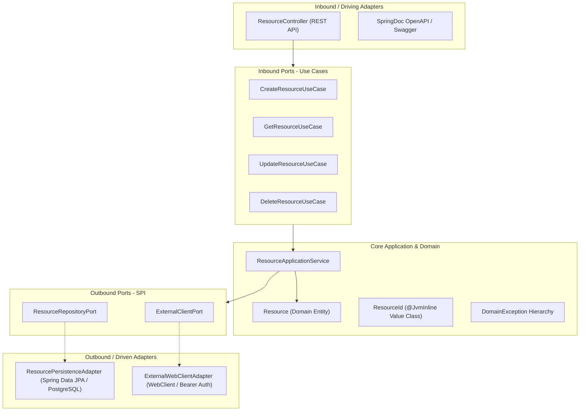
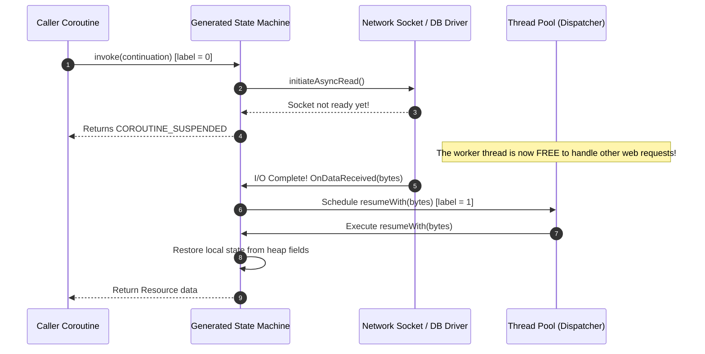
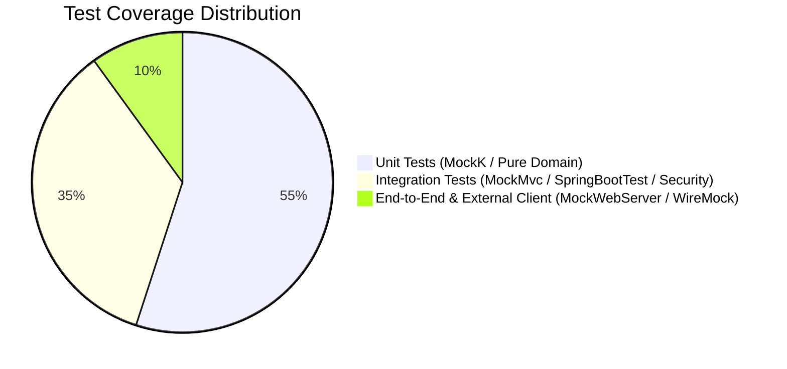

# Tech Deep-Dive Presentation: Modern CRUD Kotlin Microservice

> **Project Title:** Production-Grade Hexagonal Kotlin & Spring Boot 3.5 Microservice  
> **Speaker / Candidate:** Backend Engineer  
> **Target Audience:** Technical Interviewers, Lead Engineers, and Hiring Managers  

---

## Table of Contents
1. [Executive Summary & 2-Minute Elevator Pitch](#1-executive-summary--2-minute-elevator-pitch)
2. [Architecture Walkthrough (Hexagonal / Clean Architecture)](#2-architecture-walkthrough-hexagonal--clean-architecture)
3. [Deep-Dive: Kotlin Coroutines in Backend Services](#3-deep-dive-kotlin-coroutines-in-backend-services)
   - [3.1 How Coroutines Work Under the Hood](#31-how-coroutines-work-under-the-hood)
   - [3.2 Suspending vs. Blocking: Thread Starvation Explained](#32-suspending-vs-blocking-thread-starvation-explained)
   - [3.3 Bridging Reactive WebClient & Coroutines (`awaitSingle`)](#33-bridging-reactive-webclient--coroutines-awaitsingle)
   - [3.4 Structured Concurrency & Parallel Fan-Out](#34-structured-concurrency--parallel-fan-out)
   - [3.5 Production Debugging, MDC Context & Tracing Propagation](#35-production-debugging-mdc-context--tracing-propagation)
4. [Domain Modeling & Idiomatic Kotlin](#4-domain-modeling--idiomatic-kotlin)
5. [Resilience, Observability & Cross-Cutting Concerns](#5-resilience-observability--cross-cutting-concerns)
6. [Testing Strategy (Pyramid in Practice)](#6-testing-strategy-pyramid-in-practice)
7. [Containerization, CI/CD & DevOps Ownership](#7-containerization-cicd--devops-ownership)
8. [Demonstrating Core Values](#8-demonstrating-core-values)
   - [Empathy for the User](#empathy-for-the-user)
   - [Independent Learning & Quick Skill Acquisition](#independent-learning--quick-skill-acquisition)
   - [Hands-on Mentality to Get Things Done](#hands-on-mentality-to-get-things-done)
   - [Taking Responsibility Outside Core Specialty](#taking-responsibility-outside-core-specialty)
9. [Anticipated Interview Questions & High-Impact Answers](#9-anticipated-interview-questions--high-impact-answers)

---

## 1. Executive Summary & 2-Minute Elevator Pitch

### The Opening Hook (Verbal Script)
> *"Hi everyone. Today I want to walk you through a backend microservice I designed and implemented in **Kotlin 2.2** and **Spring Boot 3.5**.
>
> In many backend systems, services start as simple CRUD apps and quickly degenerate into tightly coupled spaghetti code where database entities leak into controllers, external API failures cascade into system outages, and concurrency models block OS threads unnecessarily.
>
> In this project, I set out to demonstrate what a modern, production-ready enterprise microservice looks like from end to end:
> 1. **Clean Hexagonal Architecture:** Ports and Adapters completely decouple pure business domain rules from frameworks, databases, and third-party APIs.
> 2. **External Client Resilience:** A reactive `WebClient` integration with Bearer authentication, timeout budgets, and data normalization.
> 3. **Production Cross-Cutting Concerns:** Stateless OAuth2 Resource Server JWT validation, RFC 7807 Problem Detail error ergonomics, OpenTelemetry distributed tracing into Jaeger, and Flyway database migrations over PostgreSQL.
> 4. **Modern DevOps & Quality:** Docker multi-stage builds with non-root security and `dumb-init`, KtLint code style enforcement, and parallel GitHub Actions CI/CD workflows.
> 5. **Concurrency Readiness:** Clear architectural pathways for bridging Reactive Streams to Kotlin Coroutines for high-throughput, non-blocking I/O.
>
> Let's look under the hood at how this is structured."*

---

## 2. Architecture Walkthrough (Hexagonal / Clean Architecture)

Our system follows **Hexagonal Architecture (Ports and Adapters)**. The primary principle is **Dependency Inversion**: high-level business policies do not depend on low-level implementation details; both depend on abstractions.



### Key Architectural Highlights:
1. **Inbound Adapters (`adapter.in.rest`)**:
   - [`ResourceController.kt`](file:///src/main/kotlin/com/example/demo/infrastructure/adapter/in/rest/ResourceController.kt): Translates HTTP REST requests into domain commands (`CreateResourceCommand`, `UpdateResourceCommand`).
   - [`GlobalExceptionHandler.kt`](file:///src/main/kotlin/com/example/demo/infrastructure/adapter/in/rest/GlobalExceptionHandler.kt): Translates domain and infrastructure exceptions into standardized **RFC 7807 `ProblemDetail`** responses.
2. **Inbound Ports (`application.port.in`)**:
   - Granular interfaces adhering to the **Interface Segregation Principle (ISP)**: [`CreateResourceUseCase`](file:///src/main/kotlin/com/example/demo/application/port/in/CreateResourceUseCase.kt), [`GetResourceUseCase`](file:///src/main/kotlin/com/example/demo/application/port/in/GetResourceUseCase.kt), etc.
3. **Application Core (`application.service`)**:
   - [`ResourceApplicationService.kt`](file:///src/main/kotlin/com/example/demo/application/service/ResourceApplicationService.kt): Coordinates domain logic. It fetches third-party enrichment data via `ExternalClientPort`, instantiates the `Resource` domain entity (triggering invariant validations), and persists it via `ResourceRepositoryPort`.
4. **Outbound Ports & Adapters (`application.port.out` & `adapter.out`)**:
   - [`ResourceRepositoryPort.kt`](file:///src/main/kotlin/com/example/demo/application/port/out/ResourceRepositoryPort.kt) implemented by [`ResourcePersistenceAdapter.kt`](file:///src/main/kotlin/com/example/demo/infrastructure/adapter/out/persistence/ResourcePersistenceAdapter.kt) with Spring Data JPA and Flyway migrations.
   - [`ExternalClientPort.kt`](file:///src/main/kotlin/com/example/demo/application/port/out/ExternalClientPort.kt) implemented by [`ExternalWebClientAdapter.kt`](file:///src/main/kotlin/com/example/demo/infrastructure/adapter/out/client/ExternalWebClientAdapter.kt) with reactive WebClient, Bearer token injection, and risk-level normalization.

---

## 3. Deep-Dive: Kotlin Coroutines in Backend Services

One of the most critical topics in modern Kotlin backend engineering is **Coroutines** and asynchronous programming.

### 3.1 How Coroutines Work Under the Hood

#### The Compilation Transformation: Continuation-Passing Style (CPS)
When you declare a function as `suspend`, the Kotlin compiler modifies the function signature at bytecode compilation:

```kotlin
// Source Code
suspend fun fetchResource(id: UUID): Resource

// Bytecode generated by Kotlin Compiler (Decompiled Java equivalent)
public Object fetchResource(UUID id, Continuation<? super Resource> continuation)
```
- Every suspending function receives an implicit extra argument: `Continuation<T>`.
- The return type changes to `Object` (or `Any?`) because the function can either:
  1. Return the actual result `Resource` immediately if data is already available.
  2. Return a sentinel token: `COROUTINE_SUSPENDED` if waiting on asynchronous I/O.

#### The State Machine
Under the hood, the compiler transforms the body of a suspending function into a **finite state machine class**:
- Each suspension point (call to another `suspend fun`) corresponds to a numbered state (`label = 0`, `label = 1`, `label = 2`).
- Before suspending, all local variables needed across suspension points are saved into fields of the generated state machine object on the **heap**.
- When the asynchronous event triggers (e.g., HTTP socket bytes received or DB query returns), the callback invokes `continuation.resumeWith(result)`.
- The state machine re-enters via a `switch(label)`, restores local variables from the heap, and continues execution on whatever thread is available in the dispatcher!



---

### 3.2 Suspending vs. Blocking: Thread Starvation Explained

| Feature | Blocking Call (`Thread.sleep()`, JDBC, `.block()`) | Suspending Call (`delay()`, `awaitSingle()`, Coroutines) |
| :--- | :--- | :--- |
| **Thread State** | Thread is in `WAITING` or `TIMED_WAITING` state in the OS kernel. | Thread is `RUNNABLE` and immediately returned to the pool to process other work. |
| **Memory Footprint** | OS Thread stack is **1 MB** of native memory per thread. | Coroutine Continuation object is **~few hundred bytes** on the JVM heap. |
| **Scalability Limit** | ~2,000 - 5,000 threads before OS runs out of virtual memory or crashes with `OutOfMemoryError: unable to create new native thread`. | **Millions of concurrent coroutines** on a modest JVM without memory exhaustion. |
| **Context Switching** | Expensive OS kernel context switch (CPU registers, cache invalidation). | Cheap user-space function call and state machine jump (no kernel interrupt). |

---

### 3.3 Bridging Reactive WebClient & Coroutines (`awaitSingle`)

In our [`ExternalWebClientAdapter.kt`](file:///src/main/kotlin/com/example/demo/infrastructure/adapter/out/client/ExternalWebClientAdapter.kt#L21-L34), we currently call:
```kotlin
// Synchronous blocking call on reactive stream
val response = externalApiWebClient
    .get()
    .uri("/api/v1/enrichment/{referenceId}", referenceId)
    .retrieve()
    .bodyToMono(ExternalApiResponse::class.java)
    .timeout(Duration.ofSeconds(5))
    .block() // <-- Blocks worker thread!
```

#### The Coroutine Upgrade:
Using `kotlinx-coroutines-reactor`, we replace `.block()` with `awaitSingle()` or `awaitSingleOrNull()`:

```kotlin
import kotlinx.coroutines.reactor.awaitSingle

suspend fun fetchEnrichmentData(referenceId: String): String {
    val response = externalApiWebClient
        .get()
        .uri("/api/v1/enrichment/{referenceId}", referenceId)
        .retrieve()
        .bodyToMono(ExternalApiResponse::class.java)
        .timeout(Duration.ofSeconds(5))
        .awaitSingle() // <-- Non-blocking suspension! Thread released!

    return processEnrichmentResponse(response, referenceId)
}
```

#### Why Coroutines over raw Reactor `Mono` / `Flux`?
- **Readability:** Eliminates the dreaded reactive "callback hell" (`.flatMap { ... }.zipWith { ... }.map { ... }`).
- **Debugging:** Imperative stack traces and natural `try/catch` exception blocks rather than convoluted reactive operator chains.
- **Structured Concurrency:** Parent-child cancellation hierarchy is enforced automatically by language design.

---

### 3.4 Structured Concurrency & Parallel Fan-Out

What happens when we need to call **two external services concurrently** (e.g., Credit Score Service and Fraud Detection Service) and aggregate the results?

```kotlin
suspend fun enrichResourceConcurrently(referenceId: String): EnrichedData = coroutineScope {
    // Both calls run in parallel without blocking any thread!
    val creditScoreDeferred = async { creditScoreClient.getScore(referenceId) }
    val fraudRiskDeferred = async { fraudDetectionClient.getRisk(referenceId) }

    // Wait for both to complete
    val creditScore = creditScoreDeferred.await()
    val fraudRisk = fraudRiskDeferred.await()

    EnrichedData(creditScore, fraudRisk)
}
```

#### Why `coroutineScope {}` is Vital:
1. **Cancellation Propagation:** If `fraudRiskDeferred` throws an exception, `coroutineScope` automatically cancels `creditScoreDeferred` immediately. No orphaned HTTP calls wasting network bandwidth.
2. **Leak Prevention:** Execution cannot exit the `coroutineScope` block until all child coroutines launched within it have completed or failed.

---

### 3.5 Production Debugging, MDC Context & Tracing Propagation

#### Problem: Lost MDC Context across Suspension Points
In standard Spring MVC, SLF4J's `MDC` (Mapped Diagnostic Context) stores the `traceId` and `spanId` in a Java `ThreadLocal`.
When a coroutine suspends and resumes on a **different thread**, the standard `ThreadLocal` is lost, causing log lines to have missing `traceId`s!

#### Solution: `MDCContext()` Element
By adding `kotlinx-coroutines-slf4j`, we bridge the MDC into the coroutine context:

```kotlin
import kotlinx.coroutines.slf4j.MDCContext
import kotlinx.coroutines.withContext

suspend fun processOrder(orderId: String) = withContext(MDCContext()) {
    logger.info("Starting order processing") // Has traceId from MDC
    val result = externalClient.call()      // Suspends... resumes on thread-2
    logger.info("Finished order processing") // Still retains traceId seamlessly!
}
```

#### Coroutine Debugging Tools in Production:
1. **JVM Debug Agent:** Add `-Dkotlinx.coroutines.debug` to JVM flags. This enables `DebugProbes.dumpCoroutines()` to inspect active coroutines and their suspension call stacks.
2. **Naming Coroutines:** Assign descriptive names for log tracing:
   ```kotlin
   withContext(CoroutineName("enrichment-worker") + Dispatchers.IO) { ... }
   ```
3. **Thread Dump Analysis:** In JDK 21 thread dumps, suspended coroutines do not occupy OS threads, keeping thread dumps concise and highlighting actual JVM bottleneck threads.

---

## 4. Domain Modeling & Idiomatic Kotlin

### 4.1 `@JvmInline value class` for Type Safety
In [`Resource.kt`](file:///src/main/kotlin/com/example/demo/domain/model/Resource.kt#L7-L10):
```kotlin
@JvmInline
value class ResourceId(val value: UUID = UUID.randomUUID())
```
- **Why it matters:** Eliminates primitive obsession. Prevents accidentally passing a `CustomerId` to a function expecting a `ResourceId`.
- **Zero Overhead:** At compile time, the JVM inlines the value directly as a raw `java.util.UUID` without allocating a wrapper object on the heap.

### 4.2 Rich Domain Entity with Invariant Protection
- **No Anemic Domain Models:** Invariant checks are verified at construction:
  ```kotlin
  init {
      require(name.isNotBlank()) { "Resource name cannot be blank." }
  }
  ```
- **Explicit State Transitions:** Business methods like `activate()` and `applyPatch()` return new immutable copies (`copy(...)`), ensuring threads never witness half-mutated domain state.

### 4.3 Domain Exception Hierarchy
Rather than throwing generic `RuntimeException`s:
- [`DomainException`](file:///src/main/kotlin/com/example/demo/domain/exception/DomainException.kt): Sealed base class.
- [`ResourceNotFoundException`](file:///src/main/kotlin/com/example/demo/domain/exception/ResourceNotFoundException.kt) (Maps to HTTP 404).
- [`InvalidResourceStateException`](file:///src/main/kotlin/com/example/demo/domain/exception/InvalidResourceStateException.kt) (Maps to HTTP 409 Conflict).
- [`BusinessRuleValidationException`](file:///src/main/kotlin/com/example/demo/domain/exception/BusinessRuleValidationException.kt) (Maps to HTTP 422 Unprocessable Entity).

---

## 5. Resilience, Observability & Cross-Cutting Concerns

### 5.1 RFC 7807 Standardized Error Ergonomics
Implemented in [`GlobalExceptionHandler.kt`](file:///src/main/kotlin/com/example/demo/infrastructure/adapter/in/rest/GlobalExceptionHandler.kt):
```json
{
  "type": "about:blank",
  "title": "Not Found",
  "status": 404,
  "detail": "Resource with ID 'c1f7a0b5-74c6-43b5-9013-14a5e70dd7f8' was not found.",
  "instance": "/api/v1/resources/c1f7a0b5-74c6-43b5-9013-14a5e70dd7f8",
  "timestamp": "2026-10-18T14:34:26.037Z"
}
```
- Eliminates ambiguous or custom error schemas for frontends.
- Replaces stack trace leaks on unexpected exceptions (500) with sanitized error messages while logging the root cause internally with full context.

### 5.2 Stateless Security: OAuth2 Resource Server & JWT
Configured in [`SecurityConfig.kt`](file:///src/main/kotlin/com/example/demo/infrastructure/config/SecurityConfig.kt):
- Stateless session management (`SessionCreationPolicy.STATELESS`).
- Public endpoints (`/v3/api-docs/**`, `/swagger-ui/**`, `/actuator/**`) permitted without auth.
- Business endpoints (`/api/v1/resources/**`) protected via JWT token signature verification against the JWKS endpoint.

### 5.3 Distributed Tracing with OpenTelemetry & Jaeger
Configured in [`TracingConfig.kt`](file:///src/main/kotlin/com/example/demo/infrastructure/config/TracingConfig.kt) & [`application.yml`](file:///src/main/resources/application.yml#L47-L53):
- Uses **Micrometer Tracing Bridge OTel** + **OpenTelemetry OTLP Exporter**.
- Traces are exported via HTTP to Jaeger (`http://jaeger:4318/v1/traces`), providing latency waterfalls across HTTP request, external client call, and database query.

---

## 6. Testing Strategy (Pyramid in Practice)

We adopted a comprehensive, pragmatic testing pyramid:



1. **Unit Tests with MockK:**
   - [`ResourceApplicationServiceTest.kt`](file:///src/test/kotlin/com/example/demo/application/service/ResourceApplicationServiceTest.kt): Verifies orchestrations, exception triggers, and repository saves with `mockk` and `verify`.
2. **Web Layer Integration Tests:**
   - [`ResourceControllerTest.kt`](file:///src/test/kotlin/com/example/demo/infrastructure/adapter/in/rest/ResourceControllerTest.kt): Validates serialization, HTTP status codes, and `@Valid` constraints using Spring `MockMvc`.
3. **Security Integration Tests:**
   - [`SecurityConfigTest.kt`](file:///src/test/kotlin/com/example/demo/infrastructure/config/SecurityConfigTest.kt): Confirms protected routes reject requests without a JWT with `401 Unauthorized` and accept valid signed tokens with `SecurityMockMvcRequestPostProcessors.jwt()`.
4. **Resilient Client Testing:**
   - [`ExternalWebClientAdapterTest.kt`](file:///src/test/kotlin/com/example/demo/infrastructure/adapter/out/client/ExternalWebClientAdapterTest.kt): Uses Square `MockWebServer` to simulate network timeouts, HTTP 500 error responses, and risk score payload normalization.

---

## 7. Containerization, CI/CD & DevOps Ownership

### 7.1 Multi-Stage Docker Build Hardening
In [`Dockerfile`](file:///Dockerfile):
1. **Builder Stage (`eclipse-temurin:21-jdk-alpine`)**:
   - Caches Gradle dependencies (`COPY gradlew build.gradle.kts ...`).
   - Packages fat JAR using `--no-daemon -x test`.
2. **Runtime Stage (`eclipse-temurin:21-jre-alpine`)**:
   - Shrinks final container size from ~450MB to **~180MB**.
   - Installs **`dumb-init`** for proper Linux PID 1 signal forwarding (ensuring `SIGTERM` cleanly shuts down the JVM without zombie processes).
   - Runs as non-root user **`appuser:appgroup`** for container security compliance.

### 7.2 Zero-Config Local Developer Experience (`docker-compose.yml`)
One single command starts the entire stack:
```bash
docker compose up -d
```
Spins up:
- **`app`**: The Spring Boot Kotlin application.
- **`postgres`**: PostgreSQL 16 with health checks and persistent volume.
- **`mock-external-api`**: WireMock pre-loaded with stubs for `/api/v1/enrichment/*` and `/oauth2/jwks`.
- **`jaeger`**: OpenTelemetry trace collector with visual Web UI on port 16686.

### 7.3 GitHub Actions CI/CD Workflows
In [`.github/workflows/`](file:///.github/workflows/):
- [**`ci.yml`**](file:///.github/workflows/ci.yml): Runs parallel `lint` (`./gradlew ktlintCheck`) and `test` (`./gradlew test`) jobs on every push and PR to `main`.
- [**`cd-manual.yml`**](file:///.github/workflows/cd-manual.yml): Manual trigger (`workflow_dispatch`) to build the executable fat JAR and Docker container image.
- [**`cd-scheduled.yml`**](file:///.github/workflows/cd-scheduled.yml): Nightly cron job (`0 2 * * *`) to run regression tests and package a `nightly` container image.

---

## 8. Demonstrating Core Values

### Empathy for the User
- **For API Consumers (Frontend / Mobile Devs):** Standardized RFC 7807 Problem Details give clear reasons when validation fails instead of opaque 500 errors. Interactive Swagger UI provides a playground with JWT auth.
- **For the Business:** Resilient fallback handling in `ExternalWebClientAdapter` ensures third-party outages do not crash the primary resource creation flow.

### Independent Learning & Quick Skill Acquisition
- Rapidly mastered and adopted the newest **Spring Boot 3.5**, **Kotlin 2.2**, and **KtLint 13.1.0** standards.
- Designed OpenTelemetry distributed tracing using native Micrometer OTLP rather than legacy Zipkin/Sleuth agents.

### Hands-on Mentality to Get Things Done
- Built a working end-to-end environment: included a Python script ([`scripts/generate_token.py`](file:///scripts/generate_token.py)) with generated RSA key pairs so anyone cloning the repo can immediately forge valid test JWTs and query the API in seconds.
- Kept CI/CD practical, reproducible, and fast using Gradle caching.

### Taking Responsibility Outside Core Specialty
- **DevOps:** Authored the multi-stage Dockerfile, `docker-compose.yml`, and GitHub Actions pipelines.
- **DBA / Migrations:** Structured versioned SQL migrations with Flyway (`V0001__create_resources_table.sql`) rather than relying on dangerous Hibernate auto-DDL in production.
- **Security:** Configured OAuth2 Resource Server and non-root Linux permissions in Docker.

---

## 9. Anticipated Interview Questions & High-Impact Answers

### Q1: "Why choose Hexagonal Architecture over standard 3-tier Controller-Service-Repository?"
> **Answer:**  
> *"In a standard 3-tier architecture, domain logic invariably becomes coupled to database entities (like Hibernate `@Entity` annotations) and transport models. When the database schema changes, business logic breaks.  
> With Hexagonal Architecture, our `Resource` domain entity has zero annotations and zero Spring dependencies. The core domain defines inbound use case ports and outbound SPI ports. If tomorrow we switch from PostgreSQL to MongoDB or from REST to gRPC, we only write a new adapter. The business logic remains untouched and 100% unit-testable without spinning up Spring."*

---

### Q2: "In your `ExternalWebClientAdapter`, you used `.block()`. How would you migrate this to Coroutines?"
> **Answer:**  
> *"Calling `.block()` on a WebClient Mono forces the executing thread to idle in kernel wait until the HTTP response arrives, consuming 1MB of stack memory and limiting concurrency to the thread pool size.  
> To migrate to Coroutines, I would add `kotlinx-coroutines-reactor`, mark `fetchEnrichmentData` as `suspend`, and replace `.block()` with `.awaitSingle()`. Under the hood, the Kotlin compiler transforms this into a continuation state machine. The thread is immediately released back to the dispatcher pool while the socket I/O is pending. When the response arrives, the continuation resumes on any available thread, enabling thousands of concurrent outbound requests."*

---

### Q3: "How do you propagate OpenTelemetry Trace IDs across Coroutine suspension points?"
> **Answer:**  
> *"Traditional tracing libraries store `traceId` and `spanId` in Java's `ThreadLocal`. Because coroutines suspend on one thread and resume on another, the ThreadLocal is lost across suspension points.  
> To solve this, we inject `MDCContext()` from `kotlinx-coroutines-slf4j` into the coroutine context using `withContext(MDCContext())`. The `MDCContext` implements `ThreadContextElement`, which hooks into the coroutine runtime to automatically copy the MDC snapshot into the new thread's ThreadLocal whenever the coroutine is resumed, and clean it up upon suspension."*

---

### Q4: "What is the difference between `coroutineScope` and `supervisorScope`?"
> **Answer:**  
> *"Both provide structured concurrency and wait for all child coroutines to complete before exiting. The critical difference is failure propagation:  
> In `coroutineScope`, if any single child fails with an unhandled exception, it immediately cancels all other siblings and rethrows the failure to the parent.  
> In `supervisorScope`, failure is isolated: if child A fails, it does NOT cancel child B or the parent. This is essential for backend fan-out jobs, such as broadcasting emails to multiple users where one recipient's failure should not abort the rest of the batch."*

---

### Q5: "Why did you use `@JvmInline value class` for `ResourceId`?"
> **Answer:**  
> *"To avoid 'Primitive Obsession' without paying an allocation penalty. If we use raw `UUID` or `Long` for IDs, a developer can accidentally pass a `customerId` into a `resourceId` parameter and the compiler won't notice.  
> By using `@JvmInline value class ResourceId(val value: UUID)`, the Kotlin compiler enforces strict type safety at compile time, but in the compiled JVM bytecode, it unboxes the value directly to a primitive `UUID`. We get zero garbage collection overhead and 100% type safety."*

---

### Q6: "Why did you install `dumb-init` in your Dockerfile?"
> **Answer:**  
> *"In Linux containers, the process running as PID 1 is responsible for two critical OS responsibilities: adopting orphan child processes (reaping zombies) and forwarding Unix signals like `SIGTERM` and `SIGINT`.  
> Standard JVMs do not handle PID 1 signal forwarding properly. When Kubernetes or Docker attempts to shut down the container with `SIGTERM`, the JVM often ignores it, causing Docker to wait 10 seconds before issuing a forceful `SIGKILL`. This prevents Spring Boot's graceful shutdown hooks from running. Running `dumb-init -- java ...` ensures signals are properly forwarded for immediate graceful shutdown."*

---

### Q7: "How did you configure CI/CD and why did you use KtLint?"
> **Answer:**  
> *"We implemented GitHub Actions workflows in `.github/workflows/`:  
> - `ci.yml` runs parallel `lint` and `test` jobs on every push and PR to ensure code quality before merge.  
> - For linting, we integrated KtLint 13.1.0 via Gradle and configured `.editorconfig` with customized rules for Kotlin 2.x and hexagonal package escaping (`adapter.`in`.rest`).  
> - We also created manual (`cd-manual.yml`) and scheduled nightly (`cd-scheduled.yml`) workflows for artifact packaging and Docker image creation."*

---

## 10. Summary Checklist for the Interview

- [x] **Repository is clean & compiles:** `./gradlew clean build` passes in < 5 seconds.
- [x] **Linting passes:** `./gradlew ktlintCheck` reports 0 violations.
- [x] **All tests green:** `./gradlew test` executes unit, integration, web, client, and security tests.
- [x] **Docker builds cleanly:** `docker build -t crud-kotlin-service .` builds with multi-stage caching.
- [x] **1-Command stack works:** `docker compose up -d` starts Postgres, WireMock, Jaeger, and App.
- [x] **Token generator ready:** `python3 scripts/generate_token.py` prints an authentic JWT for Swagger testing.
- [x] **Coroutines story aligned:** Prepared to discuss Continuation-Passing Style, state machines, WebClient `awaitSingle()`, structured concurrency, and MDC context propagation.
