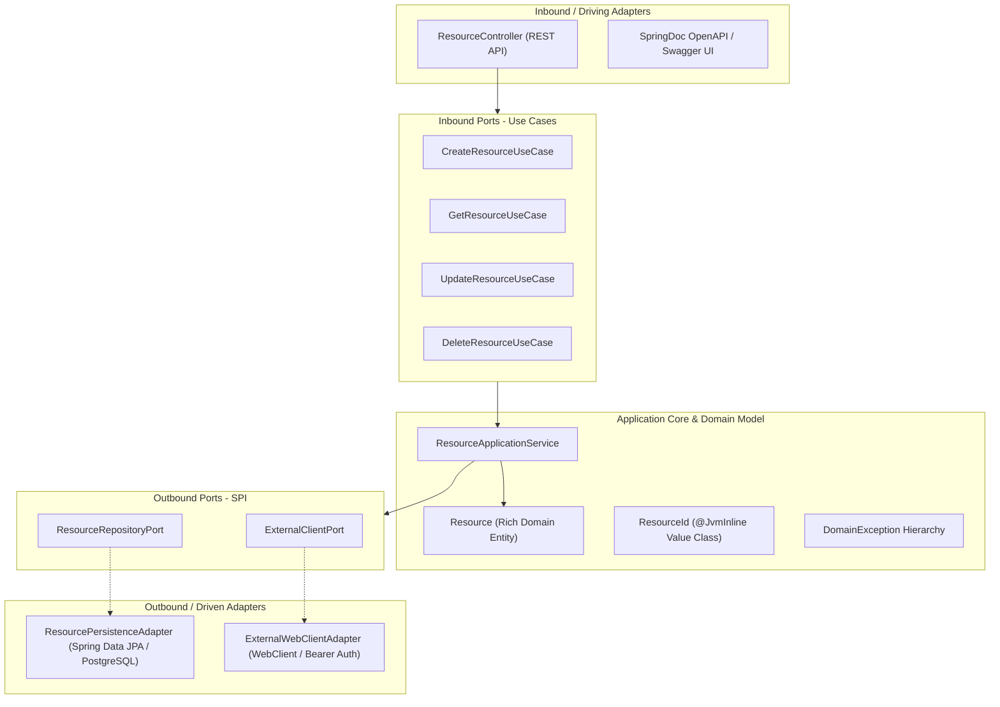

# Production-Grade Hexagonal Kotlin & Spring Boot 3.5 Microservice

[](https://kotlinlang.org/)
[](https://spring.io/projects/spring-boot)
[](https://adoptium.net/)
[](https://www.postgresql.org/)
[](https://www.docker.com/)
[](https://github.com/features/actions)
[](https://pinterest.github.io/ktlint/)
[](LICENSE)

An enterprise-ready, production-grade microservice developed in **Kotlin 2.2** and **Spring Boot 3.5**, structured according to **Hexagonal Architecture (Ports and Adapters)**. Features comprehensive CRUD operations, third-party data enrichment via reactive `WebClient`, PostgreSQL persistence with Flyway migrations, OAuth2 Resource Server JWT security, OpenTelemetry distributed tracing, and GitHub Actions CI/CD pipelines.

---

## Table of Contents
- [Architectural Overview](#architectural-overview)
- [Key Features](#key-features)
- [Tech Stack](#tech-stack)
- [Quick Start with Docker Compose](#quick-start-with-docker-compose)
- [Local Development & Build](#local-development--build)
- [API Documentation & cURL Examples](#api-documentation--curl-examples)
- [Authentication & Generating Test Tokens](#authentication--generating-test-tokens)
- [Observability & Distributed Tracing](#observability--distributed-tracing)
- [Testing & Quality Assurance](#testing--quality-assurance)
- [CI/CD Workflows](#cicd-workflows)
- [Repository Knowledge Base](#repository-knowledge-base)

---

## Architectural Overview

This service adheres strictly to **Hexagonal Architecture (Ports & Adapters)**. The pure domain model and business rules are completely decoupled from external frameworks, databases, and network transports.



### Architectural Decisions
- **Pure Domain (`domain.model`, `domain.exception`):** Free of framework annotations. Invariants are strictly enforced at construction time.
- **`@JvmInline value class ResourceId`:** Prevents *Primitive Obsession* with zero allocation overhead by unboxing to a primitive `UUID` at compile time.
- **Ports & Adapters (`application.port` & `infrastructure.adapter`):** The application core defines interfaces for repository and external client interactions, inverted and fulfilled by infrastructure adapters.

---

## Key Features

- **Full RESTful Lifecycle:** Complete `POST`, `GET`, `PATCH`, and `DELETE` endpoints with granular validation.
- **External Client Integration:** Outbound reactive `WebClient` communicating with external services using Bearer token authentication, timeout policies, error handling, and business data normalization.
- **Robust Persistence:** PostgreSQL 16 backed by Spring Data JPA and automated Flyway database schema migrations.
- **RFC 7807 Standard Error Ergonomics:** Centralized exception handling (`@RestControllerAdvice`) translating domain exceptions to standardized `ProblemDetail` structures without leaking internal stack traces.
- **Stateless OAuth2 Security:** JWT validation against external JWKS endpoints with public whitelists for documentation and actuator health.
- **Distributed Tracing:** Micrometer Tracing bridge + OpenTelemetry OTLP exporter delivering real-time latency graphs to Jaeger.
- **Production-Hardened Container:** Two-stage Docker build running on minimal Alpine JRE, non-root user `appuser`, and `dumb-init` for PID 1 signal handling.

---

## Tech Stack

| Component | Technology | Version |
| :--- | :--- | :--- |
| **Language** | Kotlin (JVM) | `2.2.21` |
| **Framework** | Spring Boot | `3.5.5` |
| **JDK Runtime** | Eclipse Temurin OpenJDK | `21` |
| **Build Tool** | Gradle | `8.7` |
| **Database** | PostgreSQL | `16-alpine` |
| **Migrations** | Flyway | `11.x` |
| **Linter / Formatter** | KtLint Gradle Plugin | `13.1.0` (KtLint `1.5.0`) |
| **Security** | Spring Security OAuth2 Resource Server | JWT / JWKS |
| **Observability** | OpenTelemetry OTLP + Micrometer + Jaeger | `1.60` |
| **Mocking / Testing** | MockK, SpringMockK, MockWebServer, WireMock | `3.9.1` |

---

## Quick Start with Docker Compose

Spin up the entire local ecosystem (Spring Boot App, PostgreSQL, WireMock mock external API, and Jaeger tracing) with a single command:

```bash
docker compose up -d --build
```

### Verified Services:
| Service | Local URL / Port | Credentials / Notes |
| :--- | :--- | :--- |
| **Spring Boot App** | `http://localhost:8080` | Main application |
| **Swagger UI** | `http://localhost:8080/swagger-ui.html` | Interactive API documentation |
| **Actuator Health** | `http://localhost:8080/actuator/health` | Service health status |
| **WireMock API** | `http://localhost:8081` | Stubs for `/api/v1/enrichment/*` and `/oauth2/jwks` |
| **Jaeger Tracing UI** | `http://localhost:16686` | Distributed trace visualizer |
| **PostgreSQL** | `localhost:5432` | User: `app_user` / Pass: `app_password` / DB: `crud_db` |

To stop and remove containers and volumes:
```bash
docker compose down -v
```

---

## Local Development & Build

### Prerequisites
- JDK 21 (Eclipse Temurin recommended)
- Docker Desktop or Docker Engine

### Run Locally
```bash
# 1. Start dependent infrastructure (Postgres, WireMock, Jaeger)
docker compose up -d postgres mock-external-api jaeger

# 2. Run application via Gradle
./gradlew bootRun
```

### Build & Package
```bash
# Clean and package fat JAR
./gradlew clean bootJar --no-daemon

# Run all verification checks and tests
./gradlew check --no-daemon
```

---

## Authentication & Generating Test Tokens

All business endpoints under `/api/v1/resources/**` require a valid OAuth2 Bearer JWT.

A token generation script with an RSA private key is included in [`scripts/`](file:///scripts/):

```bash
# Generate a valid RS256 JWT matching the local WireMock JWKS
python3 scripts/generate_token.py
```

Export the generated token to an environment variable:
```bash
export TOKEN="<paste-token-output-here>"
```

---

## API Documentation & cURL Examples

Interactive Swagger documentation is accessible at `http://localhost:8080/swagger-ui.html`.

### 1. Create a Resource (`POST`)
```bash
curl -X POST http://localhost:8080/api/v1/resources \
  -H "Authorization: Bearer $TOKEN" \
  -H "Content-Type: application/json" \
  -d '{
    "name": "Cloud Storage Volume",
    "description": "High performance SSD storage",
    "externalReferenceId": "REF-EXT-101"
  }'
```

### 2. Get Resource by ID (`GET`)
```bash
curl -X GET http://localhost:8080/api/v1/resources/{id} \
  -H "Authorization: Bearer $TOKEN"
```

### 3. List All Resources (`GET`)
```bash
curl -X GET http://localhost:8080/api/v1/resources \
  -H "Authorization: Bearer $TOKEN"
```

### 4. Update Resource Partially (`PATCH`)
```bash
curl -X PATCH http://localhost:8080/api/v1/resources/{id} \
  -H "Authorization: Bearer $TOKEN" \
  -H "Content-Type: application/json" \
  -d '{
    "name": "Updated Cloud Storage Volume",
    "description": "Upgraded tier"
  }'
```

### 5. Delete a Resource (`DELETE`)
```bash
curl -X DELETE http://localhost:8080/api/v1/resources/{id} \
  -H "Authorization: Bearer $TOKEN"
```

---

## Observability & Distributed Tracing

Every inbound HTTP request generates an OpenTelemetry trace context that spans across the database transaction and outbound `WebClient` call.

1. Issue any API request with `curl` or Swagger UI.
2. Open Jaeger UI at `http://localhost:16686`.
3. Select `crud-kotlin-service` under Service and click **Find Traces**.
4. Inspect end-to-end latency, span metadata, and SQL statement executions.

---

## Testing & Quality Assurance

The codebase maintains a balanced testing pyramid:

```bash
# Run full unit and integration test suite
./gradlew test

# Run KtLint code style checks
./gradlew ktlintCheck

# Auto-format code according to KtLint style rules
./gradlew ktlintFormat
```

### Test Coverage Highlights:
- **Unit Tests:** Business logic and domain invariant validation using **MockK**.
- **Web Controller Tests:** Request validation and HTTP status code mapping via **Spring MockMvc**.
- **External Client Tests:** Resilience, timeout handling, and payload normalization using **Square MockWebServer**.
- **Security Tests:** Validating 401 Unauthorized for unauthenticated requests and authorization verification for valid JWTs.

---

## CI/CD Workflows

Automated GitHub Actions workflows are configured in [`.github/workflows/`](file:///.github/workflows/):

| Workflow | Triggers | Description |
| :--- | :--- | :--- |
| [**`ci.yml`**](file:///.github/workflows/ci.yml) | `push` (main), `pull_request` (main) | Parallel jobs: `lint` (`ktlintCheck`) and `test` (`./gradlew test`) on JDK 21 Temurin. |
| [**`cd-manual.yml`**](file:///.github/workflows/cd-manual.yml) | `workflow_dispatch` | On-demand manual build packaging the Spring Boot fat JAR and Docker container image. |
| [**`cd-scheduled.yml`**](file:///.github/workflows/cd-scheduled.yml) | `schedule` (`0 2 * * *`), `workflow_dispatch` | Daily scheduled regression build and `nightly` Docker image creation. |

---

## Repository Knowledge Base

For in-depth explanations, architectural diagrams, and technical deep-dives, explore our documentation wiki:

- [**`PRESENTATION.md`**](file:///PRESENTATION.md): Complete Tech Deep-Dive guide for interviews, covering Hexagonal architecture, Kotlin Coroutines under the hood, reactive bridges, MDC propagation, and anticipated technical Q&A.
- [**`repo-wiki/build-process/`**](file:///repo-wiki/build-process/): Deep-dives into Gradle Daemon, Spring Boot Gradle plugin, Fat JAR ClassLoaders, and Spring BOM management.
- [**`repo-wiki/design/`**](file:///repo-wiki/design/): Detailed Hexagonal Architecture vs. alternatives and data flow analysis.
- [**`repo-wiki/docker/`**](file:///repo-wiki/docker/): Docker multi-stage builds, non-root security hardening, and Linux PID 1 `dumb-init` mechanics.
- [**`repo-wiki/kotlin/`**](file:///repo-wiki/kotlin/): `@JvmInline` value classes, sealed domain exception hierarchies, and Kotlin idioms.
- [**`repo-wiki/cicd/`**](file:///repo-wiki/cicd/): GitHub Actions strategy, linting gates, and packaging workflows.