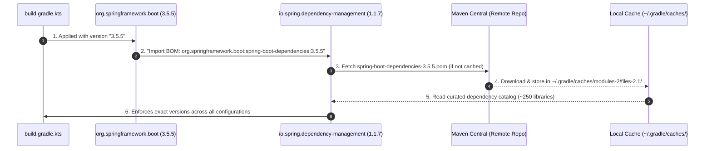
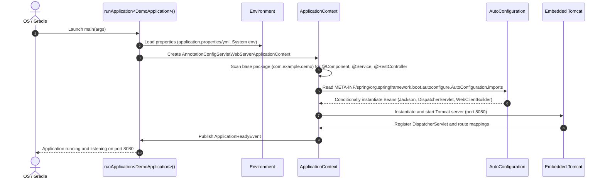

# Dependencies, Plugins, and Application Initialization Guide

This document explains each Gradle plugin and dependency currently configured in [`build.gradle.kts`](file:///Users/atifanowar/Workspace/interview/crud-kotlin-service/build.gradle.kts), why it is used, and how it initializes and executes within the Spring Boot application lifecycle.

---

## 1. Gradle Plugins

```kotlin
plugins {
    kotlin("jvm") version "2.2.21"
    kotlin("plugin.spring") version "2.2.21"

    id("org.springframework.boot") version "3.5.5"
    id("io.spring.dependency-management") version "1.1.7"
}
```

### 1.1 `kotlin("jvm") version "2.2.21"`
* **What it is:** The official Kotlin compiler plugin for targeting the Java Virtual Machine (JVM).
* **Why it is needed:** Compiles Kotlin source files (`.kt`) in `src/main/kotlin` and `src/test/kotlin` into standard JVM `.class` bytecode compatible with Java 21.
* **How it works:** It adds compilation tasks such as `compileKotlin` and `compileTestKotlin` to the Gradle execution lifecycle before Java compilation tasks run.

### 1.2 `kotlin("plugin.spring") version "2.2.21"`
* **What it is:** Kotlin's all-open compiler plugin, pre-configured specifically for Spring Framework.
* **Why it is critical in Kotlin:**
  - By default, in Kotlin, **all classes and member functions are `final`** (closed for inheritance).
  - Spring relies heavily on runtime CGLIB proxies (subclassing) for:
    - `@Configuration` (to proxy bean method calls and maintain singleton scope)
    - `@Component`, `@Service`, `@Repository` (for dependency injection proxies)
    - `@Transactional` (for dynamic transaction interception and rollback handling)
    - `@Async`, `@Cacheable`, and AOP aspects
  - Without this plugin, you would have to manually mark every Spring class and method with the `open` keyword.
* **How it works:** At compile time, the plugin inspects annotations. If a class is annotated with or meta-annotated with `@Component`, `@Configuration`, `@Async`, `@Transactional`, or `@Cacheable`, the Kotlin compiler automatically marks the class and its methods as `open`.

### 1.3 `id("org.springframework.boot") version "3.5.5"`
* **What it is:** The official Spring Boot Gradle plugin.
* **Why it is needed:**
  - Provides the `bootJar` task that packages your compiled code and all runtime dependencies into a self-contained executable "fat JAR" with an embedded web server.
  - Adds the `bootRun` task to launch the application locally with rapid restart capabilities.
  - Generates build-info metadata for Spring Boot Actuator (`/actuator/info`).
* **Deep Dive Guides:** 
  - [fat-jar-and-classloader.md](file:///Users/atifanowar/Workspace/interview/crud-kotlin-service/repo-wiki/build-process/fat-jar-and-classloader.md) for a beginner-to-advanced explanation of `.class` files, standard JVM limitations, and how Spring Boot's custom ClassLoader solves the Fat JAR problem.
  - [spring-boot-gradle-plugin.md](file:///Users/atifanowar/Workspace/interview/crud-kotlin-service/repo-wiki/build-process/spring-boot-gradle-plugin.md) for full details on Gradle tasks, `JarLauncher`, and Docker layer caching.
  - [gradle-build-directory.md](file:///Users/atifanowar/Workspace/interview/crud-kotlin-service/repo-wiki/build-process/gradle-build-directory.md) for a detailed breakdown of all folders generated inside `build/`.

### 1.4 `id("io.spring.dependency-management") version "1.1.7"`
* **What it is:** Spring's dependency management plugin.
* **Why it is needed:**
  - Automatically applies the curated Spring Boot Bill of Materials (BOM).
  - Eliminates the need to declare explicit `<version>` tags for Spring-managed dependencies (such as `spring-boot-starter-web`, Jackson, Micrometer, etc.), ensuring all transitive libraries are tested and compatible with Spring Boot 3.5.5.
  - Prevents "dependency hell" and classpath conflicts across transitive dependencies.
* **Deep Dive Guide:** See [spring-dependency-management.md](file:///Users/atifanowar/Workspace/interview/crud-kotlin-service/repo-wiki/build-process/spring-dependency-management.md) for full details on BOM resolution, overriding versions, and multi-BOM architecture.

### The 3-Party Handshake: How It Actually Works



- **`io.spring.dependency-management` (The Engine):** A generic plugin that knows how to parse BOMs; contains zero hardcoded library versions.
- **`org.springframework.boot:3.5.5` (The Coordinator):** Tells the engine to fetch the `3.5.5` BOM catalog.
- **`spring-boot-dependencies-3.5.5.pom` (The Catalog):** Downloaded from Maven Central and stored in the global cache (`~/.gradle/caches/modules-2/files-2.1/`). Contains tested versions for Jackson, Tomcat, Postgres, etc.

---

## 2. Implementation Dependencies

```kotlin
dependencies {
    // Web & Reactive WebClient
    implementation("org.springframework.boot:spring-boot-starter-web")
    implementation("org.springframework.boot:spring-boot-starter-webflux")
    implementation("org.springframework.boot:spring-boot-starter-actuator")

    // Kotlin JSON & Reflection
    implementation("com.fasterxml.jackson.module:jackson-module-kotlin")
    implementation("org.jetbrains.kotlin:kotlin-reflect")

    // Testing
    testImplementation("org.springframework.boot:spring-boot-starter-test")
    testImplementation("io.mockk:mockk-jvm:1.14.6")
    testImplementation("com.ninja-squad:springmockk:4.0.2")
}
```

### 2.1 `org.springframework.boot:spring-boot-starter-web`
* **What it is:** The standard starter for building RESTful web services using Spring MVC.
* **What it brings in:**
  - Embedded **Apache Tomcat** web server.
  - Spring MVC framework core (`DispatcherServlet`, `@RestController`, `@GetMapping`, `@PostMapping`).
  - Standard HTTP request validation and error mapping.
* **How it initializes in the application:**
  1. Detects the presence of Tomcat and Servlet classes on the classpath.
  2. Creates an embedded `ServletWebServerFactory` bean.
  3. Instantiates `DispatcherServlet` (the front controller of Spring MVC) and registers it with Tomcat.
  4. Scans `@RestController` beans and maps URL routes to controller handler methods.

### 2.2 `org.springframework.boot:spring-boot-starter-webflux`
* **What it is:** Spring's reactive web framework starter based on Project Reactor.
* **Why we use it in a Spring MVC app:**
  - Provides **`WebClient`**, Spring's modern, non-blocking HTTP client.
  - Replaces the legacy, synchronous `RestTemplate`.
  - Enables fluent, non-blocking outbound HTTP requests to external APIs with support for timeouts, retry strategies, and reactive payload streaming.
* **How it initializes in the application:**
  - Spring Boot registers a `WebClient.Builder` bean.
  - The builder can be injected into any service or configuration class to build customized, authenticated HTTP clients.

### 2.3 `org.springframework.boot:spring-boot-starter-actuator`
* **What it is:** Production-ready operational endpoints for monitoring and managing the application.
* **What it provides:**
  - Health check endpoint: `/actuator/health` (used by Kubernetes liveness/readiness probes and load balancers).
  - Application info endpoint: `/actuator/info`.
  - Metrics endpoint: `/actuator/metrics`.
* **How it initializes in the application:**
  - Auto-configures health indicators (disk space, ping, and eventually database connectivity).
  - Registers management endpoints under the `/actuator` path.

### 2.4 `com.fasterxml.jackson.module:jackson-module-kotlin`
* **What it is:** Jackson extension module for Kotlin.
* **Why it is needed:**
  - Kotlin data classes have unique features that standard Java deserializers struggle with:
    - Default parameter values (e.g. `data class User(val name: String, val active: Boolean = true)`)
    - Non-nullable types (`String` vs `String?`)
  - Without this module, Jackson requires a no-argument constructor or fails to enforce Kotlin's non-null safety at deserialization time.
* **How it initializes in the application:**
  - Spring Boot's `JacksonAutoConfiguration` detects `KotlinModule` on the classpath.
  - Automatically registers `KotlinModule` into the default `ObjectMapper` bean, ensuring all JSON request and response payloads adhere to Kotlin types.

### 2.5 `org.jetbrains.kotlin:kotlin-reflect`
* **What it is:** Kotlin's runtime reflection library.
* **Why it is needed:**
  - Spring Framework uses reflection to discover annotations, determine constructor parameter names, and resolve method signatures at runtime.
  - Jackson's `KotlinModule` relies on `kotlin-reflect` to inspect data class properties, default arguments, and constructor metadata.

---

## 3. Testing Dependencies

### 3.1 `org.springframework.boot:spring-boot-starter-test`
* **What it is:** Comprehensive test bundle provided by Spring Boot.
* **What it includes:**
  - **JUnit 5 (Jupiter):** Modern test runner and assertion framework (`@Test`, `@BeforeEach`, etc.).
  - **AssertJ:** Fluent assertions library (`assertThat(...)`).
  - **Spring Test & Spring Boot Test:** `@SpringBootTest`, `@WebMvcTest`, and `TestRestTemplate`.
  - **MockMvc:** Allows testing HTTP endpoints without spinning up a live network port.

### 3.2 `io.mockk:mockk-jvm:1.14.6`
* **What it is:** The standard mocking library designed specifically for Kotlin.
* **Why MockK over Mockito:**
  - Mockito was designed for Java and struggles with Kotlin language features such as `final` classes, extension functions, coroutines (`suspend fun`), and default arguments.
  - MockK provides clean Kotlin DSL syntax: `every { service.doWork() } returns result` and `verify { service.doWork() }`.

### 3.3 `com.ninja-squad:springmockk:4.0.2`
* **What it is:** Integration bridge between MockK and Spring's test framework.
* **Why it is needed:**
  - Replaces Spring's standard `@MockBean` and `@SpyBean` (which use Mockito) with **`@MockkBean`** and **`@SpykBean`**.
  - Injects MockK mock definitions directly into the Spring `ApplicationContext` for slice testing (e.g. `@WebMvcTest`).

---

## 4. End-to-End Application Initialization Lifecycle

When you launch the application via `main` in [`DemoApplication.kt`](file:///Users/atifanowar/Workspace/interview/crud-kotlin-service/src/main/kotlin/com/example/demo/DemoApplication.kt):

```kotlin
@SpringBootApplication
class DemoApplication

fun main(args: Array<String>) {
    runApplication<DemoApplication>(*args)
}
```

Here is the exact sequence of events that occurs under the hood:



### Detailed Lifecycle Phases:

1. **Bootstrap & Environment Resolution:**
   - Spring Boot initializes a `SpringApplication` instance.
   - It constructs the `StandardServletEnvironment`, loading active profiles, system environment variables, and properties from `application.properties`.

2. **ApplicationContext Creation:**
   - Because `spring-boot-starter-web` is on the classpath, Spring instantiates an `AnnotationConfigServletWebServerApplicationContext`.

3. **Component Scanning:**
   - The `@SpringBootApplication` annotation contains `@ComponentScan`.
   - It searches `com.example.demo` and all sub-packages for classes annotated with `@Component`, `@Service`, `@Repository`, and `@RestController`.

4. **Auto-Configuration Resolution:**
   - Spring Boot scans its auto-configuration definitions.
   - Each configuration is evaluated against conditional annotations:
     - `@ConditionalOnClass`: Checks if a class is on the classpath (e.g. `DispatcherServlet.class`).
     - `@ConditionalOnMissingBean`: Only configures a default bean if the developer hasn't defined their own.
     - `@ConditionalOnProperty`: Activates beans based on configuration flags.

5. **Bean Creation & Dependency Injection:**
   - Beans are instantiated in dependency order.
   - Dependencies are injected via constructor injection.
   - `KotlinModule` is registered into the `ObjectMapper`.

6. **Web Server Initialization:**
   - The `ServletWebServerFactory` boots an embedded Apache Tomcat instance.
   - The `DispatcherServlet` is mapped to `/` to route incoming HTTP traffic.
   - Port `8080` opens for network connections.

7. **Ready State:**
   - An `ApplicationReadyEvent` is published. The application is now fully initialized and ready to handle incoming traffic.

---

## 5. 60-Second Verbal Script (PREP Framework)

Use this script during technical interviews when asked: *"How is your Kotlin Spring Boot project structured, and what happens when the service boots up?"*

> **Point:**  
> Our service is built on Spring Boot 3 with Kotlin and Java 21, combining Spring MVC for handling incoming REST traffic with WebFlux's non-blocking `WebClient` for external API integration.
>
> **Reason:**  
> Kotlin enforces `final` classes by default and has distinct nullability rules. By utilizing `kotlin.plugin.spring` and `jackson-module-kotlin`, we enable Spring's CGLIB proxying and ensure Jackson deserializes JSON cleanly into Kotlin data classes without requiring mutable or nullable boilerplate.
>
> **Example:**  
> When `DemoApplication.kt` runs `runApplication<DemoApplication>()`, Spring Boot initializes the `ApplicationContext`, triggers component scanning, registers auto-configured beans like Jackson's `KotlinModule` and `DispatcherServlet`, and boots an embedded Tomcat on port 8080. Dependencies without explicit versions are governed by the `io.spring.dependency-management` plugin using the Spring Boot BOM.
>
> **Point (Restated):**  
> This setup gives us a minimal, production-grade foundation with guaranteed binary compatibility, type safety, and fast startup times.
