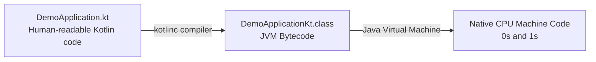
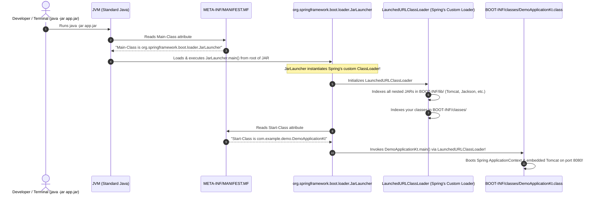

# Understanding the JVM, Class Files, and Spring Boot's "Fat JAR" Architecture

This guide explains the fundamental concepts behind how Kotlin code runs on the Java Virtual Machine (JVM), why standard Java cannot package dependencies into a single JAR, and how Spring Boot's custom ClassLoader solves the "Fat JAR" problem.

---

## 1. What is a `.class` File?

When you write Kotlin code in [`DemoApplication.kt`](file:///Users/atifanowar/Workspace/interview/crud-kotlin-service/src/main/kotlin/com/example/demo/DemoApplication.kt):
```kotlin
package com.example.demo

fun main() {
    println("Hello World")
}
```
Your computer's CPU **cannot read Kotlin or Java directly**. CPUs only understand machine code (native binary 0s and 1s).



1. **Compilation (`kotlinc`):** When you run `./gradlew compileKotlin`, the Kotlin compiler translates your human-readable text into platform-independent intermediate instructions called **JVM Bytecode**.
2. **Storage:** This bytecode is saved into a binary file ending with **`.class`** (e.g., `DemoApplicationKt.class`).
3. **Execution (JVM):** When you run your program, the **JVM (Java Virtual Machine)** reads the `.class` file, verifies the bytecode, and uses a Just-In-Time (JIT) compiler to convert it into native CPU instructions.

> **Analogy:**  
> - `.kt` file = The recipe written in English.  
> - `.class` file = The recipe translated into standardized shorthand bytecode.  
> - JVM = The kitchen robot that reads the bytecode and prepares the meal.

---

## 2. What is a `.jar` File?

A **JAR (Java ARchive)** is literally just a **ZIP file** with a `.jar` file extension.

If you take any `.jar` file, rename it to `.zip`, and extract it, your operating system will unzip standard folders containing `.class` files and metadata. A JAR file exists simply to bundle hundreds of individual `.class` files into a single, distributable archive.

---

## 3. The Core Dilemma: What is the "Fat JAR" Problem?

A production service rarely contains only your own code. It relies on third-party libraries:
- **Spring Framework** (for dependency injection and REST controllers)
- **Apache Tomcat** (embedded HTTP web server)
- **Jackson** (for JSON parsing)

Each of these libraries is distributed as its own standalone `.jar` file (e.g., `tomcat-embed-core.jar`, `jackson-databind.jar`).

### Why Can't Standard Java Put JARs Inside a JAR?

A natural thought is: *"Why not just create `myapp.jar`, and drop `tomcat.jar` and `jackson.jar` inside it?"*

```
❌ The Naive Structure (Fails in Standard Java):
myapp.jar (ZIP archive)
  ├── DemoApplication.class
  └── tomcat.jar (a nested ZIP archive inside a ZIP archive!)
```

The JVM uses a component called the **`ClassLoader`** to locate and read `.class` files into memory.  
Java's built-in standard classloader (`URLClassLoader`) **is primitive**:
1. It can read `.class` files from an uncompressed folder on your hard drive.
2. It can read `.class` files from a standalone `.jar` file on your hard drive.
3. **It CANNOT look inside a zip archive that is nested inside another zip archive.**

If you run `java -jar myapp.jar` using standard Java tools, the JVM searches for Spring and Tomcat classes, sees a nested `tomcat.jar`, cannot open it, and crashes:

```
java.lang.NoClassDefFoundError: org/springframework/web/bind/annotation/RestController
```

---

## 4. How Spring Boot Solves It: The 3 Folders Inside `app.jar`

Spring Boot's `bootJar` task solves this limitation by structuring the executable archive into **3 distinct zones**:

```
app.jar (Root level)
├── META-INF/                     <-- Zone 1: The ID Card (Manifest)
│   └── MANIFEST.MF
│
├── org/springframework/boot/     <-- Zone 2: Spring's Custom ClassLoader (Uncompressed at root)
│   └── loader/
│       └── launch/
│           └── JarLauncher.class
│
└── BOOT-INF/                     <-- Zone 3: The Vault (Your Application + Dependencies)
    ├── classes/                  <-- Your compiled Kotlin code (DemoApplication.class)
    ├── lib/                      <-- All nested .jar files (tomcat.jar, jackson.jar)
    └── classpath.idx             <-- Classpath ordering index
```

### Zone 1: `META-INF/` (The Passport / ID Card)
Every Java archive has a `META-INF/MANIFEST.MF` text file. When you run `java -jar app.jar`, the standard JVM reads this file first to find the entrypoint.

Inside a Spring Boot fat JAR, `MANIFEST.MF` contains:
```properties
Manifest-Version: 1.0
Main-Class: org.springframework.boot.loader.launch.JarLauncher
Start-Class: com.example.demo.DemoApplicationKt
Spring-Boot-Version: 3.5.5
Spring-Boot-Classes: BOOT-INF/classes/
Spring-Boot-Lib: BOOT-INF/lib/
```
- **`Main-Class` is NOT your code!** It points to Spring's `JarLauncher`.
- **`Start-Class` IS your code:** It tells Spring where your `main()` method lives.

### Zone 2: `org/springframework/boot/loader/` (Spring's Secret Weapon)
Notice where this directory sits: **at the root level of the JAR**.  
These are raw, uncompressed `.class` files provided by Spring Boot. Because they sit at the root, **the standard Java JVM can read and execute them directly without any special configuration**.

Inside this folder is Spring's custom classloader: **`LaunchedURLClassLoader`**.  
Spring engineers specifically wrote this classloader to teach Java how to read bytecode directly from nested `.jar` files inside `BOOT-INF/lib/` in memory!

### Zone 3: `BOOT-INF/` (The Application Vault)
This is where your actual project payload lives:
- **`BOOT-INF/classes/`**: Your compiled Kotlin application `.class` files (controllers, services, entities).
- **`BOOT-INF/lib/`**: All third-party dependency `.jar` files (Tomcat, Jackson, PostgreSQL driver, Spring Web).

---

## 5. The Complete Story: What Happens When You Run `java -jar app.jar`



### Step-by-Step Breakdown:
1. You run `java -jar app.jar`.
2. Standard Java reads `META-INF/MANIFEST.MF` and sees `Main-Class: org.springframework.boot.loader.launch.JarLauncher`.
3. Standard Java loads `JarLauncher.class` from the root of the archive (Zone 2).
4. `JarLauncher` creates Spring's **`LaunchedURLClassLoader`**.
5. This custom ClassLoader unlocks `BOOT-INF/` (Zone 3), making every nested `.jar` inside `BOOT-INF/lib/` searchable in memory.
6. `JarLauncher` reads `Start-Class` from the manifest (`com.example.demo.DemoApplicationKt`) and invokes its `main()` method using the custom ClassLoader.
7. Your Kotlin code executes, embedded Tomcat starts, and the application begins serving HTTP traffic.

---

## 6. 60-Second Verbal Script (PREP Framework)

Use this script during technical interviews when asked: *"How does Spring Boot package an executable Fat JAR, and how does it work under the hood?"*

> **Point:**  
> A Spring Boot Fat JAR overcomes the JVM's inability to load nested JARs by shipping a lightweight custom ClassLoader alongside the application and its dependencies.
>
> **Reason:**  
> The standard JVM `URLClassLoader` only understands flat directories or standalone JARs on the filesystem; it cannot read a JAR nested inside another JAR. Instead of unpacking and flattening all dependencies into a fragile structure, Spring Boot packages them cleanly and introduces its own classloader to read nested archives directly in memory.
>
> **Example:**  
> Inside `app.jar`, `META-INF/MANIFEST.MF` designates Spring's `JarLauncher` as the `Main-Class`. Raw loader classes reside at the archive's root so standard Java can bootstrap `JarLauncher`. `JarLauncher` then instantiates a `LaunchedURLClassLoader`, which unlocks `BOOT-INF/lib/` for third-party dependencies and `BOOT-INF/classes/` for our Kotlin code, before delegating control to `DemoApplicationKt.main()`.
>
> **Point (Restated):**  
> In essence, Spring Boot nests your dependencies in `BOOT-INF/lib/` and ships a custom classloader at the archive's root to bridge standard Java to your self-contained web service.
