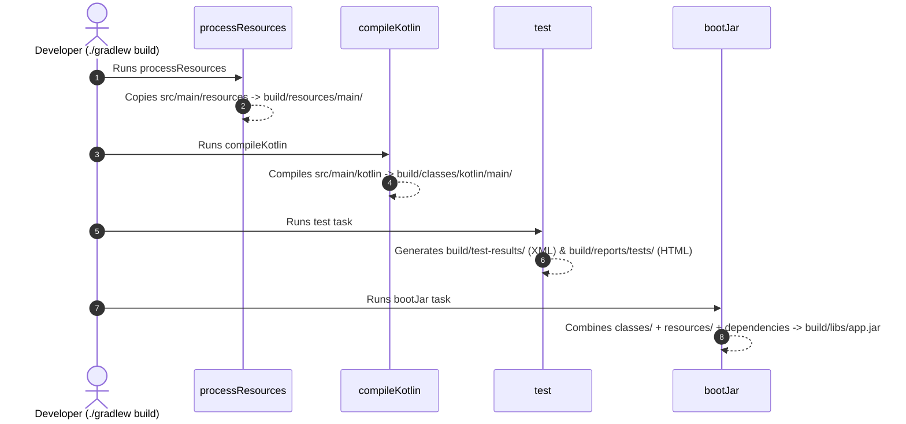

# Understanding the Gradle `build/` Directory

This guide explains the structure, purpose, and contents of the `build/` directory generated by Gradle in a Spring Boot & Kotlin project.

---

## 1. What is the `build/` Directory?

The `build/` directory is Gradle's **output workspace**. It is completely **ephemeral** (temporary) and contains everything generated by Gradle tasks during compilation, testing, and packaging.

> [!IMPORTANT]
> The `build/` folder is listed in `.gitignore` and must **never** be committed to version control. Running `./gradlew clean` safely deletes the entire `build/` folder, and running `./gradlew build` reconstructs it from scratch.

---

## 2. Directory Tree Overview

Here is what our project's `build/` directory contains after compiling and running tests:

```
build/
├── classes/                  <-- Compiled JVM Bytecode (.class files)
│   └── kotlin/
│       ├── main/             <-- Production classes (DemoApplication.class)
│       └── test/             <-- Test classes (DemoApplicationTests.class)
│
├── resources/                <-- Processed configuration & static assets
│   └── main/                 <-- Copied application.properties, Flyway SQL, etc.
│
├── libs/                     <-- Final packaged distribution archives
│   └── app.jar               <-- Executable Spring Boot Fat JAR (from bootJar)
│
├── reports/                  <-- Human-readable reports (HTML)
│   └── tests/test/           <-- Test report dashboard (index.html)
│
├── test-results/             <-- Machine-readable test summaries (XML)
│   └── test/                 <-- JUnit XML files for CI/CD pipelines
│
├── kotlin/                   <-- Kotlin compiler incremental build cache
│   └── compileKotlin/        <-- Classpath snapshots & delta hashes
│
├── tmp/                      <-- Task scratchpad / temporary files
│   ├── bootJar/              <-- Intermediate MANIFEST.MF
│   └── compileKotlin/        <-- Compiler arguments & flags
│
└── resolvedMainClassName     <-- Cached application entrypoint name
```

---

## 3. Deep Dive into Each Folder

### 3.1 `build/classes/` (Compiled Bytecode)
* **What it contains:** The compiled JVM bytecode (`.class` files) produced by the Kotlin and Java compilers.
* **Structure:**
  - `classes/kotlin/main/com/example/demo/DemoApplicationKt.class`: The compiled bytecode of your production code.
  - `classes/kotlin/test/com/example/demo/DemoApplicationTests.class`: The compiled bytecode of your unit/integration tests.
* **Why it matters:** When your application or tests run, the JVM loads classes directly from these folders during local development.

### 3.2 `build/resources/` (Configuration & Assets)
* **What it contains:** Non-code files copied from `src/main/resources/` by the `processResources` task.
* **Contents:**
  - `application.properties` (or `application.yml`)
  - Database migration scripts (e.g. `db/migration/V1__init.sql`)
  - Static web assets, logging configs (`logback.xml`).
* **Why it matters:** At runtime, the classpath consists of `classes/` + `resources/`.

### 3.3 `build/libs/` (The Deliverables / Distribution)
* **What it contains:** The packaged archive files ready for deployment.
* **Contents:**
  - **`app.jar`**: The executable Spring Boot "Fat JAR" created by the `bootJar` task. This archive embeds Tomcat, all dependency JARs from `BOOT-INF/lib/`, and our compiled classes from `BOOT-INF/classes/`.
* **Usage:** This is the exact file copied into production Docker containers:
  ```dockerfile
  COPY build/libs/app.jar app.jar
  ENTRYPOINT ["java", "-jar", "app.jar"]
  ```

### 3.4 `build/reports/` (Human-Readable Dashboards)
* **What it contains:** HTML reports intended for developers to open in a web browser.
* **Contents:**
  - `reports/tests/test/index.html`: A visual report showing total test count, execution time, passed/failed tests, and complete failure stack traces.
  - `reports/jacoco/`: Code coverage HTML reports (if Jacoco plugin is enabled).
* **Tip:** You can view your local test results anytime by opening `build/reports/tests/test/index.html` in Chrome or Safari.

### 3.5 `build/test-results/` (CI/CD Machine-Readable XML)
* **What it contains:** Standard JUnit XML files (e.g. `TEST-com.example.demo.DemoApplicationTests.xml`).
* **Why it matters:** Continuous Integration (CI) systems like GitHub Actions, Jenkins, and GitLab CI do not read HTML. They parse these XML files to display test summary widgets, track execution duration trends, and fail PR checks if a test fails.

### 3.6 `build/kotlin/` (Incremental Compilation Cache)
* **What it contains:** Internal cache metadata, classpath snapshots, and AST symbol hashes used by `kotlinc`.
* **Why it matters (Speed!):** Without this folder, if you have 200 Kotlin files and edit only 1 file, Gradle would have to recompile all 200 files. With this cache, the Kotlin compiler checks what changed and recompiles **only the modified file and its direct dependents**.

### 3.7 `build/tmp/` (Task Scratchpad)
* **What it contains:** Ephemeral working files created while Gradle tasks run.
* **Contents:**
  - `tmp/bootJar/MANIFEST.MF`: The generated manifest file before it is zipped into `app.jar`.
  - Compiler command-line arguments files.

### 3.8 `build/resolvedMainClassName`
* **What it contains:** A single text string with the discovered main entrypoint:
  ```
  com.example.demo.DemoApplicationKt
  ```
* **Why it matters:** Spring Boot scans your classes once to identify the class containing `fun main()`. It stores the result in this file so subsequent tasks (`bootJar`, `bootRun`) don't waste time scanning the bytecode again.

---

## 4. Lifecycle: How Tasks Populate the `build/` Directory



---

## 5. 60-Second Verbal Script (PREP Framework)

Use this script during technical interviews when asked: *"What is the purpose of the Gradle build directory, and how are its contents structured?"*

> **Point:**  
> The `build/` directory is Gradle's ephemeral output workspace containing all intermediate compiler artifacts, test dashboards, and final deployment archives.
>
> **Reason:**  
> Keeping all generated files isolated inside a single, dedicated directory ensures clean builds, allows fast incremental compilation, and makes resetting build state as simple as running `./gradlew clean`.
>
> **Example:**  
> When we run `./gradlew build`, `classes/` stores our compiled Kotlin bytecode, `resources/` holds `application.properties`, and `reports/` generates HTML dashboards for unit test results. Finally, the `bootJar` task packages everything into `build/libs/app.jar`—the self-contained executable Fat JAR that gets shipped into our production Docker container.
>
> **Point (Restated):**  
> In short, the `build/` directory organizes the entire build pipeline output—from raw bytecode and test metrics to the final production artifact—completely segregated from our source code.
