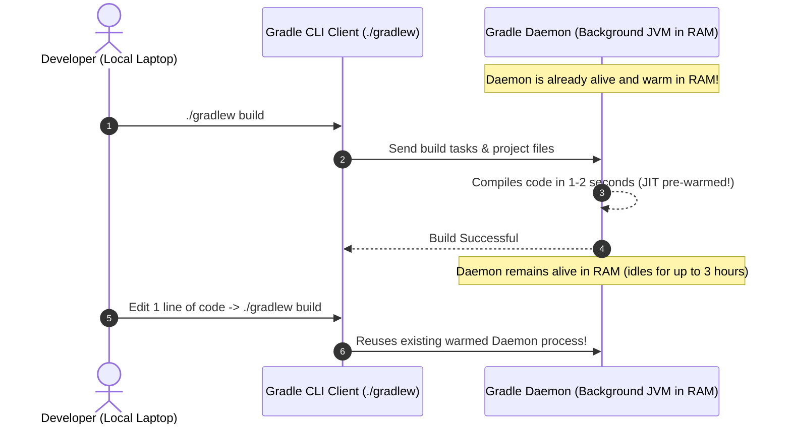

# Understanding the Gradle Daemon & `--no-daemon`

This guide explains what the Gradle Daemon is, how it accelerates local developer workflows, and why passing `--no-daemon` is mandatory inside Dockerfiles and CI/CD pipelines.

---

## 1. What is a "Daemon"?

In Unix and computer systems, a **daemon** is a background process that stays continuously running in system memory, ready to perform tasks on demand without needing to be restarted every time.

---

## 2. What is the Gradle Daemon?

Starting a Java Virtual Machine (JVM) is relatively slow. Every time you launch a JVM, it must:
1. Allocate memory heaps.
2. Load thousands of core Gradle and Kotlin compiler classes into memory.
3. Warm up the Just-In-Time (JIT) compiler to optimize hot execution paths.

To eliminate this startup overhead during daily coding, Gradle introduced the **Gradle Daemon** (enabled by default on developer machines):



* **Benefit for Local Development:** Subsequent builds run **2x to 5x faster** because the JVM is already hot and compiler caches are retained in RAM.

---

## 3. What Does `--no-daemon` Do?

Passing the `--no-daemon` flag tells Gradle:

> *"Do not leave a background JVM process running after this build finishes. Spin up, execute the requested tasks, and immediately shut down the JVM completely."*

```bash
./gradlew bootJar --no-daemon
```

---

## 4. Why `--no-daemon` is Mandatory in Docker and CI/CD

In our [`Dockerfile`](file:///Users/atifanowar/Workspace/interview/crud-kotlin-service/Dockerfile), you will see:
```dockerfile
RUN ./gradlew dependencies --no-daemon || true
RUN ./gradlew bootJar --no-daemon -x test
```

Here is why leaving the Daemon enabled inside Docker or CI is a dangerous anti-pattern:

### 1. Docker Build Steps are Ephemeral (One-Shot)
Each `RUN` command in a Dockerfile executes inside a temporary container layer. Once the command finishes, Docker snapshots the filesystem and kills the container.
- There is **no future command** that will ever connect to or benefit from that background daemon.
- Leaving a daemon running wastes CPU and RAM attempting to maintain a background process that will be discarded.

### 2. Preventing Docker Build Hangs
When Docker executes a `RUN` instruction, it waits for all child processes spawned by that step to exit before finalizing the layer.
- If the Gradle Daemon stays running in the background waiting for work (idling for up to 3 hours), Docker can **hang indefinitely** waiting for the step to close.

### 3. CI/CD Resource Starvation & Determinism
In automated CI runners (GitHub Actions, Jenkins, GitLab CI):
- Background daemons consume 1GB+ of system memory, leading to runner out-of-memory errors (`OOMKilled`).
- `--no-daemon` ensures every CI build runs in a completely clean, isolated, deterministic environment with zero leftover memory state.

---

## 5. Comparison: Local Laptop vs. Docker / CI

| Context | Recommended Setting | Why? |
| :--- | :--- | :--- |
| **Local Development** *(IntelliJ / Terminal)* | **Daemon ON** *(Default)* | Keeps JVM hot; speeds up frequent code-test-debug loops from 10s to 1s. |
| **Docker Build** *(`Dockerfile`)* | **`--no-daemon`** *(Mandatory)* | Prevents build hangs; step is single-use; avoids orphaned JVM processes. |
| **CI/CD Pipeline** *(GitHub Actions)* | **`--no-daemon`** *(Mandatory)* | Prevents runner memory leaks; guarantees clean, reproducible builds. |

---

## 6. 60-Second Verbal Script (PREP Framework)

Use this script during technical interviews when asked: *"What does the Gradle --no-daemon flag do, and why is it used in Docker and CI?"*

> **Point:**  
> The `--no-daemon` flag forces Gradle to execute as a single-use process and terminate its JVM immediately upon task completion, rather than idling in the background.
>
> **Reason:**  
> While the Gradle Daemon accelerates local development by keeping a pre-warmed JVM in RAM, background processes are harmful inside Docker and CI runners. Each container build step is ephemeral, meaning an idling daemon cannot be reused and risks hanging the Docker build or exhausting runner memory.
>
> **Example:**  
> In our `Dockerfile`, we specify `RUN ./gradlew bootJar --no-daemon -x test`. This ensures that as soon as `app.jar` is packaged, the JVM shuts down completely, allowing Docker to cleanly snapshot the layer without leaving orphaned Java processes in container memory.
>
> **Point (Restated):**  
> In short, use the daemon locally for development speed, but always pass `--no-daemon` in Docker and CI/CD for resource isolation and deterministic builds.
