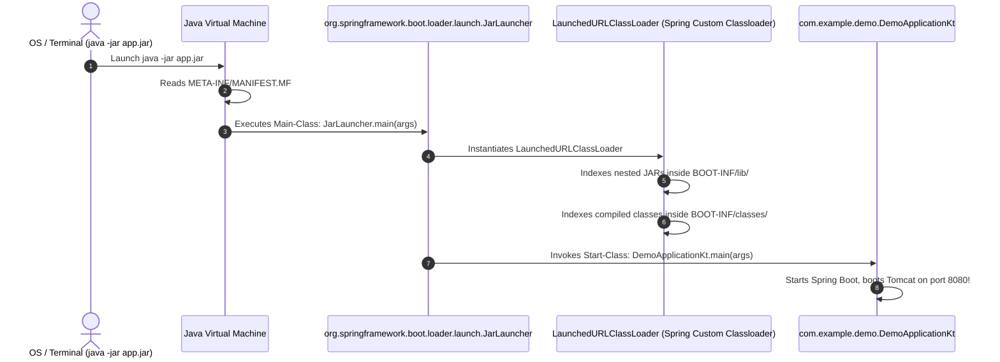
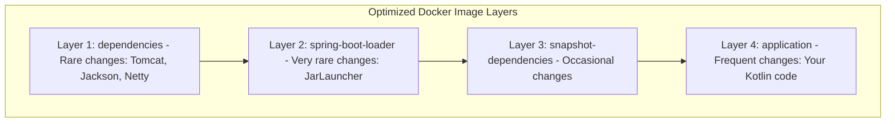

# Deep Dive: Spring Boot Gradle Plugin (`org.springframework.boot`)

This document provides a comprehensive, interview-ready breakdown of the `id("org.springframework.boot")` plugin, how it packages an executable "Fat JAR", how the Spring Boot ClassLoader works under the hood, and how it powers modern containerized deployments.

> [!TIP]
> For a foundational explanation of what `.class` files are, how the JVM works, and why standard Java cannot load nested archives, see the companion guide: [fat-jar-and-classloader.md](file:///Users/atifanowar/Workspace/interview/crud-kotlin-service/repo-wiki/dependencies/fat-jar-and-classloader.md).

---

## 1. What is the Spring Boot Gradle Plugin?

The `org.springframework.boot` plugin is the central orchestration plugin for building, running, and packaging Spring Boot applications in Gradle.

When declared in [`build.gradle.kts`](file:///Users/atifanowar/Workspace/interview/crud-kotlin-service/build.gradle.kts):
```kotlin
plugins {
    id("org.springframework.boot") version "3.5.5"
}
```

It introduces several core capabilities:
1. **Packaging**: Adds the **`bootJar`** task to assemble an executable archive containing your code and all dependencies.
2. **Execution**: Adds the **`bootRun`** task to run the application in place with fast reload support.
3. **BOM Coordination**: Automatically links with `io.spring.dependency-management` to import the matching `spring-boot-dependencies:3.5.5` catalog.
4. **OCI Container Images**: Provides **`bootBuildImage`** to produce Docker images via Cloud Native Buildpacks (without a `Dockerfile`).
5. **Actuator Metadata**: Generates `META-INF/build-info.properties` for the `/actuator/info` endpoint.

---

## 2. Under the Hood: The "Fat JAR" Problem

In traditional Java development, if you build a standard JAR using Gradle's `jar` task, it only bundles your own compiled `.class` files. If your code calls `import org.springframework.web...`, running `java -jar myapp.jar` throws a fatal error:

```
java.lang.NoClassDefFoundError: org/springframework/web/bind/annotation/RestController
```

### Why Can't Java Just Put JARs Inside a JAR?
A natural idea is: *"Why not just put `tomcat.jar` and `jackson.jar` inside `myapp.jar`?"*

The standard Java Virtual Machine (`URLClassLoader`) **cannot load nested JARs from inside an archive**. The JVM only knows how to load:
1. Uncompressed directories of `.class` files.
2. Individual, standalone `.jar` files on the flat OS filesystem.

---

## 3. How Spring Boot Solves This: The Executable Fat JAR Structure

The `bootJar` task solves this limitation by creating a specialized archive with its own custom classloader:

```
app.jar
├── META-INF/
│   ├── MANIFEST.MF                     <-- Points JVM to Spring's Launcher
│   └── ...
├── org/springframework/boot/loader/    <-- Spring's custom ClassLoader bytecode
│   ├── launch/
│   │   └── JarLauncher.class           <-- The REAL Java entrypoint!
│   └── ...
└── BOOT-INF/                           <-- Your application payload
    ├── classes/                        <-- Your compiled Kotlin code (DemoApplication.class, Controllers)
    ├── lib/                            <-- Nested dependency JARs (tomcat-embed.jar, jackson.jar, etc.)
    ├── classpath.idx                   <-- Ordering index for deterministic classpath loading
    └── layers.idx                      <-- Docker layer definitions for container optimization
```

### The `MANIFEST.MF` Magic

If you inspect `META-INF/MANIFEST.MF` inside the built `app.jar`:

```properties
Manifest-Version: 1.0
Main-Class: org.springframework.boot.loader.launch.JarLauncher
Start-Class: com.example.demo.DemoApplicationKt
Spring-Boot-Version: 3.5.5
Spring-Boot-Classes: BOOT-INF/classes/
Spring-Boot-Lib: BOOT-INF/lib/
```

Notice:
- **`Main-Class` is NOT your class!** It is `org.springframework.boot.loader.launch.JarLauncher`.
- **`Start-Class` IS your class:** `com.example.demo.DemoApplicationKt`.

---

## 4. Execution Sequence: What Happens During `java -jar app.jar`



1. **JVM Initialization:** The JVM starts up and reads `Main-Class` from `MANIFEST.MF`.
2. **Launch `JarLauncher`:** The JVM executes `JarLauncher.main()`. Because `org.springframework.boot.loader` sits at the root of the JAR, the standard JVM classloader can load it without issues.
3. **Setup Custom ClassLoader:** `JarLauncher` constructs a `LaunchedURLClassLoader` capable of reading bytecode directly from compressed, nested archives inside `BOOT-INF/lib/`.
4. **Delegate to Your Code:** `JarLauncher` reflects on `Start-Class` (`DemoApplicationKt`), finds `main(args)`, and delegates execution to it on the new classloader.
5. **Spring Boots Up:** Embedded Tomcat starts, Spring beans are wired, and your REST APIs go live.

---

## 5. Docker Optimization: Layered JARs (`layers.idx`)

Modern cloud-native applications run in Docker/Kubernetes. Rebuilding and pushing large Docker images on every small code change is slow and wastes network bandwidth.

Spring Boot divides the JAR into **4 distinct layers** via `layers.idx`:



When you extract the JAR inside a `Dockerfile`:
```dockerfile
# Extract layers
RUN java -Djarmode=tools -jar app.jar extract --layers --destination extracted/

# Copy layers from least frequently changed to most frequently changed
COPY extracted/dependencies/ ./
COPY extracted/spring-boot-loader/ ./
COPY extracted/snapshot-dependencies/ ./
COPY extracted/application/ ./

ENTRYPOINT ["java", "org.springframework.boot.loader.launch.JarLauncher"]
```
- **Result:** If you change one line of Kotlin code in a controller, Docker **caches layers 1, 2, and 3**! It only pushes layer 4 (~200KB) instead of the entire 50MB JAR.

---

## 6. Key Tasks Provided by the Plugin

| Task | What It Does | Common Usage |
| :--- | :--- | :--- |
| **`bootJar`** | Packages the executable fat JAR into `build/libs/app.jar`. Replaces standard `jar`. | `./gradlew bootJar` (CI/CD build) |
| **`bootRun`** | Executes the application directly from source without packaging a JAR. | `./gradlew bootRun` (Local dev) |
| **`bootBuildImage`** | Builds a Docker container image using Cloud Native Buildpacks (no Dockerfile required). | `./gradlew bootBuildImage` |

---

## 7. 60-Second Verbal Script (PREP Framework)

Use this script during technical interviews when asked: *"What does the Spring Boot Gradle plugin do, and how does an executable Fat JAR work?"*

> **Point:**  
> The `org.springframework.boot` Gradle plugin orchestrates application lifecycle tasks, most notably packaging the application into an executable "Fat JAR" containing embedded Tomcat and all runtime dependencies.
>
> **Reason:**  
> The standard JVM classloader cannot natively load classes from nested JARs inside an archive. The plugin overcomes this by bundling a custom `JarLauncher` and restructuring the archive so that external application servers are completely unnecessary.
>
> **Example:**  
> When running `./gradlew bootJar`, the plugin packages our Kotlin code into `BOOT-INF/classes/` and dependencies into `BOOT-INF/lib/`. The archive's `MANIFEST.MF` sets `Main-Class` to `org.springframework.boot.loader.launch.JarLauncher`. When `java -jar app.jar` is run, `JarLauncher` spins up a `LaunchedURLClassLoader` that can load classes from `BOOT-INF/lib/`, which in turn delegates to our `DemoApplicationKt.main()` method.
>
> **Point (Restated):**  
> Ultimately, it shifts Java from heavy, external application server deployments to lightweight, container-friendly, self-contained executable artifacts.
