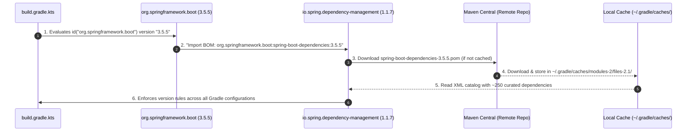

# Deep Dive: Spring Dependency Management Plugin (`io.spring.dependency-management`)

This document provides an in-depth technical explanation of the `io.spring.dependency-management` Gradle plugin, how it works behind the scenes, how the Bill of Materials (BOM) resolves versions, and how it prevents "dependency hell".

---

## 1. The Core Problem It Solves: "Dependency Hell"

In enterprise applications, libraries rarely work in isolation. A typical Spring Boot application depends on dozens of third-party libraries:
- Web server (Tomcat, Netty)
- JSON parsers (Jackson Core, Databind, Kotlin Module)
- Database drivers & ORMs (PostgreSQL JDBC driver, Hibernate, HikariCP)
- Observability (Micrometer, OpenTelemetry)
- Logging (SLF4J, Logback)
- Test frameworks (JUnit 5, AssertJ, Mockito)

### The Danger of Manual Versions
If every developer had to specify versions manually for each library:
```kotlin
// ❌ Error-prone manual versioning:
implementation("com.fasterxml.jackson.core:jackson-databind:2.18.2")
implementation("com.fasterxml.jackson.module:jackson-module-kotlin:2.17.0") // Mismatched minor version!
implementation("org.postgresql:postgresql:42.5.0") // Incompatible with newer Hibernate!
```
- **Incompatible transitive dependencies**: Jackson databind 2.18 might depend on jackson-core 2.18, but another starter pulls in 2.17, leading to runtime crashes like `java.lang.NoSuchMethodError` or `ClassNotFoundException`.
- **Tedious upgrades**: Upgrading Spring Boot would require researching and updating 40+ individual library versions.

---

## 2. What is a Bill of Materials (BOM)?

A **Bill of Materials (BOM)** is an XML file (`pom.xml`) containing a `<dependencyManagement>` section that lists curated, compatible versions for hundreds of libraries.

Spring Boot publishes `spring-boot-dependencies`:
```xml
<!-- Conceptual snippet from spring-boot-dependencies-3.5.5.pom -->
<dependencyManagement>
    <dependencies>
        <dependency>
            <groupId>org.postgresql</groupId>
            <artifactId>postgresql</artifactId>
            <version>42.7.8</version>
        </dependency>
        <dependency>
            <groupId>com.fasterxml.jackson.module</groupId>
            <artifactId>jackson-module-kotlin</artifactId>
            <version>2.18.2</version>
        </dependency>
        <dependency>
            <groupId>org.apache.tomcat.embed</groupId>
            <artifactId>tomcat-embed-core</artifactId>
            <version>10.1.34</version>
        </dependency>
        <!-- hundreds more curated dependencies -->
    </dependencies>
</dependencyManagement>
```

The Spring Boot engineering team tests this entire matrix together. If you stick to the versions in the BOM, all libraries are guaranteed to be binary-compatible.

---

## 3. Does the Plugin Store Versions Internally?

A common misconception is that the `io.spring.dependency-management` plugin internally packages and stores all BOMs for every Spring Boot version. 

**It does not.**

The plugin is a **generic, agnostic engine**. It has no hardcoded library versions inside its JAR. Instead, it relies on a **3-party dynamic handshake** during the Gradle build:

### The 3-Party Handshake: How It Actually Works



### The Roles in the Handshake:
1. **`io.spring.dependency-management:1.1.7` (The Engine):**
   - It only knows *how* to parse a Maven POM and intercept Gradle's dependency resolution. It contains zero version definitions itself.
2. **`org.springframework.boot:3.5.5` (The Coordinator):**
   - Because its own version is set to `3.5.5`, it knows the corresponding BOM coordinates are `org.springframework.boot:spring-boot-dependencies:3.5.5`. It passes this instruction to the dependency management engine.
3. **`spring-boot-dependencies-3.5.5.pom` (The Catalog):**
   - A remote XML artifact hosted on Maven Central. Gradle downloads it once and caches it locally under:
     `~/.gradle/caches/modules-2/files-2.1/org.springframework.boot/spring-boot-dependencies/3.5.5/...`
   - This file contains the curated map of versions.

> [!IMPORTANT]
> Notice that Gradle caches dependencies in `~/.gradle/` (your user home global cache), **not** in `./gradle/` (the project root, which only holds the wrapper scripts).

### What Happens When You Change the Version?
If you change [`build.gradle.kts`](file:///Users/atifanowar/Workspace/interview/crud-kotlin-service/build.gradle.kts) from `3.5.5` to `3.4.0`:
- The dependency management plugin (`1.1.7`) remains untouched.
- The Spring Boot plugin instructs the engine to fetch `spring-boot-dependencies:3.4.0.pom`.
- Gradle downloads the 3.4.0 POM, and the in-memory version map is instantly swapped.

### Why Doesn't It Know Every Library?
The plugin only knows about the ~250 libraries explicitly declared in that specific `spring-boot-dependencies.pom`.
- **In the BOM:** Jackson, PostgreSQL driver, Tomcat, Netty, Hibernate, Micrometer. (No versions needed).
- **Not in the BOM:** `io.mockk:mockk-jvm`. Because it's not listed in the Spring Boot catalog, Gradle requires an explicit version (`1.14.6`), otherwise the build fails with an `unspecified version` error.

---

## 4. How It Operates in Our Codebase

Because of this handshake, our dependencies in [`build.gradle.kts`](file:///Users/atifanowar/Workspace/interview/crud-kotlin-service/build.gradle.kts) can omit versions:

```kotlin
dependencies {
    // No version needed: BOM provides version 3.5.5
    implementation("org.springframework.boot:spring-boot-starter-web")

    // No version needed: BOM provides version 3.5.5
    implementation("org.springframework.boot:spring-boot-starter-webflux")

    // No version needed: BOM resolves compatible Jackson 2.18.x
    implementation("com.fasterxml.jackson.module:jackson-module-kotlin")

    // No version needed: Spring Boot starter test resolves compatible JUnit 5 & AssertJ
    testImplementation("org.springframework.boot:spring-boot-starter-test")

    // Explicit version REQUIRED: MockK is a 3rd-party Kotlin library not in Spring's BOM
    testImplementation("io.mockk:mockk-jvm:1.14.6")
    testImplementation("com.ninja-squad:springmockk:4.0.2")
}
```

> [!NOTE]
> If a dependency is **not** included in the Spring Boot BOM (such as `mockk-jvm` or `springmockk`), you **must** specify the explicit version string (`1.14.6`), otherwise Gradle will throw an "unspecified version" error.

---

## 5. How to Verify Resolved Versions

You can inspect the exact versions the plugin resolved for your project by running the Gradle `dependencyInsight` task:

```bash
./gradlew dependencyInsight --dependency jackson-module-kotlin --configuration compileClasspath
```

Output:
```
com.fasterxml.jackson.module:jackson-module-kotlin:2.18.x (selected by rule)
```
The `(selected by rule)` text indicates that the version was assigned by the `io.spring.dependency-management` plugin via the Spring Boot BOM.

---

## 6. Importing Additional BOMs (Multi-BOM Architecture)

If your application needs libraries from other ecosystems (e.g. Spring Cloud, Testcontainers, or AWS), you can import their BOMs into the `dependencyManagement` block:

```kotlin
dependencyManagement {
    imports {
        // Spring Cloud BOM
        mavenBom("org.springframework.cloud:spring-cloud-dependencies:2024.0.0")

        // Testcontainers BOM
        mavenBom("org.testcontainers:testcontainers-bom:1.20.4")
    }
}

dependencies {
    // Now you can declare Testcontainers without version strings!
    testImplementation("org.testcontainers:postgresql")
}
```

When multiple BOMs define the same library, the first declared BOM in the `imports` block takes precedence.

---

## 7. How to Override a BOM Version (When Needed)

If a zero-day security vulnerability (CVE) is discovered in a library before Spring releases a new Boot patch, you can safely override the BOM version in two ways:

### Approach A: Using Spring Properties (Recommended)
Spring's BOM uses Gradle properties for its versions. You can override the property in `build.gradle.kts`:

```kotlin
// In build.gradle.kts
extra["postgresql.version"] = "42.7.9"
extra["tomcat.version"] = "10.1.35"
```

### Approach B: Explicit Dependency Coordinate
Declaring an explicit version in your `implementation` line directly overrides the BOM:

```kotlin
implementation("org.postgresql:postgresql:42.7.9") // Overrides BOM version 42.7.8
```

---

## 8. Comparison: `io.spring.dependency-management` vs Gradle Native `platform()`

Modern Gradle (5.0+) introduced native support for BOMs via `platform()`:

| Feature | `io.spring.dependency-management` | Gradle Native `platform()` |
| :--- | :--- | :--- |
| **How it's declared** | Applied as a plugin `id("io.spring.dependency-management")` | `implementation(platform("org.springframework.boot:spring-boot-dependencies:3.5.5"))` |
| **BOM automatic injection** | Automatic when Spring Boot plugin is present | Requires explicit `platform(...)` declaration |
| **Configuration scope** | Applies globally to all configurations (`compileClasspath`, `testCompileClasspath`, etc.) | Must be added to each configuration or use `enforcedPlatform` |
| **Maven Exclusions** | Supports Maven-style `<exclusions>` from imported POMs | Requires custom Gradle exclusion rules |
| **Ecosystem adoption** | Industry standard in Spring Boot projects | Increasingly popular in modern Gradle-native builds |

---

## 9. Summary Checklist

- [x] **Reduces boilerplate:** No need to hardcode version numbers for Spring-compatible libraries.
- [x] **Guarantees compatibility:** All BOM-managed libraries are tested and verified together.
- [x] **Simplifies upgrades:** Upgrading Spring Boot from `3.5.5` to `3.5.6` updates the entire dependency tree automatically.
- [x] **Flexible:** Allows overriding individual versions for hotfixes and CVE patches via `extra[...]` properties.

---

## 10. 60-Second Verbal Script (PREP Framework)

Use this script during technical interviews when asked about dependency management, Gradle builds, or Spring Boot BOM resolution.

> **Point:**  
> The `io.spring.dependency-management` plugin provides centralized, battle-tested version governance in Gradle by automatically importing Spring Boot's Bill of Materials (BOM).
>
> **Reason:**  
> In modern microservices, manually pinning versions across dozens of libraries like Jackson, Tomcat, and database drivers often leads to version mismatches, binary incompatibilities, and runtime errors like `NoSuchMethodError`. The plugin eliminates this risk by resolving curated, pre-tested versions across all configurations.
>
> **Example:**  
> In our Kotlin service, we declare `spring-boot-starter-web` and `jackson-module-kotlin` without version tags. The plugin automatically pulls the exact tested versions from `spring-boot-dependencies:3.5.5`. If we need a quick patch for a critical CVE, we can override the specific library cleanly via `extra["postgresql.version"] = "..."` without destabilizing the rest of the dependency tree.
>
> **Point (Restated):**  
> Ultimately, it brings Maven-style BOM predictability into Gradle, guaranteeing binary compatibility and making framework upgrades seamless.
