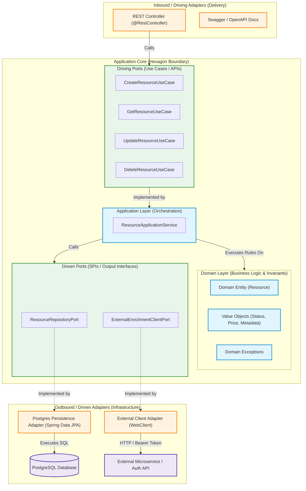
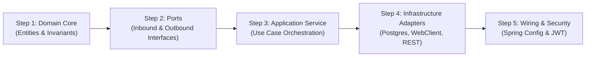

# Architecture & System Design Guide

This guide establishes the architectural foundations of our Kotlin & Spring Boot service, detailing why we chose **Hexagonal Architecture (Ports & Adapters)**, comparing it to alternative paradigms, and providing a step-by-step roadmap to implement the **Domain**, **Application**, and **Infrastructure** layers.

---

## 1. System Architecture: Hexagonal (Ports & Adapters)

Hexagonal Architecture—introduced by Alistair Cockburn in 2005—decouples core business logic from frameworks, delivery mechanisms (HTTP/REST, gRPC, CLI), and external infrastructure (databases, message queues, third-party HTTP APIs).



### The Three Golden Layers

| Layer | Responsibility | Framework Dependencies |
| :--- | :--- | :--- |
| **Domain** | Business models, domain rules, state invariants, pure business calculations. | **None (Pure Kotlin).** Zero Spring, zero JPA/Hibernate annotations. |
| **Application** | Use case orchestration, coordination between domain entities and outbound ports, transaction boundaries (`@Transactional`). | Minimal (transaction annotations, pure Kotlin interfaces). |
| **Infrastructure** | Concrete adapters: Spring MVC `@RestController`, Spring Data JPA repositories, PostgreSQL entities, `WebClient` external HTTP clients, OAuth2/Security, OpenAPI/Swagger. | Heavy (Spring Boot, Hibernate, Jackson, Reactor, WebClient). |

---

## 2. Why Choose Hexagonal Architecture?

### 2.1 The Dependency Inversion Principle (DIP) in Practice
In traditional architectures, the Service layer directly imports the Database Repository. The business logic is coupled to the database schema:

```
[ Traditional ] : Controller ---> Service ---> Repository (JPA Entity)
                  (Business depends directly on Database details)

[ Hexagonal ]   : Controller ---> [Inbound Port]
                                        │
                                  App Service ---> Domain Model
                                        │
                                  [Outbound Port] <--- Infrastructure Adapter (JPA/Postgres)
                  (Database depends on Business via Inversion)
```

By placing **Ports** (interfaces) between the application core and the outside world, high-level business policies do **not** depend on low-level technical mechanisms. Low-level details depend on high-level policies.

### 2.2 Core Advantages:
1. **Unrivaled Testability:**
   - The domain and application services can be tested with **100% pure Kotlin unit tests** using MockK.
   - No `@SpringBootTest`, no embedded H2, no Testcontainers required for business rule verification. Tests execute in **milliseconds** rather than seconds.
2. **Framework & Infrastructure Agility:**
   - Switching from Spring Data JPA to R2DBC, jOOQ, or MongoDB requires changing only an outbound adapter. The business logic remains untouched.
   - Migrating from Spring Web MVC to WebFlux or gRPC only requires writing a new inbound adapter.
3. **Protection from Schema Leaks (No Anemic Models):**
   - JPA entities often require mutable fields (`var`), no-arg constructors, and getter/setter patterns for Hibernate proxies.
   - Hexagonal separates domain models (`val`, immutable, business methods enforcing invariants) from persistence entities (`@Entity`, `@Table`).
4. **Resilience to External API Changes:**
   - The outbound `ExternalClientPort` returns domain-tailored models. When the third-party REST API changes its JSON schema, only the `WebClient` adapter's DTO parser is modified; your domain is immune to external API churn.

---

## 3. Comparing the Alternatives

| Metric / Dimension | Traditional 3-Tier Layered | Clean Architecture (Uncle Bob) | Onion Architecture (Palermo) | Vertical Slice Architecture | Hexagonal (Ports & Adapters) |
| :--- | :--- | :--- | :--- | :--- | :--- |
| **Primary Organizing Principle** | Technical layers (`controller`, `service`, `dao`) | Concentric circles of dependency | Domain model at center | Feature slices (`CreateOrder`, `GetOrder`) | Inside (Domain/App) vs. Outside (Adapters) |
| **Database Coupling** | High (Service directly references JPA) | Inverted (Gateway interfaces) | Inverted (Repository interfaces) | Direct or Slice-specific | Inverted (Driven Ports) |
| **Boilerplate & Mapping** | Very Low (Reuses JPA entity across layers) | High (DTO -> RequestModel -> Entity -> ViewModel) | Medium-High | Very Low (DTO -> Entity directly in slice) | Medium (REST DTO <-> Domain <-> JPA Entity) |
| **Unit Test Isolation** | Poor (Requires DB or heavy mocking) | Exceptional | Exceptional | Moderate (Optimized for full-slice integration tests) | Exceptional |
| **Best Used For** | Simple CRUD, small prototypes, internal tools | Large enterprise systems with complex use cases | Complex domain logic with rich DDD models | Feature-heavy apps with rapid, independent iteration | Microservices with rich domains, external integrations & high testability requirements |

> [!TIP]
> For a line-by-line comparative analysis, trade-off matrix, and migration strategies, see: [hexagonal-vs-alternatives.md](file:///Users/atifanowar/Workspace/interview/crud-kotlin-service/repo-wiki/design/hexagonal-vs-alternatives.md).

---

## 4. How Should I Start? (Step-by-Step Roadmap)

When starting a new resource with Hexagonal Architecture, **always work inside-out (Domain → Application → Infrastructure)**:



### Step 1: Model the Domain Core (Zero Frameworks)
- Create `domain/model/` with pure Kotlin data classes.
- Use `val` for immutability and define rich business methods that enforce state transitions (e.g. `activate()`, `applyDiscount()`).
- Define domain-specific exceptions in `domain/exception/` (e.g., `ResourceNotFoundException`, `InvalidResourceStateException`).

### Step 2: Define Ports (Contracts)
- **Inbound Ports (`application/port/in/`):** Interfaces representing what the outside world can ask the system to do (e.g. `CreateResourceUseCase`, `GetResourceUseCase`, `UpdateResourceUseCase`, `DeleteResourceUseCase`).
- **Outbound Ports (`application/port/out/`):** Interfaces defining what the system needs from the outside world (e.g. `ResourceRepositoryPort`, `ExternalEnrichmentClientPort`).

### Step 3: Implement the Application Service
- Create `application/service/ResourceApplicationService` that implements the inbound use cases.
- Injects outbound ports via standard constructor injection.
- Enforces business flow:
  1. Calls `ExternalEnrichmentClientPort` to fetch external data.
  2. Creates or mutates the `Resource` domain entity.
  3. Calls `ResourceRepositoryPort` to persist.
  4. Manages `@Transactional` boundaries.

### Step 4: Implement Inbound Adapters (REST)
- Create `infrastructure/adapter/in/rest/`:
  - `ResourceController`: Spring MVC `@RestController` with `@PostMapping`, `@GetMapping`, `@PatchMapping`, `@DeleteMapping`.
  - Request/Response DTOs: Specifying OpenAPI/Swagger annotations (`@Schema`, `@Operation`).
  - `GlobalExceptionHandler`: Maps domain exceptions to standard HTTP status codes (`404 NOT_FOUND`, `400 BAD_REQUEST`, `409 CONFLICT`).

### Step 5: Implement Outbound Adapters (PostgreSQL & WebClient)
- **Persistence Adapter (`infrastructure/adapter/out/persistence/`):**
  - PostgreSQL JPA Entity: `@Entity`, `@Table(name = "resources")`.
  - Spring Data Repository: `interface SpringDataResourceRepository : JpaRepository<ResourceJpaEntity, UUID>`.
  - Adapter Class: Implements `ResourceRepositoryPort`, translates domain entity <-> JPA entity using an explicit mapper.
- **External Client Adapter (`infrastructure/adapter/out/client/`):**
  - Uses `WebClient` to call third-party APIs with OAuth2 Bearer token authentication.
  - Implements `ExternalEnrichmentClientPort`.

> [!TIP]
> For complete package diagrams, full Kotlin code templates, and end-to-end CRUD sequence diagrams, see: [folder-structure-and-data-flow.md](file:///Users/atifanowar/Workspace/interview/crud-kotlin-service/repo-wiki/design/folder-structure-and-data-flow.md).

---

## 5. Summary of Design Documentation

| Document | Focus Area |
| :--- | :--- |
| **[README.md](file:///Users/atifanowar/Workspace/interview/crud-kotlin-service/repo-wiki/design/README.md)** | Architectural overview, core principles, step-by-step roadmap, and interview PREP script. |
| **[hexagonal-vs-alternatives.md](file:///Users/atifanowar/Workspace/interview/crud-kotlin-service/repo-wiki/design/hexagonal-vs-alternatives.md)** | In-depth comparison of Hexagonal, Clean, Onion, Layered, and Vertical Slice architectures. |
| **[folder-structure-and-data-flow.md](file:///Users/atifanowar/Workspace/interview/crud-kotlin-service/repo-wiki/design/folder-structure-and-data-flow.md)** | Target folder structure, port/adapter mappings, and end-to-end CRUD sequence flows. |

---

## 6. 60-Second Verbal Script (PREP Framework)

Use this script during technical interviews when asked: *"Why did you structure your Kotlin Spring Boot microservice using Hexagonal Architecture instead of traditional 3-tier layered architecture?"*

> **Point:**  
> We adopted Hexagonal Architecture (Ports and Adapters) to isolate our core business domain completely from infrastructure mechanisms like Spring Web, Spring Data JPA, and external HTTP clients.
>
> **Reason:**  
> In traditional 3-tier Spring Boot applications, the service layer often becomes tightly coupled to database entities and HTTP request models, which leads to anemic domain models, difficult-to-maintain code, and slow unit tests that require Spring ApplicationContext bootstrapping. Hexagonal inverts this dependency: the core defines ports, and outer adapters conform to those ports.
>
> **Example:**  
> In our project, our domain entities are pure Kotlin data classes with zero framework annotations. When a request arrives, the REST adapter passes an inbound command into the `CreateResourceUseCase`. The application service orchestrates the flow: it calls our `ExternalEnrichmentClientPort` implemented via `WebClient`, validates business invariants in the domain model, and saves via `ResourceRepositoryPort` implemented by a PostgreSQL Spring Data JPA adapter. We can unit test 100% of our business logic in milliseconds without touching a database or web server.
>
> **Point (Restated):**  
> This architectural separation guarantees maximum testability, framework independence, and the flexibility to swap databases or external APIs without impacting core business rules.
