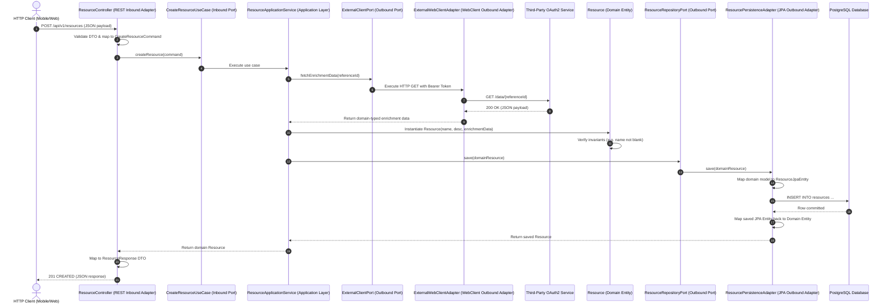
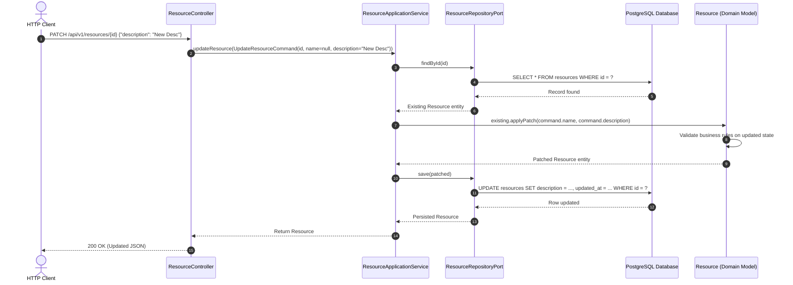

# Folder Structure, Layer Responsibilities & Data Flow Guide

This document specifies the exact package layout, responsibilities, and runtime data flow for implementing Hexagonal Architecture in our Kotlin Spring Boot service.

---

## 1. Concrete Package & Folder Structure

All source code resides under `src/main/kotlin/com/example/demo/`:

```
src/main/kotlin/com/example/demo/
├── DemoApplication.kt                      # Spring Boot Entry Point
│
├── domain/                                 # 1. DOMAIN LAYER (Pure Kotlin - Zero Frameworks)
│   ├── model/
│   │   ├── Resource.kt                     # Aggregate Root / Domain Entity
│   │   ├── ResourceId.kt                   # Strongly Typed Value Object
│   │   ├── ResourceStatus.kt               # Domain Enum
│   │   └── EnrichedMetadata.kt             # Value Object for external client data
│   └── exception/
│       ├── DomainException.kt              # Base Domain Exception
│       ├── ResourceNotFoundException.kt    # Entity not found
│       └── InvalidResourceStateException.kt # Business rule invariant violated
│
├── application/                            # 2. APPLICATION LAYER (Use Cases & Orchestration)
│   ├── port/
│   │   ├── in/                             # Inbound / Driving Ports
│   │   │   ├── CreateResourceUseCase.kt
│   │   │   ├── GetResourceUseCase.kt
│   │   │   ├── UpdateResourceUseCase.kt
│   │   │   └── DeleteResourceUseCase.kt
│   │   └── out/                            # Outbound / Driven Ports (SPIs)
│   │       ├── ResourceRepositoryPort.kt   # Database contract
│   │       └── ExternalClientPort.kt       # External API contract
│   └── service/
│       └── ResourceApplicationService.kt   # Implements Inbound Ports, orchestrates flow
│
└── infrastructure/                         # 3. INFRASTRUCTURE LAYER (Spring, JPA, WebClient)
    ├── adapter/
    │   ├── in/
    │   │   └── rest/                       # Inbound Driving Adapter (HTTP/REST)
    │   │       ├── ResourceController.kt
    │   │       ├── dto/
    │   │       │   ├── CreateResourceRequest.kt
    │   │       │   ├── UpdateResourceRequest.kt
    │   │       │   └── ResourceResponse.kt
    │   │       └── GlobalExceptionHandler.kt # Maps domain exceptions to HTTP responses
    │   └── out/
    │       ├── persistence/                # Outbound Driven Adapter (PostgreSQL / JPA)
    │       │   ├── ResourceJpaEntity.kt    # @Entity @Table(name = "resources")
    │       │   ├── SpringDataResourceRepository.kt # Spring Data JpaRepository
    │       │   ├── ResourcePersistenceAdapter.kt   # Implements ResourceRepositoryPort
    │       │   └── ResourcePersistenceMapper.kt   # Domain <-> JPA Entity Mapper
    │       └── client/                     # Outbound Driven Adapter (WebClient External API)
    │           ├── ExternalWebClientAdapter.kt    # Implements ExternalClientPort
    │           ├── dto/
    │           │   └── ExternalApiResponse.kt     # Third-party JSON contract
    │           └── config/
    │               └── WebClientConfig.kt         # WebClient Bean, OAuth2, Timeouts
    └── config/                             # Cross-Cutting Infrastructure Config
        ├── SecurityConfig.kt               # OAuth2 Resource Server JWT Validation
        ├── OpenApiConfig.kt                # Swagger / OpenAPI documentation
        └── TracingConfig.kt                # Micrometer & OpenTelemetry OTLP
```

---

## 2. Layer Responsibilities & Kotlin Code Patterns

### 2.1 Domain Layer: `domain/model/Resource.kt`
The domain model enforces business invariants and has **no annotations** from Spring or Hibernate.

```kotlin
package com.example.demo.domain.model

import com.example.demo.domain.exception.InvalidResourceStateException
import java.time.Instant
import java.util.UUID

@JvmInline
value class ResourceId(val value: UUID = UUID.randomUUID())

enum class ResourceStatus { DRAFT, ACTIVE, ARCHIVED }

data class Resource(
    val id: ResourceId = ResourceId(),
    val name: String,
    val description: String,
    val status: ResourceStatus = ResourceStatus.DRAFT,
    val externalEnrichmentData: String? = null,
    val createdAt: Instant = Instant.now(),
    val updatedAt: Instant = Instant.now()
) {
    init {
        require(name.isNotBlank()) { "Resource name cannot be blank." }
    }

    fun activate(): Resource {
        if (status == ResourceStatus.ARCHIVED) {
            throw InvalidResourceStateException("Cannot activate an archived resource.")
        }
        return this.copy(status = ResourceStatus.ACTIVE, updatedAt = Instant.now())
    }

    fun applyPatch(newName: String?, newDescription: String?): Resource {
        val updated = this.copy(
            name = newName ?: this.name,
            description = newDescription ?: this.description,
            updatedAt = Instant.now()
        )
        require(updated.name.isNotBlank()) { "Resource name cannot be blank." }
        return updated
    }
}
```

---

### 2.2 Application Layer: Ports & Application Service

#### Inbound Port (`application/port/in/CreateResourceUseCase.kt`):
```kotlin
package com.example.demo.application.port.`in`

import com.example.demo.domain.model.Resource

data class CreateResourceCommand(
    val name: String,
    val description: String,
    val externalReferenceId: String
)

interface CreateResourceUseCase {
    fun createResource(command: CreateResourceCommand): Resource
}
```

#### Outbound Ports (`application/port/out/`):
```kotlin
package com.example.demo.application.port.out

import com.example.demo.domain.model.Resource
import com.example.demo.domain.model.ResourceId

interface ResourceRepositoryPort {
    fun save(resource: Resource): Resource
    fun findById(id: ResourceId): Resource?
    fun findAll(): List<Resource>
    fun deleteById(id: ResourceId): Boolean
}

interface ExternalClientPort {
    fun fetchEnrichmentData(referenceId: String): String
}
```

#### Application Service (`application/service/ResourceApplicationService.kt`):
Orchestrates business operations, calls outbound ports, and manages transactions.

```kotlin
package com.example.demo.application.service

import com.example.demo.application.port.`in`.*
import com.example.demo.application.port.out.ExternalClientPort
import com.example.demo.application.port.out.ResourceRepositoryPort
import com.example.demo.domain.exception.ResourceNotFoundException
import com.example.demo.domain.model.Resource
import com.example.demo.domain.model.ResourceId
import org.springframework.stereotype.Service
import org.springframework.transaction.annotation.Transactional

@Service
@Transactional
class ResourceApplicationService(
    private val repositoryPort: ResourceRepositoryPort,
    private val externalClientPort: ExternalClientPort
) : CreateResourceUseCase, GetResourceUseCase, UpdateResourceUseCase, DeleteResourceUseCase {

    override fun createResource(command: CreateResourceCommand): Resource {
        // 1. Fetch external enrichment data via outbound client port
        val enrichmentData = externalClientPort.fetchEnrichmentData(command.externalReferenceId)

        // 2. Instantiate and validate domain entity
        val newResource = Resource(
            name = command.name,
            description = command.description,
            externalEnrichmentData = enrichmentData
        )

        // 3. Persist via outbound repository port
        return repositoryPort.save(newResource)
    }

    @Transactional(readOnly = true)
    override fun getResourceById(id: ResourceId): Resource {
        return repositoryPort.findById(id)
            ?: throw ResourceNotFoundException("Resource with ID ${id.value} was not found.")
    }

    override fun updateResource(command: UpdateResourceCommand): Resource {
        val existing = getResourceById(command.id)
        val patched = existing.applyPatch(command.name, command.description)
        return repositoryPort.save(patched)
    }

    override fun deleteResource(id: ResourceId) {
        if (!repositoryPort.deleteById(id)) {
            throw ResourceNotFoundException("Resource with ID ${id.value} was not found.")
        }
    }
}
```

---

### 2.3 Infrastructure Layer: Adapters

#### REST Controller (`infrastructure/adapter/in/rest/ResourceController.kt`):
```kotlin
package com.example.demo.infrastructure.adapter.`in`.rest

import com.example.demo.application.port.`in`.*
import com.example.demo.domain.model.ResourceId
import com.example.demo.infrastructure.adapter.`in`.rest.dto.*
import org.springframework.http.HttpStatus
import org.springframework.web.bind.annotation.*
import java.util.UUID

@RestController
@RequestMapping("/api/v1/resources")
class ResourceController(
    private val createResourceUseCase: CreateResourceUseCase,
    private val getResourceUseCase: GetResourceUseCase,
    private val updateResourceUseCase: UpdateResourceUseCase,
    private val deleteResourceUseCase: DeleteResourceUseCase
) {

    @PostMapping
    @ResponseStatus(HttpStatus.CREATED)
    fun create(@RequestBody request: CreateResourceRequest): ResourceResponse {
        val command = request.toCommand()
        val created = createResourceUseCase.createResource(command)
        return ResourceResponse.fromDomain(created)
    }

    @GetMapping("/{id}")
    fun getById(@PathVariable id: UUID): ResourceResponse {
        val resource = getResourceUseCase.getResourceById(ResourceId(id))
        return ResourceResponse.fromDomain(resource)
    }

    @PatchMapping("/{id}")
    fun patch(
        @PathVariable id: UUID,
        @RequestBody request: UpdateResourceRequest
    ): ResourceResponse {
        val command = request.toCommand(id)
        val updated = updateResourceUseCase.updateResource(command)
        return ResourceResponse.fromDomain(updated)
    }

    @DeleteMapping("/{id}")
    @ResponseStatus(HttpStatus.NO_CONTENT)
    fun delete(@PathVariable id: UUID) {
        deleteResourceUseCase.deleteResource(ResourceId(id))
    }
}
```

#### Outbound Persistence Adapter (`infrastructure/adapter/out/persistence/`):
```kotlin
package com.example.demo.infrastructure.adapter.out.persistence

import com.example.demo.application.port.out.ResourceRepositoryPort
import com.example.demo.domain.model.Resource
import com.example.demo.domain.model.ResourceId
import org.springframework.stereotype.Component

@Component
class ResourcePersistenceAdapter(
    private val springDataRepository: SpringDataResourceRepository,
    private val mapper: ResourcePersistenceMapper
) : ResourceRepositoryPort {

    override fun save(resource: Resource): Resource {
        val entity = mapper.toJpaEntity(resource)
        val saved = springDataRepository.save(entity)
        return mapper.toDomain(saved)
    }

    override fun findById(id: ResourceId): Resource? {
        return springDataRepository.findById(id.value).map { mapper.toDomain(it) }.orElse(null)
    }

    override fun findAll(): List<Resource> {
        return springDataRepository.findAll().map { mapper.toDomain(it) }
    }

    override fun deleteById(id: ResourceId): Boolean {
        return if (springDataRepository.existsById(id.value)) {
            springDataRepository.deleteById(id.value)
            true
        } else {
            false
        }
    }
}
```

---

## 3. End-to-End Data Flow Walkthroughs

### 3.1 POST / Create Resource (with External Client Call)



---

### 3.2 PATCH / Partial Update Resource



---

## 4. Key Takeaways & Best Practices

1. **Inbound Direction (Delivery):**
   - Controllers never touch domain entities or database entities directly.
   - Controllers only talk to Inbound Ports using **Commands** and return **Response DTOs**.
2. **Outbound Direction (Infrastructure):**
   - Outbound adapters implement Outbound Ports.
   - Database entities never leak into the application core.
   - The persistence mapper guarantees domain models remain immutable while JPA entities handle database lifecycle states.
3. **External Client Direction:**
   - WebClient logic, error status handling, retry policies, and OAuth2 client token attachments are completely encapsulated in `ExternalWebClientAdapter`.
4. **Transactions:**
   - Transaction boundaries (`@Transactional`) belong on the **Application Service**, never on controllers or repository adapters.

---

## 5. 60-Second Verbal Script (PREP Framework)

Use this script during technical interviews when asked: *"Walk me through the flow of data in your hexagonal architecture when a POST request creates an entity with external data."*

> **Point:**  
> In our service, an incoming POST request travels cleanly from an Inbound REST Adapter through an Application Use Case, enriches itself via an Outbound WebClient Port, executes domain rules, and persists via an Outbound JPA Port to PostgreSQL.
>
> **Reason:**  
> This ensures that neither the delivery protocol (HTTP/REST) nor the infrastructure mechanisms (Postgres, WebClient) ever bleed into or constrain our business logic.
>
> **Example:**  
> When a client submits a POST request to `/api/v1/resources`, the `ResourceController` maps the JSON payload to an immutable `CreateResourceCommand` and invokes the `CreateResourceUseCase`. The `ResourceApplicationService` first calls `ExternalClientPort` to fetch enrichment data using our non-blocking `WebClient`. Next, it instantiates the `Resource` domain entity, which asserts its own business invariants. The service then persists the entity via `ResourceRepositoryPort`, where our JPA persistence adapter maps the domain model to a `ResourceJpaEntity` and commits it to PostgreSQL. Finally, the controller maps the resulting domain model into a `ResourceResponse` DTO and returns HTTP 201 Created.
>
> **Point (Restated):**  
> Every layer has a single responsibility, inputs and outputs are strictly mapped at boundaries, and all external dependencies are inverted.
