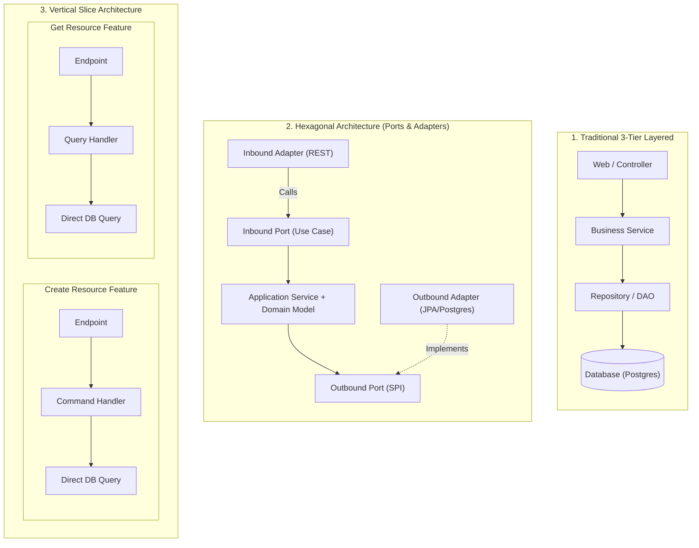

# Architectural Patterns: Hexagonal vs. Alternatives

Choosing an architectural pattern is a trade-off between **development velocity, domain complexity, testability, and long-term maintainability**. This document provides an exhaustive technical comparison between **Hexagonal Architecture (Ports & Adapters)** and its common alternatives in the JVM/Spring Boot ecosystem.

---

## 1. The Architectural Landscape



---

## 2. In-Depth Architectural Profiles

### 2.1 Traditional 3-Tier Layered Architecture

The default pattern in standard Spring tutorials (`@RestController` → `@Service` → `@Repository`).

#### Structure:
```
com.example.demo/
├── controller/     # ResourceController (@RestController)
├── service/        # ResourceService (@Service)
├── repository/     # ResourceRepository (JpaRepository<Resource, Long>)
└── model/          # Resource (@Entity, @Table)
```

#### How It Works:
- Dependencies flow **top-to-bottom**: Controller depends on Service; Service depends on Repository; Repository depends on Database table schema.
- Often, the `@Entity` class is passed directly from the database query through the Service and returned to the Controller (or lightly converted to a response DTO).

#### Pros:
- **Zero Friction & Minimal Boilerplate:** Quickest time to launch an MVP.
- **Familiarity:** Every Spring developer immediately understands where files live.
- **Single Model:** No translation between JPA entity and Domain model.

#### Cons:
- **Database-Driven Design:** The database schema dictates the business logic. Any change to a column forces refactoring across all layers.
- **Anemic Domain Models:** Business logic frequently leaks into "God Services", turning entities into passive data bags with getters/setters.
- **Poor Unit Testability:** Testing `ResourceService` usually requires mocking `JpaRepository` or launching `@DataJpaTest` with an in-memory database, slowing down test suites.
- **Framework Lock-in:** Domain logic is tightly bound to Spring Framework annotations (`@Transactional`, `@Autowired`, `@Entity`).

---

### 2.2 Hexagonal Architecture (Ports & Adapters)

Invented by Alistair Cockburn (2005) to solve the problem of core logic being infected by user interfaces and database mechanisms.

#### Structure:
```
com.example.demo/
├── domain/
│   ├── model/                  # Pure Kotlin Domain Entities & Value Objects
│   └── exception/              # Pure Domain Exceptions
├── application/
│   ├── port/
│   │   ├── in/                 # Use Cases (CreateResourceUseCase)
│   │   └── out/                # Output SPIs (ResourceRepositoryPort, ExternalClientPort)
│   └── service/                # Application Services (orchestrators)
└── infrastructure/
    ├── adapter/
    │   ├── in/rest/            # Controllers, Request/Response DTOs, Swagger
    │   ├── out/persistence/    # JPA Entities, Spring Data Repositories, Mappers
    │   └── out/client/         # WebClient HTTP Adapters
    └── config/                 # Security, Tracing, Bean Configurations
```

#### How It Works:
- Core application logic lives inside the hexagon.
- The outside world communicates with the core through **Driving (Inbound) Ports**.
- The core communicates with databases and external services through **Driven (Outbound) Ports**.
- Adapters convert external data formats (JSON, HTTP, SQL rows) into domain models and vice versa.

#### Pros:
- **Strict Dependency Inversion:** The domain does not know about Spring, JPA, HTTP, or PostgreSQL.
- **Lightning-Fast Unit Tests:** Domain rules and use cases can be 100% verified using native Kotlin tests with MockK—running in milliseconds without loading the Spring ApplicationContext.
- **Technology Replaceability:** You can replace PostgreSQL with DynamoDB, or REST with gRPC, simply by adding or swapping adapters without modifying a single line of business code.
- **Clean Separation of Concerns:** Inbound DTOs, Domain Entities, and Database Entities are decoupled, preventing accidental leak of internal database IDs or passwords to REST consumers.

#### Cons:
- **Mapping Overhead:** Requires object mappers (e.g., `ResourceRequestDto` → `CreateResourceCommand` → `Resource` domain entity → `ResourceJpaEntity`).
- **Higher Initial Boilerplate:** More interfaces, packages, and classes to write for simple CRUD operations.
- **Learning Curve:** Requires discipline from team members to avoid importing infrastructure classes into the domain.

---

### 2.3 Clean Architecture (Robert C. Martin / Uncle Bob)

Clean Architecture organizes code into concentric circles with strict dependency rules pointing inward:
`Entities` → `Use Cases` → `Interface Adapters` → `Frameworks & Drivers`.

#### Comparison with Hexagonal:
- **Virtually Identical Core Philosophy:** Clean Architecture is an elaboration of Hexagonal and Onion Architecture.
- **Differences:**
  - Clean Architecture introduces specialized terms like `Interactors`, `Request/Response Models`, and `Presenters` (often used to prepare ViewModel data for UI rendering).
  - Hexagonal Architecture uses the simpler, symmetrical **Ports & Adapters** metaphor (driving vs. driven), which fits backend microservices and REST APIs more naturally than Clean Architecture's GUI-oriented Presenters.

---

### 2.4 Onion Architecture (Jeffrey Palermo)

Introduced in 2008, Onion Architecture emphasizes domain models at the core, surrounded by domain services, then application services, and infrastructure at the outermost layer.

#### Comparison with Hexagonal:
- Hexagonal and Onion are siblings. Both enforce the **Dependency Inversion Principle**.
- Onion explicitly separates **Domain Services** (business logic spanning multiple entities) from **Application Services** (workflow orchestration).
- In Hexagonal, this distinction is readily accommodated within the `domain` and `application` layers.

---

### 2.5 Vertical Slice Architecture (Jimmy Bogard)

Instead of partitioning the application by horizontal technical concerns (controllers, services, repositories), Vertical Slice Architecture partitions the application along **functional business features**.

#### Structure:
```
com.example.demo/
└── features/
    ├── create_resource/
    │   ├── CreateResourceEndpoint.kt
    │   ├── CreateResourceCommand.kt
    │   └── CreateResourceHandler.kt
    ├── get_resource/
    │   ├── GetResourceEndpoint.kt
    │   └── GetResourceQueryHandler.kt
    └── patch_resource/
        ├── PatchResourceEndpoint.kt
        └── PatchResourceCommandHandler.kt
```

#### Pros:
- **High Cohesion:** Everything needed for "Create Resource" (endpoint, validation, query, mapping) lives in a single package.
- **No Cross-Layer Refactoring:** Modifying one feature rarely touches another feature.
- **Pragmatic:** Handlers can use whatever data access method makes the most sense (e.g., Spring Data JPA for writes, raw JDBC / jOOQ for fast queries).

#### Cons:
- **Code Duplication Risk:** Shared domain invariants across features can lead to copy-paste code if domain boundaries are not strictly governed.
- **Inconsistent Patterns:** Different developers may implement persistence differently across slices unless strict guidelines exist.

---

## 3. Comprehensive Feature & Trade-Off Matrix

| Evaluation Criteria | 3-Tier Layered | Hexagonal (Ports & Adapters) | Clean Architecture | Vertical Slice |
| :--- | :--- | :--- | :--- | :--- |
| **Initial Time to Hello World** | ⚡ Fast (Minutes) | ⏳ Moderate | ⏳ Moderate-Slow | ⚡ Fast |
| **Domain Model Purity** | ❌ None (JPA leaks) |  Pure Kotlin |  Pure Kotlin | ⚠️ Mixed |
| **DIP Adherence** | ❌ None |  Strict |  Strict | ⚠️ Feature-dependent |
| **Spring Context-Free Unit Testing** | ❌ Very Difficult |  100% Feasible |  100% Feasible | ⚠️ Partial |
| **External API Insulation** | ❌ Low |  High (Client Port) |  High (Gateway) | ⚠️ Moderate |
| **Mapping Boilerplate** |  Minimal | ⚠️ Moderate | ❌ High |  Minimal |
| **Suitability for Microservices** | ⚠️ Only small services |  Ideal |  Ideal |  Ideal for feature-dense apps |

---

## 4. Why Hexagonal is the Winning Choice for Our Service

In our project requirements ([`AGENTS.md`](file:///Users/atifanowar/Workspace/interview/crud-kotlin-service/AGENTS.md)), the service must:
1. **Expose REST CRUD endpoints** (POST, GET, PATCH, DELETE).
2. **Call an external client with OAuth2 auth via `WebClient`** and perform operations on returned data.
3. **Persist data into PostgreSQL**.
4. **Implement distributed tracing, OpenAPI documentation, and security validation**.
5. **Support rigorous Unit, Integration, and Load testing**.

### The Decisive Rationale:
1. **External Client Isolation:** Calling a third-party API via `WebClient` requires handling token refreshes, timeouts, and JSON transformations. Placing this in an outbound adapter behind an `ExternalClientPort` prevents third-party API models from polluting our domain business rules.
2. **True Unit Testing for Business Rules:** When calculating business operations on data returned by the external service, we can test the `ApplicationService` and `DomainEntity` with pure MockK unit tests in 10ms without launching Tomcat, PostgreSQL, or WireMock.
3. **Partial Updates (PATCH) Cleanliness:** Implementing HTTP PATCH in traditional 3-tier architecture often results in messy null checks intermingled with JPA dirty checking. In Hexagonal, inbound DTOs map to explicit domain patch commands, validating state transitions before touching the database adapter.
4. **Interview Readiness:** In senior backend engineering interviews, Hexagonal Architecture demonstrates mastery of architectural boundaries, the Dependency Inversion Principle, and domain-driven design principles.

---

## 5. 60-Second Verbal Script (PREP Framework)

Use this script during technical interviews when asked: *"How does Hexagonal Architecture compare to traditional 3-tier layered architecture or Vertical Slice architecture?"*

> **Point:**  
> While traditional 3-tier layered architecture is database-centric and Vertical Slice is feature-centric, Hexagonal Architecture is domain-centric and strictly adheres to the Dependency Inversion Principle.
>
> **Reason:**  
> In 3-tier architecture, the service layer depends directly on database repositories and JPA entities, coupling business logic to storage mechanics and making isolated unit testing difficult. Vertical Slice is excellent for colocation, but can scatter shared business invariants across feature folders. Hexagonal separates concerns symmetrically: inbound ports define what the app can do, outbound ports define what the app needs, and adapters bridge external technology to the domain.
>
> **Example:**  
> In our service, when fetching data from an external authenticated API and saving to PostgreSQL, our domain entities remain pure Kotlin classes with zero annotations. The WebClient logic is encapsulated in an outbound client adapter, and PostgreSQL is encapsulated in an outbound persistence adapter. If we ever migrate from JPA to R2DBC or change our external provider, our domain logic remains 100% untouched.
>
> **Point (Restated):**  
> For microservices requiring rich domain validation, external integrations, and sub-second test execution, Hexagonal Architecture offers the ideal balance of testability, decoupling, and maintainability.
