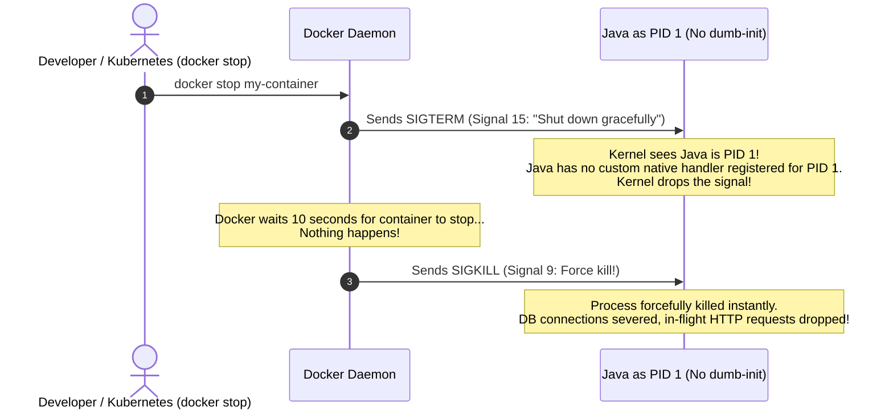
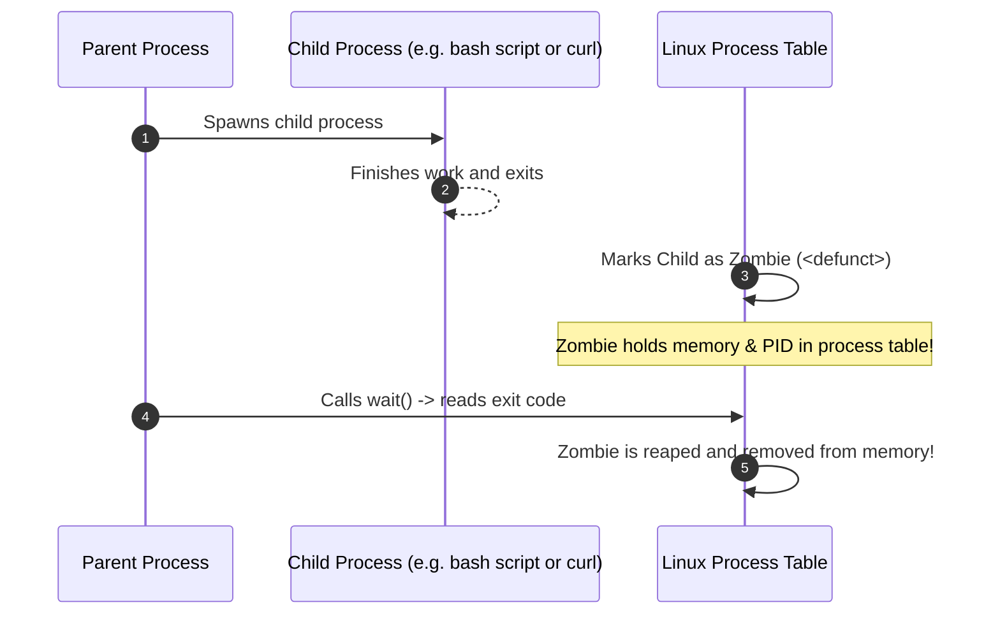
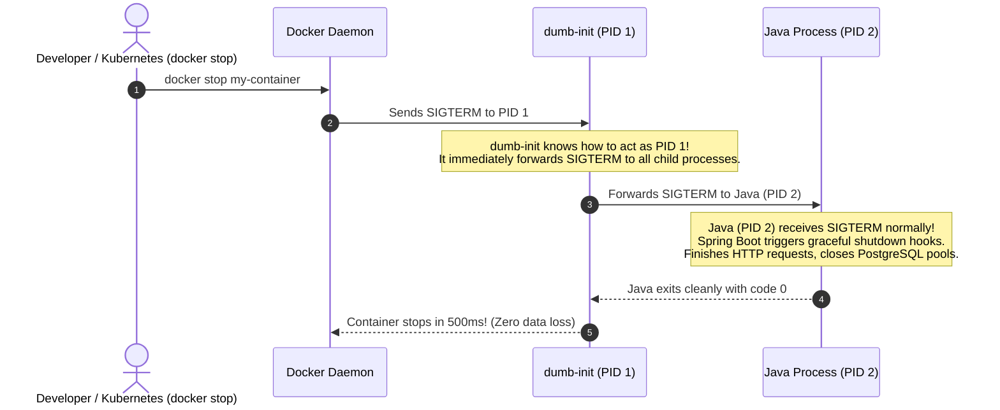

# Deep Dive: The Linux PID 1 Problem & Why We Use `dumb-init`

This guide explains what **Process ID 1 (PID 1)** is in Linux, why running Java directly as PID 1 inside Docker containers causes shutdown timeouts and zombie process leaks, and how `dumb-init` solves these issues.

---

## 1. What is Process ID 1 (PID 1) in Linux?

In every Linux operating system, every running program is assigned a unique number called a **PID (Process ID)**.

When Linux boots up, the kernel creates the very first user-space process and assigns it **PID 1**.
- On your Mac or a Linux server, PID 1 is the **init system** (such as `systemd` or `launchd`).
- Every other program on the computer is a child, grandchild, or descendant of PID 1, forming a tree of processes.

```
Linux Kernel
  └── PID 1 (init / systemd)
        ├── PID 24 (SSH daemon)
        ├── PID 55 (Cron daemon)
        └── PID 102 (Web Browser)
```

Because PID 1 is the "parent of all processes," the Linux kernel treats PID 1 completely differently from all other normal processes. PID 1 has **two unique OS responsibilities**:
1. **Handling Signals** (`SIGTERM`, `SIGINT`, etc.)
2. **Reaping "Zombie" Processes**

---

## 2. Problem #1: The Kernel Ignores Signals Sent to PID 1

When you want to stop a normal process in Linux, you send it a signal like `SIGTERM` (Signal 15, meaning *"please shut down gracefully"*).

* **For Normal Processes (PID 2, 3, 100...):**  
  If the process hasn't written special code to catch `SIGTERM`, the Linux kernel applies the **default action: kill the process immediately**.
* **For PID 1 (Special Kernel Rule):**  
  The Linux kernel protects PID 1 from accidental crashes. **The kernel will NOT apply default signal actions to PID 1.** If PID 1 does not explicitly register a custom handler for a signal, **the kernel quietly ignores the signal!**

### What Happens When You Run `docker stop` on a Container:



1. You run `docker stop` (or Kubernetes terminates a pod).
2. Docker sends a `SIGTERM` signal to PID 1 inside the container.
3. Because Java is running as PID 1 and does not have specialized Linux init signal handlers registered with the kernel, **the kernel drops the signal**.
4. Java never knows it was asked to stop! It keeps running.
5. Docker waits 10 seconds (the default timeout).
6. Docker gives up and sends **`SIGKILL` (Signal 9)**.
7. **The Disaster:** `SIGKILL` forcibly kills the Java process on the spot. Spring Boot never gets to run its graceful shutdown hooks:
   - In-flight HTTP requests from active users are abruptly cut off.
   - Database connection pools are not closed cleanly, leaving orphan connections open in PostgreSQL.
   - File writes or pending background tasks are corrupted.

---

## 3. Problem #2: Zombie Process Accumulation

What is a **Zombie Process**?

In Linux, when a child process finishes executing, it doesn't immediately vanish from the system. It enters the **"zombie"** state (`<defunct>`). It stays in the operating system's process table until its parent process calls the `wait()` or `waitpid()` system call to read its exit code.



### The "Orphan" Problem:
What happens if the parent process crashes or terminates *before* its child process finishes?
- The child process becomes an **orphan**.
- The Linux kernel automatically reparents the orphan process to **PID 1**.
- **It is PID 1's job to call `wait()` and "reap" the orphan when it dies.**

### Why Java Fails as PID 1:
The Java Virtual Machine (JVM) was never designed to be an operating system init process! It does not monitor the system process table or reap orphan zombie processes.
- Over time, zombie processes accumulate inside the container.
- Eventually, the container exhausts the operating system's PID table limit, causing the container to freeze and crash with `fork: cannot allocate memory`.

---

## 4. The Solution: What is `dumb-init`?

`dumb-init` is a lightweight, 20-kilobyte C binary created by engineers at Yelp specifically to solve the PID 1 problem in containers.

In our [`Dockerfile`](file:///Users/atifanowar/Workspace/interview/crud-kotlin-service/Dockerfile), we set:
```dockerfile
ENTRYPOINT ["dumb-init", "--", "java", "-jar", "/app/app.jar"]
```

### How `dumb-init` Solves Both Problems:



1. **Proper Signal Forwarding:**
   - `dumb-init` runs as **PID 1**.
   - `java` runs as a regular child process (**PID 2**).
   - When Docker sends `SIGTERM`, `dumb-init` intercepts it and immediately proxies the signal to Java.
   - Because Java is running as a normal process (PID 2), the JVM receives `SIGTERM` as expected.
   - Spring Boot intercepts the signal, completes all in-flight HTTP requests, closes the HikariCP database pool, and exits cleanly within milliseconds—**no 10-second hang and no `SIGKILL`**.
2. **Automatic Zombie Reaping:**
   - `dumb-init` listens for `SIGCHLD` signals. Whenever an orphaned process dies, `dumb-init` calls `waitpid()` and cleans it out of the process table, preventing memory and PID exhaustion.

---

## 5. Comparison: Java as PID 1 vs. `dumb-init` as PID 1

| Behavior | Without `dumb-init` (Java as PID 1) | With `dumb-init` (`dumb-init` as PID 1) |
| :--- | :--- | :--- |
| **`docker stop` Speed** | Hangs for **10 seconds** every time | Stops in **< 1 second** |
| **Shutdown Type** | **Unclean** (`SIGKILL` force termination) | **Graceful** (`SIGTERM` Spring shutdown hooks) |
| **In-Flight Requests** | Abruptly severed (Users get 502 errors) | Allowed to complete cleanly |
| **Database Connections** | Abandoned in PostgreSQL | Closed gracefully via HikariCP |
| **Zombie Processes** | Accumulate until PID exhaustion | Automatically reaped from memory |
| **Binary Overhead** | 0 KB | ~20 KB (negligible) |

---

## 6. How Other Languages (Like Go) Handle Signals vs. Java

A common question is: *"Why does Go seem to handle containers so easily, while Java needs `dumb-init`?"*

### 1. Go Compiles Directly to Native Machine Code
- **Go (Golang):** Compiles directly to native Linux ELF binary code with zero intermediate layer. It speaks directly to the Linux kernel via native system calls (`SYS_RT_SIGACTION`).
- In Go, signal handling is a direct language primitive via channels:
  ```go
  // In Go:
  sigChan := make(chan os.Signal, 1)
  signal.Notify(sigChan, syscall.SIGTERM, syscall.SIGINT)
  <-sigChan // Instantly unblocks when SIGTERM arrives!
  ```
- The Go runtime sets up the kernel signal table directly. When `SIGTERM` arrives, the Linux kernel interrupts and the Go runtime immediately writes to the channel.

### 2. The JVM is an Abstraction Layer
- **Java / Kotlin:** Runs inside a Virtual Machine written in C++.
- When the Linux kernel fires `SIGTERM` at the JVM, the JVM's native C++ code (`os_linux.cpp`) intercepts it. However, the C++ code cannot directly execute your Kotlin code inside the kernel interrupt handler!
- The JVM must queue the signal, wake up a dedicated JVM thread called the **`Signal Dispatcher`**, allocate Java thread objects, and schedule your Spring Boot shutdown hooks.
- If the JVM is still initializing or under heavy GC/IO load, or if it is running as PID 1 without explicit custom OS-level handlers registered for that PID, the kernel or JVM can drop or delay the signal.

### 3. But What About Zombie Processes in Go?
Even Go is **not immune to the Zombie Process problem**!
- If a Go web application executes external shell commands or child processes (`exec.Command("curl", ...)`), and those processes spawn children and die, the orphans are reparented to PID 1.
- Unless the Go developer explicitly wrote a loop using `syscall.Wait4(-1, ...)` to act as a process reaper, **a Go container will ALSO leak zombie processes!**
- That is why Docker itself added the `--init` flag (which injects `tini`, a sibling of `dumb-init`) to handle PID 1 for containers regardless of what programming language is used.

---

## 7. The Core Paradox: If Java Can Handle SIGTERM from `dumb-init`, Why Not Directly from the Kernel?

This is the most common doubt engineers have:

> *"Wait! When `dumb-init` forwards `SIGTERM` to Java, it's still using the Linux kernel to send the signal. If Java can handle `SIGTERM` from `dumb-init`, why couldn't Java handle it directly from the kernel in the first place?"*

The answer lies in **how the Linux kernel treats the recipient Process ID (PID)** and the **3 hidden traps of running without an init process**:

---

### Trap 1: The Linux Kernel's Special Rule for PID 1 vs. Non-PID 1

In Linux kernel source code (`kernel/signal.c`):
- **When the signal is sent to PID 2 (Java running under `dumb-init`):**  
  The kernel treats Java as a **regular process**. The kernel checks: *"Is PID 2 alive?"* -> Yes. The kernel immediately interrupts Java and delivers the signal.
- **When the signal is sent to PID 1 (Java running alone):**  
  The kernel treats Java as the **operating system's master init process**. The kernel applies a special safety check:  
  *Is PID 1 currently blocking signals? Is PID 1 still bootstrapping? Does PID 1 have a handler actively wired right this microsecond?*  
  If the JVM is in the middle of a Garbage Collection (GC) safepoint, thread context switch, or class loading, **the kernel drops the signal entirely** to protect "the operating system" from crashing.

---

### Trap 2: The Shell Wrapping Trap (Why 90% of Dockerfiles Fail)

In real-world projects, developers rarely run `java` directly. They often write:
```dockerfile
CMD java -jar /app/app.jar        # ❌ Shell Form (Missing square brackets!)
# OR
ENTRYPOINT /app/run.sh            # ❌ Shell script entrypoint
```

When you write commands without JSON array syntax `["..."]`, Docker executes them via a shell:
```
/bin/sh -c "java -jar /app/app.jar"
```

Look at what the process tree becomes:
```
PID 1: /bin/sh        <-- The shell is PID 1!
  └── PID 2: java     <-- Java is PID 2!
```

1. You run `docker stop`. Docker sends `SIGTERM` to **PID 1 (`/bin/sh`)**.
2. **`/bin/sh` does NOT forward signals to child processes!** It completely swallows `SIGTERM` and does nothing.
3. Java (PID 2) **never receives any signal at all**!
4. After 10 seconds, Docker forcefully kills the container with `SIGKILL`.

**How `dumb-init` fixes this:**  
`dumb-init` is placed explicitly as PID 1 (`ENTRYPOINT ["dumb-init", "--", ...]`). It guarantees that whatever is running underneath it **will receive the forwarded signal**.

---

### Trap 3: Process Group Broadcast (`kill` vs. `killpg`)

When Docker sends `SIGTERM`, it sends it to **one single process: PID 1**.
- If your application has spawned any helper processes, background workers, or child threads, Docker's signal will **never reach them**.

When `dumb-init` receives `SIGTERM`, look at what it does in its C source code:
```c
kill(-child_pid, signum); // Notice the minus sign: -child_pid!
```
In Linux C programming, passing a **negative PID** (`-PID`) to `kill()` means:  
**Broadcast this signal to the ENTIRE PROCESS GROUP!**
- `dumb-init` doesn't just poke Java; it broadcasts `SIGTERM` simultaneously to Java and **every single child process and helper thread** that was ever spawned. Everything terminates cleanly and synchronously.

---

### Trap 4: Even If Modern Java 21 Catches `SIGTERM`, It STILL Cannot Reap Zombies!

In modern OpenJDK (Java 17/21), if you use strict JSON syntax (`ENTRYPOINT ["java", "-jar", "..."]`), Java can catch `SIGTERM` directly in simple scenarios.

**However, Java still CANNOT act as an operating system zombie reaper!**
- If your application (or a third-party library, APM agent like Datadog/NewRelic, or AWS SDK) invokes a shell script, `curl`, or sub-process that crashes, that dead child becomes a **Zombie Process** (`<defunct>`).
- Java has no code to call `waitpid(-1)` for arbitrary OS orphans.
- **The zombie processes will permanently stay in the Linux kernel table**, eventually exhausting the container's PID limits.

---

## 8. Summary: What `dumb-init` Gives You That Java Cannot

```
Without dumb-init:
Docker (SIGTERM) ──> [Linux Kernel] ──> PID 1 (Java / sh) ──> Signal dropped or swallowed!
                                                          └── Zombies accumulate forever!

With dumb-init:
Docker (SIGTERM) ──> [Linux Kernel] ──> PID 1 (dumb-init) ──> Broadcasts to entire process group!
                                                          └── Reaps all dead zombie orphans!
```

---

## 9. 60-Second Verbal Script (PREP Framework)

Use this script during technical interviews when asked: *"Why does Java handle SIGTERM from dumb-init, but fails when running directly as PID 1?"*

> **Point:**  
> Java can handle `SIGTERM` from `dumb-init` because `dumb-init` runs Java as a normal process (PID 2) and broadcasts signals to the entire process group, bypassing the Linux kernel's restrictive PID 1 filtering.
>
> **Reason:**  
> The Linux kernel applies special protection to PID 1, dropping signals if the process is not actively ready to receive them. Furthermore, in many Dockerfiles, shell wrapping traps signals at `/bin/sh`, preventing Java from ever seeing them. Finally, even when modern Java receives `SIGTERM`, it lacks the POSIX capabilities to reap orphaned zombie processes.
>
> **Example:**  
> In our container, `ENTRYPOINT ["dumb-init", "--", "java", "-jar", "/app/app.jar"]` places `dumb-init` at PID 1. When `docker stop` fires, `dumb-init` uses `kill(-child_pid, SIGTERM)` to broadcast the signal to Java and all child threads, triggering Spring Boot's graceful shutdown hooks immediately. Concurrently, `dumb-init` runs a background `waitpid()` loop that reaps dead subprocesses, preventing memory and PID exhaustion.
>
> **Point (Restated):**  
> `dumb-init` ensures reliable signal delivery across process groups and provides essential OS zombie reaping that the JVM was never built to perform.
