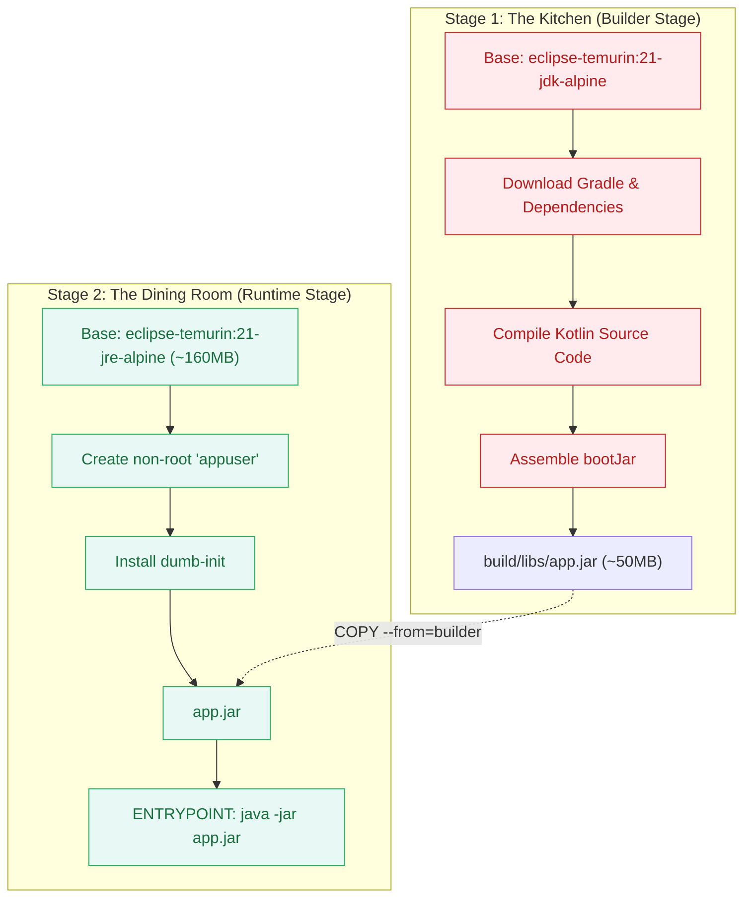

# Deep Dive: Why Multi-Stage Docker Builds?

This document provides a comprehensive technical breakdown of **Multi-Stage Docker Builds**, contrasting them with legacy single-stage Dockerfiles, and detailing the security, size, and caching benefits for enterprise Spring Boot microservices.

---

## 1. The Problem: The Legacy Single-Stage Anti-Patterns

To run a Kotlin Spring Boot service, you need two fundamental steps:
1. **The Build Step:** Use the Kotlin compiler (`kotlinc`), Java JDK, and Gradle to compile source code into an executable fat JAR (`app.jar`).
2. **The Run Step:** Launch a Java Virtual Machine (`java -jar app.jar`) to serve web requests.

Before Docker introduced multi-stage builds (Docker 17.05+), a `Dockerfile` could only have **one single `FROM` line**. This forced engineering teams to choose between two fundamentally flawed approaches:

---

### Anti-Pattern A: "Compile on the Developer's Laptop, Then Copy the JAR"

In this approach, compilation happens on the developer's local machine or CI runner:

```bash
# Developer manually runs this on their Mac/Windows laptop:
./gradlew bootJar
```

Then, the single-stage `Dockerfile` simply copies the pre-built JAR:

```dockerfile
# ❌ Anti-Pattern A: Pre-compiled on host machine
FROM eclipse-temurin:21-jre-alpine

WORKDIR /app
COPY build/libs/app.jar app.jar

ENTRYPOINT ["java", "-jar", "app.jar"]
```

#### Why Anti-Pattern A Failed in Real Production Environments:
1. **The "Works on My Machine" Nightmare:**
   - What if Developer Alice compiles using Java 21.0.3 on macOS, but Developer Bob compiles using Java 17 on Windows? Different team members produce different binary bytecode for the exact same source code!
2. **The Stale Build Human Error:**
   - A developer edits a Kotlin file, forgets to run `./gradlew bootJar`, and immediately runs `docker build`. Docker blindly copies yesterday's old `app.jar` from the `build/libs/` folder. The developer deploys outdated code to production without realizing it.
3. **CI/CD Host Server Pollution:**
   - Every GitHub Actions runner or Jenkins build agent must have the exact correct JDK version, Gradle version, and environment variables pre-installed on the host operating system. Upgrading from Java 21 to Java 22 requires updating dozens of physical build servers.

---

### Anti-Pattern B: "Compile Inside Docker Using a Single Container"

To fix Anti-Pattern A, developers thought: *"Let's never compile on laptops! Let's put the full compiler and Gradle inside the Dockerfile so Docker handles the entire build!"*

```dockerfile
# ❌ Anti-Pattern B: Compiling inside a single monolithic image
FROM eclipse-temurin:21-jdk-alpine

WORKDIR /app

# Copy EVERYTHING (source code, git history, gradle configs) into the container
COPY . .

# Compile the code inside the container
RUN ./gradlew bootJar

# Run the application
ENTRYPOINT ["java", "-jar", "build/libs/app.jar"]
```

#### Why Anti-Pattern B Failed in Real Production Environments:
1. **Massive Image Bloat (~1.2 GB to 1.5 GB!):**
   - The final container image that gets uploaded to AWS ECR or Docker Hub retains:
     - The full JDK (`javac`, C header files, debugging symbols: ~400MB).
     - The downloaded Gradle cache in `~/.gradle/caches/` (hundreds of megabytes of cached JARs).
     - Intermediate compilation artifacts in `build/classes/` and `build/tmp/`.
   - Deployments take minutes instead of seconds because Kubernetes has to download a massive 1.5GB image on every pod restart.
2. **Severe Security & Compliance Risk (Leaking Source Code):**
   - Because `COPY . .` copied the entire repository, your **raw Kotlin source code (`src/`)**, test files, and even your **`.git/` commit history** are baked directly into the production container image running on public clouds.
   - Anyone who inspects the container can read your proprietary source code, internal comments, and commit logs.
3. **Compiler in Production (Violating CIS Benchmarks):**
   - The production container contains `javac` (the compiler). If an attacker discovers a remote code execution vulnerability, having a compiler inside the container allows them to write and compile malicious exploit scripts in memory.

---

## 2. How Multi-Stage Builds Combine the Best of Both Worlds

Multi-stage builds eliminate this trade-off completely:
- **Stage 1 (Builder)** acts like **Anti-Pattern B**: It compiles inside Docker using a full JDK. You don't need Java installed on your host machine. Builds are 100% reproducible and automated.
- **Stage 2 (Runtime)** acts like **Anti-Pattern A**: It starts from a completely fresh, minimal JRE image (~160MB). It copies **ONLY** the finished `app.jar` from Stage 1.
- When Docker finishes, **everything from Stage 1 (the JDK, Gradle caches, raw source code, and .git history) is automatically thrown in the trash!**



> **The Kitchen Analogy:**  
> When you eat at a fine restaurant, you don't want cutting boards, dirty pots, onion peels, and raw meat scraps brought to your table.  
> - **Stage 1 (Builder)** is the **Kitchen**: messy, full of heavy knives (compilers), ingredients (source code), and preparation tools (Gradle).  
> - **Stage 2 (Runtime)** is the **Dining Room**: pristine, containing only the finished dish (`app.jar`) served to the customer. Everything from the kitchen is thrown away!

---

## 3. The 4 Major Pillars of Multi-Stage Builds

### 3.1 Security Hardening & Attack Surface Reduction
* **No Compilers in Production:** If an attacker exploits a remote code execution (RCE) flaw, having `javac` or `gcc` in the container lets them download source code and compile malware or rootkits directly in memory.
* **No Source Code or Git History:** Raw `.kt` source files, build scripts, and `.git` directories remain in the discarded builder stage. The production container only contains compiled `.class` bytecode inside `app.jar`.

### 3.2 Drastic Image Size Reduction
```
┌─────────────────────────────────────────────────────────┐
│ Single-Stage Build (JDK + Gradle + Cache + Source): ~1.2 GB│
└─────────────────────────────────────────────────────────┘
                           vs.
┌──────────────────────────────────────┐
│ Multi-Stage Build (JRE + JAR): ~210 MB│ (85% smaller!)
└──────────────────────────────────────┘
```
* **Faster CI/CD Deployments:** Pushing and pulling a 210MB image across AWS ECR or Docker Hub is up to 5x faster than a 1.2GB image, dramatically speeding up auto-scaling and Kubernetes rolling updates.
* **Lower Cloud Infrastructure Costs:** Reduces container registry storage costs and network bandwidth charges.

### 3.3 Hermetic & Reproducible Builds
* **Zero Host Tool Dependencies:** The only prerequisite on any machine (a developer's Mac, a Linux server, or a GitHub Actions runner) is **Docker**.
* The exact JDK version (Java 21) and Gradle toolchain run inside the isolated builder container, eliminating any possibility of "it compiles on my laptop but fails on CI".

### 3.4 Docker Layer Caching for Lightning-Fast Rebuilds
In our [`Dockerfile`](file:///Users/atifanowar/Workspace/interview/crud-kotlin-service/Dockerfile), steps are ordered strategically to maximize Docker's layer cache:

```dockerfile
# Step 1: Copy ONLY dependency declarations
COPY gradlew ./
COPY gradle/ gradle/
COPY settings.gradle.kts build.gradle.kts ./

# Step 2: Download dependencies (CACHED LAYER)
RUN ./gradlew dependencies --no-daemon || true

# Step 3: Copy source code (FREQUENTLY CHANGED)
COPY src/ src/
RUN ./gradlew bootJar --no-daemon -x test
```

* **How Caching Works:**  
  Docker checks if `build.gradle.kts` has changed. If it hasn't, Docker **reuses the cached layer** from Step 2.
* When you edit a Kotlin controller or service, Docker skips downloading dependencies and immediately starts compilation at Step 3, cutting rebuild times from minutes to seconds!

---

## 4. Single-Stage vs. Multi-Stage Comparison Table

| Feature | Single-Stage Container | Multi-Stage Container *(Our Architecture)* |
| :--- | :--- | :--- |
| **Final Image Size** | 1.0 GB – 1.5 GB | **~210 MB** |
| **Contains Compiler (`javac`)** | Yes (High security risk) | **No (Secure)** |
| **Contains Source Code** | Yes | **No (Bytecode only)** |
| **Host Tool Requirements** | Either full host SDK or huge container | **Docker only (Hermetic)** |
| **Registry Push/Pull Speed** | Slow | **Blazing fast** |
| **Layer Caching** | Hard to optimize | **Dependencies cached separately from code** |

---

## 5. 60-Second Verbal Script (PREP Framework)

Use this script during technical interviews when asked: *"Why do you use a multi-stage Docker build for your microservices?"*

> **Point:**  
> We use a multi-stage Docker build to decouple the build environment from the runtime environment, producing a lightweight, secure, and reproducible production container.
>
> **Reason:**  
> A single-stage build forces you to choose between non-reproducible host builds or bloated production containers containing full JDKs, compilers, source code, and build caches. Multi-stage builds eliminate this trade-off by compiling inside an ephemeral builder stage and copying only the final executable JAR into a stripped-down JRE runtime.
>
> **Example:**  
> In our `Dockerfile`, Stage 1 uses `eclipse-temurin:21-jdk-alpine` to cache dependencies and package `app.jar`. Stage 2 then starts from a fresh `eclipse-temurin:21-jre-alpine` image, creating an unprivileged `appuser` and copying only the 50MB `app.jar`. This drops the final image size from over 1.2GB down to ~210MB and removes `javac` entirely to adhere to CIS security benchmarks.
>
> **Point (Restated):**  
> Ultimately, multi-stage builds guarantee 100% build reproducibility across all environments while delivering minimal, hardened container images for production.
