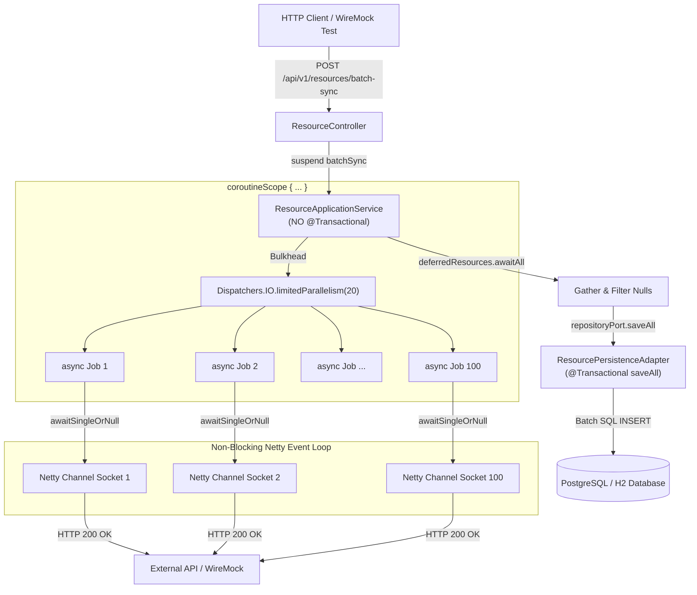

# Line-by-Line Deep Dive: 100-Call Batch Sync & Non-Blocking WebClient Bridge

This document provides a comprehensive, line-by-line architectural and JVM runtime breakdown of the two core functions powering the concurrent fan-out engine in `crud-kotlin-service`:
1. **[`ResourceApplicationService.batchSync`](file:///Users/atifanowar/Workspace/interview/crud-kotlin-service/src/main/kotlin/com/example/demo/application/service/ResourceApplicationService.kt#L85-L135)**: Coordinates the 100-call scatter-gather fan-out and batch database persistence.
2. **[`ExternalWebClientAdapter.fetchEnrichmentDataAsync`](file:///Users/atifanowar/Workspace/interview/crud-kotlin-service/src/main/kotlin/com/example/demo/infrastructure/adapter/out/client/ExternalWebClientAdapter.kt#L45-L69)**: Bridges Spring Reactive `WebClient` / Project Reactor `Mono` with Kotlin Coroutines.

---

## 1. High-Level Architecture Flow



---

## 2. Function 1: `batchSync` in `ResourceApplicationService.kt`

```kotlin
85:     @OptIn(kotlinx.coroutines.ExperimentalCoroutinesApi::class)
86:     override suspend fun batchSync(command: BatchSyncCommand): BatchSyncResult =
87:         coroutineScope {
88:             val startTime = System.currentTimeMillis()
89:             val targetIds =
90:                 command.referenceIds.ifEmpty {
91:                     (1..command.count).map { "${command.referencePrefix}-$it" }
92:                 }
93: 
94:             logger.info(
95:                 "Starting batch sync for {} external API calls with parallelism limit {}",
96:                 targetIds.size,
97:                 command.parallelism,
98:             )
99: 
100:            // Bulkhead pattern: throttle concurrent outbound calls
101:            val limitedDispatcher = Dispatchers.IO.limitedParallelism(command.parallelism)
102: 
103:            val deferredResources =
104:                targetIds.map { refId ->
105:                    async(limitedDispatcher) {
106:                        try {
107:                            val enrichment = externalClientPort.fetchEnrichmentDataAsync(refId)
108:                            Resource(
109:                                name = "Resource for $refId",
110:                                description = "Batch synced resource for external reference $refId",
111:                                status = ResourceStatus.ACTIVE,
112:                                externalEnrichmentData = enrichment,
113:                            )
114:                        } catch (ex: Exception) {
115:                            logger.error("Failed to fetch enrichment for refId='{}'", refId, ex)
116:                            null
117:                        }
118:                    }
119:                }
120: 
121:            val resourcesToSave = deferredResources.awaitAll().filterNotNull()
122: 
123:            logger.info("External calls completed. Saving {} entities to database...", resourcesToSave.size)
124:            val savedResources = repositoryPort.saveAll(resourcesToSave)
125: 
126:            val durationMs = System.currentTimeMillis() - startTime
127:            logger.info("Batch sync finished in {}ms. Saved {} entities.", durationMs, savedResources.size)
128: 
129:            BatchSyncResult(
130:                totalRequested = targetIds.size,
131:                totalPersisted = savedResources.size,
132:                durationMs = durationMs,
133:                resources = savedResources,
134:            )
135:        }
```

### Line-by-Line Breakdown:

| Line(s) | Code Snippet | What It Does & Why It Is Designed This Way |
| :--- | :--- | :--- |
| **85** | `@OptIn(kotlinx.coroutines.ExperimentalCoroutinesApi::class)` | **Compiler Opt-In:** `Dispatchers.IO.limitedParallelism(...)` is currently marked as an experimental API in `kotlinx-coroutines`. This annotation instructs the Kotlin compiler to allow its usage without emitting compile-time warnings. |
| **86** | `override suspend fun batchSync(command: BatchSyncCommand): BatchSyncResult =` | **Inbound Port Implementation:** Implements `BatchSyncResourcesUseCase`. Marked with `suspend` so it compiles to Continuation Passing Style (CPS). <br><br>**Architectural Decision (No `@Transactional`):** `batchSync` is deliberately **NOT** annotated with `@Transactional`. If annotated, Spring's transaction interceptor would lease a physical database connection from HikariCP immediately and hold it for the entire duration of 100 network calls. Running the network calls outside any transaction protects the Hikari pool. |
| **87** | `coroutineScope {` | **Structured Concurrency Root:** Creates a child coroutine scope attached to the caller's context. It guarantees that `batchSync` will not return until all 100 child coroutines have completed. If any unhandled fatal error or cancellation occurs, all sibling coroutines are cancelled automatically, preventing orphaned background threads. |
| **88** | `val startTime = System.currentTimeMillis()` | **Latency Tracking:** Captures the initial millisecond timestamp to measure the total end-to-end wall-clock latency of the batch operation. |
| **89–92** | `val targetIds = command.referenceIds.ifEmpty { (1..command.count).map { ... } }` | **Dynamic Target List:** If the caller passed an explicit list of reference IDs, it uses them; otherwise, it generates a sequence of 100 items (`"ref-1"` through `"ref-100"`). |
| **94–98** | `logger.info("Starting batch sync for {} external API calls...", ...)` | **Structured Observability:** Emits structured logs showing total items to sync and the active parallelism ceiling. |
| **101** | `val limitedDispatcher = Dispatchers.IO.limitedParallelism(command.parallelism)` | **The Bulkhead Pattern:** Creates a constrained execution view on `Dispatchers.IO`. Even though 100 coroutines are scheduled, **at most `command.parallelism` (e.g., 20) threads are ever used concurrently**. The remaining 80 coroutines wait in an in-memory queue as suspended continuations without allocating native OS threads, protecting downstream systems from socket exhaustion. |
| **103–104** | `val deferredResources = targetIds.map { refId ->` | **Scatter Iteration:** Loops over all 100 target IDs, returning a list of 100 `Deferred<Resource?>` handles. |
| **105** | `async(limitedDispatcher) {` | **Scatter Fan-Out:** Spawns a child coroutine on `limitedDispatcher`. Because `async` returns immediately with a `Deferred` handle, all 100 jobs are scheduled concurrently in under a millisecond. |
| **106** | `try {` | **Fault Isolation:** Granular error boundary per item. Ensures that if external call #42 fails, it does not crash or abort items #1–#41 or #43–#100. |
| **107** | `val enrichment = externalClientPort.fetchEnrichmentDataAsync(refId)` | **Non-Blocking Network Call:** Calls the outbound adapter. Suspends the coroutine while Netty waits for bytes over the TCP socket, freeing the worker thread to process other tasks. |
| **108–113** | `Resource(name = "Resource for $refId", ...)` | **Domain Entity Construction:** Constructs the pure domain entity [`Resource`](file:///Users/atifanowar/Workspace/interview/crud-kotlin-service/src/main/kotlin/com/example/demo/domain/model/Resource.kt), validating invariants (non-blank name) and populating the retrieved enrichment payload with status `ACTIVE`. |
| **114–117** | `} catch (ex: Exception) { logger.error(...); null }` | **Resilience Fallback:** If an individual item fails (network timeout, 500 error), it logs the failure and yields `null`, preserving the remaining 99 items. |
| **121** | `val resourcesToSave = deferredResources.awaitAll().filterNotNull()` | **Gather Phase:** Suspends `batchSync` until all 100 `Deferred` jobs finish. `awaitAll()` collects their results into a `List<Resource?>`, and `.filterNotNull()` strips out any failed items. |
| **123** | `logger.info("External calls completed. Saving {} entities...", ...)` | **Audit Logging:** Logs the number of valid items retrieved and ready for database insertion. |
| **124** | `val savedResources = repositoryPort.saveAll(resourcesToSave)` | **Lease-on-Demand Transaction:** Hands the entities to [`ResourcePersistenceAdapter.saveAll()`](file:///Users/atifanowar/Workspace/interview/crud-kotlin-service/src/main/kotlin/com/example/demo/infrastructure/adapter/out/persistence/ResourcePersistenceAdapter.kt#L19-L23), which delegates to Spring Data JPA's `saveAll()`. Spring Data JPA automatically opens a short-lived `@Transactional` boundary, executes a batch SQL `INSERT`, commits, and immediately releases the connection back to HikariCP. |
| **126–127** | `val durationMs = ...; logger.info(...)` | **Throughput Telemetry:** Calculates total elapsed time and logs completion metrics. |
| **129–134** | `BatchSyncResult(totalRequested = ..., totalPersisted = ..., ...)` | **Result Envelope:** Constructs and returns the domain result with summary counters and the list of persisted resources. |
| **135** | `}` | **Scope Finalization:** Closes the `coroutineScope`. |

---

## 3. Function 2: `fetchEnrichmentDataAsync` in `ExternalWebClientAdapter.kt`

```kotlin
45:     override suspend fun fetchEnrichmentDataAsync(referenceId: String): String {
46:         logger.debug("Calling external API async to fetch enrichment data for referenceId='{}'", referenceId)
47: 
48:         return try {
49:             val response =
50:                 externalApiWebClient
51:                     .get()
52:                     .uri("/api/v1/enrichment/{referenceId}", referenceId)
53:                     .retrieve()
54:                     .onStatus(HttpStatusCode::isError) { clientResponse ->
55:                         logger.error("External API returned error status: {}", clientResponse.statusCode())
56:                         clientResponse.createException()
57:                     }.bodyToMono(ExternalApiResponse::class.java)
58:                     .timeout(Duration.ofSeconds(5))
59:                     .awaitSingleOrNull()
60: 
61:             processEnrichmentResponse(response, referenceId)
62:         } catch (ex: WebClientResponseException) {
63:             logger.error("External client HTTP error: status={}, body={}", ex.statusCode, ex.responseBodyAsString, ex)
64:             "source=external-api;referenceId=$referenceId;status=UNAVAILABLE;details=${ex.statusCode}"
65:         } catch (ex: Exception) {
66:             logger.error("Failed to fetch enrichment data from external client for referenceId='{}'", referenceId, ex)
67:             "source=external-api;referenceId=$referenceId;status=FAILED;details=${ex.message}"
68:         }
69:     }
```

### Line-by-Line Breakdown:

| Line(s) | Code Snippet | What It Does & Why It Is Designed This Way |
| :--- | :--- | :--- |
| **45** | `override suspend fun fetchEnrichmentDataAsync(referenceId: String): String {` | **Non-Blocking Outbound Port:** Implements `ExternalClientPort`. Marked with `suspend` to avoid blocking operating system threads during outbound network I/O. |
| **46** | `logger.debug("Calling external API async...", referenceId)` | **Traceability:** Emits debug logs with `referenceId` for distributed tracing and debugging. |
| **48** | `return try {` | **Guard Clause:** Encapsulates network operations, timeouts, and JSON parsing in a resilient try-catch block. |
| **50** | `externalApiWebClient` | **Pre-Configured Client:** Injected Spring `WebClient` bean configured with base URL, Netty event loops, connect/read timeouts, and default authorization headers. |
| **51** | `.get()` | **HTTP Verb:** Sets the HTTP method to `GET`. |
| **52** | `.uri("/api/v1/enrichment/{referenceId}", referenceId)` | **URI Templating:** Safely interpolates `referenceId` into the path template with automatic URL-encoding. |
| **53** | `.retrieve()` | **Reactive Execution:** Sends the HTTP request via Netty and provides access to response status and body decoding streams. |
| **54–56** | `.onStatus(HttpStatusCode::isError) { clientResponse -> ... }` | **Error Status Interceptor:** Catches 4xx and 5xx HTTP statuses. Instead of letting Jackson fail when trying to decode an error payload into `ExternalApiResponse`, it logs the status code and transforms the response into a `WebClientResponseException`. |
| **57** | `.bodyToMono(ExternalApiResponse::class.java)` | **Asynchronous JSON Streaming:** Jackson decodes the incoming Netty byte buffers into a typed `ExternalApiResponse` instance wrapped in a Project Reactor `Mono`. |
| **58** | `.timeout(Duration.ofSeconds(5))` | **SLA & Circuit Breaker:** Imposes a strict 5-second deadline. If the downstream service fails to return bytes within 5 seconds, Reactor emits a `TimeoutException`, preventing connection pool starvation. |
| **59** | `.awaitSingleOrNull()` | **The Coroutine-to-Reactor Bridge:** Extension function from `kotlinx.coroutines.reactor`. It subscribes to the `Mono`, **suspends** the coroutine, and registers a callback on Netty. The calling thread is immediately freed. When Netty finishes receiving the response, it resumes the coroutine with the parsed object (or `null` if the body was empty). **Zero OS threads are blocked while waiting.** |
| **61** | `processEnrichmentResponse(response, referenceId)` | **Domain Normalization:** Normalizes third-party data into a canonical format (calculates risk levels `HIGH`/`MEDIUM`/`LOW`, capitalizes category casing, and formats tag lists). |
| **62–64** | `} catch (ex: WebClientResponseException) { ... }` | **HTTP Error Handling:** Catches explicit HTTP errors (404 Not Found, 503 Unavailable, 429 Rate Limited). Returns a structured fallback string (e.g. `"status=UNAVAILABLE;details=503"`). |
| **65–68** | `} catch (ex: Exception) { ... }` | **Transport Error Handling:** Catches transport-level failures (connection timeouts, connection resets, DNS failures). Returns `"status=FAILED"`. |
| **69** | `}` | **Function Closing.** |

---

## 4. Senior Engineering Interview Trade-Offs

### Q1: *"Why did you avoid placing `@Transactional` on `batchSync`?"*
> **Answer:**  
> "In Spring, `@Transactional` binds a physical database connection from the HikariCP pool to the current thread.  
> If `batchSync` were annotated with `@Transactional`, the service would acquire a database connection before launching the 100 network calls and hold it for the entire duration of the network I/O. With a pool size of 10 connections, just 10 concurrent users running batch sync would completely starve the database pool for the rest of the application.  
> By keeping network calls outside of any transaction and calling `repositoryPort.saveAll()` at the very end, the database connection is only held for the ~10ms required to execute the batch `INSERT` statement."

---

### Q2: *"Why did you use `Dispatchers.IO.limitedParallelism(20)` instead of unbounded coroutines?"*
> **Answer:**  
> "Unbounded coroutines (`Dispatchers.IO` without limits) would attempt to open 100 TCP sockets simultaneously. In high-traffic scenarios or during traffic spikes, this creates socket churn, exhausts local ephemeral ports, and DDoSes the downstream microservice.  
> By applying the Bulkhead pattern via `Dispatchers.IO.limitedParallelism(20)`, we enforce a hard ceiling of 20 concurrent connections. The remaining 80 coroutines stay suspended in memory at virtually zero overhead, creating a natural backpressure valve."

---

### Q3: *"Why did you use `awaitSingleOrNull()` instead of `.block()` inside `fetchEnrichmentDataAsync`?"*
> **Answer:**  
> "Calling `.block()` on a Project Reactor `Mono` parks the underlying OS thread. In a batch of 100 calls, you would need up to 100 active OS threads, each requiring 1MB of stack memory and causing CPU context switching in the kernel.  
> In contrast, `awaitSingleOrNull()` suspends the coroutine at the bytecode level via Continuation Passing Style (CPS). The worker thread is immediately returned to the dispatcher pool. Netty handles the network I/O via its epoll/kqueue event loop, and when the HTTP response arrives, Netty resumes the continuation. This allows 100 concurrent HTTP requests to be handled over just 1 or 2 threads."
