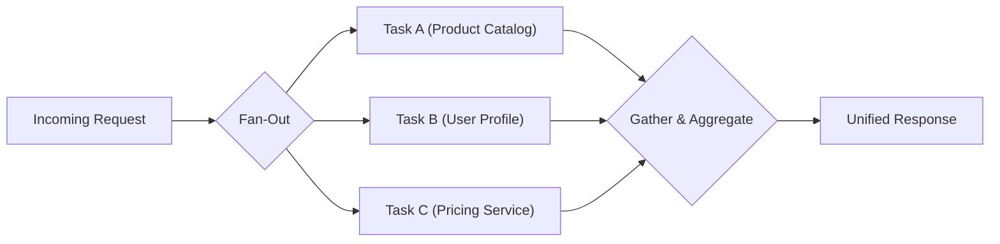
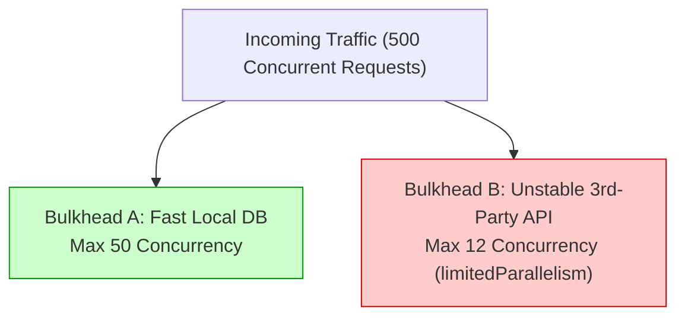
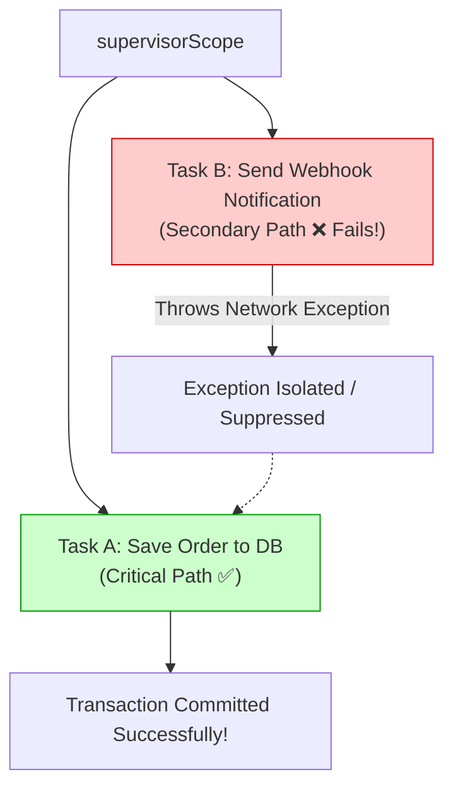
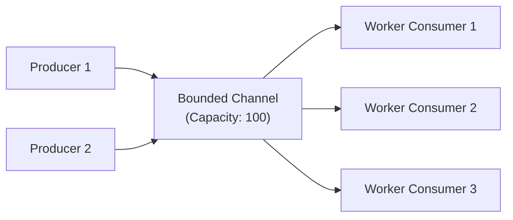

# Concurrency Patterns in Modern Backend Engineering (Kotlin & Java 21)

Concurrency is one of the most critical topics in distributed systems, high-throughput microservices, and senior engineering technical interviews. 

Understanding concurrency requires moving beyond raw threads and synchronization locks to master **architectural concurrency patterns**—how tasks are scheduled, isolated, throttled, coordinated, and recovered from failure.

This guide provides a comprehensive encyclopedia of concurrency patterns used in modern Kotlin, Java 21, and Spring Boot architectures, complete with diagrams, production code snippets, and interview defense scripts.

---

## Table of Contents
1. [Foundational Mental Model: Concurrency vs. Parallelism](#1-foundational-mental-model-concurrency-vs-parallelism)
2. [The 4 Execution & Threading Models](#2-the-4-execution--threading-models)
   - [Model 1: Thread-per-Request (Classic Servlet / Tomcat)](#model-1-thread-per-request-classic-servlet--tomcat)
   - [Model 2: EventLoop Non-Blocking (Netty / WebFlux)](#model-2-eventloop-non-blocking-netty--webflux)
   - [Model 3: Structured Concurrency & Coroutines (Kotlin)](#model-3-structured-concurrency--coroutines-kotlin)
   - [Model 4: Virtual Threads (Java 21 Project Loom)](#model-4-virtual-threads-java-21-project-loom)
3. [Kotlin Coroutines vs. Java 21 Virtual Threads (Deep Dive)](#3-kotlin-coroutines-vs-java-21-virtual-threads-deep-dive)
4. [Master Pattern Catalog](#4-master-pattern-catalog)
   - [Pattern 1: Scatter-Gather (Parallel Fan-Out & Aggregation)](#pattern-1-scatter-gather-parallel-fan-out--aggregation)
   - [Pattern 2: The Bulkhead Pattern (Bounded Concurrency & Throttling)](#pattern-2-the-bulkhead-pattern-bounded-concurrency--throttling)
   - [Pattern 3: Supervisor & Failure-Domain Isolation](#pattern-3-supervisor--failure-domain-isolation)
   - [Pattern 4: Producer-Consumer Pipeline (Channels & Flow)](#pattern-4-producer-consumer-pipeline-channels--flow)
   - [Pattern 5: Non-Blocking Retry with Exponential Backoff & Jitter](#pattern-5-non-blocking-retry-with-exponential-backoff--jitter)
   - [Pattern 6: Non-Blocking Critical Section (`Mutex.withLock`)](#pattern-6-non-blocking-critical-section-mutexwithlock)
   - [Pattern 7: Thread Confinement Pattern](#pattern-7-thread-confinement-pattern)
   - [Pattern 8: Work-Stealing Pattern](#pattern-8-work-stealing-pattern)
   - [Pattern 9: Database Concurrency: Optimistic vs. Pessimistic Locking](#pattern-9-database-concurrency-optimistic-vs-pessimistic-locking)
5. [The Thread Pinning Trap (`synchronized` inside Coroutines/Loom)](#5-the-thread-pinning-trap-synchronized-inside-coroutinesloom)
6. [Pattern Comparison Matrix](#6-pattern-comparison-matrix)
7. [60-Second Interview PREP Scripts](#7-60-second-interview-prep-scripts)

---

## 1. Foundational Mental Model: Concurrency vs. Parallelism

Rob Pike (co-creator of Go) famously stated:
> *"Concurrency is about **dealing** with lots of things at once. Parallelism is about **doing** lots of things at once."*

```
Concurrency (Structure):
Task A ──► [Run] ──► [Wait I/O] ──────────► [Run]
Task B ──────────────► [Run] ──► [Wait I/O] ──► [Run]  (Multiplexed on 1 Core)

Parallelism (Hardware Execution):
Core 1: Task A ──► [Running on Core 1 simultaneously]
Core 2: Task B ──► [Running on Core 2 simultaneously]
```

- **Concurrency** is an architectural composition: structuring an application as independent executing computations (I/O multiplexing, coroutines, event handling).
- **Parallelism** is a physical execution property: running computations simultaneously on separate CPU hardware execution units.
- **I/O-Bound Workloads:** Benefit heavily from concurrency (threads/coroutines suspend while waiting for network or database I/O, allowing CPU cores to serve other requests).
- **CPU-Bound Workloads:** Benefit strictly from parallelism bounded by physical CPU cores (`Runtime.getRuntime().availableProcessors()`).

---

## 2. The 4 Execution & Threading Models

| Feature | Model 1: Thread-per-Request | Model 2: EventLoop (Netty) | Model 3: Coroutines (Kotlin) | Model 4: Virtual Threads (Loom) |
| :--- | :--- | :--- | :--- | :--- |
| **Primary Framework** | Spring MVC / Tomcat | Spring WebFlux / Node.js | Kotlin + Spring Boot | Spring Boot 3.2+ / Java 21 |
| **Stack Allocation** | ~1 MB (Native OS Stack) | ~8 KB per event handler | **~250 bytes (Heap Object)** | **~200-500 bytes (Heap Object)** |
| **Max Concurrent Tasks**| Hundreds (~200–500) | Tens of thousands | **Hundreds of thousands** | **Millions** |
| **Context Switch Cost**| Heavy (Kernel Syscall) | None (Single/Few Threads) | **Ultra-light (User-space)** | **Ultra-light (JVM Carrier)** |
| **Code Style** | Imperative / Blocking | Reactive Streams (`Mono`) | **Sequential Imperative** | **Sequential Imperative** |
| **Thread Pinning Risk** | N/A | High (Never block loop) | Low (Use Mutex, not sync) | High (Native monitors pre-24)|

---

## 3. Kotlin Coroutines vs. Java 21 Virtual Threads (Deep Dive)

A major 2024–2026 senior engineering interview question is:  
*"Now that Java 21 has Virtual Threads (Project Loom), do we still need Kotlin Coroutines?"*

**Answer: YES! They solve different problems at different layers of abstraction.**

```
┌─────────────────────────────────────────────────────────────┐
│                    Comparison of Paradigms                  │
├──────────────────────────────┬──────────────────────────────┤
│  Java 21 Virtual Threads     │       Kotlin Coroutines      │
│  (Runtime Thread Scheduling) │  (Language-Level Control)    │
├──────────────────────────────┼──────────────────────────────┤
│ • Transparent 1:1 drop-in    │ • Explicit async semantics   │
│ • No syntax changes needed   │ • Built-in cancellation tree │
│ • Lacks structured controls  │ • Rich Channels & Flow APIs  │
│ • Carrier thread pinning risk│ • Cooperative suspension     │
└──────────────────────────────┴──────────────────────────────┘
```

### Key Differences:
1. **Cancellation & Structured Concurrency:**
   - In Kotlin, canceling a parent `Job` automatically cancels all child coroutines recursively. If a timeout occurs, resources are cleaned up deterministically.
   - Java Virtual Threads rely on standard Java `Thread.interrupt()`. Many Java libraries silently catch `InterruptedException` and swallow it, making reliable cancellation difficult.
2. **Reactive Streams & Asynchronous Dataflow:**
   - Kotlin Coroutines feature **`Flow<T>`** and **`Channel<T>`** for cold and hot asynchronous stream processing, backpressure, and transformation. Virtual Threads only provide blocking queues.
3. **Transparency vs. Explicitness:**
   - Virtual Threads make blocking code non-blocking behind the scenes without changing code signatures.
   - Kotlin requires the `suspend` keyword, making asynchronous boundaries explicit in the type system.

---

## 4. Master Pattern Catalog

---

### Pattern 1: Scatter-Gather (Parallel Fan-Out & Aggregation)
**Intent:** Decompose an incoming request into multiple independent downstream tasks, execute them concurrently, and gather the results to produce a unified response.



#### Kotlin Coroutines Implementation:
```kotlin
suspend fun getEnrichedOrder(orderId: UUID): EnrichedOrder = coroutineScope {
    val orderDeferred = async(Dispatchers.IO) { orderRepo.findById(orderId) }
    val userDeferred = async(Dispatchers.IO) { userClient.getUser(orderId) }
    val paymentDeferred = async(Dispatchers.IO) { paymentClient.getStatus(orderId) }

    // Concurrently await all results:
    EnrichedOrder(
        order = orderDeferred.await(),
        user = userDeferred.await(),
        payment = paymentDeferred.await()
    )
}
```

#### Java 21 CompletableFuture Implementation:
```java
public CompletableFuture<EnrichedOrder> getEnrichedOrder(UUID orderId) {
    var orderFuture = CompletableFuture.supplyAsync(() -> orderRepo.findById(orderId), executor);
    var userFuture = CompletableFuture.supplyAsync(() -> userClient.getUser(orderId), executor);

    return CompletableFuture.allOf(orderFuture, userFuture)
        .thenApply(v -> new EnrichedOrder(orderFuture.join(), userFuture.join()));
}
```

---

### Pattern 2: The Bulkhead Pattern (Bounded Concurrency & Throttling)
**Intent:** Isolate resources into bounded execution pools to prevent a failure or latency spike in one dependency from consuming all system threads and bringing down the entire service.



#### Kotlin Production Implementation:
Using `Dispatchers.IO.limitedParallelism(N)` creates a zero-overhead execution view:
```kotlin
class ThirdPartyClient {
    companion object {
        // Caps concurrency strictly to 12 outgoing requests:
        private val bulkheadDispatcher = Dispatchers.IO.limitedParallelism(12)
    }

    suspend fun callExternalService(id: String): Response = withContext(bulkheadDispatcher) {
        // If 100 requests arrive, 12 run concurrently; 88 suspend harmlessly in memory!
        httpClient.get("/data/$id")
    }
}
```

---

### Pattern 3: Supervisor & Failure-Domain Isolation
**Intent:** Prevent child failures from cascading upwards and cancelling sibling tasks. Used when running critical primary tasks alongside secondary side-effects (e.g. notifications, metrics, audit logs).



#### Kotlin Production Implementation:
```kotlin
suspend fun processOrder(order: Order) = supervisorScope {
    // 1. Critical task:
    val orderResult = async { orderRepository.save(order) }

    // 2. Secondary side effects (failure will NOT cancel orderResult!):
    launch {
        runCatching { notificationClient.sendReceipt(order) }
            .onFailure { ex -> logger.warn("Receipt notification failed", ex) }
    }
    launch {
        runCatching { analyticsClient.trackEvent(order) }
            .onFailure { ex -> logger.warn("Analytics event failed", ex) }
    }

    // Await primary result safely:
    orderResult.await()
}
```

---

### Pattern 4: Producer-Consumer Pipeline (Channels & Flow)
**Intent:** Decouple data generation from data processing, allowing consumers to process items at their own rate while enforcing backpressure.



#### Kotlin Channel Fan-Out Implementation:
```kotlin
fun CoroutineScope.produceEvents(): ReceiveChannel<Event> = produce(capacity = 100) {
    while (true) {
        val event = readFromQueue()
        send(event) // Suspends if channel capacity is full (Automatic Backpressure!)
    }
}

fun CoroutineScope.launchConsumers(channel: ReceiveChannel<Event>, workerCount: Int) {
    repeat(workerCount) { workerId ->
        launch(Dispatchers.Default) {
            for (event in channel) {
                processEvent(workerId, event)
            }
        }
    }
}
```

---

### Pattern 5: Non-Blocking Retry with Exponential Backoff & Jitter
**Intent:** Retry transient network failures without blocking worker threads, using randomized jitter to prevent the **Thundering Herd Problem**.

$$\text{sleep} = \min(\text{cap}, \text{base} \times 2^{\text{attempt}}) + \text{random\_jitter}$$

#### Kotlin Implementation:
```kotlin
suspend fun <T> retryWithBackoff(
    maxAttempts: Int = 3,
    initialDelayMs: Long = 500,
    maxDelayMs: Long = 5000,
    factor: Double = 2.0,
    block: suspend () -> T
): T {
    var currentDelay = initialDelayMs
    repeat(maxAttempts - 1) { attempt ->
        try {
            return block()
        } catch (e: Exception) {
            val jitter = ThreadLocalRandom.current().nextLong(0, currentDelay / 2)
            val sleepDuration = minOf(currentDelay + jitter, maxDelayMs)
            delay(sleepDuration) // ⚡ Suspends, does not block thread!
            currentDelay = (currentDelay * factor).toLong()
        }
    }
    return block() // Final attempt
}
```

---

### Pattern 6: Non-Blocking Critical Section (`Mutex.withLock`)
**Intent:** Protect shared mutable in-memory state across coroutines without locking an operating system thread.

```kotlin
class RateLimiter {
    private val mutex = Mutex()
    private var tokenBucket = 100

    suspend fun acquireToken(): Boolean = mutex.withLock {
        // Critical section: Coroutines suspend, threads are NOT blocked!
        if (tokenBucket > 0) {
            tokenBucket--
            true
        } else {
            false
        }
    }
}
```

---

### Pattern 7: Thread Confinement Pattern
**Intent:** Eliminate locking entirely by confining all reads and writes of mutable state to a **single dedicated background thread**.

```kotlin
class InMemoryAccountRegistry {
    // Single-thread dispatcher acts as an actor mailbox:
    private val accountDispatcher = Dispatchers.newSingleThreadContext("AccountDispatcher")
    private val balances = mutableMapOf<UUID, BigDecimal>()

    suspend fun deposit(accountId: UUID, amount: BigDecimal): BigDecimal = withContext(accountDispatcher) {
        // Zero synchronization locks needed! Thread confinement guarantees thread safety:
        val current = balances.getOrDefault(accountId, BigDecimal.ZERO)
        val updated = current + amount
        balances[accountId] = updated
        updated
    }
}
```

---

### Pattern 8: Work-Stealing Pattern
**Intent:** Maximize CPU core utilization when task execution times vary unpredictably. Idle worker threads "steal" tasks from the tail of busy threads' local dequeues.

- **JVM Engine:** `java.util.concurrent.ForkJoinPool` / `Dispatchers.Default`.
- **HikariCP Application:** HikariCP's `ConcurrentBag` uses work-stealing so threads borrow their most recently used connection from a thread-local queue before stealing from the shared pool.

---

### Pattern 9: Database Concurrency: Optimistic vs. Pessimistic Locking

| Dimension | Optimistic Locking (`@Version`) | Pessimistic Locking (`PESSIMISTIC_WRITE`) |
| :--- | :--- | :--- |
| **Mechanism** | App-level check: `UPDATE ... WHERE id=? AND version=?` | DB-level lock: `SELECT ... FOR UPDATE` |
| **Lock Duration** | Zero database lock held during user thinking time. | Lock held for entire database transaction. |
| **Concurrency Impact**| **Very High Throughput** (Readers never block writers).| **Low Concurrency** (Concurrent readers/writers block). |
| **Failure Behavior** | Throws `OptimisticLockException` on commit conflict. | Threads wait on database lock; risk of deadlocks. |
| **Best Used For** | Low-to-moderate contention (web apps, profiles). | High contention (financial balances, ticket booking). |

---

## 5. The Thread Pinning Trap (`synchronized` inside Coroutines/Loom)

A critical bug in modern JVM concurrency is **Thread Pinning**:

```kotlin
// ⚠️ DANGER ZONE: Thread Pinning Anti-Pattern
suspend fun badDesign() {
    synchronized(lock) { // ❌ Never use synchronized in Coroutines or Virtual Threads!
        delay(1000)      // or blocking I/O
    }
}
```

### Why it causes outages:
1. When a Kotlin Coroutine or Java Virtual Thread executes inside a Java `synchronized` block, the runtime **pins the coroutine/virtual thread to its underlying OS carrier thread**.
2. If the task suspends or blocks on I/O while pinned, the runtime **cannot release the carrier thread**.
3. If multiple tasks enter this block, all carrier threads are frozen, bringing the entire JVM event loop or virtual thread pool to a dead halt!
4. **The Fix:** Replace `synchronized` with Kotlin's **`Mutex`** (`mutex.withLock { ... }`) or Java's **`ReentrantLock`**.

---

## 6. Pattern Comparison Matrix

| Concurrency Pattern | Best Used For | Kotlin Construct | Java Construct | Major Pitfall |
| :--- | :--- | :--- | :--- | :--- |
| **Scatter-Gather** | Independent API / DB queries | `async { ... }.awaitAll()` | `CompletableFuture.allOf` | Cascading timeouts if 1 call hangs |
| **Bulkhead** | Protecting downstream services | `limitedParallelism(N)` | `Semaphore` / Resilience4j | Setting limit too low throttles app |
| **Supervisor** | Non-critical side effects | `supervisorScope { launch }` | ForkJoin sub-tasks | Swallowing critical errors |
| **Producer-Consumer**| Stream & batch processing | `Channel<T>` / `Flow<T>` | `BlockingQueue<T>` | Unbounded queue causing OOM |
| **Exponential Backoff**| Resilient API retries | `delay()` with full jitter | ScheduledExecutorService | Fixed sleep causing Thundering Herd |
| **Non-Blocking Mutex**| Shared in-memory state | `Mutex.withLock` | `ReentrantLock` | Deadlocks with nested locks |
| **Thread Confinement**| In-memory registries/caches | `newSingleThreadContext` | SingleThreadExecutor | Bottleneck if task takes too long |
| **Optimistic Lock** | High-read database entities | `@Version` in JPA entity | `@Version` in JPA entity | High retry rate under heavy write contention |

---

## 7. 60-Second Interview PREP Scripts

### Question 1: "What concurrency patterns do you use when aggregating data from multiple microservices?"
> **Answer:**  
> "We combine the **Scatter-Gather** and **Bulkhead** patterns using Kotlin Coroutines.  
> We use `coroutineScope` and `async` to fan out requests to downstream dependencies in parallel, gathering them with `awaitAll()`. To prevent DDoSing downstream services or exhausting our own thread pool, we wrap the calls in a Bulkhead using `Dispatchers.IO.limitedParallelism(12)`. This allows maximum parallel throughput while enforcing a strict ceiling on active socket connections."

---

### Question 2: "What is thread pinning, and why is it dangerous in modern Kotlin or Java 21 applications?"
> **Answer:**  
> "Thread pinning occurs when a coroutine or virtual thread executes inside a Java `synchronized` monitor block or calls native JNI code.  
> When this happens, the runtime cannot detach the coroutine from its underlying OS carrier thread upon suspension. If the task blocks on I/O while pinned, the carrier thread is held hostage. If several tasks hit that block, the carrier thread pool is starved, freezing the entire application.  
> To prevent this, we avoid `synchronized` blocks and use non-blocking synchronization primitives like Kotlin's `Mutex` or Java's `ReentrantLock`."

---

### Question 3: "How do you handle failures when a service needs to execute both critical logic and secondary notifications?"
> **Answer:**  
> "We use the **Supervisor pattern** via `supervisorScope`.  
> In standard structured concurrency, an exception in any child cancels all siblings and the parent. With `supervisorScope`, failure domains are isolated. If a secondary background notification throws an exception, it is caught and logged, while the primary database transaction proceeds and commits without interruption."
