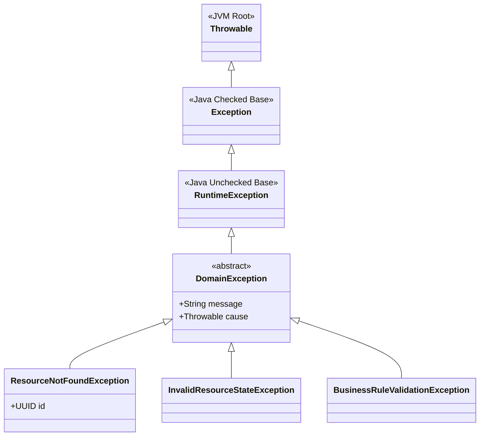

# Domain Exceptions: Abstract Classes, JVM Unchecked Exceptions & Architecture

This guide explains the design rationale, language mechanics, and architectural tradeoffs behind the domain exception hierarchy in our service, focusing on [DomainException.kt](file:///Users/atifanowar/Workspace/interview/crud-kotlin-service/src/main/kotlin/com/example/demo/domain/exception/DomainException.kt).

---

## 1. The Code Under the Microscope

Located in `src/main/kotlin/com/example/demo/domain/exception/DomainException.kt`:

```kotlin
package com.example.demo.domain.exception

/**
 * Base abstract exception for all domain-level business errors.
 * Completely decoupled from HTTP status codes and Spring framework classes.
 */
abstract class DomainException(
    override val message: String,
    override val cause: Throwable? = null
) : RuntimeException(message, cause)
```

At first glance, this is a clean, 10-line class. However, it embodies two foundational architectural and JVM decisions:
1. **Why `abstract class`?** Why not an `open class`, `sealed class`, or `interface`?
2. **Why extend `RuntimeException`?** Why not standard `Exception` (checked exception), or a custom non-throwable error type?

---

## 2. Core Decision 1: Why an `abstract class`?

### 2.1 Enforcing Semantic Precision (DDD Ubiquitous Language)
In Domain-Driven Design (DDD), errors represent business events that prevented an invariant from being satisfied. 

A generic `DomainException` has **no business meaning on its own**:
```kotlin
// ❌ Anti-pattern: What actually went wrong? What should the user or caller do?
throw DomainException("Something invalid happened")
```

By marking `DomainException` as **`abstract`**, we enforce compile-time rules:
- **It is impossible to instantiate `DomainException` directly.**
- Developers are forced to express intent using concrete domain types:
  - [`ResourceNotFoundException`](file:///Users/atifanowar/Workspace/interview/crud-kotlin-service/src/main/kotlin/com/example/demo/domain/exception/ResourceNotFoundException.kt) (Aggregate was not found)
  - [`InvalidResourceStateException`](file:///Users/atifanowar/Workspace/interview/crud-kotlin-service/src/main/kotlin/com/example/demo/domain/exception/InvalidResourceStateException.kt) (State transition violation)
  - [`BusinessRuleValidationException`](file:///Users/atifanowar/Workspace/interview/crud-kotlin-service/src/main/kotlin/com/example/demo/domain/exception/BusinessRuleValidationException.kt) (Invariant violation)



---

### 2.2 Hierarchical Polymorphism & Boundary Exception Handling
In clean architecture, the web/REST layer must translate internal domain errors into HTTP responses (RFC 7807 `ProblemDetail`).

Having a common abstract base class provides **type grouping**:
```kotlin
@RestControllerAdvice
class GlobalExceptionHandler {

    // Specific domain errors map to specific HTTP codes
    @ExceptionHandler(ResourceNotFoundException::class)
    fun handleNotFound(ex: ResourceNotFoundException): ResponseEntity<ProblemDetail> =
        buildProblemResponse(HttpStatus.NOT_FOUND, ex.message)

    @ExceptionHandler(InvalidResourceStateException::class)
    fun handleConflict(ex: InvalidResourceStateException): ResponseEntity<ProblemDetail> =
        buildProblemResponse(HttpStatus.CONFLICT, ex.message)

    // Catch-all safety net for ANY domain error that isn't individually handled
    @ExceptionHandler(DomainException::class)
    fun handleGenericDomainException(ex: DomainException): ResponseEntity<ProblemDetail> =
        buildProblemResponse(HttpStatus.BAD_REQUEST, ex.message)

    // System/infrastructure errors are isolated from business errors
    @ExceptionHandler(Exception::class)
    fun handleUnhandledException(ex: Exception): ResponseEntity<ProblemDetail> =
        buildProblemResponse(HttpStatus.INTERNAL_SERVER_ERROR, "An unexpected internal error occurred.")
}
```

This pattern guarantees:
1. **Domain errors never leak as HTTP 500.** Business rule rejections are client/input issues (HTTP 4xx), not infrastructure crashes.
2. **System failures (SQL down, NullPointerException, network timeouts) are treated separately** as HTTP 500 without accidentally leaking sensitive internal details.

---

### 2.3 Alternative Analysis: Why `abstract class` vs. Alternatives?

| Construct | Why It Was NOT Chosen | Tradeoff / Rationale |
| :--- | :--- | :--- |
| **`interface`** | ❌ **JVM Limitation:** In Java/JVM bytecode, an object can only be thrown via the `ATHROW` bytecode instruction if it is a class descending from `java.lang.Throwable`. An `interface` cannot extend a class (`Throwable`), so an interface alone cannot be thrown. | You cannot do `throw MyInterfaceException()`. |
| **`open class`** | ❌ **Permits Anti-Patterns:** An `open class` allows direct instantiation (`throw DomainException("oops")`). This allows developers to be lazy and skip creating meaningful domain exceptions. | Lacks compile-time enforcement of concrete domain concepts. |
| **`sealed class`** | ⚠️ **Valid Alternative, but Rigid:** A `sealed class` restricts all subclasses to the same package and compilation unit. In a multi-module or growing domain with multiple subdomains/aggregates, a `sealed class` forces all domain exceptions to either live in one file or one package. | An `abstract class` provides an open domain taxonomy that different aggregates/modules can extend independently. *(See Section 5 for when `sealed` is preferred).* |

---

## 3. Core Decision 2: Why extend `RuntimeException` (Unchecked Exception)?

The decision to extend `RuntimeException` instead of `java.lang.Exception` rests on three pillars: **Kotlin language design**, **Spring `@Transactional` mechanics**, and **Hexagonal Architecture principles**.

---

### 3.1 Spring `@Transactional` Rollback Mechanics (The Critical Reason)

In Spring Boot, transactions are managed via declarative proxies using `@Transactional`.

> [!CAUTION]
> **Spring's Default Rollback Policy:**
> By default, Spring's transaction interceptor (`TransactionAspectSupport`) **ONLY marks a transaction for rollback on Unchecked Exceptions (`RuntimeException` and `Error`)**.
> It does **NOT** roll back transactions on Checked Exceptions (`Exception`)!

If `DomainException` had extended `java.lang.Exception`:
```kotlin
// ⚠️ HYPOTHETICAL BUGGY DESIGN:
abstract class DomainException(message: String) : Exception(message)
```

Consider what would happen in a transactional domain workflow:
```kotlin
@Service
class OrderProcessingService(
    private val orderRepository: OrderRepository,
    private val paymentGateway: PaymentGateway
) {
    @Transactional
    fun processOrder(orderId: UUID) {
        val order = orderRepository.findById(orderId)
        
        order.markPaid()
        orderRepository.save(order) // Database updated in memory / transaction buffer!

        if (!paymentGateway.charge(order.total)) {
            // Throws checked domain exception!
            throw BusinessRuleValidationException("Payment authorization failed")
        }
    }
}
```

#### What happens at runtime?
1. The method throws `BusinessRuleValidationException : Exception`.
2. The exception bubbles out of the `@Transactional` boundary.
3. Spring inspects the exception: `ex instanceof RuntimeException` evaluates to **`false`**.
4. **Spring COMMITS the transaction!** The order is saved as paid in PostgreSQL even though payment failed!
5. To fix this with checked exceptions, you would have to remember to annotate every single service with `@Transactional(rollbackFor = [Exception::class])`, which is fragile, human-error prone, and easily forgotten.

By extending `RuntimeException`, **automatic rollback is guaranteed across all Spring services without exception**.

---

### 3.2 Kotlin Language Philosophy: Zero Checked Exceptions

Kotlin does not have checked exceptions. In Java, checked exceptions force either:
```java
// Java checked exception:
public void execute() throws DomainException { ... }
```

In Kotlin:
- The `throws` clause does not exist for control flow (the `@Throws` annotation is only used for Java interop bytecode generation).
- The compiler never forces `try-catch` blocks around method calls.
- Anders Hejlsberg (C# designer) and the Kotlin design team (JetBrains) eliminated checked exceptions based on industry experience: checked exceptions lead to empty catch blocks (`catch (Exception e) {}`), boilerplate wrapping, and fragile signatures that break API encapsulation when refactoring.

Extending `RuntimeException` matches idiomatic Kotlin conventions and seamlessly works with Kotlin's standard library.

---

### 3.3 Functional Programming, Lambdas & Collections Compatibility

In modern Kotlin code, domain operations frequently use higher-order functions:
- Standard library: `.map { ... }`, `.filter { ... }`, `.let { ... }`, `.flatMap { ... }`
- Collections and Sequences: `resources.forEach { it.validate() }`
- Reactive / Coroutines: `Mono.fromCallable { ... }`, Flow transformations

Kotlin's functional types are defined as:
```kotlin
public inline fun <T, R> Iterable<T>.map(transform: (T) -> R): List<R>
```

The function signature `(T) -> R` does not declare throws. When working with Java interop or functional pipelines, checked exceptions cannot be thrown without ugly rewrapping. `RuntimeException` propagates naturally out of lambdas and streams.

---

### 3.4 Decoupling the Domain Layer (Hexagonal / Clean Architecture)

In Clean Architecture:
- **Domain Layer:** Contains pure business rules, entities, and domain exceptions. It has no knowledge of HTTP, JSON, or databases.
- **Application Layer:** Orchestrates use cases and transactions.
- **Presentation Layer:** Handles web requests and maps domain responses.

If the domain layer required checked exception propagation, every interface and use-case port would be tightly coupled to exception signatures:

```mermaid
flowchart TD
    subgraph PresentationLayer ["1. Presentation Layer (Web Adapter)"]
        Controller["ResourceController"]
        Advice["GlobalExceptionHandler (@RestControllerAdvice)"]
    end

    subgraph ApplicationLayer ["2. Application Layer (Service)"]
        Service["ResourceApplicationService (@Transactional)"]
    end

    subgraph DomainLayer ["3. Domain Core (Entities & Invariants)"]
        Entity["Resource Entity (Enforces Invariants)"]
        DomainEx["DomainException (: RuntimeException)"]
    end

    subgraph DatabaseLayer ["4. Persistence Layer"]
        DB[(PostgreSQL)]
    end

    Controller -->|1. Invokes Use Case| Service
    Service -->|2. Calls business method| Entity
    Entity -.->|3. Invariant fails: throw InvalidResourceStateException| DomainEx
    DomainEx -.->|4. Bubbles through Service| Service
    Service -.->|5. Automatic DB Transaction ROLLBACK| DB
    Service -.->|6. Unchecked exception bubbles to Web| Advice
    Advice -->|7. Formats RFC 7807 ProblemDetail (409 Conflict)| Controller
```

With `RuntimeException`:
- The domain invariants fail fast: `throw InvalidResourceStateException(...)`.
- The exception cleanly bubbles past intermediary application logic without cluttering function signatures.
- The boundary advice intercepts it and converts it into standard HTTP `ProblemDetail`.

---

## 4. Constructor Delegation & JVM Stack Trace Preservation

Notice the signature of [DomainException.kt](file:///Users/atifanowar/Workspace/interview/crud-kotlin-service/src/main/kotlin/com/example/demo/domain/exception/DomainException.kt):

```kotlin
abstract class DomainException(
    override val message: String,
    override val cause: Throwable? = null
) : RuntimeException(message, cause)
```

### Why override `message` and `cause`?
1. **JVM `Throwable` Delegation:**
   `Throwable` stores `detailMessage` and `cause` internally in private JVM fields. Passing `(message, cause)` to `super(message, cause)` ensures:
   - `ex.message` and `ex.localizedMessage` are properly populated for logging and APM telemetry.
   - `ex.cause` preserves the chained root cause (e.g., if a domain error was caused by a parsing or validation error).
   - Calling `ex.printStackTrace()` or exporting to OpenTelemetry / Micrometer preserves the entire causational chain.

2. **Kotlin Default Arguments (`cause: Throwable? = null`):**
   Allows concise single-argument instantiation for leaf exceptions:
   ```kotlin
   class InvalidResourceStateException(message: String) : DomainException(message)
   ```
   while still allowing root-cause wrapping if needed:
   ```kotlin
   class BusinessRuleValidationException(
       message: String,
       cause: Throwable? = null
   ) : DomainException(message, cause)
   ```

---

## 5. Architectural Deep-Dive: When to Use `sealed class` vs. `abstract class`

A common question from senior Kotlin engineers is: *"Why not use `sealed class DomainException`?"*

### Comparison Matrix:

| Feature | `abstract class DomainException` (Current) | `sealed class DomainException` |
| :--- | :--- | :--- |
| **Direct Instantiation** | ❌ Prevented (compile error) | ❌ Prevented (compile error) |
| **Where Subclasses Can Live** | Anywhere (any package, any module) | Must be in the **same package & compilation module** |
| **Pattern Matching (`when`)** | Requires `else` branch | **Exhaustive** (No `else` required if all known) |
| **Extensibility** | **Open:** New aggregates/subdomains can introduce exceptions without touching existing files. | **Closed:** Adding an exception requires modifying the sealed hierarchy file/package. |
| **Best Used When...** | Building multi-module architectures or standard cross-cutting exception hierarchies. | Domain errors are handled locally as control flow (functional railway-oriented programming). |

### When would a `sealed class` or `Result<T>` be better?
If your architecture favors **Railway-Oriented Programming (ROP)** where domain methods return `Result<DomainError>` instead of throwing exceptions:

```kotlin
// Functional Error Modeling Alternative:
sealed interface DomainError {
    data class NotFound(val id: UUID) : DomainError
    data class InvalidState(val reason: String) : DomainError
    data class ValidationError(val field: String, val error: String) : DomainError
}

fun updateResource(id: UUID): Either<DomainError, Resource>
```

However, when following standard Spring Boot idioms with declarative transactions (`@Transactional`), throwing an unchecked `DomainException` remains the cleanest, most idiomatic, and least boilerplate-heavy pattern.

---

## 6. Summary Checklist

When designing domain exceptions in Kotlin & Spring Boot:

- [x] **Always use an `abstract class`** for the root domain exception to prevent instantiation of vague, unclassified errors.
- [x] **Always extend `RuntimeException`** to ensure Spring's `@Transactional` performs automatic database rollback on failures.
- [x] **Never extend `Exception` directly** unless you intend to configure explicit `@Transactional(rollbackFor = [...])` everywhere.
- [x] **Pass `message` and `cause` to `super`** to maintain JVM stack traces and OpenTelemetry span error events.
- [x] **Keep domain exceptions decoupled** from Spring (`HttpStatus`, `@ResponseStatus`) and HTTP protocols to maintain DDD architectural purity.

---

## 7. 60-Second Verbal Script (PREP Framework)

Use this script during technical interviews when asked: *"Why did you design `DomainException` as an `abstract class` extending `RuntimeException` in your Kotlin/Spring Boot service?"*

> **Point:**  
> In our Kotlin and Spring Boot service, `DomainException` is designed as an `abstract class` extending `RuntimeException` to enforce explicit domain modeling, guarantee automatic database rollbacks under `@Transactional`, and adhere to idiomatic Kotlin and Clean Architecture.
>
> **Reason:**  
> First, making it `abstract` prevents developers from throwing vague, unclassified root errors—it enforces the ubiquitous language of Domain-Driven Design (DDD) by requiring concrete subclasses like `ResourceNotFoundException` or `InvalidResourceStateException`, while still giving `@RestControllerAdvice` a polymorphic base type to catch all business errors and map them to HTTP 4xx problem details.  
> Second, extending `RuntimeException` is essential for Spring Boot's transactional integrity: by default, Spring's `@Transactional` interceptor **only rolls back transactions on unchecked exceptions**. If we extended checked `Exception`, an uncaught domain invariant violation would silently commit dirty database states to PostgreSQL. Additionally, Kotlin deliberately omits checked exceptions, making `RuntimeException` the natural, non-leaky choice for higher-order functions and functional pipelines.
>
> **Example:**  
> In our service, when an aggregate in `Resource.kt` detects an illegal transition, it throws `InvalidResourceStateException`. Spring's transaction interceptor catches this unchecked exception and immediately triggers an automatic database rollback. Then, `GlobalExceptionHandler` intercepts `InvalidResourceStateException` (or falls back to `DomainException`) and converts it into an RFC 7807 `ProblemDetail` with an HTTP 409 Conflict status—keeping domain code 100% free of web and framework dependencies.
>
> **Point (Restated):**  
> An abstract `RuntimeException` guarantees fail-fast domain semantics, preserves ACID transactional safety by default in Spring, and keeps our domain boundaries clean and expressive.
