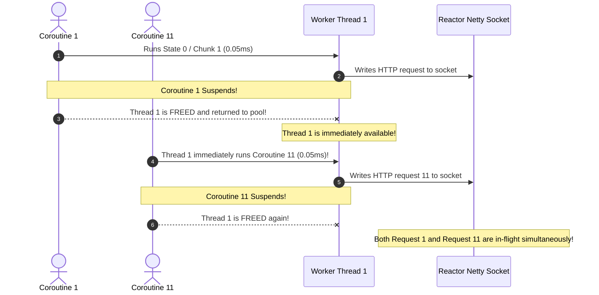
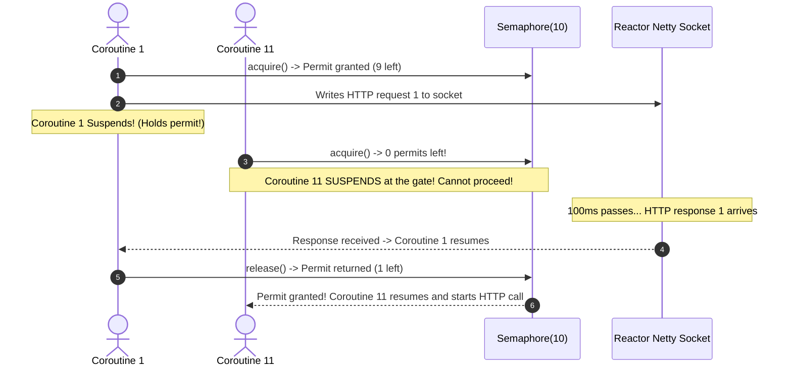

# Master Guide: `limitedParallelism` vs. `Semaphore` in Kotlin Coroutines

A comprehensive JVM runtime deep dive explaining the critical architectural difference between dispatcher-level thread throttling (`limitedParallelism`) and in-flight concurrency throttling across suspension boundaries (`Semaphore`).

---

## 1. Executive Summary: The Concurrency Illusion

Many JVM developers transitioning from traditional Java thread pools (`Executors.newFixedThreadPool(N)`) assume that `Dispatchers.IO.limitedParallelism(N)` will limit how many concurrent network requests their application sends to an external API.

```kotlin
// ❌ THE ILLUSION: Expecting at most 10 concurrent HTTP requests
val limitedDispatcher = Dispatchers.IO.limitedParallelism(10)

val deferredList = (1..100).map { i ->
    async(limitedDispatcher) {
        webClient.get().uri("/resource/$i").retrieve().awaitSingleOrNull()
    }
}
```

> [!CAUTION]
> **What Actually Happens**:
> All **100 HTTP requests are dispatched in under 4 milliseconds**.
> `limitedParallelism(10)` does **not** limit the number of active network requests!
> To strictly enforce that only 10 requests are in-flight over the network, you **must use a `Semaphore(10)`**.

---

## 2. The Restaurant Analogy: Waiters vs. Tables

To understand why this happens, compare a restaurant with three distinct elements:

```
Waiters  = Worker Threads (Dispatchers.IO)
Tables   = Semaphore Permits (In-flight concurrency)
Kitchen  = Remote External API (100ms latency)
```



```mermaid
flowchart TD
    subgraph WaiterModel ["Model A: limitedParallelism(10) -> Limits Waiters"]
        W["10 Waiters"] --> C1["100 Customers Arrive"]
        C1 --> W1["Waiter takes Order 1 (0.05ms) -> hands to Kitchen"]
        W1 --> Rel["COROUTINE SUSPENDS!\nWaiter is freed immediately!"]
        Rel --> W2["Same Waiter immediately takes Order 11 (0.05ms)"]
        W2 --> Boom["All 100 orders sent to Kitchen in 4ms!\nKitchen is overwhelmed!"]
    end

    subgraph TableModel ["Model B: Semaphore(10) -> Limits Tables"]
        T["10 Tables + Bouncer"] --> C2["100 Customers Arrive"]
        C2 --> T1["10 Customers seated at 10 Tables"]
        T1 --> T2["Customers 11-100 MUST WAIT outside!\n(Suspended at semaphore.acquire)"]
        T2 --> Cook["Kitchen cooks 10 meals at a time"]
        Cook --> Done["Customer 1 finishes and leaves Table 1\nPermit released -> Customer 11 enters!"]
    end
```

### Model A: Limiting Waiters (`limitedParallelism = 10`)
* You have 10 Waiters.
* 100 customers arrive.
* Waiter 1 takes Customer 1's order and hands it to the kitchen.
* **Does Waiter 1 stand by the stove for 100ms waiting for the kitchen to cook?**
  **NO!** Because the HTTP call is non-blocking (`awaitSingleOrNull()`), the coroutine **suspends**. The waiter is freed immediately.
* Waiter 1 turns around in 0.05ms to take Customer 11's order!
* In 4 milliseconds, the 10 fast waiters have handed **all 100 orders to the kitchen**.
* The kitchen is slammed with 100 orders at once, while the 10 waiters stand idle waiting for food to be ready!

### Model B: Limiting Tables (`Semaphore = 10`)
* The restaurant has a door bouncer and only **10 Tables**.
* 10 customers sit down. Customers 11–100 must wait outside on the sidewalk.
* The 10 customers order.
* Even though the waiter walks away while the kitchen cooks for 100ms, **the customer occupies the table!**
* Customer 11 cannot enter until Customer 1 finishes eating, vacates the table, and returns the permit to the bouncer.
* The kitchen never has more than 10 orders cooking at any moment!

---

## 3. JVM Runtime Mechanics: How the Kotlin Compiler Slices Continuations

To understand the difference at the JVM bytecode level, look at what the Kotlin compiler does to a suspending function. Every suspending function is converted into a **Finite State Machine** implementing `Continuation<T>`:

```kotlin
async(limitedDispatcher) {
    // --- [STATE 0 / CHUNK 1]: CPU work before suspension ---
    val url = "/api/v1/enrichment/$refId"
    logger.info("Starting call for {}", refId)
    
    // --- SUSPENSION POINT: Hands socket to Netty event loop ---
    val result = webClient.get().uri(url).bodyToMono(...).awaitSingleOrNull()
    
    // --- [STATE 1 / CHUNK 2]: CPU work after resumption ---
    processResult(result)
}
```

### The Step-by-Step Thread Execution:

1. **Dispatcher Queue**: 100 continuations are queued in `limitedDispatcher`.
2. **Chunk 1 Execution**: 10 worker threads pick up Coroutines 1 through 10. They execute **State 0 (Chunk 1)**. Creating the HTTP request and calling `awaitSingleOrNull()` takes **~0.05 milliseconds** of CPU time.
3. **The Suspension Moment**: `awaitSingleOrNull()` registers an asynchronous callback with Reactor Netty's EventLoop and returns `COROUTINE_SUSPENDED`.
4. **Thread Release**: The coroutine runtime intercepts `COROUTINE_SUSPENDED`. It saves the local variables into a heap continuation object and **exits the `run()` method on Thread 1**.
5. **Thread 1 is now completely idle!**
6. `limitedDispatcher` sees an idle thread and immediately dequeues Coroutine 11.
7. Coroutine 11 runs Chunk 1 (0.05ms), registers its callback with Netty, and suspends.
8. Within **4 milliseconds**, all 100 coroutines have executed Chunk 1 and suspended.
9. **All 100 TCP requests are now actively in-flight on the network card**, while 0 threads are currently active on `limitedDispatcher`!

---

## 4. Sequence Diagram: Thread Lifecycle Comparison

### `limitedParallelism(10)` Flow:


### `Semaphore(10)` Flow:


---

## 5. Side-by-Side Comparison Matrix

| Property | `Dispatchers.IO.limitedParallelism(N)` | `kotlinx.coroutines.sync.Semaphore(N)` |
| :--- | :--- | :--- |
| **Primary Purpose** | CPU Thread Limiter | Asynchronous Concurrency Limiter |
| **What it limits** | Number of **OS threads** executing code simultaneously. | Number of **in-flight operations**, whether running or suspended. |
| **Behavior at suspension (`delay`, `await`)** | **Releases thread immediately**. Next queued coroutine executes. | **Retains permit**. Prevents new operations from starting until released. |
| **State Storage** | Internal task queue within `CoroutineDispatcher`. | Atomic integer permit counter + suspension wait queue. |
| **Ideal For** | • CPU-bound calculations<br>• Legacy blocking I/O (JDBC, `Thread.sleep`)<br>• File system disk writes | • Non-blocking HTTP (`WebClient`, `Ktor`)<br>• gRPC asynchronous stubs<br>• AWS SDK v2 async clients |
| **Downstream Protection** | Protects the **local JVM CPU** from thread starvation. | Protects the **downstream server** from connection flooding. |

---

## 6. Code Recipes: How to Use Each Correctly

### Recipe 1: Throttling Blocking I/O (Use `limitedParallelism`)
When wrapping legacy blocking calls (e.g., Spring Data JPA, Hibernate, JDBC) that **block the thread**:
```kotlin
// Limit blocking database calls to 10 concurrent threads
val dbDispatcher = Dispatchers.IO.limitedParallelism(10)

suspend fun fetchFromDatabase(id: Long): User = withContext(dbDispatcher) {
    // Thread.sleep or blocking JDBC: thread is held for the entire duration!
    userRepository.findById(id)
}
```

### Recipe 2: Throttling Non-Blocking Asynchronous Calls (Use `Semaphore`)
When calling non-blocking APIs (`WebClient`, `awaitSingleOrNull`, `delay`) that **suspend the coroutine**:
```kotlin
// Limit in-flight external HTTP calls to 20
val httpSemaphore = Semaphore(20)

suspend fun fetchExternalData(refId: String): ExternalData =
    httpSemaphore.withPermit {
        // Coroutine suspends here, but permit is held until the response arrives!
        webClient.get()
            .uri("/api/data/{refId}", refId)
            .retrieve()
            .bodyToMono(ExternalData::class.java)
            .awaitSingleOrNull()
    }
```

---

## 7. Senior Interview Defense Script

> **Question**: *"In a high-throughput Kotlin service, why shouldn't you use `Dispatchers.IO.limitedParallelism(10)` to throttle outbound calls to a partner API?"*
>
> **Answer**:
> "`limitedParallelism` is a dispatcher-level constraint that controls thread execution, not asynchronous operation concurrency. 
> 
> When calling a partner API with a non-blocking client like Spring WebClient, the coroutine suspends at `awaitSingleOrNull()`. Upon suspension, the coroutine immediately yields its dispatcher thread back to the pool. The dispatcher sees an idle thread and immediately dequeues the next coroutine, causing all queued jobs to fire within milliseconds.
> 
> To enforce a true outbound bulkhead where at most 10 requests are in-flight on the wire at any moment, we must use a Kotlin `Semaphore(10)` with `semaphore.withPermit`. A semaphore permit is held across the entire suspension lifecycle until the remote response arrives, shielding both the network card and the partner service from traffic spikes."
