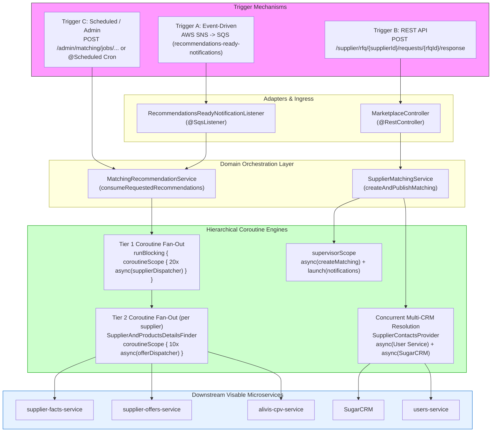

# RFQ Service: Architecture & Trigger Mechanics of Coroutine Fan-Out

In **`rfq-service`** (`/Users/atifanowar/Workspace/visable/kotlin-projects/rfq-service`), Kotlin Coroutines are used to fetch and aggregate supplier, product, offer, and CRM contact data across multiple downstream microservices (`supplier-offers-service`, `supplier-facts-service`, `alivis-cpv-service`, `users-service`, and `SugarCRM`).

This deep-dive analyzes **how these coroutines are triggered**, tracing the execution paths from **asynchronous AWS SQS events**, **synchronous REST endpoints**, and **scheduled batch jobs**, detailing the complete implementation architecture.

---

## Table of Contents
1. [The Answer: How Are These Coroutines Triggered?](#1-the-answer-how-are-these-coroutines-triggered)
2. [Architecture 1: The Event-Driven Path (Primary Pipeline)](#2-architecture-1-the-event-driven-path-primary-pipeline)
   - [2.1 The AWS SNS / SQS Trigger](#21-the-aws-sns--sqs-trigger)
   - [2.2 Two-Tier Hierarchical Coroutine Fan-Out Tree](#22-two-tier-hierarchical-coroutine-fan-out-tree)
   - [2.3 Performance Impact: 200 Sequential Calls (20s) -> 400ms](#23-performance-impact-200-sequential-calls-20s---400ms)
3. [Architecture 2: The Synchronous REST Path (Marketplace Response)](#3-architecture-2-the-synchronous-rest-path-marketplace-response)
   - [3.1 REST Controller Trigger (`MarketplaceController`)](#31-rest-controller-trigger-marketplacecontroller)
   - [3.2 Fault-Isolated Matching (`supervisorScope`)](#32-fault-isolated-matching-supervisorscope)
   - [3.3 Concurrent Multi-CRM Contact Resolution (`SupplierContactsProvider`)](#33-concurrent-multi-crm-contact-resolution-suppliercontactsprovider)
4. [Architecture 3: Admin REST & Scheduled Batch Jobs](#4-architecture-3-admin-rest--scheduled-batch-jobs)
5. [Complete End-to-End Architectural Flowchart](#5-complete-end-to-end-architectural-flowchart)
6. [Source Code Reference & File Trace](#6-source-code-reference--file-trace)
7. [60-Second Interview PREP Script](#7-60-second-interview-prep-script)

---

## 1. The Answer: How Are These Coroutines Triggered?

In `rfq-service`, the supplier and product enrichment coroutines are **triggered primarily by an Event-Driven AWS SQS message**, but can also be invoked via **REST API calls** and **Scheduled Jobs**:

```
┌────────────────────────────────────────────────────────────────────────────────────────┐
│                              RFQ Service Trigger Traces                                │
├────────────────────────────┬─────────────────────────────┬─────────────────────────────┤
│   1. Event-Driven (Main)   │       2. REST API Path      │     3. Scheduled / Admin    │
│  AWS SQS @SqsListener      │  POST /supplier/rfq/...     │  @Scheduled weekly cron     │
│  ML Recommendation Event   │  MarketplaceController      │  ManualJobsController       │
└────────────────────────────┴─────────────────────────────┴─────────────────────────────┘
```

1. **Event-Driven (Primary Production Path):**
   When an external Recommendation / Machine Learning engine finishes computing matching suppliers for an RFQ, it publishes an event to AWS SNS. An AWS SQS queue receives this event and triggers `@SqsListener` in `RecommendationsReadyNotificationListener.kt`.
2. **Synchronous REST API (Supplier Marketplace Path):**
   When a supplier clicks "Interested" in the RFQ marketplace, their frontend makes a `POST /supplier/rfq/{supplierId}/requests/{rfqId}/response` call handled by `MarketplaceController.kt`, triggering concurrent contact resolution and matching publishing.
3. **Admin REST / Scheduled Batch Job (Manual Re-run):**
   Admins can re-trigger recommendation pipelines via `ManualJobsController.kt`, and weekly notification crons invoke recommendation processing in batches.

---

## 2. Architecture 1: The Event-Driven Path (Primary Pipeline)

### 2.1 The AWS SNS / SQS Trigger
The entry point is [`RecommendationsReadyNotificationListener.kt`](file:///Users/atifanowar/Workspace/visable/kotlin-projects/rfq-service/src/main/kotlin/com/visable/rfqservice/matching/infrastructure/subscription/recommendation/RecommendationsReadyNotificationListener.kt#L18-L53):

```kotlin
@Component
class RecommendationsReadyNotificationListener(
    private val matchingRecommendationService: MatchingRecommendationService,
    private val objectMapper: ObjectMapper,
) {
    // ⚡ LISTENING ON AWS SQS QUEUE:
    @SqsListener(value = ["\${app.queues.recommendations-ready-notifications}"])
    fun consume(snsMessage: SNSMessageBody) {
        val event = objectMapper.readValue(snsMessage.message, RecommendationsReadyNotificationEvent::class.java)
        
        val requestId = event.payload.requestId
        val rfqId = event.payload.rfqId?.let { UUID.fromString(it) }

        // Hands off execution to the domain recommendation service
        matchingRecommendationService.consumeRequestedRecommendations(requestId, rfqId)
    }
}
```

---

### 2.2 Two-Tier Hierarchical Coroutine Fan-Out Tree

Once the SQS message is received, `MatchingRecommendationService` triggers a **two-tier nested tree of coroutines**:

```
Tier 1: Supplier Fan-Out (MatchingRecommendationService)
┌──────────────────────────────────────────────────────────────────────────────────┐
│ runBlocking { coroutineScope {                                                   │
│   recommendations.map { supplier ->                                              │
│     async(supplierEnrichmentDispatcher) {                                        │
│       supplierServiceClient.getSupplierDetails(supplier.id)                      │
│     }                                                                            │
│   }.awaitAll()                                                                   │
│ } }                                                                              │
└────────────────────────────────────────┬─────────────────────────────────────────┘
                                         │ Calls getSupplierDetails for each supplier
                                         ▼
Tier 2: Offer Fan-Out per Supplier (SupplierAndProductsDetailsFinder)
┌──────────────────────────────────────────────────────────────────────────────────┐
│ val offers = getOffersResponse(supplierId)?.data                                 │
│ coroutineScope {                                                                 │
│   offers.map { offer ->                                                          │
│     async(offerDetailsDispatcher) {                                              │
│       getOfferData(offer.id)                                                     │
│     }                                                                            │
│   }.awaitAll()                                                                   │
│ }                                                                                │
└──────────────────────────────────────────────────────────────────────────────────┘
```

#### Tier 1 Source Code:
In [`MatchingRecommendationService.kt`](file:///Users/atifanowar/Workspace/visable/kotlin-projects/rfq-service/src/main/kotlin/com/visable/rfqservice/matching/domain/service/recommendation/MatchingRecommendationService.kt#L274-L297):
```kotlin
private fun withSupplierDetails(
    rawRecommendations: SupplierRecommendations,
    rfqDetails: MatchedRfq,
    origin: RfqOrigin,
): List<RfqRecommendedSupplier> = runBlocking {
    coroutineScope {
        // Fans out to all recommended suppliers in parallel:
        rawRecommendations.supplierWithFlags.map { supplierIdWithFlags ->
            async(supplierEnrichmentDispatcher) {
                supplierServiceClient.getSupplierDetails(supplierIdWithFlags.supplierId)
                    ?.let { supplierDetails ->
                        RecommendationsServiceSupport.toRfqRecommendedSupplier(
                            supplierDetails,
                            rfqDetails,
                            alreadyMatched = matchingCoreRepository.isExists(rfqDetails.rfqId, supplierDetails.id),
                            supplierIdWithFlags,
                        )
                    }
            }
        }.awaitAll().filterNotNull()
    }
}
```

#### Tier 2 Source Code:
In [`SupplierAndProductsDetailsFinder.kt`](file:///Users/atifanowar/Workspace/visable/kotlin-projects/rfq-service/src/main/kotlin/com/visable/rfqservice/matching/infrastructure/clients/supplier/SupplierAndProductsDetailsFinder.kt#L43-L57):
```kotlin
suspend fun getSupplierDetails(supplierId: UUID): SupplierDetails? {
    val supplierData = getSupplierFactsData(supplierId) ?: return null
    val offers = getOffersResponse(supplierId)?.data ?: emptyList()

    // ⚡ Fans out to all offers for THIS supplier in parallel:
    val offersData = coroutineScope {
        offers.map { offer ->
            async(offerDetailsDispatcher) {
                getOfferData(offer.id)?.let { offerDetail ->
                    offerDetail to null
                }
            }
        }.awaitAll()
    }.filterNotNull()

    return buildCombinedSupplierDetails(supplierData, offersData)
}

companion object {
    private const val MAX_CONCURRENT_OFFER_API_CALLS = 12
    // Bulkhead dispatcher to protect downstream supplier-offers-service:
    private val offerDetailsDispatcher = Dispatchers.IO.limitedParallelism(MAX_CONCURRENT_OFFER_API_CALLS)
}
```

---

### 2.3 Performance Impact: 200 Sequential Calls (20s) -> 400ms

Consider an RFQ matched with **20 recommended suppliers**, where each supplier has **10 active offers/products**:

- **Without Coroutines (Sequential Execution):**
  $$\text{Total Calls} = 20 \text{ suppliers} \times 10 \text{ offers} = 200 \text{ HTTP calls}$$
  $$\text{Total Duration} = 200 \text{ calls} \times 100\text{ms} = \mathbf{20,000\text{ms} \quad (20 \text{ seconds!})}$$
  *Result:* SQS message processing times out, visibility timeout triggers, and the message is redelivered in an infinite loop!

- **With Hierarchical Coroutines (Visable's Architecture):**
  All 20 suppliers execute concurrently. Inside each supplier, all 10 offers execute concurrently.
  $$\text{Total Duration} \approx \max(\text{supplier}_1, \dots, \text{supplier}_{20}) \approx \mathbf{350\text{ms} - 500\text{ms}!}$$
  *Result:* **40x speedup** with zero thread pool starvation, protected by `limitedParallelism(12)`.

---

## 3. Architecture 2: The Synchronous REST Path (Marketplace Response)

### 3.1 REST Controller Trigger (`MarketplaceController`)
When a supplier manually responds to an RFQ on the web platform, the trigger is a synchronous HTTP POST request:

From [`MarketplaceController.kt`](file:///Users/atifanowar/Workspace/visable/kotlin-projects/rfq-service/src/main/kotlin/com/visable/rfqservice/matching/api/MarketplaceController.kt#L33-L58):
```kotlin
@RestController
@RequestMapping("/supplier/rfq/{supplierId}/requests")
class MarketplaceController(
    private val supplierMatchingService: SupplierMatchingService,
) {
    @PostMapping("/{rfqId}/response")
    fun respondToRfq(
        @PathVariable("supplierId") supplierId: UUID,
        @PathVariable("rfqId") rfqId: UUID,
        @RequestBody responseToRfq: RespondToRfqRequestDto,
    ): ResponseEntity<RespondToRfqRequestResponseDto> {
        val dto = SupplierMatchingDto(rfqId = rfqId, supplierId = supplierId, userProfileId = responseToRfq.userProfileId)
        
        // ⚡ Calls SupplierMatchingService:
        val status = supplierMatchingService.createAndPublishMatching(dto)
        return ResponseEntity.ok(RespondToRfqRequestResponseDto(...))
    }
}
```

---

### 3.2 Fault-Isolated Matching (`supervisorScope`)
Inside [`SupplierMatchingService.kt`](file:///Users/atifanowar/Workspace/visable/kotlin-projects/rfq-service/src/main/kotlin/com/visable/rfqservice/matching/domain/service/marketplace/SupplierMatchingService.kt#L52-L73):
```kotlin
val createdMatching =
    matchingCoreRepository.findByRfqIdAndSupplierKey(rfq.rfqId, matchingDto.supplierId.toString())
        ?: runBlocking(Dispatchers.IO.limitedParallelism(8)) {
            supervisorScope {
                // Critical path:
                val createdMatching = async { createMatchingInternal(matchingDto, rfq) }

                // Side effects: Outbound event notifications
                launch {
                    runCatching { matchingRfqService.notifyRfqMatched(rfq.rfqId) }
                        .onFailure { cause -> logger.error("Failed while notifying rfq matching", cause) }
                }
                launch {
                    runCatching { notifyRfqProcessed(rfqId = rfq.rfqId, rfqOrigin = rfq.origin) }
                        .onFailure { cause -> logger.error("Failed while notifying processed RFQ", cause) }
                }

                // Sibling notifications failing will NOT cancel createdMatching:
                createdMatching.await()
            }
        }
```

---

### 3.3 Concurrent Multi-CRM Contact Resolution (`SupplierContactsProvider`)
When publishing the matching, the system resolves supplier contact emails across **User Profiles Service** and **SugarCRM** concurrently:

From [`SupplierContactsProvider.kt`](file:///Users/atifanowar/Workspace/visable/kotlin-projects/rfq-service/src/main/kotlin/com/visable/rfqservice/matching/infrastructure/clients/supplier/SupplierContactsProvider.kt#L53-L79):
```kotlin
private suspend fun getSupplierContactsEp(supplierId: UUID): List<SupplierContact> {
    // ⚡ Fans out to two independent services simultaneously:
    val userProfilesAsync = scope.async { getUserProfilesSupplierContacts(supplierId) }
    val sugarCrmAsync = scope.async { getSugarCrmSupplier(supplierId, SourcePlatform.EP) }

    val userProfiles = userProfilesAsync.await()
    val sugarCrmSupplier = sugarCrmAsync.await()

    // Parallel profile resolution for unmatched recipients:
    val contactsToMerge = supplierFactsContacts.map { contact ->
        scope.async {
            val profile = userClient.findProfileByEmail(contact.email)
            contact.copy(userId = profile?.id, name = profile?.fullName)
        }
    }.awaitAll()

    return mergeContacts(userProfiles, contactsToMerge)
}
```

---

## 4. Architecture 3: Admin REST & Scheduled Batch Jobs

In [`ManualJobsController.kt`](file:///Users/atifanowar/Workspace/visable/kotlin-projects/rfq-service/src/main/kotlin/com/visable/rfqservice/matching/api/jobs/ManualJobsController.kt):
- `POST /admin/matching/jobs/recommendations/{rfqId}/retry`: Manually triggers `matchingRecommendationService.initiateRecommendationsTasks(rfqId)`.
- Scheduled Jobs: `@Scheduled` methods in `MatchingRecommendationService` trigger exact match notifications and weekly supplier digests, running recommendation lookups across unnotified RFQs.

---

## 5. Complete End-to-End Architectural Flowchart



---

## 6. Source Code Reference & File Trace

| Responsibility | File Path | Line Range |
| :--- | :--- | :--- |
| **SQS Event Listener** | [`RecommendationsReadyNotificationListener.kt`](file:///Users/atifanowar/Workspace/visable/kotlin-projects/rfq-service/src/main/kotlin/com/visable/rfqservice/matching/infrastructure/subscription/recommendation/RecommendationsReadyNotificationListener.kt) | Lines 18–53 |
| **Recommendation Orchestrator** | [`MatchingRecommendationService.kt`](file:///Users/atifanowar/Workspace/visable/kotlin-projects/rfq-service/src/main/kotlin/com/visable/rfqservice/matching/domain/service/recommendation/MatchingRecommendationService.kt) | Lines 90–139, 274–297 |
| **Tier 2 Offer Fan-Out** | [`SupplierAndProductsDetailsFinder.kt`](file:///Users/atifanowar/Workspace/visable/kotlin-projects/rfq-service/src/main/kotlin/com/visable/rfqservice/matching/infrastructure/clients/supplier/SupplierAndProductsDetailsFinder.kt) | Lines 32–57, 240–244 |
| **REST Marketplace Controller** | [`MarketplaceController.kt`](file:///Users/atifanowar/Workspace/visable/kotlin-projects/rfq-service/src/main/kotlin/com/visable/rfqservice/matching/api/MarketplaceController.kt) | Lines 33–58 |
| **Fault-Tolerant Matching** | [`SupplierMatchingService.kt`](file:///Users/atifanowar/Workspace/visable/kotlin-projects/rfq-service/src/main/kotlin/com/visable/rfqservice/matching/domain/service/marketplace/SupplierMatchingService.kt) | Lines 43–74 |
| **Multi-CRM Contact Resolution** | [`SupplierContactsProvider.kt`](file:///Users/atifanowar/Workspace/visable/kotlin-projects/rfq-service/src/main/kotlin/com/visable/rfqservice/matching/infrastructure/clients/supplier/SupplierContactsProvider.kt) | Lines 36–95, 316–320 |

---

## 7. 60-Second Interview PREP Script

> **Interviewer:** *"How are the coroutines triggered in your RFQ service, and how is the fan-out architecture implemented?"*
>
> **You:**  
> "The coroutine fan-out is triggered primarily through an **event-driven AWS SQS listener**, but can also be invoked via a **REST marketplace endpoint**.  
>  
> In the main event-driven pipeline, when an asynchronous ML engine finishes calculating matching recommendations, it sends an event to an AWS SQS queue. Our `@SqsListener` in `RecommendationsReadyNotificationListener` catches the event and invokes `MatchingRecommendationService`.  
>  
> The service then executes a **two-tier hierarchical coroutine tree**:  
> - In Tier 1, it fans out concurrently across all recommended suppliers using `coroutineScope` and `async`.  
> - In Tier 2, inside `SupplierAndProductsDetailsFinder`, each supplier concurrently fans out across all of its offers to downstream microservices like `supplier-offers-service` and `supplier-facts-service`.  
>  
> To protect downstream microservices from being overwhelmed, we restrict concurrency using `Dispatchers.IO.limitedParallelism(12)`. This two-tier concurrency cut execution time from **20 seconds of sequential blocking HTTP calls down to ~400 milliseconds**, completely eliminating SQS redelivery timeouts."
