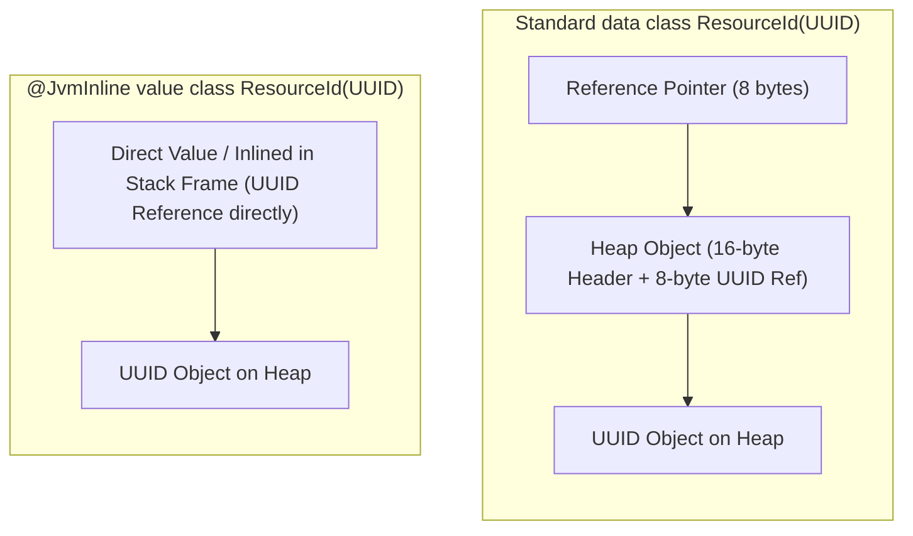
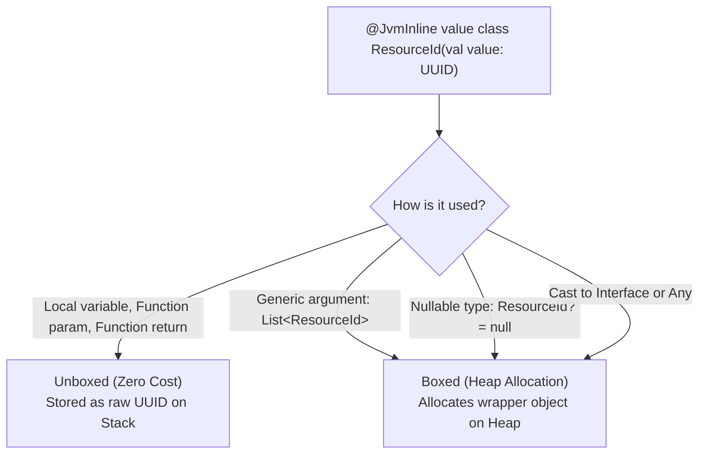

# Kotlin Value Classes & The `@JvmInline` Annotation

This guide explains what Kotlin `value class`es are, how they eliminate runtime heap overhead for domain Value Objects, why the compiler emits `'value' classes without '@JvmInline' annotation are not yet supported`, and how boxing/unboxing works under the hood at the bytecode level.

---

## 1. The Core Problem: Primitive Obsession vs. Heap Allocation Overhead

In Domain-Driven Design (DDD), using raw primitives or generic UUIDs for entity identifiers and business concepts is an anti-pattern known as **Primitive Obsession**:

```kotlin
// ❌ Dangerous: Easy to swap arguments by accident!
fun transferFunds(senderId: UUID, recipientId: UUID, amount: BigDecimal)

// The compiler cannot prevent this bug:
transferFunds(recipientId, senderId, amount)
```

To achieve compile-time type safety, developers traditionally wrapped primitives in standard `data class`es:

```kotlin
data class ResourceId(val value: UUID)
data class Money(val amount: BigDecimal)

fun transferFunds(sender: ResourceId, recipient: ResourceId, amount: Money)
```

### The Cost of Standard `data class`es:
Every single time a `data class` instance is created:
1. **Object Header Overhead:** The JVM allocates a **12 to 16-byte object header** (Mark Word + Klass Word) on the heap.
2. **Padding & Reference Overhead:** Memory alignment adds padding, plus an 8-byte pointer on 64-bit JVMs.
3. **Garbage Collection Pressure:** In high-throughput services handling tens of thousands of requests per second, creating millions of short-lived wrapper objects triggers frequent GC pauses (young-generation allocation churn).

---

## 2. The Solution: Kotlin `value class`

A **Value Class** is a type-safe wrapper that wraps a single underlying property and is **inlined directly at runtime**.

```kotlin
@JvmInline
value class ResourceId(val value: UUID = UUID.randomUUID()) {
    init {
        // Enforce invariants right inside the value class!
        require(value.version() == 4) { "Only UUID v4 is supported." }
    }

    override fun toString(): String = value.toString()
}
```

### Memory Layout Comparison:



- **Compile Time:** You get 100% type safety. You cannot accidentally pass a `UserId` where a `ResourceId` is expected.
- **Runtime:** The JVM treats the variable as a raw `UUID`—no wrapper object is allocated on the heap!

---

## 3. Why the Error: `'value' classes without '@JvmInline' annotation are not yet supported`?

When you declare a `value class` on the JVM without `@JvmInline`:

```kotlin
// ❌ Compilation Error:
// 'value' classes without '@JvmInline' annotation are not yet supported
value class ResourceId(val value: UUID)
```

### Why does this error occur?

1. **Kotlin is a Multiplatform Language:**
   - `value class` is a generic language keyword designed to work across all Kotlin targets: **Kotlin/JVM**, **Kotlin/Native**, **Kotlin/JS**, and **Kotlin/Wasm**.
   - On platforms like Kotlin/Native or WebAssembly, the runtime architecture natively supports custom value representations without special JVM-specific flags.

2. **The JVM's Historical Limitation:**
   - Java and the JVM have historically only supported two types of data:
     - **Primitives:** (`int`, `long`, `boolean`, `double`, etc.) stored directly on the stack / CPU registers.
     - **Reference Types:** (Everything extending `java.lang.Object`) allocated on the heap with an object header and accessed via pointers.
   - The JVM itself did not traditionally have a concept of a user-defined "value type" (flat, headerless composite data).

3. **Project Valhalla (The Future of the JVM):**
   - The OpenJDK community has been developing **Project Valhalla (JEP 401 - Value Objects)** to introduce true native value objects directly into the JVM bytecode and memory specification.
   - When Project Valhalla officially arrives in future LTS Java versions, the JVM will natively understand headerless value types.
   - Until then, Kotlin must **emulate** value classes using bytecode transformation tricks (unboxing, static methods, and name mangling).

4. **The Role of `@JvmInline`:**
   - Because native JVM value objects are not yet standard, the Kotlin compiler targeting the JVM requires the developer to explicitly provide the `@JvmInline` annotation.
   - `@JvmInline` signals to the Kotlin JVM compiler:  
     *"Target the current JVM by inlining this single property directly into method signatures and local variables, and apply name mangling to prevent bytecode collisions."*

> [!NOTE]
> The compiler error message says *"are not **yet** supported"* precisely because Kotlin plans to support JVM value classes natively without `@JvmInline` once Project Valhalla lands in the JDK!

---

## 4. Under the Hood: Bytecode & Name Mangling

Let's see what happens to your Kotlin code when compiled to JVM bytecode.

### Kotlin Source:
```kotlin
@JvmInline
value class ResourceId(val value: UUID)

class ResourceService {
    fun findById(id: ResourceId): String {
        return "Found ${id.value}"
    }
}
```

### Decompiled Java Equivalent (`javap -c`):
```java
public final class ResourceService {

    // 1. Notice the method parameter is unboxed to raw java.util.UUID!
    // 2. Notice the compiler mangled the method name with a hash suffix: -uYgqT78
    @NotNull
    public final String findById-uYgqT78(@NotNull UUID id) {
        Intrinsics.checkNotNullParameter(id, "id");
        return "Found " + id;
    }
}
```

### Why Name Mangling (`-uYgqT78`)?
Consider what happens if you have function overloading:

```kotlin
fun find(id: ResourceId)
fun find(id: UUID)
```

At the JVM bytecode level, after unboxing `ResourceId`, **both functions would have the identical signature**:  
`find(Ljava/util/UUID;)V`!  
The JVM classloader would fail with a duplicate method error.

To resolve this, the Kotlin compiler generates a deterministic alphanumeric suffix derived from the value class type hash (`findById-uYgqT78`), guaranteeing that unboxed signatures never clash.

---

## 5. Boxing vs. Unboxing: When is Memory Actually Allocated?

Value classes are **unboxed** (zero heap allocation) in most standard scenarios, but the compiler must **box** them (allocate a wrapper object on the heap) in specific situations:



### Detailed Breakdown:

| Scenario | Code Example | Memory Behavior | Explanation |
| :--- | :--- | :--- | :--- |
| **Local Variable** | `val id = ResourceId.generate()` | **Unboxed (0 B)** | Stored directly as `UUID` in the JVM stack frame. |
| **Method Parameter** | `fun process(id: ResourceId)` | **Unboxed (0 B)** | Bytecode accepts `UUID id`. Zero allocation. |
| **Method Return** | `fun create(): ResourceId` | **Unboxed (0 B)** | Bytecode returns `UUID`. Zero allocation. |
| **Generics** | `val list: List<ResourceId> = listOf(id)` | **Boxed (Heap)** | Generics on the JVM are erased to `java.lang.Object`. JVM must instantiate a heap wrapper. |
| **Nullable Reference** | `val opt: ResourceId? = null` | **Boxed (Heap)** | To represent `null` vs an unboxed instance, the JVM wraps it in a heap object. |
| **Casting to `Any`** | `val obj: Any = id` | **Boxed (Heap)** | Polymorphic references require an object header on the heap. |

---

## 6. Comparison: `typealias` vs `data class` vs `@JvmInline value class`

| Feature / Trait | `typealias` | `data class` | `@JvmInline value class` |
| :--- | :--- | :--- | :--- |
| **Syntax** | `typealias ResourceId = UUID` | `data class ResourceId(val value: UUID)` | `@JvmInline value class ResourceId(val value: UUID)` |
| **Compile-Time Type Safety** | ❌ **None** (Can pass raw UUID anywhere) |  **Strong** |  **Strong** |
| **Runtime Heap Allocation** |  **Zero** (Pure alias) | ❌ **16-24 bytes** per instance |  **Zero** (Unboxed in 90% of cases) |
| **Custom Methods & `init` Blocks**| ❌ No |  Yes |  Yes (`init`, member functions, computed props) |
| **Interface Implementation** | ❌ No |  Yes |  Yes (Can implement interfaces) |
| **Number of Properties Allowed** | N/A | Multiple (`val id, val name`) | **Exactly 1 property** |
| **Best Used For** | Long generic type shortcuts (`typealias TaskMap = Map<UUID, List<Task>>`) | Multi-property entities and DTOs | Strongly typed IDs, currency, quantities, single-value domain wrappers |

---

## 7. 60-Second Verbal Script (PREP Framework)

Use this script during technical interviews when asked: *"What are Kotlin value classes, and why do they require the `@JvmInline` annotation?"*

> **Point:**  
> A Kotlin value class is a zero-cost domain abstraction that provides strong compile-time type safety without the heap allocation overhead of a standard `data class`.
>
> **Reason:**  
> Wrapping primitives like `UUID` or `Long` in a `data class` causes the JVM to allocate a 16-byte object header on the heap for every instance, creating garbage collection pressure. Value classes inline the wrapped value directly into stack frames and method signatures as raw primitives or references. Because the JVM does not yet natively support value objects (until Project Valhalla matures), the `@JvmInline` annotation is required on the JVM backend to tell the compiler to emulate this inlining through bytecode unboxing and name mangling.
>
> **Example:**  
> In our service, we define `ResourceId` as an `@JvmInline value class(val value: UUID)`. In our domain and application code, methods like `findById(id: ResourceId)` prevent developers from accidentally passing a `UserId`. At bytecode runtime, the JVM compiles this to accept a raw `UUID`, incurring zero extra heap allocations unless used inside generic collections like `List<ResourceId>`.
>
> **Point (Restated):**  
> `@JvmInline value class` gives us the ideal balance: the type safety of rich domain modeling with the raw performance of unboxed JVM references.
