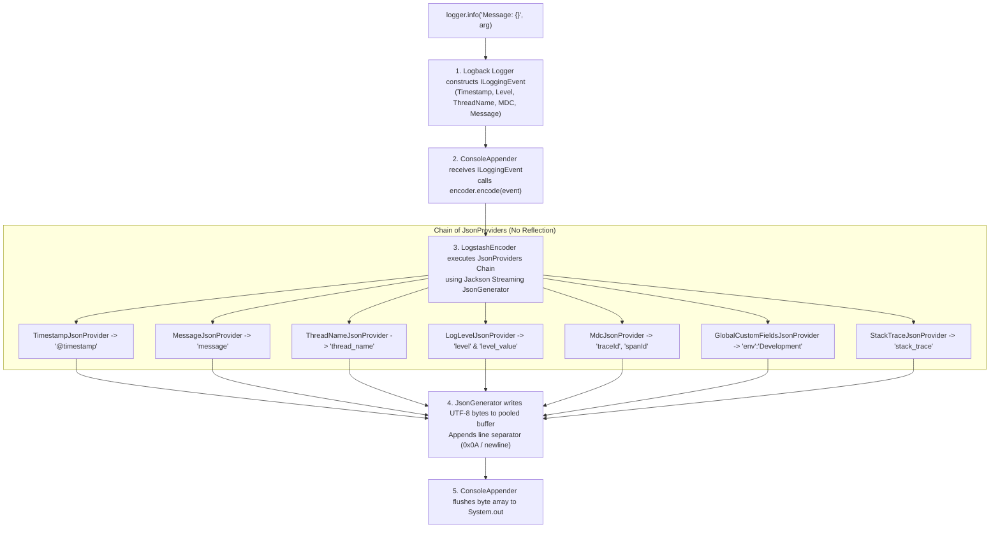

# Structured JSON Logging & LogstashEncoder Under the Hood

This document explains the internal mechanics, JVM runtime pipeline, and architectural benefits of structured JSON logging using **`net.logstash.logback.encoder.LogstashEncoder`** in `crud-kotlin-service`.

---

## 1. High-Level Processing Pipeline



---

## 2. Step-by-Step Breakdown: How Logback Converts Events to JSON

### Step 1: The Code Call & `ILoggingEvent` Instantiation
When application code calls:
```kotlin
logger.info("Order processed for refId='{}'", refId)
```
Logback does **not** allocate or format a string immediately. Instead, it creates an instance of `ch.qos.logback.classic.spi.ILoggingEvent`.

This object captures an immutable runtime snapshot:
* **`event.getTimeStamp()`**: System epoch milliseconds when the log was triggered.
* **`event.getLevel()`**: `Level.INFO`.
* **`event.getThreadName()`**: Captures the thread and coroutine context (e.g. `DefaultDispatcher-worker-1 @sync-ref-1#3`).
* **`event.getLoggerName()`**: Fully-qualified class name (e.g. `com.example.demo.application.service.ResourceApplicationService`).
* **`event.getMessage()` & `getArgumentArray()`**: Formats the message string `"Order processed for refId='ref-10'"`.
* **`event.getMDCPropertyMap()`**: Captures the active SLF4J MDC map (`traceId`, `spanId`).
* **`event.getThrowableProxy()`**: Exception instance and stack trace (if passed).

---

### Step 2: Appender Delegates to Encoder
The configured `ConsoleAppender` in [`src/main/resources/logback-spring.xml`](file:///Users/atifanowar/Workspace/interview/crud-kotlin-service/src/main/resources/logback-spring.xml) receives the `ILoggingEvent`:
```java
public class ConsoleAppender<E> extends OutputStreamAppender<E> {
    @Override
    protected void subAppend(E event) {
        byte[] byteArray = this.encoder.encode(event);
        writeBytes(byteArray);
    }
}
```

---

### Step 3: Jackson Streaming API (Why It's So Fast)
`LogstashEncoder` **does not** use Jackson's high-level `ObjectMapper.writeValueAsString(pojo)`. Doing that would require:
1. Java reflection and getter introspection on every log statement.
2. Allocating intermediate wrapper objects on the JVM heap.
3. Severe garbage collection churn under high throughput (e.g. 5,000 logs/sec).

Instead, `LogstashEncoder` uses **Jackson's low-level Streaming API (`com.fasterxml.jackson.core.JsonGenerator`)**:
1. It calls `generator.writeStartObject()` $\rightarrow$ outputs `{`.
2. It delegates to an ordered chain of specialized **`JsonProvider`s**:

| Provider Class | Output JSON Key | How It Resolves Values |
| :--- | :--- | :--- |
| `LoggingEventFormattedTimestampJsonProvider` | `"@timestamp"` | Formats `event.getTimeStamp()` into ISO-8601 (`"2026-10-19T18:05:04.83163+02:00"`). |
| `LoggingEventLevelJsonProvider` | `"level"`, `"level_value"` | Writes string name (`"INFO"`) and integer code (`20000` for INFO, `40000` for ERROR). |
| `MessageJsonProvider` | `"message"` | Escapes quotes, backslashes, and newlines into valid JSON string literals. |
| `LoggerNameJsonProvider` | `"logger_name"` | Writes `event.getLoggerName()`. |
| `ThreadNameJsonProvider` | `"thread_name"` | Writes thread name, automatically capturing Kotlin `CoroutineName` and coroutine IDs. |
| `GlobalCustomFieldsJsonProvider` | `"env"`, `"stage"` | Injects static or dynamic properties configured in `<customFields>{"env":"${stage}"}</customFields>`. |
| `MdcJsonProvider` | `"traceId"`, `"spanId"` | Iterates over SLF4J MDC keys and writes them as top-level JSON fields for distributed tracing. |
| `StackTraceJsonProvider` | `"stack_trace"` | Only executed if `event.getThrowableProxy() != null`. Runs through `ShortenedThrowableConverter`. |

3. It calls `generator.writeEndObject()` $\rightarrow$ outputs `}`.

---

### Step 4: Shortened Stack Trace Formatting
Standard Java exceptions often print 100+ lines of framework reflection, Netty channels, and Tomcat internals. In [`logback-spring.xml`](file:///Users/atifanowar/Workspace/interview/crud-kotlin-service/src/main/resources/logback-spring.xml), we configured:

```xml
<throwableConverter class="net.logstash.logback.stacktrace.ShortenedThrowableConverter">
    <maxDepthPerThrowable>30</maxDepthPerThrowable>
    <shortenedClassNameLength>40</shortenedClassNameLength>
    <exclude>kotlin\.reflect\.jvm.*</exclude>
    <exclude>org\.apache\.catalina.*</exclude>
</throwableConverter>
```

#### Under the Hood:
1. **Depth Clamping:** Caps stack frames at 30 levels (`<maxDepthPerThrowable>30</maxDepthPerThrowable>`), discarding redundant frames.
2. **Package Name Shortening:** Truncates package names longer than 40 chars (`com.example.demo.application.service` $\rightarrow$ `c.e.d.a.s`).
3. **Regex Filtering:** Strips reflection and servlet engine frames (`kotlin.reflect.jvm.*`, `org.apache.catalina.*`).
4. **Single-Line Escaping:** Any newlines inside the exception stack trace are escaped as literal `\n` characters inside the `"stack_trace"` JSON value.

---

### Step 5: Buffer Recycling & Standard Output
* The `JsonGenerator` writes directly to a reusable, pooled byte buffer (`ByteArrayOutputStream`), avoiding array re-allocations on the heap.
* Appends a line terminator byte (`0x0A` / `\n`).
* Flushes the resulting `byte[]` to `System.out` (`java.io.PrintStream`).

---

## 3. Sample Generated JSON Log

```json
{
  "@timestamp": "2026-10-19T18:05:04.83163+02:00",
  "@version": "1",
  "message": "Closing JPA EntityManagerFactory for persistence unit 'default'",
  "logger_name": "org.springframework.orm.jpa.LocalContainerEntityManagerFactoryBean",
  "thread_name": "SpringApplicationShutdownHook",
  "level": "INFO",
  "level_value": 20000,
  "stage": "Development",
  "env": "Development"
}
```

When an exception occurs:
```json
{
  "@timestamp": "2026-10-19T18:05:10.12345+02:00",
  "@version": "1",
  "message": "External API returned error status: 503",
  "logger_name": "c.e.d.i.a.o.c.ExternalWebClientAdapter",
  "thread_name": "DefaultDispatcher-worker-1 @sync-ref-42#88",
  "level": "ERROR",
  "level_value": 40000,
  "env": "Production",
  "traceId": "4bf92f3577b34da6a3ce929d0e0e4736",
  "spanId": "00f067aa0ba902b7",
  "stack_trace": "org.springframework.web.reactive.function.client.WebClientResponseException: 503 Service Unavailable\n\tat org.springframework.web.reactive.function.client.DefaultWebClient$DefaultResponseSpec.createException(DefaultWebClient.java:312)\n\tat c.e.d.i.a.o.c.ExternalWebClientAdapter.fetchEnrichmentDataAsync(ExternalWebClientAdapter.kt:56)..."
}
```

---

## 4. Why JSON Logging is Crucial in Production

| Aspect | Plain Text Logging | Structured JSON (`LogstashEncoder`) |
| :--- | :--- | :--- |
| **Multiline Stack Traces** | Broken across 50 separate log lines in Kubernetes log collectors (FluentBit, Promtail). | Preserved as a single log line with escaped `\n`, eliminating broken log streams. |
| **Log Forwarder Parsing** | Requires brittle Regular Expressions / Grok patterns in FluentBit / Logstash. | Ingested natively by Elasticsearch, OpenSearch, Datadog, and Grafana Loki without CPU-heavy parsing. |
| **Trace-Log Correlation** | Trace ID must be grepped out of arbitrary string patterns. | `traceId` and `spanId` are first-class JSON fields linked directly to OpenTelemetry spans. |
| **Cloud Ingestion Cost** | Verbose 100-line Java reflection traces inflate GB ingestion charges. | `ShortenedThrowableConverter` reduces stack trace payload size by **60% to 80%**. |
