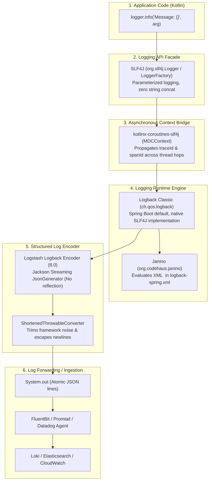

# Logging Architecture & Libraries Guide

A complete technical reference detailing the logging stack used across `crud-kotlin-service`: the API facade (**SLF4J**), runtime engine (**Logback**), structured JSON encoder (**Logstash Logback Encoder**), asynchronous context propagator (**`kotlinx-coroutines-slf4j`**), and dynamic configuration evaluator (**Janino**).

---

## 1. The 5-Layer Logging Stack Overview

Rather than relying on a single monolithic logging library, modern production systems decouple the API, engine, formatting, and asynchronous propagation:



### Dependency Breakdown in [`build.gradle.kts`](file:///Users/atifanowar/Workspace/interview/crud-kotlin-service/build.gradle.kts#L44-L63):

| Layer | Artifact / Dependency | Scope | Primary Purpose |
| :--- | :--- | :--- | :--- |
| **API Facade** | `org.slf4j:slf4j-api` | Transitive (`spring-boot-starter`) | Unified logging API; decouples business code from specific logging engines. |
| **Engine** | `ch.qos.logback:logback-classic` | Transitive (`spring-boot-starter-logging`) | Manages log appenders, filtering, and lifecycle. |
| **JSON Encoder** | `net.logstash.logback:logstash-logback-encoder:8.0` | `implementation` | Streams structured single-line JSON records using zero-reflection Jackson `JsonGenerator`. |
| **Coroutine MDC** | `org.jetbrains.kotlinx:kotlinx-coroutines-slf4j` | `implementation` | Transfers SLF4J MDC (`traceId`, `spanId`) across coroutine suspension points and thread hops. |
| **XML Evaluator** | `org.codehaus.janino:janino` | `implementation` | Allows conditional expressions (`<if condition='...'>`) in [`logback-spring.xml`](file:///Users/atifanowar/Workspace/interview/crud-kotlin-service/src/main/resources/logback-spring.xml). |

---

## 2. Layer 1: SLF4J (Simple Logging Facade for Java)

### Why SLF4J Instead of Direct Logback or java.util.logging?
1. **Decoupled Architecture:** Business logic depends strictly on `org.slf4j.Logger` and `org.slf4j.LoggerFactory`. If the underlying logging engine changes in the future, zero application code needs modification.
2. **Parameterized Logging Performance:**
   ```kotlin
   // GOOD: Parameterized logging
   logger.info("Resource created: id={}, ref={}", resource.id.value, resource.externalReferenceId)

   // BAD: String concatenation
   logger.info("Resource created: id=" + resource.id.value + ", ref=" + resource.externalReferenceId)
   ```
   * With string concatenation (`+`), string builder allocations and `.toString()` calls execute **even if the log level is disabled** (e.g., `DEBUG` in production).
   * With SLF4J's `{}` placeholder syntax, arguments are only formatted if the logger's level is active, saving millions of unnecessary JVM string allocations per minute.

### Code Idiom in Kotlin:
```kotlin
@Service
class ResourceApplicationService(
    private val repositoryPort: ResourceRepositoryPort,
    private val externalClientPort: ExternalClientPort,
) {
    // Companion object or private val logger idiom
    private val logger = LoggerFactory.getLogger(javaClass)
}
```

---

## 3. Layer 2: Logback Classic (The Engine)

### Why Logback Classic?
* **Spring Boot's Native Standard:** Pre-configured out of the box in `spring-boot-starter-logging`.
* **Zero Adaptation Overhead:** Logback natively implements SLF4J interfaces (`ch.qos.logback.classic.Logger` directly implements `org.slf4j.Logger`). Unlike Log4j2 which requires an intermediate adapter layer (`log4j-slf4j-impl`), Logback introduces zero bridge overhead.
* **Spring Boot Integration:** Supports `logback-spring.xml`, enabling access to Spring properties via `<springProperty>` before beans are loaded:
  ```xml
  <springProperty scope="context" name="stage" source="app.env" defaultValue="Development"/>
  ```

---

## 4. Layer 3: Logstash Logback Encoder (Structured JSON Output)

Configured in [`src/main/resources/logback-spring.xml`](file:///Users/atifanowar/Workspace/interview/crud-kotlin-service/src/main/resources/logback-spring.xml#L8-L18):

```xml
<appender name="CONSOLE" class="ch.qos.logback.core.ConsoleAppender">
    <encoder class="net.logstash.logback.encoder.LogstashEncoder">
        <customFields>{"env":"${stage}"}</customFields>
        <throwableConverter class="net.logstash.logback.stacktrace.ShortenedThrowableConverter">
            <maxDepthPerThrowable>30</maxDepthPerThrowable>
            <shortenedClassNameLength>40</shortenedClassNameLength>
            <exclude>kotlin\.reflect\.jvm.*</exclude>
            <exclude>org\.apache\.catalina.*</exclude>
        </throwableConverter>
    </encoder>
</appender>
```

### Key Production Capabilities:
1. **Zero-Reflection Streaming:** Uses Jackson's low-level `JsonGenerator` to stream UTF-8 bytes directly into a buffer. It avoids `ObjectMapper.writeValueAsString()` reflection overhead and heap allocation churn.
2. **Single-Line Guarantee:** Replaces raw newline characters in messages and stack traces with `\n` escape sequences, guaranteeing that every log entry is exactly **one physical line**. This prevents Kubernetes log collectors (FluentBit, Promtail) from splitting a single exception stack trace into 40 disconnected lines.
3. **Stacktrace Optimization (`ShortenedThrowableConverter`):**
   * Limits exception stack traces to 30 frames (`maxDepthPerThrowable`).
   * Strips noisy framework internals (`kotlin.reflect.jvm.*`, `org.apache.catalina.*`), retaining only relevant application logic.

---

## 5. Layer 4: The Coroutine Context Problem & `kotlinx-coroutines-slf4j`

### The Asynchronous MDC Trap:
In traditional synchronous Spring MVC, 1 request = 1 Tomcat worker thread. SLF4J's Mapped Diagnostic Context (MDC) is backed by Java's `ThreadLocal`.

In Kotlin Coroutines:
1. A request starts on `DefaultDispatcher-worker-1`. The trace ID (`0367737b6045f3d75e3c7501e59aca08`) is written to `ThreadLocal`.
2. The coroutine calls `externalApiWebClient.fetchEnrichmentDataAsync(...)` and **suspends**.
3. Netty performs non-blocking network I/O.
4. When the response arrives, the coroutine is resumed on **`DefaultDispatcher-worker-4`**.
5. **The Bug:** `DefaultDispatcher-worker-4` is a completely different physical OS thread! Its `ThreadLocal` map is empty or contains stale trace IDs from an unrelated request!

```text
Without MDC Bridge:
[thread-1] INFO - [traceId=0367737b] [COROUTINE-SUSPEND] refId='ref-1' preparing HTTP call
-- suspension & resumption on thread-4 --
[thread-4] INFO - [traceId=MISSING!]  [COROUTINE-RESUME]  refId='ref-1' resumed after I/O
```

### The Solution: `kotlinx-coroutines-slf4j` (`MDCContext`)
`kotlinx-coroutines-slf4j` provides `MDCContext()`, an implementation of Kotlin's `ThreadContextElement`:

```kotlin
// In coroutine launch or async fan-out:
withContext(Dispatchers.Default + MDCContext()) {
    // When the coroutine suspends, MDCContext snapshots the SLF4J MDC map.
    // When the coroutine resumes on worker-4, MDCContext automatically 
    // injects the snapshot into worker-4's ThreadLocal!
}
```

This guarantees 100% trace correlation across coroutine suspensions without missing trace IDs.

---

## 6. Layer 5: Janino (Conditional Evaluator)

In [`build.gradle.kts`](file:///Users/atifanowar/Workspace/interview/crud-kotlin-service/build.gradle.kts#L62):
```kotlin
implementation("org.codehaus.janino:janino")
```

### Why Janino is Required:
Logback allows dynamic XML conditional logic:
```xml
<if condition='property("stage").equals("Production")'>
    <then>
        <root level="INFO"><appender-ref ref="JSON_CONSOLE"/></root>
    </then>
    <else>
        <root level="DEBUG"><appender-ref ref="PRETTY_CONSOLE"/></root>
    </else>
</if>
```
Logback delegates the evaluation of Java expressions in `<if condition="...">` to the **Janino compiler**. Without `janino` on the classpath, Logback emits a warning and ignores all `<if>` blocks.

---

## 7. Sample Production JSON Log Record

Here is an actual JSON log record emitted by this microservice during a batch sync operation:

```json
{
  "@timestamp": "2026-10-19T18:25:56.323237+02:00",
  "@version": "1",
  "message": "[GATHER-RESUME] awaitAll() finished. batchSync resumed on thread=[DefaultDispatcher-worker-24]. Saving 100 entities to database...",
  "logger_name": "com.example.demo.application.service.ResourceApplicationService",
  "thread_name": "DefaultDispatcher-worker-24",
  "level": "INFO",
  "level_value": 20000,
  "stage": "Development",
  "traceId": "0367737b6045f3d75e3c7501e59aca08",
  "spanId": "97b38d0fbc72fdc3",
  "env": "Development"
}
```

* **`@timestamp`**: ISO-8601 UTC timestamp.
* **`traceId` & `spanId`**: OpenTelemetry trace context automatically bound to SLF4J MDC via Micrometer Tracing.
* **`env`**: Injected via `<customFields>` in `logback-spring.xml`.
* **`thread_name`**: Displays the active coroutine dispatcher worker thread.

---

## 8. 60-Second Interview PREP Script

When asked: *"Which logging libraries do you use, and how do you handle logging in a Kotlin Coroutine microservice?"*

* **Point (P):**
  > "We use **SLF4J** as the logging facade backed by **Logback Classic**, formatted as structured single-line JSON via **Logstash Logback Encoder**, with **`kotlinx-coroutines-slf4j`** preserving MDC context across asynchronous thread hops."

* **Reason (R):**
  > "In containerized environments, unstructured plaintext logs break log shippers when exceptions span multiple lines. Furthermore, standard SLF4J MDC relies on `ThreadLocal`, which fails in Kotlin Coroutines because coroutines hop between worker threads upon suspension."

* **Example (E):**
  > "In application code, we log via `LoggerFactory.getLogger(javaClass)` using `{}` parameterized placeholders to avoid string allocation overhead. In `logback-spring.xml`, `LogstashEncoder` utilizes Jackson's non-reflective streaming API and `ShortenedThrowableConverter` to output atomic JSON records with escaped newlines. To prevent trace context loss during coroutine fan-out, `kotlinx-coroutines-slf4j` snapshots the MDC map and re-populates the new thread's `ThreadLocal` upon resumption."

* **Point (P):**
  > "This guarantees zero-reflection performance, clean OpenTelemetry trace correlation in Jaeger, and reliable ingestion by FluentBit or Datadog without log fragmentation."
