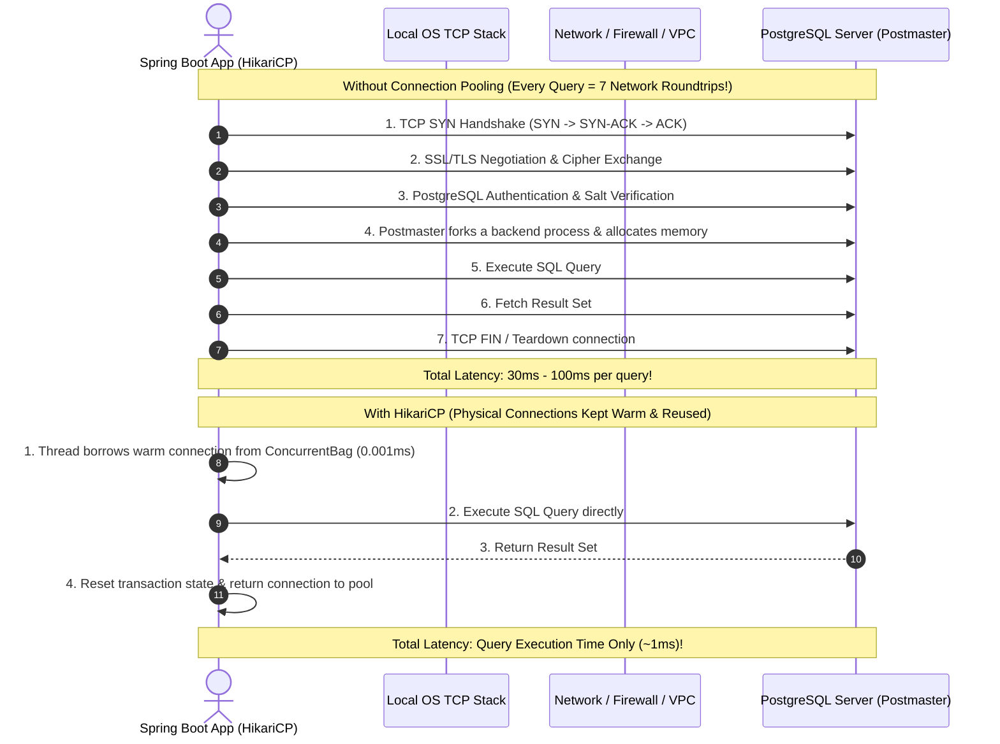

# Spring Boot DataSource & HikariCP Configuration: Complete Deep Dive

In Spring Boot 3 enterprise applications, the **`DataSource`** is the foundational factory responsible for creating, managing, and pooling physical database connections to relational databases (PostgreSQL in our service).

This guide provides a comprehensive breakdown of:
1. Every DataSource property defined in [`src/main/resources/application.yml`](file:///src/main/resources/application.yml)
2. Advanced & production-critical HikariCP properties
3. The internal lifecycle of a database connection
4. Architectural tradeoffs (Pool sizing formulas, connection leaks, Coroutine thread starvation)
5. Senior Engineer interview Q&A

---

## Table of Contents
1. [Mental Model: The Database Connection Lifecycle](#1-mental-model-the-database-connection-lifecycle)
2. [Defined Properties in `application.yml` (Line-by-Line)](#2-defined-properties-in-applicationyml-line-by-line)
   - [2.1 `spring.datasource.url`](#21-springdatasourceurl)
   - [2.2 `spring.datasource.username` & `password`](#22-springdatasourceusername--password)
   - [2.3 `spring.datasource.driver-class-name`](#23-springdatasourcedriver-class-name)
   - [2.4 `spring.datasource.hikari.maximum-pool-size`](#24-springdatasourcehikarimaximum-pool-size)
   - [2.5 `spring.datasource.hikari.minimum-idle`](#25-springdatasourcehikariminimum-idle)
   - [2.6 `spring.datasource.hikari.idle-timeout`](#26-springdatasourcehikariidle-timeout)
   - [2.7 `spring.datasource.hikari.connection-timeout`](#27-springdatasourcehikariconnection-timeout)
   - [2.8 `spring.datasource.hikari.pool-name`](#28-springdatasourcehikaripool-name)
3. [Production-Critical Properties You Must Add](#3-production-critical-properties-you-must-add)
   - [3.1 `max-lifetime` (The Cloud NAT / AWS RDS Life-Saver)](#31-max-lifetime-the-cloud-nat--aws-rds-life-saver)
   - [3.2 `keepalive-time` (Preventing Dead Socket Drop)](#32-keepalive-time-preventing-dead-socket-drop)
   - [3.3 `leak-detection-threshold` (Catching Unclosed Connections)](#33-leak-detection-threshold-catching-unclosed-connections)
   - [3.4 `auto-commit: false`](#34-auto-commit-false)
4. [HikariCP Pool Sizing: The PostgreSQL Golden Rule](#4-hikaricp-pool-sizing-the-postgresql-golden-rule)
5. [HikariCP vs. Tomcat JDBC vs. DBCP2](#5-hikaricp-vs-tomcat-jdbc-vs-dbcp2)
6. [Kotlin Coroutines & HikariCP Gotchas](#6-kotlin-coroutines--hikaricp-gotchas)
7. [Sub-Guides in this Directory](#7-sub-guides-in-this-directory)
8. [60-Second Interview PREP Scripts](#8-60-second-interview-prep-scripts)

---

## 1. Mental Model: The Database Connection Lifecycle

Before tuning properties, it is essential to understand **why** connection pooling exists and how expensive a physical TCP/database handshake is.



### HikariCP's Core Mechanism: `ConcurrentBag`
Unlike older connection pools (Commons DBCP, C3P0) that locked the entire pool during checkout using heavy `synchronized` blocks or `ReentrantLock`, HikariCP uses a custom lock-free lock-stealing collection called **`ConcurrentBag`**:
1. **Thread-Local Cache:** HikariCP attempts to borrow the connection that the *current thread used most recently*. If available, acquisition is completely lock-free (`ThreadLocal.get()`).
2. **Shared Queue:** If the thread-local connection is unavailable, it checks a lock-free queue (`CopyOnWriteArrayList`).
3. **Handoff Synchronizer:** If all connections are in use, the thread registers a waiter on a `SynchronousQueue` waiting for another thread to release a connection.

---

## 2. Defined Properties in `application.yml` (Line-by-Line)

The current [`application.yml`](file:///src/main/resources/application.yml#L40-L51) configures:

```yaml
spring:
  datasource:
    url: ${SPRING_DATASOURCE_URL:jdbc:postgresql://localhost:5432/crud_db}
    username: ${SPRING_DATASOURCE_USERNAME:app_user}
    password: ${SPRING_DATASOURCE_PASSWORD:app_password}
    driver-class-name: org.postgresql.Driver
    hikari:
      maximum-pool-size: 10
      minimum-idle: 2
      idle-timeout: 30000
      connection-timeout: 20000
      pool-name: ResourceHikariCP
```

---

### 2.1 `spring.datasource.url`
```yaml
url: ${SPRING_DATASOURCE_URL:jdbc:postgresql://localhost:5432/crud_db}
```
- **What it is:** The JDBC Connection URL indicating the protocol (`jdbc:`), database engine subprotocol (`postgresql:`), host (`localhost`), port (`5432`), and database name (`crud_db`).
- **Environment Variable Fallback:** `${SPRING_DATASOURCE_URL:...}` allows 12-Factor App dynamic configuration across Docker, Kubernetes, and local development.
- **Production Query Parameters:** In production, the URL should include network and socket-level timeouts:
  ```text
  jdbc:postgresql://postgres.prod:5432/crud_db?sslmode=verify-full&sslrootcert=/etc/ssl/certs/rds-ca.pem&connectTimeout=5&socketTimeout=30&tcpKeepAlive=true
  ```
  - `connectTimeout=5`: Aborts the initial TCP socket connect after 5 seconds if the database server is unreachable or DNS hangs.
  - `socketTimeout=30`: Aborts long-hanging queries at the OS socket level after 30 seconds if the database server crashes midway through a transaction.
  - `tcpKeepAlive=true`: Enables OS-level TCP keep-alive probes.

---

### 2.2 `spring.datasource.username` & `password`
```yaml
username: ${SPRING_DATASOURCE_USERNAME:app_user}
password: ${SPRING_DATASOURCE_PASSWORD:app_password}
```
- **What it is:** Credentials used by the PostgreSQL JDBC driver during authentication (SCRAM-SHA-256 or MD5).
- **Security Best Practice:**
  - Never hardcode plaintext production passwords in `application.yml` or git.
  - In Kubernetes, inject them via Secrets (`envFrom: secretRef`) or HashiCorp Vault / AWS Secrets Manager.
  - In test profiles ([`src/test/resources/application.yml`](file:///src/test/resources/application.yml)), an embedded H2 database is used with `username: sa` and empty `password: ""` for fast isolated test execution.

---

### 2.3 `spring.datasource.driver-class-name`
```yaml
driver-class-name: org.postgresql.Driver
```
- **What it is:** The fully-qualified class name of the JDBC driver that implements `java.sql.Driver`.
- **Is it mandatory in Spring Boot?**
  - **No.** Spring Boot can automatically deduce the driver class from the JDBC URL prefix (`jdbc:postgresql:` -> `org.postgresql.Driver`, `jdbc:h2:` -> `org.h2.Driver`, `jdbc:mysql:` -> `com.mysql.cj.jdbc.Driver`).
  - **Why define it explicitly?** Explicit declaration speeds up startup by avoiding class-path scanning heuristics and guarantees that misconfigured URLs fail fast with a `ClassNotFoundException`.

---

### 2.4 `spring.datasource.hikari.maximum-pool-size`
```yaml
maximum-pool-size: 10
```
- **What it is:** The maximum number of physical database connections HikariCP will keep in the pool (both active in transactions + idle).
- **Default in HikariCP:** 10.
- **Why 10 is usually optimal:**
  - PostgreSQL uses a **process-per-connection** model. Every connection on PostgreSQL spawns a dedicated OS backend process with private memory (`work_mem`, `temp_buffers`).
  - Having 200 Tomcat worker threads does **not** mean you need 200 database connections! If 200 threads hit the database simultaneously, the database disk heads, memory buses, and CPU cores thrash with context switching.
  - A small pool (10-20 connections) forces threads to queue briefly at HikariCP, maximizing database throughput and CPU cache hits.

---

### 2.5 `spring.datasource.hikari.minimum-idle`
```yaml
minimum-idle: 2
```
- **What it is:** The minimum number of idle connections HikariCP tries to maintain in the pool.
- **Default:** Equal to `maximum-pool-size` (10).
- **Behavior with `minimum-idle: 2` and `maximum-pool-size: 10`:**
  - At startup or during low traffic, HikariCP keeps 2 idle connections alive.
  - When traffic spikes, HikariCP dynamically creates up to 8 more connections (up to 10).
  - When traffic subsides, idle connections beyond 2 are closed after `idle-timeout` (30 seconds).
- **Production Recommendation: Fixed Pool Size (`minimum-idle` == `maximum-pool-size`)**
  - Brett Wooldridge (author of HikariCP) strongly recommends **omitting `minimum-idle`** so the pool size is fixed.
  - **Why?** Dynamic connection creation during traffic spikes adds 30ms-100ms latency to the user requests that happen to trigger connection expansion. A fixed pool is pre-warmed and latency-predictable.

---

### 2.6 `spring.datasource.hikari.idle-timeout`
```yaml
idle-timeout: 30000 # 30 seconds (in milliseconds)
```
- **What it is:** The maximum time in milliseconds that a connection is allowed to sit idle in the pool before it is retired and closed.
- **Constraint:** Only applies when `minimum-idle` is configured to be less than `maximum-pool-size`. If `minimum-idle == maximum-pool-size`, connections are never retired due to idleness.
- **Minimum allowed value:** 10,000ms (10 seconds). Default is 600,000ms (10 minutes).
- **Why 30,000ms (30s) here?** Helps reclaim database server resources quickly after traffic bursts in development or memory-constrained staging environments.

---

### 2.7 `spring.datasource.hikari.connection-timeout`
```yaml
connection-timeout: 20000 # 20 seconds (in milliseconds)
```
- **What it is:** The maximum number of milliseconds that an application thread will wait to borrow a connection from the pool before throwing a `SQLTransientConnectionException`.
- **Default:** 30,000ms (30 seconds).
- **Why 20,000ms (20s) here?**
  - If all 10 connections are busy handling long queries, an incoming HTTP request thread will block and wait for a connection to be released.
  - If no connection is released within 20s, HikariCP throws:
    ```text
    java.sql.SQLTransientConnectionException: ResourceHikariCP - Connection is not available, request timed out after 20000ms
    ```
  - This prevents HTTP worker threads from waiting indefinitely, allowing Spring MVC to catch the exception and return HTTP `503 Service Unavailable` or `500 Internal Server Error`.
  - **Microservice Best Practice:** In high-throughput APIs, 20s is often too high; 3,000ms - 5,000ms (3s - 5s) is preferred to fail fast before upstream API gateways (e.g., NGINX / Cloudflare with 10s-30s timeouts) drop the request.

---

### 2.8 `spring.datasource.hikari.pool-name`
```yaml
pool-name: ResourceHikariCP
```
- **What it is:** A user-defined label for this connection pool.
- **Default:** Auto-generated (`HikariPool-1`, `HikariPool-2`).
- **Why it matters:**
  - **JMX & Prometheus Metrics:** Shows up in Grafana metrics tagged as `hikaricp_connections{pool="ResourceHikariCP"}`.
  - **Thread Dumps & Logs:** When analyzing thread dumps or connection leak logs, pool threads are clearly named `ResourceHikariCP connection adder` and `ResourceHikariCP housekeeper`.

---

## 3. Production-Critical Properties You Must Add

While the defined properties provide a working baseline, production deployments on AWS, GCP, Azure, or Kubernetes require four additional properties to prevent catastrophic silent connection drops:

```yaml
spring:
  datasource:
    hikari:
      maximum-pool-size: 10
      minimum-idle: 10            # Match maximum-pool-size for fixed pool
      connection-timeout: 3000    # 3s fail-fast
      max-lifetime: 1740000       # 29 minutes (CRITICAL for Cloud/Firewalls)
      keepalive-time: 120000      # 2 minutes (TCP keep-alive probe)
      leak-detection-threshold: 2000 # 2 seconds (Detects unclosed connections)
      auto-commit: false          # Explicit transaction management
```

### 3.1 `max-lifetime` (The Cloud NAT / AWS RDS Life-Saver)
```yaml
max-lifetime: 1740000 # 29 minutes (default is 30 minutes / 1800000ms)
```
- **The Problem:** Cloud firewalls, AWS VPC NAT Gateways, Azure Load Balancers, and stateful network switches silently terminate TCP connections that have been idle or open longer than their timeout table (often 15-30 minutes). When the application next attempts to execute a query on this socket, it hangs or crashes with `Connection reset by peer` or `Broken pipe`.
- **The Fix:** `max-lifetime` forces HikariCP to gracefully retire and recreate physical connections before the network middlebox terminates them.
- **Rule of Thumb:** Set `max-lifetime` to **2 to 3 minutes less** than the infrastructure or database server timeout (e.g. PostgreSQL `idle_in_transaction_session_timeout` or AWS RDS 30-minute default).

---

### 3.2 `keepalive-time` (Preventing Dead Socket Drop)
```yaml
keepalive-time: 120000 # 2 minutes (120,000ms)
```
- **What it is:** Introduced in HikariCP 4.0.1. HikariCP will "ping" idle connections periodically by sending a lightweight heartbeat query (or JDBC4 `isValid()`).
- **Why it matters:** Keeps the TCP connection active in firewall state tables without having to close and recreate the physical connection.
- **Constraint:** Must be less than `max-lifetime`.

---

### 3.3 `leak-detection-threshold` (Catching Unclosed Connections)
```yaml
leak-detection-threshold: 2000 # 2000ms = 2 seconds
```
- **The Problem:** A developer forgets to close a connection, or a long-running external HTTP call is mistakenly made inside a `@Transactional` boundary. The database connection remains checked out and cannot be used by other threads.
- **The Fix:** If a connection is borrowed and not returned within 2,000ms, HikariCP logs a warning with the **exact stack trace of the thread that checked it out**:
  ```text
  WARN  c.z.h.p.ProxyLeakTask - Connection leak detection triggered for org.postgresql.jdbc.PgConnection@6b38c2 on thread http-nio-8080-exec-1
  java.lang.Exception: Apparent connection leak detected
      at com.example.demo.application.service.ResourceApplicationService.createResource(ResourceApplicationService.kt:45)
  ```
- **Safety:** It does NOT terminate or close the connection; it only logs the alert so you can pinpoint the offending code!

---

### 3.4 `auto-commit: false`
```yaml
auto-commit: false
```
- By default in JDBC, every single SQL statement is committed immediately (`auto-commit: true`).
- In Spring Boot with Spring Data JPA and Hibernate, Spring's `JpaTransactionManager` manages transaction boundaries (`BEGIN` ... `COMMIT` / `ROLLBACK`) via `@Transactional`.
- Setting `auto-commit: false` avoids unnecessary JDBC driver mode-switching overhead.

---

## 4. HikariCP Pool Sizing: The PostgreSQL Golden Rule

One of the most frequent junior vs. senior engineer interview questions is:  
*"Our API has 200 Tomcat worker threads. Should our database pool size be 200?"*

**Answer: NO! A larger pool makes your application SLOWER, not faster.**

### The Formula
Brett Wooldridge (HikariCP) and the PostgreSQL development team established the empirical formula:

$$\text{connections} = ((\text{CPU cores} \times 2) + \text{effective spindle count})$$

For an 8-core database server with SSD storage:
$$\text{connections} = (8 \times 2) + 1 = 17 \text{ connections!}$$

```mermaid
graph TD
    subgraph ScenarioA["Scenario A: 200 Database Connections (Disaster)"]
        T200["200 Concurrent Queries Hit DB"] --> CPUThrash["PostgreSQL Spawns 200 Backend Processes"]
        CPUThrash --> CxtSwitch["CPU Core Context-Switch Thrashing"]
        CxtSwitch --> DiskSaturate["Disk I/O Controller Overwhelmed"]
        DiskSaturate --> HighLatency["Query Latency: 5,000ms ❌ High Memory & CPU Lockup"]
    end

    subgraph ScenarioB["Scenario B: 15 Database Connections (Optimized)"]
        T15["15 Queries Run In Parallel"] --> FullCore["8 CPU Cores Run at 100% Efficiency"]
        FullCore --> FastDisk["SSD Sequential/Burst Reads"]
        FastDisk --> FastReturn["Query Latency: 2ms ✅ Connections Returned in Milliseconds!"]
    end
```



### Why?
1. **CPU Context Switching:** If 200 threads compete for 8 CPU cores, the OS spends more time saving and restoring CPU register states (context switching) than executing SQL statements.
2. **Disk I/O Bottlenecks:** Hard disks and SSD controllers have physical queue limits. 15 focused queries allow the disk controller to read sequentially; 200 concurrent queries force random disk seeks.
3. **Connection Queuing is Cheap:** It is dramatically faster for 185 threads to wait in a non-blocking queue in Java memory for 2ms than for 200 queries to lock up PostgreSQL.

---

## 5. HikariCP vs. Tomcat JDBC vs. DBCP2

Why is HikariCP the default connection pool in Spring Boot since version 2.0?

| Metric / Feature | HikariCP | Apache Commons DBCP2 | Tomcat JDBC Pool |
| :--- | :--- | :--- | :--- |
| **Connection Borrow Latency** | **~25 microseconds** (Microsecond-level) | ~400 microseconds | ~180 microseconds |
| **Concurrency Data Structure** | Lock-free **`ConcurrentBag`** with Thread-Local caching | Synchronized locks | `ReentrantLock` |
| **Bytecode Optimization** | Javassist-generated compiled proxies (eliminates reflection) | Standard reflection proxies | Standard reflection proxies |
| **Memory Footprint** | Extremely small (~130KB JAR) | Medium | Medium |
| **Reliability & Leak Detection** | Built-in `leak-detection-threshold` | Third-party / complex | `removeAbandonedTimeout` |
| **Spring Boot Integration** | **Default out-of-the-box** | Requires manual dependency | Requires manual dependency |

---

## 6. Kotlin Coroutines & HikariCP Gotchas

Our service uses Kotlin Coroutines for asynchronous, non-blocking execution (`suspend fun`). However, standard JDBC (and HikariCP) is **fundamentally blocking I/O**:

```kotlin
// ⚠️ DANGER ZONE: Coroutine Connection Starvation
suspend fun badDesign(): ResourceResponse = coroutineScope {
    // 1. Thread borrows JDBC connection
    val entity = resourceRepository.findById(id) 

    // 2. Thread SUSPENDS while waiting for external HTTP API (3000ms)
    // BUT the JDBC Connection is STILL HELD by the transaction!
    val externalData = webClient.get().awaitSingle() 

    // 3. Thread resumes and updates entity
    resourceRepository.save(entity) 
}
```

### The Pitfall:
When a coroutine suspends at `awaitSingle()`, the underlying worker thread is freed, but **the JDBC connection remains checked out from HikariCP!**  
If 10 coroutines make external HTTP calls while holding a database connection, **the entire HikariCP pool is starved**, blocking all other database operations across the microservice.

### The Solution (Hexagonal Architecture Pattern):
In [`ResourceApplicationService.kt`](file:///src/main/kotlin/com/example/demo/application/service/ResourceApplicationService.kt), our service cleanly decouples external I/O from database transactions:
1. **First:** Fetch external data over HTTP asynchronously using WebClient (`externalClientPort.fetchEnrichmentData()`). *No database connection is held!*
2. **Second:** Open the database transaction, persist the entity, and immediately commit/release the connection.

---

## 7. Sub-Guides in this Directory

For deeper technical implementation details, read the companion guides in this directory:
- [hikari-connection-pool-deep-dive.md](file:///repo-wiki/springboot/datasource/hikari-connection-pool-deep-dive.md): `ConcurrentBag` internals, Javassist bytecode proxies, and pool state transitions.
- [connection-timeouts-and-leak-detection.md](file:///repo-wiki/springboot/datasource/connection-timeouts-and-leak-detection.md): Detailed mechanics of `max-lifetime`, `keepalive-time`, and how to debug connection leaks.
- [postgresql-jdbc-driver-and-tuning.md](file:///repo-wiki/springboot/datasource/postgresql-jdbc-driver-and-tuning.md): PostgreSQL JDBC URL parameters, binary transfer, statement caching, and batch insert optimizations.

---

## 8. 60-Second Interview PREP Scripts

### Question 1: "Explain how HikariCP works and why Spring Boot chose it as the default connection pool."
> **Answer:**  
> "HikariCP is the default connection pool in Spring Boot because it delivers microsecond-level connection borrow latency through three architectural innovations:  
> 1. **`ConcurrentBag`:** A lock-free collection that uses thread-local caching so threads can re-borrow the connection they just used without acquiring global locks.  
> 2. **Bytecode Optimization:** It uses Javassist to compile connection proxies directly into bytecode, eliminating reflection overhead.  
> 3. **Elimination of Defensive Copies:** It eliminates redundant array cloning and object allocations in the critical borrow/return path.  
> In our service, HikariCP manages connections to PostgreSQL with a tuned pool of 10 connections, providing rock-solid throughput without overwhelming database CPU or memory."

---

### Question 2: "What is `max-lifetime` in HikariCP, and why is it essential in cloud environments?"
> **Answer:**  
> "`max-lifetime` determines the maximum duration a physical database connection is allowed to exist before HikariCP retires and recreates it.  
> In cloud architectures (like AWS RDS, Azure Database, or Kubernetes with NAT Gateways), stateful firewalls silently terminate idle TCP sockets after 15 to 30 minutes without sending a TCP RST packet. If an application attempts to use that dead socket, queries hang or fail with 'Connection reset by peer'.  
> By setting `max-lifetime` to 28-29 minutes—just under the firewall timeout—HikariCP retires connections proactively from the client side, ensuring that every connection in the pool is valid and avoiding mid-flight socket crashes."

---

### Question 3: "If our microservice has 200 Tomcat worker threads, should we set HikariCP's `maximum-pool-size` to 200?"
> **Answer:**  
> "No, setting the database pool size to 200 would severely degrade database performance.  
> PostgreSQL uses a process-per-connection architecture. If 200 connections run queries concurrently, the database CPU thrashes from operating system context switching, and the storage disk controller is overwhelmed by concurrent random I/O.  
> Following the PostgreSQL formula $((\text{cores} \times 2) + \text{spindles})$, a pool of 10 to 20 connections is optimal for an 8-core database server. Threads that need a connection queue briefly in Java memory for a fraction of a millisecond, allowing PostgreSQL to execute queries at maximum sequential CPU and disk efficiency."
