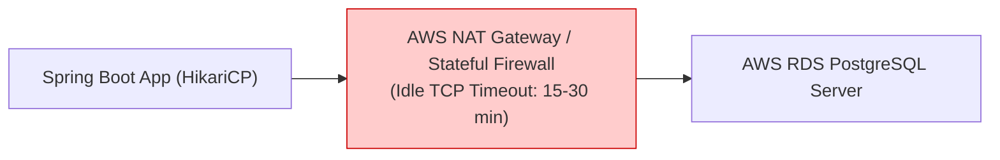

# HikariCP Timeouts, Connection Leaks & Cloud Failure Modes

In high-concurrency production environments, misconfigured connection timeouts and undetected connection leaks are among the most common causes of cascading microservice outages.

This guide provides a comprehensive breakdown of:
1. The 5 HikariCP timeouts and their mathematical relationships
2. Why cloud firewalls (AWS VPC, Azure, GCP) silently kill idle connections
3. How connection leaks occur and how `leak-detection-threshold` captures stack traces
4. Real-world incident case studies and debugging runbooks

---

## Table of Contents
1. [The 5 Critical HikariCP Timeouts](#1-the-5-critical-hikaricp-timeouts)
2. [Cloud Failure Mode: The Silent TCP Reset (Why `max-lifetime` is Mandatory)](#2-cloud-failure-mode-the-silent-tcp-reset-why-max-lifetime-is-mandatory)
3. [Connection Leaks: The Silent Microservice Killer](#3-connection-leaks-the-silent-microservice-killer)
4. [Configuring `leak-detection-threshold`](#4-configuring-leak-detection-threshold)
5. [Real-World Outage Scenarios & Debugging Runbook](#5-real-world-outage-scenarios--debugging-runbook)

---

## 1. The 5 Critical HikariCP Timeouts

HikariCP enforces a strict hierarchy of timeouts. Configuring them incorrectly can cause startup failures or cascading latency spikes.

```
┌────────────────────────────────────────────────────────────────────────┐
│                        HikariCP Timeout Hierarchy                      │
├──────────────────────┬──────────────────────┬──────────────────────────┤
│ connection-timeout   │ idle-timeout         │ max-lifetime             │
│ (Thread Wait Limit)  │ (Idle Eviction Time) │ (Maximum Connection Age) │
├──────────────────────┼──────────────────────┼──────────────────────────┤
│ validation-timeout   │ keepalive-time       │ leak-detection-threshold │
│ (Health Check Limit) │ (Heartbeat Interval) │ (Unclosed Connection Log)│
└──────────────────────┴──────────────────────┴──────────────────────────┘
```

| Timeout Property | Current Project Value | Default | Recommended Production Value | Description |
| :--- | :---: | :---: | :---: | :--- |
| **`connection-timeout`** | `20000` (20s) | `30000` (30s) | `3000` - `5000` (3s-5s) | Max milliseconds an application thread will wait for a connection before throwing `SQLTransientConnectionException`. |
| **`idle-timeout`** | `30000` (30s) | `600000` (10m) | Omit (if fixed pool) or `300000` (5m) | Max milliseconds a connection can remain idle before being retired (only if `minimum-idle < maximum-pool-size`). |
| **`max-lifetime`** | *Unset (uses default)* | `1800000` (30m) | `1740000` (29m) | Maximum lifespan of a physical connection before it is retired and refreshed. Must be less than cloud firewall timeout. |
| **`keepalive-time`** | *Unset (disabled)* | `0` (disabled) | `120000` (2m) | Interval at which HikariCP pings idle connections to keep them active in firewall state tables. |
| **`validation-timeout`**| *Unset (uses default)* | `5000` (5s) | `3000` (3s) | Timeout for checking if a connection is alive via JDBC4 `Connection.isValid()`. Must be less than `connection-timeout`. |

---

## 2. Cloud Failure Mode: The Silent TCP Reset (Why `max-lifetime` is Mandatory)

### The Architecture Problem:
In local development, your application connects directly to PostgreSQL running on `localhost:5432`. Local sockets never drop packets or expire.

In enterprise cloud environments (AWS RDS, Aurora, Azure Database for PostgreSQL, Google Cloud SQL, Kubernetes VPCs):
- The connection passes through **stateful middleboxes**:
  - AWS NAT Gateway / VPC Router
  - Network Load Balancers (NLB / ALB)
  - Stateful Firewalls / Security Groups
  - Database Proxy (e.g., AWS RDS Proxy, PgBouncer)



### The Silent Drop:
1. When traffic is quiet (e.g., 2:00 AM), a connection sits idle in HikariCP.
2. The firewall's connection tracking table records no traffic for 15 minutes.
3. The firewall **silently drops the TCP state entry** from its connection table without sending a `FIN` or `RST` packet to either side.
4. When a user requests an API endpoint at 2:16 AM, HikariCP hands this socket to the application thread.
5. The thread sends an SQL query.
6. The firewall rejects the packet because the TCP state entry is gone, resulting in:
   ```text
   org.postgresql.util.PSQLException: This connection has been closed.
   or
   java.io.IOException: Broken pipe / Connection reset by peer
   ```

### The Fix:
1. **Set `max-lifetime` to 28-29 minutes** (just below the standard 30-minute cloud timeout):
   ```yaml
   spring:
     datasource:
       hikari:
         max-lifetime: 1740000 # 29 minutes
   ```
   HikariCP's housekeeper will gracefully retire and replace connections before the firewall can silently kill them.
2. **Set `keepalive-time` to 2 minutes**:
   ```yaml
   spring:
     datasource:
       hikari:
         keepalive-time: 120000 # 2 minutes
   ```
   Sends a lightweight heartbeat through the socket every 2 minutes, resetting the firewall's idle timer.

---

## 3. Connection Leaks: The Silent Microservice Killer

### What is a Connection Leak?
A connection leak occurs when an application borrows a database connection from the pool but **never returns it**, or holds it for an abnormally long time while doing non-database work.

Because the connection pool has a finite size (e.g. `maximum-pool-size: 10`), leaking just 10 connections will completely exhaust the pool. All subsequent API calls will block, time out after `connection-timeout`, and fail with HTTP 500/503.

### The 3 Most Common Causes of Connection Leaks:

#### 1. Long-Running External I/O Inside `@Transactional`
```kotlin
@Transactional // ❌ ANTI-PATTERN
fun processOrder(orderId: UUID) {
    // 1. Transaction starts -> JDBC connection checked out from HikariCP
    val order = orderRepository.findById(orderId)

    // 2. Slow external HTTP call (takes 5-10 seconds!)
    // The database connection is held hostage while waiting for network I/O!
    val paymentResult = paymentGatewayClient.charge(order.amount)

    // 3. Update database
    order.status = paymentResult.status
}
```
**Why it's fatal:** If 10 requests hit `processOrder()` at the same time, all 10 HikariCP connections are held waiting for the external payment gateway. **Zero connections remain for any other endpoint in the service.**

#### 2. Coroutine Suspension Across Transaction Boundaries
When a Kotlin Coroutine suspends (`awaitSingle()`, `delay()`), the thread is returned to the coroutine pool, but the transactional context holds the JDBC connection open.

#### 3. Unclosed Manual JDBC Resources
If using raw `DataSource` or `JdbcTemplate` without try-with-resources:
```kotlin
val connection = dataSource.connection // ❌ Leaked if exception thrown before close()
val stmt = connection.createStatement()
```

---

## 4. Configuring `leak-detection-threshold`

HikariCP includes an integrated, zero-overhead leak detector:

```yaml
spring:
  datasource:
    hikari:
      leak-detection-threshold: 2000 # 2000ms = 2 seconds (0 = disabled)
```

### How It Works:
1. When an application thread borrows a connection, HikariCP schedules a lightweight `ProxyLeakTask` using its internal `ScheduledExecutorService`.
2. If the connection is returned within 2 seconds, the task is cancelled with negligible CPU overhead.
3. If the connection is **still checked out after 2 seconds**, HikariCP prints an actionable warning with the **exact stack trace of the line of code that borrowed the connection**:

```text
2026-10-19T13:25:00.123+02:00  WARN 24159 --- [crud-service] [l-1 housekeeper] c.z.h.p.ProxyLeakTask : 
Connection leak detection triggered for org.postgresql.jdbc.PgConnection@3a82a01d on thread http-nio-8080-exec-4, 
Apparent connection leak detected
java.lang.Exception: Apparent connection leak detected
    at com.zaxxer.hikari.HikariDataSource.getConnection(HikariDataSource.java:128)
    at org.springframework.jdbc.datasource.DataSourceTransactionManager.doBegin(DataSourceTransactionManager.java:265)
    at org.springframework.transaction.support.AbstractPlatformTransactionManager.startTransaction(AbstractPlatformTransactionManager.java:400)
    at org.springframework.transaction.interceptor.TransactionAspectSupport.createTransactionIfNecessary(TransactionAspectSupport.java:595)
    at com.example.demo.application.service.ResourceApplicationService.createResource(ResourceApplicationService.kt:38)
    at com.example.demo.infrastructure.adapter.in.rest.ResourceController.createResource(ResourceController.kt:42)
```

> **Crucial Safety Note:** `leak-detection-threshold` does **NOT** forcibly close or terminate the connection! Forcibly terminating a connection during an active SQL transaction could corrupt data. It serves purely as an automated diagnostic tool.

---

## 5. Real-World Outage Scenarios & Debugging Runbook

### Scenario A: `SQLTransientConnectionException: Connection is not available, request timed out after 20000ms`

#### Symptoms:
- API responses spike from 5ms to exactly 20,000ms (20 seconds).
- HTTP requests start returning 500 Internal Server Error.
- Database CPU is at 2%, but the microservice is completely unresponsive.

#### Root Cause:
Pool exhaustion. All 10 connections are checked out and never returned, or transactions are blocked waiting on table locks.

#### Diagnostic Checklist:
1. **Check HikariCP Metrics in Actuator/Prometheus:**
   - `hikaricp_connections_active`: Is it pinned at `10`?
   - `hikaricp_connections_pending`: Are threads queuing up waiting for a connection?
2. **Inspect PostgreSQL Active Queries:**
   ```sql
   SELECT pid, now() - query_start AS duration, query, state 
   FROM pg_stat_activity 
   WHERE state != 'idle' 
   ORDER BY duration DESC;
   ```
   If a query has been running for 5 minutes, it is holding a table lock or executing a sequential table scan without an index.
3. **Inspect Thread Dumps:**
   Look for threads in `WAITING` state on `com.zaxxer.hikari.util.ConcurrentBag.borrow()`.

---

### Scenario B: `PSQLException: This connection has been closed` (Early Morning Outage)

#### Symptoms:
- The first API request of the morning fails with an unrecoverable database error.
- Subsequent requests succeed.

#### Root Cause:
Firewall dropped idle TCP socket.

#### Solution:
Add `max-lifetime: 1740000` (29 min) and `keepalive-time: 120000` (2 min) in `application.yml`.
