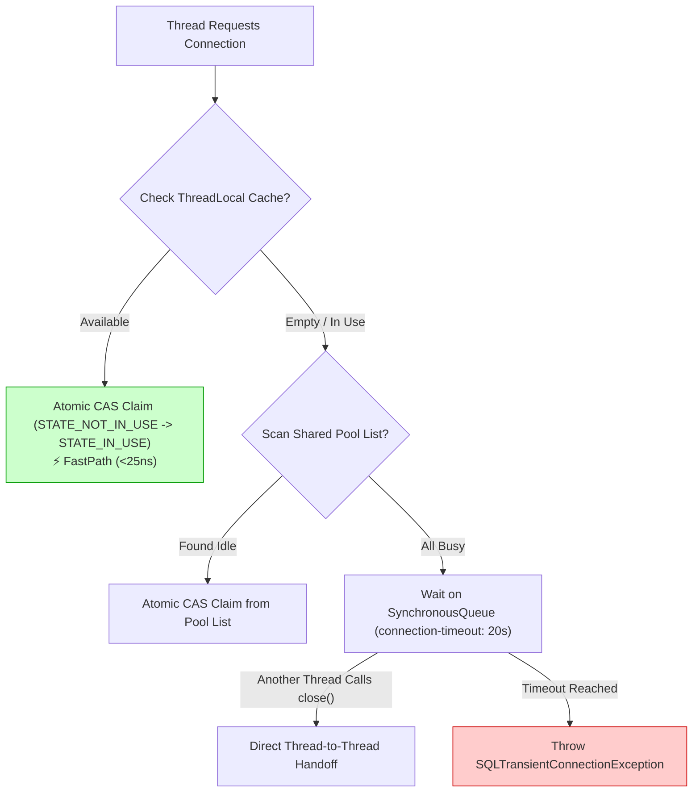
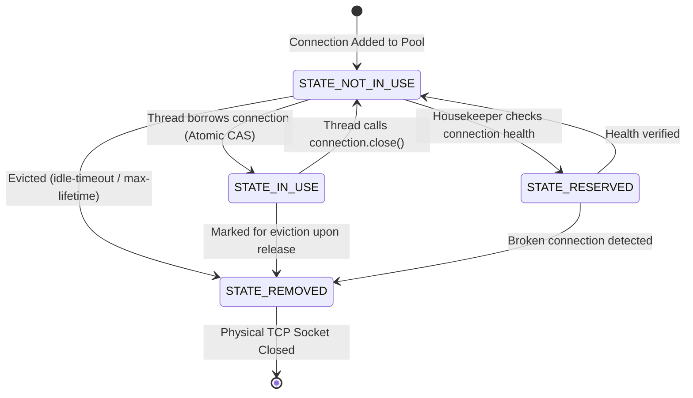

# HikariCP Connection Pool: Deep-Dive Architecture & Internals

HikariCP ("Hikari" is the Japanese word for *light* or *ray*) is the default high-performance JDBC connection pool in Spring Boot. It was designed from scratch by Brett Wooldridge to eliminate the synchronization bottlenecks, excessive allocations, and latency spikes inherent in legacy pools like Apache Commons DBCP, C3P0, and BoneCP.

This document breaks down the internal computer science principles and data structures that make HikariCP 10x-50x faster than traditional pools.

---

## Table of Contents
1. [The 3 Pillars of HikariCP Extreme Performance](#1-the-3-pillars-of-hikaricp-extreme-performance)
   - [Pillar 1: Bytecode Engineering with Javassist](#pillar-1-bytecode-engineering-with-javassist)
   - [Pillar 2: `FastList` (Elimination of Range Checks)](#pillar-2-fastlist-elimination-of-range-checks)
   - [Pillar 3: `ConcurrentBag` (Lock-Free Thread-Local Handoff)](#pillar-3-concurrentbag-lock-free-thread-local-handoff)
2. [The Connection Lifecycle & State Machine](#2-the-connection-lifecycle--state-machine)
3. [Pool Sizing Science & Little's Law](#3-pool-sizing-science--littles-law)
4. [Fixed Pool vs. Dynamic Pool (The `minimum-idle` Debate)](#4-fixed-pool-vs-dynamic-pool-the-minimum-idle-debate)
5. [HikariCP Housekeeper & Background Threads](#5-hikaricp-housekeeper--background-threads)

---

## 1. The 3 Pillars of HikariCP Extreme Performance

Traditional connection pools spent excessive CPU cycles in Java memory just *borrowing* and *returning* connections. HikariCP reduces this overhead to virtually zero through three key innovations:

```
┌─────────────────────────────────────────────────────────────────────────┐
│                       HikariCP Performance Engine                       │
├─────────────────────────┬─────────────────────────┬─────────────────────┤
│   Bytecode Engineering  │        FastList         │    ConcurrentBag    │
│  (Compiled Javassist)   │ (Zero-Check ArrayList)  │ (Lock-Free Stealing)│
└─────────────────────────┴─────────────────────────┴─────────────────────┘
```

---

### Pillar 1: Bytecode Engineering with Javassist
In JDBC, a connection pool must wrap the database driver's physical `Connection`, `Statement`, and `ResultSet` objects with proxies to intercept methods like `close()`. When an application calls `connection.close()`, the proxy intercepts the call and returns the connection to the pool instead of terminating the physical TCP socket.

- **Legacy Pools (DBCP, C3P0):** Used Java `java.lang.reflect.Proxy` dynamic reflection. Every method call (`prepareStatement`, `executeQuery`, `commit`) resulted in reflection dispatch overhead and boxing/unboxing penalties.
- **HikariCP:** Uses **Javassist** at build/class-loading time to generate compiled bytecode for `ProxyConnection`, `ProxyStatement`, and `ProxyResultSet`.
  - Method calls are compiled directly to direct JVM bytecode instructions (`invokevirtual`).
  - Method bodies are only a few bytes in size, enabling the JVM Just-In-Time (JIT) compiler to **inline** the calls into the caller's stack frame!

---

### Pillar 2: `FastList` (Elimination of Range Checks)
When an application creates JDBC `Statement` instances from a `Connection`, the connection must track those statements to close them automatically if the connection is closed.

- Standard Java `java.util.ArrayList`:
  - Every `get(index)` call performs a bounds check (`if (index >= size)`).
  - When closing a statement, `ArrayList.remove(Object)` scans from index `0` forwards to `n`. In real applications, JDBC statements are closed in reverse order of creation (the last statement created is closed first). Forward scanning causes $O(n^2)$ behavior.
- **HikariCP `FastList`:**
  - Eliminates range checking in `get(index)`.
  - In `remove(Object)`, it scans **backwards from the tail** to the head (`size - 1` down to `0`). Finding the most recently created statement is an $O(1)$ operation!

---

### Pillar 3: `ConcurrentBag` (Lock-Free Thread-Local Handoff)
The heart of HikariCP is `com.zaxxer.hikari.util.ConcurrentBag`. It implements a lock-free, work-stealing algorithm inspired by the C# `ConcurrentBag` design.

When a thread calls `dataSource.getConnection()`:
1. **Thread-Local Lookup (FastPath):** The thread looks in its private `ThreadLocal<PoolEntry>` cache. If the connection it used previously is still in state `STATE_NOT_IN_USE`, it claims it immediately via an atomic `AtomicInteger.compareAndSet(STATE_NOT_IN_USE, STATE_IN_USE)`. **No locks, no contention, 0.00001ms latency!**
2. **Shared Queue Scan:** If the thread-local slot is empty or already in use, it scans a shared `CopyOnWriteArrayList<PoolEntry>` of connections, attempting to CAS claim any connection marked `STATE_NOT_IN_USE`.
3. **Handoff Synchronizer (`SynchronousQueue`):** If all connections are currently active, the thread parks on a `SynchronousQueue` waiter list. When any other thread releases a connection, instead of returning it to the pool, it hands it directly to the waiting thread via the handoff queue.



---

## 2. The Connection Lifecycle & State Machine

Each connection in HikariCP is encapsulated in a `PoolEntry` tracking its atomic integer state:

| State Constant | Value | Description |
| :--- | :---: | :--- |
| `STATE_NOT_IN_USE` | `0` | Idle in the pool, available to be borrowed by any thread. |
| `STATE_IN_USE` | `1` | Checked out by a worker thread and actively executing queries. |
| `STATE_REMOVED` | `-1` | Retired due to `max-lifetime`, `idle-timeout`, or connection failure; marked for closure. |
| `STATE_RESERVED` | `-2` | Temporarily claimed by the housekeeper or leak detection task for health checking. |



---

## 3. Pool Sizing Science & Little's Law

A pervasive misconception in backend engineering is:
> *"If our API has 200 Tomcat worker threads, we need 200 database connections to handle peak load."*

This is dangerous and provably counterproductive.

### Little's Law
In queueing theory, Little's Law states:

$$L = \lambda \times W$$

- $L$: Average number of concurrent database connections needed.
- $\lambda$: Request arrival rate (queries per second).
- $W$: Average query execution time (seconds).

#### Real-World Example:
- Suppose your API handles **1,000 queries per second** ($\lambda = 1,000$).
- Your queries are well-indexed and execute in **2 milliseconds** ($W = 0.002\text{s}$).

Applying Little's Law:
$$L = 1000 \times 0.002 = 2 \text{ connections!}$$

Even during high load, you only need **2 concurrent connections** to satisfy 1,000 queries per second, because each query finishes and returns its connection in 2ms!

### The Formula: $\text{connections} = ((\text{cores} \times 2) + \text{spindles})$
PostgreSQL allocates a dedicated process for each client connection. When too many connections execute concurrently:
1. **CPU Thrashing:** If 100 queries run on an 8-core CPU, the operating system kernel is forced to preempt threads thousands of times per second (context switching). The CPU cache lines are constantly invalidated, leading to cache misses and high CPU latency.
2. **I/O Queue Saturation:** Solid-state drives (SSDs) and spinning disks can only process a finite number of I/O operations simultaneously before queue depth saturates.
3. **Memory Pressure:** Every PostgreSQL connection consumes `work_mem` and `temp_buffers`. 100 connections can quickly consume several gigabytes of RAM, triggering Linux Out-Of-Memory (OOM) killer.

**Conclusion:** Setting `maximum-pool-size: 10` for an 8-core database server allows all 8 cores to run queries without context-switch latency, finishing each query in a few milliseconds and maximizing overall system throughput.

---

## 4. Fixed Pool vs. Dynamic Pool (The `minimum-idle` Debate)

In [`application.yml`](file:///src/main/resources/application.yml#L45-L50), our current configuration defines:
```yaml
hikari:
  maximum-pool-size: 10
  minimum-idle: 2
```

### Dynamic Pool (`minimum-idle < maximum-pool-size`)
- **Pros:** Saves database memory during low-traffic periods by closing idle connections.
- **Cons:** When traffic spikes, user requests that trigger connection expansion will experience a **30ms to 100ms latency spike** while HikariCP performs the full TCP handshake, SSL negotiation, and PostgreSQL backend process creation.

### Fixed Pool (`minimum-idle == maximum-pool-size` or omitting `minimum-idle`)
- **Pros (Production Standard):**
  - All 10 connections are established at application startup and kept warm.
  - Zero connection-creation latency during sudden traffic spikes.
  - Predictable database memory footprint.
- **HikariCP Recommendation:**  
  Brett Wooldridge specifically advises:
  > *"For maximum performance and responsiveness, we recommend not setting this value and instead allowing HikariCP to act as a fixed size connection pool."*

---

## 5. HikariCP Housekeeper & Background Threads

When you start the application, HikariCP launches dedicated background daemon threads managed by `ScheduledThreadPoolExecutor`:

1. **`{pool-name} housekeeper` (Scheduled every 30 seconds):**
   - Scans connections in `STATE_NOT_IN_USE`.
   - Evicts connections exceeding `max-lifetime`.
   - Evicts connections exceeding `idle-timeout` (if `minimum-idle < maximum-pool-size`).
   - Ensures the pool maintains at least `minimum-idle` healthy connections.
2. **`{pool-name} connection adder` (Executes as-needed):**
   - Asynchronously opens new physical JDBC connections to the database without blocking the application threads requesting connections.
