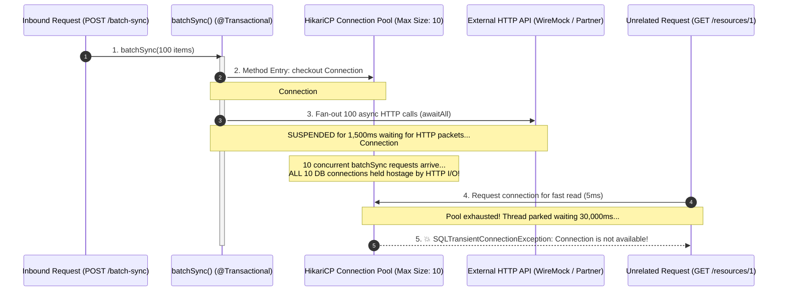

# Short-Lived Transactions & TransactionTemplate: Preventing HikariCP Starvation

A comprehensive guide on preventing database connection pool exhaustion in high-concurrency microservices, understanding Spring's `TransactionTemplate` under the hood, and implementing the **Two-Phase Short-Lived Transaction Pattern** with Kotlin Coroutines.

---

## Table of Contents
1. [The Root Problem: HikariCP Connection Starvation](#1-the-root-problem-hikaricp-connection-starvation)
2. [What is `TransactionTemplate`?](#2-what-is-transactiontemplate)
3. [Under the Hood: How `TransactionTemplate` Works](#3-under-the-hood-how-transactiontemplate-works)
   - [Internal Sequence Diagram](#internal-sequence-diagram)
   - [Spring Framework Core Source Code Walkthrough](#spring-framework-core-source-code-walkthrough)
4. [`@Transactional` vs. `TransactionTemplate` Comparison](#4-transactional-vs-transactiontemplate-comparison)
5. [The Spring AOP Self-Invocation Trap](#5-the-spring-aop-self-invocation-trap)
6. [Production Implementation in `ResourceApplicationService`](#6-production-implementation-in-resourceapplicationservice)
7. [Unit Testing Without Spring Context Overhead](#7-unit-testing-without-spring-context-overhead)
8. [60-Second Interview PREP Script](#8-60-second-interview-prep-script)

---

## 1. The Root Problem: HikariCP Connection Starvation

In Spring applications, database transactions lease physical TCP connections from the connection pool (HikariCP). When an external network call is made inside an active database transaction, the physical connection is held hostage while waiting for network I/O.

### The Catastrophic Sequence:


### Why it Fails in Production:
1. **Connection Starvation:** HikariCP defaults to a pool size of **10 connections**. Just 10 concurrent requests executing network I/O inside `@Transactional` completely deplete the pool.
2. **Cascading Service Outages:** Unrelated CRUD endpoints that only require a quick 2ms database read fail with:
   ```text
   org.springframework.dao.CannotAcquireLockException: 
   java.sql.SQLTransientConnectionException: Connection is not available, request timed out after 30000ms
   ```
3. **Coroutine Thread-Hop Context Detachment:** Spring's standard `@Transactional` uses `TransactionSynchronizationManager`, which is backed by `ThreadLocal`. Because Kotlin coroutines suspend and resume on different worker threads (`DefaultDispatcher-worker-1` $\to$ `worker-4`), placing `@Transactional` across suspension points risks context mismatch, connection leaks, or rollbacks occurring on the wrong thread.

---

## 2. What is `TransactionTemplate`?

In Spring Framework, **`TransactionTemplate`** (`org.springframework.transaction.support.TransactionTemplate`) is the standard component for **programmatic transaction management**.

Unlike declarative `@Transactional` (which uses Spring AOP proxies to wrap an entire method from entry to exit), `TransactionTemplate` uses the **Template Method / Callback Pattern** (similar to `JdbcTemplate` or `RestTemplate`). It allows you to wrap **only the specific lines of code that touch the database** inside a short-lived transaction.

```kotlin
// Database connection is leased ONLY for the 10ms batch insert!
val savedResources = transactionTemplate.execute {
    repositoryPort.saveAll(resourcesToSave)
} ?: emptyList()
```

---

## 3. Under the Hood: How `TransactionTemplate` Works

### Internal Sequence Diagram
When `transactionTemplate.execute { ... }` is invoked:

```mermaid
sequenceDiagram
    autonumber
    actor App as ResourceApplicationService
    participant TT as TransactionTemplate
    participant TM as PlatformTransactionManager (JpaTransactionManager)
    participant Pool as HikariCP Pool
    participant DB as PostgreSQL Database

    App->>TT: execute(TransactionCallback)
    activate TT
    
    TT->>TM: getTransaction(TransactionDefinition)
    activate TM
    TM->>Pool: Borrow physical Connection
    Pool-->>TM: Connection #4
    TM->>DB: SET AUTOCOMMIT = OFF; BEGIN TRANSACTION;
    TM->>TM: Bind Connection #4 to ThreadLocal (TransactionSynchronizationManager)
    TM-->>TT: Return TransactionStatus
    deactivate TM

    Note over TT,App: --- Executes YOUR Lambda inside the transaction ---
    TT->>App: action.doInTransaction(status)
    App->>DB: repositoryPort.saveAll(...) (Uses Connection #4 from ThreadLocal)
    DB-->>App: Batch INSERT successful (10ms)
    App-->>TT: Return saved entities

    alt Success (No Exception)
        TT->>TM: commit(status)
        TM->>DB: COMMIT;
    else Failure (RuntimeException or status.setRollbackOnly())
        TT->>TM: rollback(status)
        TM->>DB: ROLLBACK;
    end

    TT->>TM: Cleanup
    TM->>TM: Unbind Connection #4 from ThreadLocal
    TM->>Pool: Return Connection #4 back to HikariCP pool
    TT-->>App: Return saved entities
    deactivate TT
```

---

### Spring Framework Core Source Code Walkthrough

Inside Spring's `org.springframework.transaction.support.TransactionTemplate.java`:

```java
public <T> T execute(TransactionCallback<T> action) throws TransactionException {
    Assert.state(this.transactionManager != null, "No PlatformTransactionManager set");

    // 1. Ask JpaTransactionManager / DataSourceTransactionManager to begin transaction
    TransactionStatus status = this.transactionManager.getTransaction(this);
    T result;
    try {
        // 2. Execute your application lambda
        result = action.doInTransaction(status);
    }
    catch (RuntimeException | Error ex) {
        // 3. Rollback automatically on uncaught exceptions
        rollbackOnException(status, ex);
        throw ex;
    }
    catch (Throwable ex) {
        rollbackOnException(status, ex);
        throw new UndeclaredThrowableException(ex, "TransactionCallback threw undeclared checked exception");
    }
    // 4. Commit automatically on clean completion
    this.transactionManager.commit(status);
    
    // 5. Connection is released back to HikariCP pool
    return result;
}
```

---

## 4. `@Transactional` vs. `TransactionTemplate` Comparison

| Dimension | Declarative: `@Transactional` | Programmatic: `TransactionTemplate` |
| :--- | :--- | :--- |
| **Scope Granularity** | **Method-level only** (Entire function body) | **Block-level** (Targeted lambda expressions) |
| **Invocation Mechanism** | Spring AOP Proxy (CGLIB / JDK Dynamic Proxy) | Direct method invocation on injected bean |
| **Self-Invocation Trap** | ❌ **Silently fails** if called from the same class (`this.method()`) | ✅ **Always succeeds**; calls the template directly |
| **Connection Hold Time** | Spans across the entire method (including external HTTP calls) | Strictly limited to the lines inside the lambda (~5–15ms) |
| **Coroutine Compatibility** | ⚠️ Dangerous across `suspend` points (thread-switching detaches `ThreadLocal`) | ✅ Safe: Runs synchronously within the block on the active thread |
| **Rollback Control** | Throws `RuntimeException` or configure `rollbackFor` | Auto-rolls back on exception or via `status.setRollbackOnly()` |

---

## 5. The Spring AOP Self-Invocation Trap

A classic mistake when trying to avoid connection starvation is attempting to extract an internal helper method:

```kotlin
@Service
class ResourceApplicationService(...) {

    suspend fun batchSync(...) {
        // 1. Network calls
        val data = awaitAll(...)
        
        // ❌ DEADLY MISTAKE: Self-invocation bypasses Spring AOP proxy!
        this.saveResourcesInTx(data) 
    }

    @Transactional
    fun saveResourcesInTx(data: List<Resource>) = repositoryPort.saveAll(data)
}
```

### Why it Silently Fails:
Spring creates a CGLIB or JDK dynamic proxy around your `@Service` bean.
* When an external caller (e.g. `ResourceController`) calls `resourceApplicationService.batchSync()`, it invokes the proxy.
* However, when `batchSync()` calls `this.saveResourcesInTx()`, it calls the method directly on the internal `this` instance, **bypassing the proxy's `TransactionInterceptor` entirely**.
* **Result:** No transaction is started! The database writes execute in autocommit mode without transaction boundaries.

### Why `TransactionTemplate` or `ResourcePersistenceAdapter` Avoids This:
1. `TransactionTemplate` does not rely on AOP proxy interception at all; it executes transaction boundaries programmatically.
2. In Hexagonal Architecture, calling `repositoryPort.saveAll(resourcesToSave)` crosses bean boundaries from `ResourceApplicationService` into `ResourcePersistenceAdapter` (`@Component`), which **is** intercepted by Spring's proxy!

---

## 6. Production Implementation in `ResourceApplicationService`

In [`ResourceApplicationService.kt`](file:///Users/atifanowar/Workspace/interview/crud-kotlin-service/src/main/kotlin/com/example/demo/application/service/ResourceApplicationService.kt#L136-L150):

```kotlin
@Service
class ResourceApplicationService(
    private val repositoryPort: ResourceRepositoryPort,
    private val externalClientPort: ExternalClientPort,
    private val tracer: Tracer = Tracer.NOOP,
    private val transactionTemplate: TransactionTemplate? = null,
) : CreateResourceUseCase, ... {

    override suspend fun batchSync(command: BatchSyncCommand): BatchSyncResult = coroutineScope {
        // =========================================================================
        // PHASE 1: Asynchronous Network Fan-Out (OUTSIDE Transaction)
        // Zero HikariCP database connections are leased. Pool remains 100% free!
        // =========================================================================
        val deferredResources = targetIds.map { refId ->
            async(Dispatchers.IO + MDCContext() + tracer.asContextElement() + CoroutineName("sync-$refId")) {
                semaphore.withPermit {
                    val enrichment = externalClientPort.fetchEnrichmentDataAsync(refId)
                    Resource(...)
                }
            }
        }

        // Wait for all non-blocking network calls to gather results in memory
        val resourcesToSave = deferredResources.awaitAll().filterNotNull()

        // =========================================================================
        // PHASE 2: Atomic Batch Persistence (Inside Short-Lived Transaction)
        // Connection checked out from HikariCP for ~10ms, committed & returned!
        // =========================================================================
        val savedResources =
            if (transactionTemplate != null) {
                transactionTemplate.execute { repositoryPort.saveAll(resourcesToSave) } ?: emptyList()
            } else {
                repositoryPort.saveAll(resourcesToSave)
            }

        BatchSyncResult(...)
    }
}
```

---

## 7. Unit Testing Without Spring Context Overhead

In Hexagonal Architecture, Application Service unit tests must execute in milliseconds without bootstrapping Spring's `ApplicationContext`.

By defaulting `transactionTemplate: TransactionTemplate? = null` in the constructor:
1. **Existing Unit Tests Stay Fast:** Standard tests do not provide `transactionTemplate`, allowing business logic tests to run in **~15ms** without mock overhead.
2. **Explicit Transaction Verification:** When testing transactional behavior in [`ResourceApplicationServiceTest.kt`](file:///Users/atifanowar/Workspace/interview/crud-kotlin-service/src/test/kotlin/com/example/demo/application/service/ResourceApplicationServiceTest.kt#L146-L173):

```kotlin
@Test
fun `batchSync should execute batch save inside transactionTemplate when provided`() = runTest {
    val mockTransactionTemplate: TransactionTemplate = mockk()
    val serviceWithTx = ResourceApplicationService(
        repositoryPort = repositoryPort,
        externalClientPort = externalClientPort,
        transactionTemplate = mockTransactionTemplate,
    )
    val command = BatchSyncCommand(count = 3, referencePrefix = "item", parallelism = 2)

    coEvery { externalClientPort.fetchEnrichmentDataAsync(any()) } returns "status=OK"
    every { repositoryPort.saveAll(any()) } answers { firstArg() }
    every { mockTransactionTemplate.execute<List<Resource>>(any()) } answers {
        val action = firstArg<TransactionCallback<List<Resource>>>()
        action.doInTransaction(mockk())
    }

    val result = serviceWithTx.batchSync(command)

    assertEquals(3, result.totalPersisted)
    verify(exactly = 1) { mockTransactionTemplate.execute<List<Resource>>(any()) }
    verify(exactly = 1) { repositoryPort.saveAll(match { it.size == 3 }) }
}
```

---

## 8. 60-Second Interview PREP Script

When an interviewer asks: *"How do you handle database transactions during batch operations or asynchronous external API calls in Spring Boot?"*

* **Point (P):**
  > "We strictly separate asynchronous network calls from database transactions using the **Two-Phase Short-Lived Transaction Pattern** with `TransactionTemplate`."

* **Reason (R):**
  > "Annotating asynchronous functions with `@Transactional` holds a JDBC connection from HikariCP captive during external network I/O. Just 10 concurrent requests will exhaust the connection pool, starving unrelated CRUD endpoints and causing `SQLTransientConnectionException`. Furthermore, Spring's declarative `@Transactional` relies on `ThreadLocal`, which can detach when coroutines hop between worker threads."

* **Example (E):**
  > "In `ResourceApplicationService`, `batchSync` runs 100 concurrent HTTP requests outside of any transaction with zero database connections held. Once all payloads are gathered in memory, we wrap only the batch insert in `transactionTemplate.execute { repositoryPort.saveAll(...) }`. This leases a connection for only 10 milliseconds before committing and returning it immediately to the pool. It also completely avoids the Spring AOP self-invocation trap."

* **Point (P):**
  > "This guarantees maximum database connection density, zero pool starvation, and atomic persistence boundaries."
