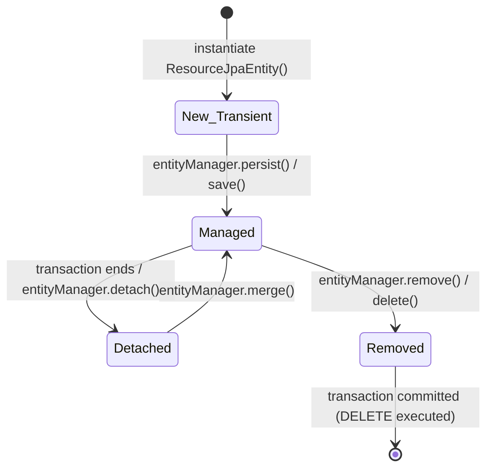

# Spring Data JPA & Hibernate in Spring Boot 3: Complete Architecture & Deep Dive

In Spring Boot 3 and Kotlin microservices, **Spring Data JPA** (built atop **Hibernate 6.x**) provides the Object-Relational Mapping (ORM) and persistence abstraction over PostgreSQL.

While JPA greatly accelerates development by eliminating boilerplate JDBC SQL, misconfigurations in caching, entity state management, and transaction boundaries can lead to silent connection pool starvation, the dreaded $N+1$ query problem, and severe performance bottlenecks.

This guide provides a comprehensive breakdown of:
1. Every JPA/Hibernate property configured in [`src/main/resources/application.yml`](file:///src/main/resources/application.yml)
2. The JPA Persistence Context and Entity Lifecycle
3. Production configuration standards (`ddl-auto`, SQL logging, batching)
4. Senior Engineer / Tech Lead interview questions & answers

---

## Table of Contents
1. [Mental Model: The JPA Architecture Stack](#1-mental-model-the-jpa-architecture-stack)
2. [Defined Properties in `application.yml` (Line-by-Line)](#2-defined-properties-in-applicationyml-line-by-line)
   - [2.1 `spring.jpa.hibernate.ddl-auto`](#21-springjpahibernateddl-auto)
   - [2.2 `spring.jpa.properties.hibernate.format_sql`](#22-springjpapropertieshibernateformat_sql)
   - [2.3 `spring.jpa.open-in-view: false`](#23-springjpaopen-in-view-false)
3. [The JPA Persistence Context & Entity Lifecycle](#3-the-jpa-persistence-context--entity-lifecycle)
4. [Spring Data JPA `save()` vs. `persist()` with Assigned UUIDs](#4-spring-data-jpa-save-vs-persist-with-assigned-uuids)
5. [Production-Critical Properties You Must Add](#5-production-critical-properties-you-must-add)
   - [5.1 Statement Batching (`jdbc.batch_size`)](#51-statement-batching-jdbcbatch_size)
   - [5.2 SQL Logging: `show-sql` vs. `org.hibernate.SQL`](#52-sql-logging-show-sql-vs-orghibernatesql)
   - [5.3 Production `ddl-auto: validate`](#53-production-ddl-auto-validate)
6. [Sub-Guides in this Directory](#6-sub-guides-in-this-directory)
7. [60-Second Interview PREP Scripts](#7-60-second-interview-prep-scripts)

---

## 1. Mental Model: The JPA Architecture Stack

To master JPA, one must understand the distinct abstraction layers between your Kotlin domain code and the PostgreSQL database:

```
┌────────────────────────────────────────────────────────┐
│  Domain Layer (com.example.demo.domain.model.Resource)  │
└───────────────────────────▲────────────────────────────┘
                            │ Domain Mapping
┌───────────────────────────▼────────────────────────────┐
│      Persistence Adapter (ResourcePersistenceAdapter)   │
└───────────────────────────▲────────────────────────────┘
                            │ Method Invocation
┌───────────────────────────▼────────────────────────────┐
│   Spring Data JPA (SpringDataResourceRepository)       │
│   (Dynamic Proxy implementing JpaRepository<T, ID>)     │
└───────────────────────────▲────────────────────────────┘
                            │ JPA API calls
┌───────────────────────────▼────────────────────────────┐
│           Jakarta Persistence API (JPA 3.1)            │
│           (EntityManager, TransactionManager)          │
└───────────────────────────▲────────────────────────────┘
                            │ ORM Provider Engine
┌───────────────────────────▼────────────────────────────┐
│                  Hibernate ORM 6.x                     │
│      (Persistence Context, Dirty Checking, SQM)        │
└───────────────────────────▲────────────────────────────┘
                            │ Connection Borrowing
┌───────────────────────────▼────────────────────────────┐
│                HikariCP Connection Pool                │
└───────────────────────────▲────────────────────────────┘
                            │ JDBC Protocol 3.0
┌───────────────────────────▼────────────────────────────┐
│             PostgreSQL Database Server                 │
└────────────────────────────────────────────────────────┘
```

---

## 2. Defined Properties in `application.yml` (Line-by-Line)

The current [`application.yml`](file:///src/main/resources/application.yml#L52-L58) configures:

```yaml
spring:
  jpa:
    hibernate:
      ddl-auto: update
    properties:
      hibernate:
        format_sql: true
    open-in-view: false
```

---

### 2.1 `spring.jpa.hibernate.ddl-auto`
```yaml
hibernate:
  ddl-auto: update
```
- **What it does:** Controls Hibernate's SchemaExport tool, which inspects `@Entity` annotations and automatically executes Data Definition Language (DDL) queries against the database at application startup.
- **Available Modes:**
  - `none`: Hibernate does not touch the database schema.
  - `validate`: Hibernate verifies that tables, columns, and datatypes in PostgreSQL match `@Entity` classes. If a column is missing, the application fails to start with `SchemaManagementException`.
  - `update`: Hibernate analyzes the schema and executes non-destructive `ALTER TABLE` / `CREATE TABLE` statements to add new tables or columns. It will **not** drop existing columns or tables.
  - `create`: Drops all existing tables and recreates them from scratch on startup.
  - `create-drop`: Drops all tables, recreates them on startup, and drops them again when the `ApplicationContext` closes (ideal for tests in [`src/test/resources/application.yml`](file:///src/test/resources/application.yml)).
- **Production Warning:**  
  In production, using `ddl-auto: update` is **strictly prohibited**. It can cause database table locks, race conditions across multiple microservice replicas, and schema drift. In production, database schema changes must be driven exclusively by version-controlled migration tools like **Flyway** (which is configured in our service), and `ddl-auto` should be set to `validate` or `none`.

---

### 2.2 `spring.jpa.properties.hibernate.format_sql`
```yaml
properties:
  hibernate:
    format_sql: true
```
- **What it does:** When Hibernate generates and prints SQL queries to the log, setting `format_sql: true` instructs Hibernate to format the SQL statement across multiple lines with clean indentation and line breaks, rather than dumping a single long unreadable string.
- **Example Without `format_sql`:**
  ```sql
  select r1_0.id,r1_0.created_at,r1_0.description,r1_0.external_enrichment_data,r1_0.name,r1_0.status,r1_0.updated_at from resources r1_0 where r1_0.id=?
  ```
- **Example With `format_sql: true`:**
  ```sql
  select
      r1_0.id,
      r1_0.created_at,
      r1_0.description,
      r1_0.external_enrichment_data,
      r1_0.name,
      r1_0.status,
      r1_0.updated_at 
  from
      resources r1_0 
  where
      r1_0.id=?
  ```
- **Production Tip:** Enable during local development and debugging; disable in ultra-high-throughput production environments to minimize logging CPU overhead and log aggregation volume.

---

### 2.3 `spring.jpa.open-in-view: false`
```yaml
open-in-view: false
```
- **What it does:** Disables Spring Boot's **Open Session in View (OSIV)** pattern.
- **Default in Spring Boot:** `true` (Spring Boot logs a warning: `spring.jpa.open-in-view is enabled by default. Therefore, database queries may be performed during view rendering`).
- **Why setting `false` is mandatory in production:**
  - With `open-in-view: true`, Spring registers an `OpenEntityManagerInViewInterceptor` that binds an `EntityManager` and **holds a physical database connection from HikariCP for the ENTIRE duration of the HTTP request**—including controller processing, Jackson JSON serialization, and waiting for the client to download the response over slow networks!
  - With `open-in-view: false`, the database connection is borrowed from HikariCP **only for the exact duration of the `@Transactional` boundary** (e.g. inside the service or persistence adapter) and returned immediately to the pool.
- **Deep Dive Guide:** See [open-in-view-deep-dive.md](file:///repo-wiki/springboot/jpa/open-in-view-deep-dive.md) for full architectural sequence diagrams and how to prevent `LazyInitializationException`.

---

## 3. The JPA Persistence Context & Entity Lifecycle

Every database transaction in Hibernate operates within a **Persistence Context** (the First-Level Cache). An entity exists in one of 4 lifecycle states:



1. **New (Transient):** The object is freshly instantiated in memory (`val entity = ResourceJpaEntity(...)`). It has no database identity and is not tracked by the `EntityManager`.
2. **Managed (Persistent):** The entity is inside the Persistence Context. Every change to a mutable field (`entity.name = "New Name"`) is tracked by Hibernate's **Automatic Dirty Checking**. No explicit `save()` is needed—when the transaction commits, Hibernate automatically emits an `UPDATE` statement!
3. **Detached:** The transaction committed and the Persistence Context closed. The entity object still exists in JVM memory, but changes to its fields are no longer tracked. Attempting to access uninitialized lazy associations (`entity.lazyCollection.size`) throws `LazyInitializationException`.
4. **Removed:** Marked for deletion. Hibernate will execute an SQL `DELETE` during the transaction flush.

---

## 4. Spring Data JPA `save()` vs. `persist()` with Assigned UUIDs

In our project, [`ResourceJpaEntity.kt`](file:///src/main/kotlin/com/example/demo/infrastructure/adapter/out/persistence/ResourceJpaEntity.kt) uses client-assigned UUIDs:

```kotlin
@Entity
@Table(name = "resources")
class ResourceJpaEntity(
    @Id
    @Column(name = "id", nullable = false, updatable = false)
    val id: UUID,
    // ...
)
```

### The Spring Data JPA Trap:
When you call `springDataRepository.save(entity)`, Spring Data JPA executes:

```java
// Spring Data JPA SimpleJpaRepository.java
@Transactional
public <S extends T> S save(S entity) {
    if (entityInformation.isNew(entity)) {
        em.persist(entity);
        return entity;
    } else {
        return em.merge(entity);
    }
}
```

### How `isNew()` Determines State:
- By default, Spring Data JPA checks if the `@Id` field is `null`.
- Because our domain layer generates the UUID **before** saving (`id = UUID.randomUUID()`), the `id` is **never null**!
- Spring Data JPA mistakenly concludes: *"This entity is NOT new; it must already exist in the database!"*
- Therefore, it calls `entityManager.merge(entity)`.
- **The Performance Consequence:** Before inserting, Hibernate executes an extra `SELECT` query (`SELECT id FROM resources WHERE id = ?`) to see if the record exists, followed by the `INSERT`! That doubles the number of database queries for every create operation!

### The Solution (`Persistable<UUID>`):
In Kotlin microservices with client-assigned IDs, implementing `Persistable<UUID>` on the JPA entity instructs Spring Data JPA whether the entity is genuinely new:

```kotlin
@Entity
@Table(name = "resources")
class ResourceJpaEntity(
    @Id val id: UUID,
    // ...
) : Persistable<UUID> {
    @Transient
    private var isNewRecord: Boolean = false

    override fun getId(): UUID = id
    override fun isNew(): Boolean = isNewRecord

    fun markAsNew() { isNewRecord = true }
}
```
*(See [kotlin-and-jpa-pitfalls.md](file:///repo-wiki/springboot/jpa/kotlin-and-jpa-pitfalls.md) for full details).*

---

## 5. Production-Critical Properties You Must Add

To achieve maximum performance and production observability, enhance the `spring.jpa` block:

```yaml
spring:
  jpa:
    hibernate:
      ddl-auto: validate        # Validates schema against entities; Flyway owns DDL
    properties:
      hibernate:
        format_sql: false       # Disable formatting in production for log efficiency
        jdbc:
          batch_size: 25        # Batches 25 INSERTs/UPDATEs into a single network send
        order_inserts: true     # Groups INSERTs by entity type to allow batching
        order_updates: true     # Groups UPDATEs by entity type to allow batching
    open-in-view: false         # Mandatory for preventing connection starvation
```

### 5.1 Statement Batching (`jdbc.batch_size`)
Without batching, if you insert 100 entities, Hibernate sends 100 separate network requests to PostgreSQL.  
With `batch_size: 25`, `order_inserts: true`, and `reWriteBatchedInserts=true` (in HikariCP), Hibernate groups them into 4 multi-row batch inserts, reducing network latency by up to 80%.

### 5.2 SQL Logging: `show-sql` vs. `org.hibernate.SQL`
- **Never use `spring.jpa.show-sql: true` in production.** It writes directly to `System.out`, bypassing your logging framework (Logback/SLF4J). It lacks timestamps, thread names, MDC trace IDs, and log levels.
- **Use Logback logger levels instead:**
  ```yaml
  logging:
    level:
      org.hibernate.SQL: DEBUG                    # Logs SQL statements through SLF4J
      org.hibernate.orm.jdbc.bind: TRACE          # Logs bind parameter values (Spring Boot 3)
  ```

---

## 6. Sub-Guides in this Directory

For specialized technical breakdowns, explore the sub-guides:
- [open-in-view-deep-dive.md](file:///repo-wiki/springboot/jpa/open-in-view-deep-dive.md): The Open Session in View (OSIV) anti-pattern, connection pool exhaustion, and resolving `LazyInitializationException` using `@EntityGraph` and DTO projections.
- [kotlin-and-jpa-pitfalls.md](file:///repo-wiki/springboot/jpa/kotlin-and-jpa-pitfalls.md): Why Kotlin `data class` breaks JPA, `equals`/`hashCode` contracts, `allopen`/`noarg` plugins, and the assigned UUID `isNew()` trap.
- [hibernate-performance-and-batching.md](file:///repo-wiki/springboot/jpa/hibernate-performance-and-batching.md): JDBC batching, why `GenerationType.IDENTITY` disables batching, and eliminating the $N+1$ query problem.

---

## 7. 60-Second Interview PREP Scripts

### Question 1: "Why should `spring.jpa.open-in-view` always be set to `false` in production microservices?"
> **Answer:**  
> "`spring.jpa.open-in-view` (OSIV) keeps the Hibernate Session and the physical JDBC connection open for the entire duration of the HTTP request, even after the service layer completes.  
> If an API endpoint takes 100ms to serialize a large JSON payload or wait on a slow network client, that database connection is held hostage and cannot be used by other threads. Under peak load, this rapidly exhausts the HikariCP connection pool, leading to cascading HTTP 500/503 errors.  
> Setting `open-in-view: false` ensures connections are borrowed only during active `@Transactional` methods and returned immediately to the pool. Any lazy associations accessed outside transactions must be explicitly fetched using `@EntityGraph` or DTO projections."

---

### Question 2: "Why is `ddl-auto: update` dangerous in production, and how should database schemas be managed?"
> **Answer:**  
> "`ddl-auto: update` allows Hibernate to dynamically alter the database schema on startup. In production with multiple microservice replicas, concurrent startup can cause race conditions and table locking. Furthermore, Hibernate will never delete deprecated columns or tables, resulting in schema drift and lack of auditability.  
> In production, schema management must be automated through version-controlled migration tools like Flyway or Liquibase. In `application.yml`, we set `flyway.enabled: true` and configure `spring.jpa.hibernate.ddl-auto: validate` or `none` so Hibernate only verifies that the entities match the Flyway-migrated schema without attempting any modifications."

---

### Question 3: "How does Spring Data JPA handle `save()` when using client-assigned UUIDs, and how do you optimize it?"
> **Answer:**  
> "When `save()` is called, Spring Data JPA checks `entityInformation.isNew()`. By default, it checks if the entity's ID is null. Because client-assigned UUIDs are non-null before saving, Spring Data JPA assumes the entity already exists and calls `entityManager.merge()` instead of `persist()`.  
> This causes Hibernate to execute an unnecessary `SELECT` query prior to the `INSERT`. To eliminate this extra query, the entity can implement `Persistable<UUID>` or provide a custom version/flag so `isNew()` returns `true`, allowing Hibernate to call `persist()` directly and execute only the `INSERT` statement."
