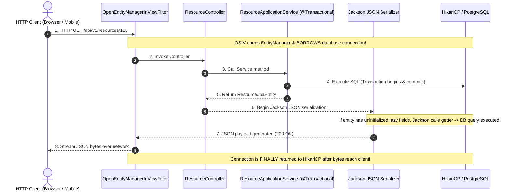
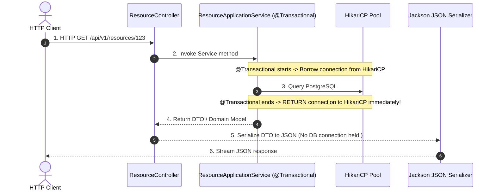

# Open Session in View (OSIV): The Microservice Anti-Pattern Deep Dive

In Spring Boot, one of the most critical properties in `application.yml` is:
```yaml
spring:
  jpa:
    open-in-view: false # Default in Spring Boot is TRUE!
```
Spring Boot outputs a famous warning at startup if left unconfigured:
```text
WARN 12345 --- [main] w.s.c.ServletWebServerApplicationContext : 
spring.jpa.open-in-view is enabled by default. Therefore, database queries may be performed during view rendering. 
Explicitly configure spring.jpa.open-in-view to disable this warning
```

This guide explains the history of OSIV, the architectural disaster it causes in modern microservices, and how to operate safely with `open-in-view: false`.

---

## Table of Contents
1. [History: Why Was OSIV Invented?](#1-history-why-was-osiv-invented)
2. [How OSIV Works Under the Hood](#2-how-osiv-works-under-the-hood)
3. [The 3 Fatal Disasters of OSIV in Microservices](#3-the-3-fatal-disasters-of-osiv-in-microservices)
   - [Disaster 1: HikariCP Connection Pool Exhaustion](#disaster-1-hikaricp-connection-pool-exhaustion)
   - [Disaster 2: The Silent $N+1$ Serialization Problem](#disaster-2-the-silent-n1-serialization-problem)
   - [Disaster 3: Violation of Architectural Boundaries](#disaster-3-violation-of-architectural-boundaries)
4. [Life with `open-in-view: false`](#4-life-with-open-in-view-false)
5. [The Proper Solutions: How to Avoid `LazyInitializationException`](#5-the-proper-solutions-how-to-avoid-lazyinitializationexception)
   - [Solution A: `JOIN FETCH` Queries](#solution-a-join-fetch-queries)
   - [Solution B: `@EntityGraph`](#solution-b-entitygraph)
   - [Solution C: Hexagonal Domain Mappers (Our Architecture)](#solution-c-hexagonal-domain-mappers-our-architecture)

---

## 1. History: Why Was OSIV Invented?

In the early 2000s (Spring Framework 1.x / Hibernate 2), web applications used server-side MVC template rendering (JSP, Struts, Velocity, Thymeleaf).

A typical controller returned an entity (`Department`) with a lazily loaded collection (`employees`). When the JSP rendered the HTML table:
```jsp
<c:forEach items="${department.employees}" var="emp">
    <tr><td>${emp.name}</td></tr>
</c:forEach>
```
If the database transaction closed in the service layer, the JSP failed with:
`org.hibernate.LazyInitializationException: could not initialize proxy - no Session`.

To make life easy for developers, Spring introduced **Open Session in View (OSIV)** via `OpenEntityManagerInViewInterceptor`: it kept the Hibernate session open throughout the entire HTTP request so JSP templates could freely trigger lazy loading.

---

## 2. How OSIV Works Under the Hood

When `open-in-view: true`, Spring registers an interceptor that wraps the **entire** HTTP request lifecycle:



---

## 3. The 3 Fatal Disasters of OSIV in Microservices

Modern applications are **RESTful microservices**, not server-side JSP web apps. In a JSON REST API, OSIV causes three catastrophic failure modes:

### Disaster 1: HikariCP Connection Pool Exhaustion
Look at steps 6, 7, and 8 in the diagram above:
- The database transaction finished at step 4.
- Yet the database connection **remains checked out from HikariCP** during step 6 (Jackson serialization) and step 8 (streaming bytes over the network to the client).
- **The Slow Client Attack:** If an API client is on a high-latency mobile network (e.g. takes 400ms to download the 50KB JSON response), that physical database connection is held hostage for 400ms while doing **zero database work**!
- With `maximum-pool-size: 10`, just 20 concurrent slow clients will starve the entire connection pool. All other API endpoints in the microservice will block on `connection-timeout: 20000` and fail!

---

### Disaster 2: The Silent $N+1$ Serialization Problem
When an entity with lazy relationships is returned to the controller layer:
1. Jackson's `ObjectMapper` uses reflection to inspect every getter on the entity.
2. When Jackson invokes `entity.getItems()`, Hibernate intercepts the call and executes an additional SQL query.
3. If the collection contains 100 items, Jackson triggers **100 additional SQL queries on the fly**, directly inside the JSON serialization layer!
4. Because this happens outside `@Transactional`, each query runs in auto-commit mode with separate connection roundtrips, multiplying database load by 100x.

---

### Disaster 3: Violation of Architectural Boundaries
In Hexagonal / Clean Architecture:
- The Web Adapter (Controllers, DTOs, Serializers) must **never** execute database queries.
- Database access must be strictly confined to the Persistence Layer.
- OSIV leaks database access into Jackson and HTTP filter layers, making query optimization and performance profiling virtually impossible.

---

## 4. Life with `open-in-view: false`

When `open-in-view: false` is configured:



### The Invariant:
- The database connection is held **only for the few milliseconds** of the `@Transactional` method.
- Even if JSON serialization takes 500ms, the database connection is already back in the HikariCP pool, ready for the next request.
- **Result:** Connection pool utilization drops by up to 90%!

---

## 5. The Proper Solutions: How to Avoid `LazyInitializationException`

With `open-in-view: false`, accessing an uninitialized lazy proxy outside `@Transactional` throws:
```text
org.hibernate.LazyInitializationException: could not initialize proxy [com.example.demo.Entity#1] - no Session
```
This exception is **a blessing, not a bug**. It alerts you that your query did not fetch the data it needed! Here is how to handle it properly:

### Solution A: `JOIN FETCH` Queries
In your Spring Data JPA repository:
```kotlin
@Query("SELECT r FROM ResourceJpaEntity r LEFT JOIN FETCH r.tags WHERE r.id = :id")
fun findByIdWithTags(@Param("id") id: UUID): ResourceJpaEntity?
```
Hibernate fetches the parent entity and its child collection in a **single SQL JOIN query**, fully initializing the data before the transaction closes.

---

### Solution B: `@EntityGraph`
Using JPA 2.1 Entity Graphs allows declarative eager fetching without writing JPQL:
```kotlin
@EntityGraph(attributePaths = ["tags", "auditLogs"])
override fun findById(id: UUID): Optional<ResourceJpaEntity>
```

---

### Solution C: Hexagonal Domain Mappers (Our Architecture)

In our project, we follow Hexagonal Architecture:
1. [`ResourceJpaEntity.kt`](file:///src/main/kotlin/com/example/demo/infrastructure/adapter/out/persistence/ResourceJpaEntity.kt) lives strictly inside the persistence adapter.
2. In [`ResourcePersistenceAdapter.kt`](file:///src/main/kotlin/com/example/demo/infrastructure/adapter/out/persistence/ResourcePersistenceAdapter.kt), the entity is immediately mapped into a pure Kotlin domain model ([`Resource.kt`](file:///src/main/kotlin/com/example/demo/domain/model/Resource.kt)) using [`ResourcePersistenceMapper.kt`](file:///src/main/kotlin/com/example/demo/infrastructure/adapter/out/persistence/ResourcePersistenceMapper.kt).
3. The domain model contains pure Kotlin values (`val name: String`, `val status: ResourceStatus`). It has **zero Hibernate proxies**.
4. The controller receives the domain model and converts it into a `ResourceResponse` DTO.
5. `LazyInitializationException` is **physically impossible** because Hibernate entities never escape the persistence adapter!
