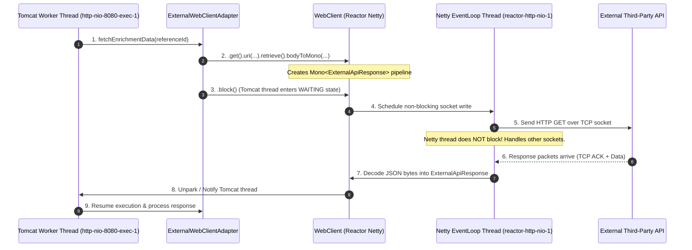

# Spring WebClient: Architecture, Benefits, and The `.block()` Dilemma

In our Kotlin Spring Boot 3 microservice, outgoing HTTP requests to external third-party services are handled by **Spring WebClient** via [`WebClientConfig.kt`](file:///src/main/kotlin/com/example/demo/infrastructure/adapter/out/client/config/WebClientConfig.kt) and [`ExternalWebClientAdapter.kt`](file:///src/main/kotlin/com/example/demo/infrastructure/adapter/out/client/ExternalWebClientAdapter.kt).

This guide answers the core architectural questions:
1. **Why did we choose `WebClient` over `RestTemplate` or `RestClient`?**
2. **What are the technical and operational benefits of `WebClient`?**
3. **Why did we use `.block()` in [`ExternalWebClientAdapter.kt`](file:///src/main/kotlin/com/example/demo/infrastructure/adapter/out/client/ExternalWebClientAdapter.kt)?**
4. **What are the tradeoffs and dangers of `.block()`?**
5. **How does Kotlin Coroutines' `.awaitSingle()` eliminate the downsides of `.block()`?**

---

## Table of Contents
1. [Mental Model: How WebClient Executes Requests Under the Hood](#1-mental-model-how-webclient-executes-requests-under-the-hood)
2. [Why WebClient? (Comparison with RestTemplate and RestClient)](#2-why-webclient-comparison-with-resttemplate-and-restclient)
3. [Key Architectural Benefits of WebClient](#3-key-architectural-benefits-of-webclient)
   - [3.1 Netty EventLoop & Non-Blocking I/O](#31-netty-eventloop--non-blocking-io)
   - [3.2 Low Memory Footprint & High Connection Concurrency](#32-low-memory-footprint--high-connection-concurrency)
   - [3.3 Reactor Netty Connection Pool & HTTP/2 Support](#33-reactor-netty-connection-pool--http2-support)
   - [3.4 Declarative Resiliency (`timeout`, `retry`, `onStatus`)](#34-declarative-resiliency-timeout-retry-onstatus)
4. [Deep Dive into Our Configuration (`WebClientConfig.kt`)](#4-deep-dive-into-our-configuration-webclientconfigkt)
5. [The `.block()` Dilemma: Why Did We Use It Here?](#5-the-block-dilemma-why-did-we-use-it-here)
   - [5.1 The Spring MVC Architectural Context](#51-the-spring-mvc-architectural-context)
   - [5.2 What Happens When `.block()` is Executed?](#52-what-happens-when-block-is-executed)
   - [5.3 The Fatal WebFlux Trap: `IllegalStateException`](#53-the-fatal-webflux-trap-illegalstateexception)
6. [The Kotlin Coroutine Evolution: `.awaitSingle()` vs. `.block()`](#6-the-kotlin-coroutine-evolution-awaitsingle-vs-block)
7. [Sub-Guides in this Directory](#7-sub-guides-in-this-directory)
8. [60-Second Interview PREP Scripts](#8-60-second-interview-prep-scripts)

---

## 1. Mental Model: How WebClient Executes Requests Under the Hood

Unlike traditional HTTP clients where a single worker thread executes the socket read and waits synchronously, WebClient delegates socket I/O to **Reactor Netty's EventLoopGroup**:



---

## 2. Why WebClient? (Comparison with RestTemplate and RestClient)

In the Spring ecosystem, there are three primary HTTP client abstractions:

| Dimension | `RestTemplate` | `RestClient` (Spring 6.1+) | `WebClient` (Our Choice) |
| :--- | :--- | :--- | :--- |
| **Status in Spring** | **Maintenance Mode** (no new features) | Modern Synchronous Facade | **Modern Reactive Engine** |
| **I/O Engine** | Blocking I/O (`HttpURLConnection` / Apache HttpClient) | Blocking or Configurable | **Non-blocking Event-Driven (Netty / epoll)** |
| **API Style** | Template method (`getForObject`, `exchange`) | Fluent API (`.get().uri().retrieve()`) | **Fluent Functional Reactive Pipeline** |
| **Concurrency Model** | 1 Thread per outgoing request | 1 Thread per outgoing request | **M multiplexed connections on N EventLoop threads** |
| **Streaming / Reactive** | ❌ No | ❌ No | **✅ Native `Flux<T>`, Server-Sent Events, WebSockets** |
| **Coroutine Integration** | Requires manual wrapping | Requires manual wrapping | **✅ Native `awaitSingle()`, `awaitSingleOrNull()`, `asFlow()`** |

### Why We Chose WebClient:
1. **Deprecation of `RestTemplate`:** The Spring documentation states: *"As of 5.0, the RestTemplate is in maintenance mode and will not receive major feature updates. Please use WebClient instead."*
2. **Future-Proof Reactive & Coroutine Foundation:** Even in a Spring MVC app, `WebClient` provides the non-blocking Netty engine. If an endpoint is refactored to Kotlin Coroutines (`suspend fun`), `WebClient` requires zero client replacement—simply change `.block()` to `.awaitSingle()`.
3. **Fine-Grained Low-Level Tuning:** Netty provides socket-level channel options (`ChannelOption.CONNECT_TIMEOUT_MILLIS`, `responseTimeout`, connection pool limits) that are notoriously difficult to configure consistently in `RestTemplate`.

---

## 3. Key Architectural Benefits of WebClient

### 3.1 Netty EventLoop & Non-Blocking I/O
- `RestTemplate` binds 1 operating system thread to 1 outgoing HTTP socket. If you call an external API that takes 3,000ms, that thread sits completely idle in memory consuming OS resources.
- `WebClient` uses **Reactor Netty**, which registers sockets with OS kernel polling mechanisms (`epoll` on Linux, `kqueue` on macOS). A pool of just 4–8 Netty event loop threads can manage **thousands of concurrent outbound HTTP sockets**.

### 3.2 Low Memory Footprint & High Connection Concurrency
- A traditional Java thread consumes **~1MB of virtual memory** for its call stack. 500 concurrent outbound requests with `RestTemplate` require 500 threads ($\approx 500\text{MB}$ RAM just for thread stacks).
- WebClient handles 500 concurrent outbound connections on its small default event loop pool ($\approx 8$ threads $\approx 8\text{MB}$ RAM), yielding huge cost savings in cloud containers.

### 3.3 Reactor Netty Connection Pool & HTTP/2 Support
- Under the hood, `ReactorClientHttpConnector` maintains a high-performance connection pool with keep-alive, TCP connection reuse, and automatic eviction of dead sockets.
- It natively supports **HTTP/2 multiplexing**, allowing multiple logical requests to stream over a single physical TCP connection to downstream microservices.

### 3.4 Declarative Resiliency (`timeout`, `retry`, `onStatus`)
WebClient makes error handling and timeouts declarative:
```kotlin
externalApiWebClient
    .get()
    .uri("/api/v1/enrichment/{referenceId}", referenceId)
    .retrieve()
    // Explicit HTTP status code classification
    .onStatus(HttpStatusCode::isError) { clientResponse ->
        logger.error("External API returned error: {}", clientResponse.statusCode())
        clientResponse.createException()
    }
    .bodyToMono(ExternalApiResponse::class.java)
    // Declarative read timeout
    .timeout(Duration.ofSeconds(5))
    // Built-in exponential backoff retry (if desired)
    .retryWhen(Retry.backoff(3, Duration.ofMillis(500)))
```

---

## 4. Deep Dive into Our Configuration (`WebClientConfig.kt`)

In [`src/main/kotlin/com/example/demo/infrastructure/adapter/out/client/config/WebClientConfig.kt`](file:///src/main/kotlin/com/example/demo/infrastructure/adapter/out/client/config/WebClientConfig.kt), we configure:

```kotlin
@Configuration
class WebClientConfig(
    @param:Value("\${external.client.base-url:http://localhost:8081}")
    private val baseUrl: String,
    @param:Value("\${external.client.auth-token:default-auth-token}")
    private val authToken: String,
    @param:Value("\${external.client.connect-timeout-ms:3000}")
    private val connectTimeoutMs: Int,
    @param:Value("\${external.client.read-timeout-ms:5000}")
    private val readTimeoutMs: Long,
) {
    @Bean
    fun externalApiWebClient(webClientBuilder: WebClient.Builder): WebClient {
        // 1. Configure low-level Netty HTTP client timeouts
        val httpClient = HttpClient.create()
            .option(ChannelOption.CONNECT_TIMEOUT_MILLIS, connectTimeoutMs) // TCP connect timeout (3s)
            .responseTimeout(Duration.ofMillis(readTimeoutMs))               // HTTP read timeout (5s)

        // 2. Build WebClient with default headers and base URL
        return webClientBuilder
            .baseUrl(baseUrl)
            .clientConnector(ReactorClientHttpConnector(httpClient))
            .defaultHeader(HttpHeaders.AUTHORIZATION, "Bearer $authToken")
            .defaultHeader(HttpHeaders.CONTENT_TYPE, MediaType.APPLICATION_JSON_VALUE)
            .defaultHeader(HttpHeaders.ACCEPT, MediaType.APPLICATION_JSON_VALUE)
            .build()
    }
}
```

### Why Both `connectTimeout` and `responseTimeout`?
1. **`ChannelOption.CONNECT_TIMEOUT_MILLIS: 3000` (3s):**
   Governs the initial TCP 3-way handshake. If the downstream server is down, DNS is unresponsive, or a firewall drops packets, it fails fast after 3 seconds instead of hanging for 127 seconds.
2. **`responseTimeout: 5000` (5s):**
   Governs the read timeout after the TCP connection is established. If the external server receives the query but freezes or experiences an infinite database lock, Netty drops the socket after 5 seconds.

---

## 5. The `.block()` Dilemma: Why Did We Use It Here?

In [`ExternalWebClientAdapter.kt`](file:///src/main/kotlin/com/example/demo/infrastructure/adapter/out/client/ExternalWebClientAdapter.kt#L22-L33), you will find:

```kotlin
override fun fetchEnrichmentData(referenceId: String): String {
    val response = externalApiWebClient
        .get()
        .uri("/api/v1/enrichment/{referenceId}", referenceId)
        .retrieve()
        .bodyToMono(ExternalApiResponse::class.java)
        .timeout(Duration.ofSeconds(5))
        .block() // 👈 The Synchronous Bridge

    return processEnrichmentResponse(response, referenceId)
}
```

### 5.1 The Spring MVC Architectural Context
- Our microservice is built using **Spring Web MVC** (`spring-boot-starter-web`) and Tomcat, not Spring WebFlux.
- The Domain Port interface is defined synchronously in Hexagonal architecture:
  ```kotlin
  interface ExternalClientPort {
      fun fetchEnrichmentData(referenceId: String): String
  }
  ```
- Because the calling layer (`ResourceApplicationService.kt`) executes on a Tomcat worker thread and expects a synchronous `String` return value, `.block()` acts as the **bridge between the reactive Netty engine and the imperative Spring MVC thread**.

---

### 5.2 What Happens When `.block()` is Executed?
1. When `.block()` is called on `Mono<ExternalApiResponse>`, Reactor instantiates a `BlockingSingleSubscriber`.
2. It registers a `CountDownLatch(1)` or `LockSupport.park()`.
3. The calling Tomcat thread (`http-nio-8080-exec-1`) is **parked (WAITING)** by the OS.
4. Meanwhile, the Netty thread handles the asynchronous socket I/O.
5. When the response arrives, Netty delivers the payload to the subscriber, which calls `LockSupport.unpark()` to wake up the Tomcat thread.

---

### 5.3 The Fatal WebFlux Trap: `IllegalStateException`
A frequent senior engineering interview question is:  
*"Is `.block()` always safe to call?"*

**Answer: NO! It depends entirely on WHICH thread calls it.**

| Application Context | Thread Calling `.block()` | Behavior |
| :--- | :--- | :--- |
| **Spring MVC (Our Project)** | Tomcat Worker Thread (`http-nio-8080-exec-*`) | ✅ **Permitted.** Tomcat worker threads are designed to block on I/O. |
| **Spring WebFlux / Reactive** | Netty EventLoop Thread (`reactor-http-nio-*`) | ❌ **CRASH!** Throws `IllegalStateException`. |

#### The WebFlux Crash:
If you call `.block()` on a Netty EventLoop thread in a reactive Spring WebFlux service, Reactor detects it and immediately throws:
```text
java.lang.IllegalStateException: block()/blockFirst()/blockLast() are blocking, 
which is not supported in thread reactor-http-nio-2
```
**Why?** Netty event loop threads must **NEVER** be blocked. If you block an event loop thread, you freeze hundreds of other concurrent sockets multiplexed on that single thread, bringing down the entire reactive server!

---

## 6. The Kotlin Coroutine Evolution: `.awaitSingle()` vs. `.block()`

In Kotlin, we can achieve 100% non-blocking execution **without** reactive callback hell by replacing `.block()` with Kotlin Coroutines' **`.awaitSingle()`**:

```
┌──────────────────────────────────────────────┬──────────────────────────────────────────────┐
│        Synchronous MVC with .block()         │       Kotlin Coroutines with .awaitSingle()  │
├──────────────────────────────────────────────┼──────────────────────────────────────────────┤
│ override fun fetchEnrichmentData(...): String│ override suspend fun fetchEnrichmentData()   │
│                                              │                                              │
│ val res = webClient.get()                    │ val res = webClient.get()                    │
│     .retrieve()                              │     .retrieve()                              │
│     .bodyToMono(ExternalApiResponse::class)  │     .bodyToMono(ExternalApiResponse::class)  │
│     .block()                                 │     .awaitSingle()                           │
│                                              │                                              │
│ ❌ Thread is PARKED (consumed) for 3 seconds │ ⚡ Thread is FREED (suspends) instantly!     │
└──────────────────────────────────────────────┴──────────────────────────────────────────────┘
```

### Why `.awaitSingle()` is Architecturally Superior:
1. **Zero Thread Blocking:** When `.awaitSingle()` is called, the coroutine **suspends** (saves its state in a Continuation object). The underlying worker thread is returned to the pool and can immediately serve other incoming HTTP requests!
2. **Resume on Callback:** When Netty finishes receiving the response bytes, it resumes the coroutine on an available thread.
3. **Sequential Syntax:** The code reads line-by-line like synchronous code, avoiding `.flatMap()` or `.subscribe()` chaining.

---

## 7. Sub-Guides in this Directory

For deeper technical implementation details, read the companion guides in this directory:
- [webclient-vs-resttemplate-vs-restclient.md](file:///repo-wiki/springboot/reactive/webclient-vs-resttemplate-vs-restclient.md): Deep feature comparison, memory benchmarks, and migration strategies.
- [the-block-dilemma-and-coroutine-bridge.md](file:///repo-wiki/springboot/reactive/the-block-dilemma-and-coroutine-bridge.md): Internal mechanics of `.block()`, `BlockingSingleSubscriber`, and step-by-step refactoring to Kotlin Coroutines.

---

## 8. 60-Second Interview PREP Scripts

### Question 1: "Why did you use Spring WebClient instead of RestTemplate or RestClient in this microservice?"
> **Answer:**  
> "We chose Spring WebClient because `RestTemplate` has been placed in maintenance mode by the Spring team and lacks modern non-blocking capabilities.  
> WebClient uses Reactor Netty under the hood, allowing multiplexed non-blocking I/O with a tiny thread footprint. It provides granular socket-level timeout controls (`connectTimeout`, `responseTimeout`), declarative error handling via `.onStatus()`, and built-in connection pooling.  
> Furthermore, WebClient provides a future-proof foundation: if we refactor our endpoints to full asynchronous Kotlin Coroutines, WebClient integrates natively via `.awaitSingle()` with zero client replacement."

---

### Question 2: "In `ExternalWebClientAdapter`, why did you use `.block()`, and what are its risks?"
> **Answer:**  
> "Our application uses Spring MVC with a standard Tomcat servlet engine and synchronous domain ports. Calling `.block()` bridges the reactive `Mono` returned by WebClient into the synchronous return type expected by our service layer.  
> In Spring MVC, this is safe because Tomcat worker threads are dedicated to the request and allowed to block.  
> However, in a reactive Spring WebFlux environment, calling `.block()` on a Netty EventLoop thread is strictly prohibited and throws an `IllegalStateException`, because blocking an event loop thread freezes all other multiplexed sockets. To eliminate thread blocking entirely, the optimal evolution in Kotlin is defining the port as a `suspend fun` and using `.awaitSingle()`."
