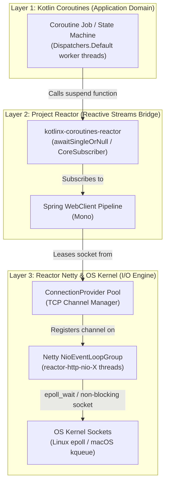
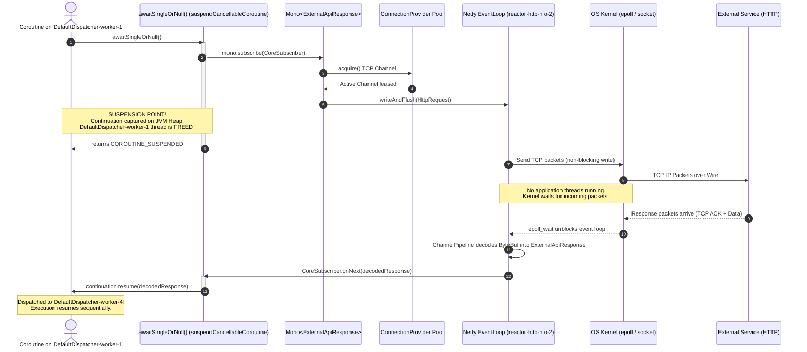

# How Kotlin Coroutines Communicate with Netty & Deep Dive into ConnectionProvider

A comprehensive architectural and JVM-level deep dive into how Kotlin Coroutines interact with Netty via Spring WebClient, and how to configure Reactor Netty's `ConnectionProvider` for high-throughput, non-blocking HTTP operations.

---

## Table of Contents
1. [The 3-Layer Communication Stack](#1-the-3-layer-communication-stack)
2. [Netty Non-Blocking Network Architecture](#2-netty-non-blocking-network-architecture)
3. [The Coroutine-to-Netty Handshake Under the Hood](#3-the-coroutine-to-netty-handshake-under-the-hood)
   - [Step 1: The Call Site in `ExternalWebClientAdapter`](#step-1-the-call-site-in-externalwebclientadapter)
   - [Step 2: Inside `awaitSingleOrNull()` & `suspendCancellableCoroutine`](#step-2-inside-awaitsingleornull--suspendcancellablecoroutine)
   - [Step 3: Coroutine Suspension & Immediate Thread Release](#step-3-coroutine-suspension--immediate-thread-release)
   - [Step 4: Non-Blocking OS Socket Wait (Zero App Threads Involved)](#step-4-non-blocking-os-socket-wait-zero-app-threads-involved)
   - [Step 5: Netty ByteBuf Decoding & CoreSubscriber Callback](#step-5-netty-bytebuf-decoding--coresubscriber-callback)
   - [Step 6: State Machine Resumption (`cont.resume`)](#step-6-state-machine-resumption-contresume)
4. [Cancellation Propagation Across the Boundary](#4-cancellation-propagation-across-the-boundary)
5. [Deep Dive: ConnectionProvider Configuration](#5-deep-dive-connectionprovider-configuration)
   - [5.1 `builder("external-api-connection-pool")`](#51-builderexternal-api-connection-pool)
   - [5.2 `maxConnections(200)` & The Default 16-Connection Trap](#52-maxconnections200--the-default-16-connection-trap)
   - [5.3 `pendingAcquireMaxCount(1000)`: OOM Prevention & Load Shedding](#53-pendingacquiremaxcount1000-oom-prevention--load-shedding)
   - [5.4 `pendingAcquireTimeout(Duration.ofSeconds(45))`](#54-pendingacquiretimeoutdurationofseconds45)
   - [5.5 `maxIdleTime(Duration.ofSeconds(20))`: The Stale Connection Bug](#55-maxidletimedurationofseconds20-the-stale-connection-bug)
6. [Failure Modes & Exception Matrix](#6-failure-modes--exception-matrix)
7. [Senior Interview PREP Script](#7-senior-interview-prep-script)

---

## 1. The 3-Layer Communication Stack

When executing non-blocking external requests in our microservice, three distinct concurrency models collaborate:



1. **Kotlin Coroutines**: Provides sequential, imperative syntax (`val res = client.fetch()`) powered by compiler-generated state machines (`Continuation<T>`).
2. **Project Reactor (`Mono<T>`)**: Spring's reactive stream foundation representing lazy, asynchronous data pipelines.
3. **Reactor Netty**: The event-driven network engine managing TCP channels, connection pooling, and non-blocking socket I/O using operating system multiplexers (`epoll` or `kqueue`).

---

## 2. Netty Non-Blocking Network Architecture

To understand how coroutines communicate with Netty, we must first understand Netty's threading model:

* **EventLoop**: A single thread running an infinite loop executing `Selector.select()` or `epoll_wait()`. One `EventLoop` multiplexes **thousands** of TCP sockets (`Channel`).
* **Channel**: An open network socket abstraction capable of reading and writing bytes.
* **ChannelPipeline**: A chain of inbound and outbound interceptors (`ByteToMessageDecoder`, `HttpClientCodec`, `HttpObjectAggregator`) that transform raw `ByteBuf` packets into typed HTTP response objects.
* **Thread Footprint**: Reactor Netty initializes by default only **`Runtime.getRuntime().availableProcessors()`** threads (named `reactor-http-nio-1`, `reactor-http-nio-2`, etc.).

> [!IMPORTANT]
> Netty `EventLoop` threads must **NEVER** be blocked. If an `EventLoop` thread is blocked (e.g. via `Thread.sleep` or `.block()`), all other hundreds or thousands of TCP connections assigned to that `EventLoop` freeze!

---

## 3. The Coroutine-to-Netty Handshake Under the Hood

The interaction lifecycle follows a rigorous, non-blocking sequence across threads:



---

### Step 1: The Call Site in [`ExternalWebClientAdapter.kt`](file:///Users/atifanowar/Workspace/interview/crud-kotlin-service/src/main/kotlin/com/example/demo/infrastructure/adapter/out/client/ExternalWebClientAdapter.kt#L54-L64)

```kotlin
override suspend fun fetchEnrichmentDataAsync(referenceId: String): String {
    val threadBefore = Thread.currentThread().name // e.g., DefaultDispatcher-worker-1

    val response = externalApiWebClient
        .get()
        .uri("/api/v1/enrichment/{referenceId}", referenceId)
        .retrieve()
        .bodyToMono(ExternalApiResponse::class.java)
        .timeout(Duration.ofSeconds(5))
        .awaitSingleOrNull() // 👈 The Coroutine-to-Netty Bridge

    val threadAfter = Thread.currentThread().name // e.g., DefaultDispatcher-worker-4
    // threadBefore != threadAfter -> Execution jumped across threads!
}
```

---

### Step 2: Inside `awaitSingleOrNull()` & `suspendCancellableCoroutine`

The extension function `awaitSingleOrNull()` from `kotlinx-coroutines-reactor` bridges the reactive `Publisher` contract into Kotlin's `Continuation`:

```kotlin
// Simplified implementation from kotlinx-coroutines-reactor:
suspend fun <T> Mono<T>.awaitSingleOrNull(): T? =
    suspendCancellableCoroutine { cont: CancellableContinuation<T?> ->
        var hasValue = false

        subscribe(object : CoreSubscriber<T> {
            override fun onSubscribe(s: Subscription) {
                // Link cancellation bidirectionally
                cont.invokeOnCancellation { s.cancel() }
                s.request(1) // Request 1 item (Reactive Streams Backpressure)
            }

            override fun onNext(value: T) {
                hasValue = true
                cont.resume(value) // 👈 Wake up coroutine with value!
            }

            override fun onError(throwable: Throwable) {
                cont.resumeWithException(throwable) // 👈 Wake up with exception!
            }

            override fun onComplete() {
                if (!hasValue) {
                    cont.resume(null) // 👈 Wake up with null if Mono was empty
                }
            }
        })
    }
```

---

### Step 3: Coroutine Suspension & Immediate Thread Release

1. **Reactive Subscription:** `subscribe()` triggers Reactor Netty's `HttpClientConnect`.
2. **Channel Lease:** Netty requests an active TCP channel from `ConnectionProvider`.
3. **Suspension:** The coroutine hits `suspendCancellableCoroutine`.
4. **Stack Unwinding:** Kotlin's compiler saves all local variables (`referenceId`, `threadBefore`) into a heap-allocated `Continuation` object.
5. **Thread Freed:** The calling thread (`DefaultDispatcher-worker-1`) returns to the Kotlin coroutine thread pool immediately. It is free to execute other coroutines. **Zero threads are blocked waiting for network I/O.**

---

### Step 4: Non-Blocking OS Socket Wait (Zero App Threads Involved)

* Netty's `reactor-http-nio` thread registers the socket with the operating system's kernel selector via `epoll_ctl` (Linux) or `kevent` (macOS).
* The Netty event loop thread is **not blocked**; it moves on to service other active channels.
* While the HTTP request travels across the internet to the external server, **zero JVM threads are active for this request**.

---

### Step 5: Netty ByteBuf Decoding & CoreSubscriber Callback

1. When response packets arrive on the network interface card (NIC), the OS kernel signals Netty's `epoll_wait`.
2. A Netty I/O worker (`reactor-http-nio-2`) reads bytes from the socket into a pooled `ByteBuf`.
3. The bytes pass through Netty's `ChannelPipeline`:
   * `HttpResponseDecoder`: Parses HTTP status code and headers.
   * `HttpObjectAggregator`: Aggregates chunked payloads.
   * Jackson `HttpMessageReader`: Deserializes JSON bytes directly into `ExternalApiResponse`.
4. Netty forwards the decoded object to Reactor, which invokes `CoreSubscriber.onNext(response)`.

---

### Step 6: State Machine Resumption (`cont.resume`)

1. Inside `onNext`, `cont.resume(value)` is called.
2. The Kotlin Coroutines runtime places the saved `Continuation` into the dispatch queue of `Dispatchers.Default`.
3. The next available worker thread (e.g. `DefaultDispatcher-worker-4`) dequeues the continuation, loads the state machine, and resumes execution right after `awaitSingleOrNull()`.
4. This explains why `threadBefore` and `threadAfter` in our application logs often show different thread names:
   ```text
   [COROUTINE-SUSPEND] refId='ref-1' preparing non-blocking HTTP call on thread=[DefaultDispatcher-worker-1]
   [COROUTINE-RESUME]  refId='ref-1' resumed after I/O on thread=[DefaultDispatcher-worker-4] (threadSwitched=true)
   ```

---

## 4. Cancellation Propagation Across the Boundary

One of the greatest dangers in asynchronous programming is **dangling network sockets**: a client drops the request or times out, but the backend continues executing the HTTP call and consuming remote resources.

Because `awaitSingleOrNull()` registers an `invokeOnCancellation` callback:

```kotlin
cont.invokeOnCancellation { s.cancel() }
```

If the coroutine is cancelled (e.g., via `withTimeout(2000)`, client disconnect, or parent job failure):
1. Kotlin triggers `cont.invokeOnCancellation`.
2. It invokes `Subscription.cancel()` on the Reactive Stream.
3. Reactor signals Netty's `HttpClientHandler`.
4. Netty closes the in-flight request or terminates the stream (HTTP/2 RST_STREAM), releasing the TCP channel back to `ConnectionProvider`.
5. **No leaked sockets, no orphaned background requests.**

---

## 5. Deep Dive: ConnectionProvider Configuration

In [`WebClientConfig.kt`](file:///Users/atifanowar/Workspace/interview/crud-kotlin-service/src/main/kotlin/com/example/demo/infrastructure/adapter/out/client/config/WebClientConfig.kt#L30-L39):

```kotlin
val connectionProvider =
    ConnectionProvider
        .builder("external-api-connection-pool")
        .maxConnections(maxConnections) // 200
        .pendingAcquireMaxCount(1000)
        .pendingAcquireTimeout(Duration.ofSeconds(45))
        .maxIdleTime(Duration.ofSeconds(20))
        .build()
```

---

### 5.1 `builder("external-api-connection-pool")`
* **Purpose**: Assigns an explicit name to the connection pool.
* **Why it is vital**:
  * Reactor Netty exposes Micrometer and JMX metrics keyed by this name.
  * In Grafana, you can inspect:
    * `reactor.netty.connection.provider.total.connections{pool="external-api-connection-pool"}`
    * `reactor.netty.connection.provider.active.connections{pool="external-api-connection-pool"}`
    * `reactor.netty.connection.provider.pending.connections{pool="external-api-connection-pool"}`

---

### 5.2 `maxConnections(200)` & The Default 16-Connection Trap

* **Definition**: The maximum number of concurrently open physical TCP socket connections to the remote host.
* **The Trap**: If omitted, Reactor Netty defaults to:
  $$\text{defaultMaxConnections} = \max(16, 2 \times \text{Available CPU Cores})$$
  On an 8-core CPU, the default ceiling is **only 16 connections**!
* **The Empirical Symptom**:
  * If you launch 100 concurrent requests via `async` / `awaitAll`:
  * Connections 1 to 16 acquire sockets immediately and execute in parallel.
  * Connections 17 to 100 are queued.
  * Every time a socket finishes, the next request is dequeued, splitting your 100 calls into **6 consecutive 16-request waves**, multiplying latency by $6\times$!
* **The Fix**: Configuring `maxConnections(200)` enables all 100 coroutines to acquire distinct TCP connections simultaneously without queue serialization.

---

### 5.3 `pendingAcquireMaxCount(1000)`: OOM Prevention & Load Shedding

* **Definition**: The maximum depth of the FIFO queue that holds pending requests when all 200 connections are active.
* **Why 1,000?**:
  * If your service experiences a sudden spike of 5,000 incoming requests while downstream external APIs are sluggish:
  * 200 requests occupy active connections.
  * 1,000 requests wait in the pending acquire queue.
  * Request 1,001 is **immediately rejected** with `PoolAcquirePendingLimitException`.
* **Architectural Purpose**: Acts as a **circuit breaker / load shedder**. Without this limit (or with unbounded `-1`), millions of pending reactive publisher chains accumulate in the JVM heap, leading to severe GC pressure and eventual `OutOfMemoryError`.

---

### 5.4 `pendingAcquireTimeout(Duration.ofSeconds(45))`

* **Definition**: The maximum duration a coroutine will wait in the pending acquire queue for an existing leased connection to be returned to the pool.
* **Failure Trigger**: If all 200 connections remain saturated for 45 consecutive seconds, Netty throws:
  ```text
  reactor.netty.internal.shaded.reactor.pool.PoolAcquireTimeoutException: 
  [external-api-connection-pool] Pool#acquire(Duration) has been pending for more than 45000ms
  ```
* **Why 45s?**: Ample time to weather temporary burst latency while providing an upper boundary so HTTP client callers don't hang indefinitely.

---

### 5.5 `maxIdleTime(Duration.ofSeconds(20))`: The Stale Connection Bug

* **Definition**: The maximum time an established, unused TCP connection can sit idle in the pool before Netty proactively terminates it (`TCP FIN`).
* **The Silent Production Failure (Connection Reset by Peer)**:
  * Upstream infrastructure (AWS Application Load Balancers, Nginx, Envoy, Cloudflare) has an **idle timeout** (commonly 60s or 30s).
  * If a connection sits idle in Netty's pool for 40s, AWS ALB silently closes its end of the socket (`TCP FIN` or `RST`).
  * If the client tries to reuse that idle socket 45s later, Netty writes the HTTP request to an already-dead socket, resulting in:
    ```text
    PrematureCloseException: Connection reset by peer
    or
    IOException: Broken pipe
    ```
* **The Golden Rule**: 
  $$\text{Client maxIdleTime} < \text{Upstream Server / Load Balancer Idle Timeout}$$
  Setting `maxIdleTime(Duration.ofSeconds(20))` guarantees that our client closes idle sockets **before** AWS ALB or Nginx does, completely eliminating premature close exceptions.

---

## 6. Failure Modes & Exception Matrix

| Failure Condition | Exception Thrown | Root Cause | Architectural Remedy |
| :--- | :--- | :--- | :--- |
| **Pending queue overflows** | `PoolAcquirePendingLimitException` | More than 1,000 requests waiting for connections | Scale `maxConnections`, add rate limiting / Semaphore throttling, or scale out pods |
| **Pending queue timeout** | `PoolAcquireTimeoutException` | Request waited >45s for a free connection | Upstream API latency degradation; verify connection leaks |
| **Server closes dead socket** | `PrematureCloseException` | Client reused a socket after upstream closed it | Set client `maxIdleTime` lower than upstream keep-alive timeout |
| **TCP Connect timeout** | `ConnectTimeoutException` | Remote host IP unreachable or firewall blocking | Check DNS, security groups, or `connectTimeoutMs` |
| **Read / Response timeout** | `ReadTimeoutException` / `TimeoutException` | Server accepted TCP connection but took >5s to reply | Tune `responseTimeout` or apply circuit breaker / fallback |

---

## 7. Senior Interview PREP Script

### Question: "How do Kotlin Coroutines communicate with Netty without blocking threads?"

* **Point (P):**
  > "Kotlin Coroutines communicate with Netty via a reactive bridge (`kotlinx-coroutines-reactor`) using `suspendCancellableCoroutine`. This decouples thread execution from I/O wait entirely."

* **Reason (R):**
  > "Traditional clients block a thread per request (`LockSupport.park`), consuming 1 MB of stack memory per connection. Netty, by contrast, multiplexes thousands of sockets over a tiny pool of EventLoop threads using OS kernel primitives (`epoll` on Linux). When a coroutine awaits a WebClient call, it suspends its state machine onto the heap and releases its thread immediately."

* **Example (E):**
  > "In [`ExternalWebClientAdapter.kt`](file:///Users/atifanowar/Workspace/interview/crud-kotlin-service/src/main/kotlin/com/example/demo/infrastructure/adapter/out/client/ExternalWebClientAdapter.kt), calling `.awaitSingleOrNull()` subscribes a `CoreSubscriber` to WebClient's `Mono`. The coroutine suspends and the `DefaultDispatcher` thread returns to the pool. Netty writes to the TCP channel and waits non-blockingly. When the remote server replies, the kernel wakes up Netty's event loop via `epoll_wait`. Netty decodes the JSON payload into an object and triggers `subscriber.onNext()`, which invokes `cont.resume(data)` to reschedule the coroutine on an available dispatcher thread."

* **Point (P):**
  > "This architecture achieves maximum I/O density: 10,000 concurrent external requests can be handled simultaneously using only a handful of worker threads and Netty event loops."

---

### Question: "How and why do you tune Reactor Netty's `ConnectionProvider`?"

* **Point (P):**
  > "We configure a dedicated, pooled `ConnectionProvider` with tuned `maxConnections`, `pendingAcquireMaxCount`, and `maxIdleTime` to prevent artificial concurrency bottlenecks and avoid stale socket drops."

* **Reason (R):**
  > "Out-of-the-box, Reactor Netty limits max connections to `2 * CPU cores` (e.g., 16). If you fire 100 concurrent requests, 84 of them get serialized into queues, nullifying the benefits of coroutines. Additionally, without setting `maxIdleTime`, clients suffer from `PrematureCloseException` when cloud load balancers close idle connections."

* **Example (E):**
  > "In [`WebClientConfig.kt`](file:///Users/atifanowar/Workspace/interview/crud-kotlin-service/src/main/kotlin/com/example/demo/infrastructure/adapter/out/client/config/WebClientConfig.kt), we set `maxConnections(200)` to allow 100+ parallel requests in batch-sync, `pendingAcquireMaxCount(1000)` to shed load and protect JVM heap against OOM, and `maxIdleTime(20s)` to ensure sockets are closed before AWS ALB's 30-second or 60-second idle keep-alive threshold."
