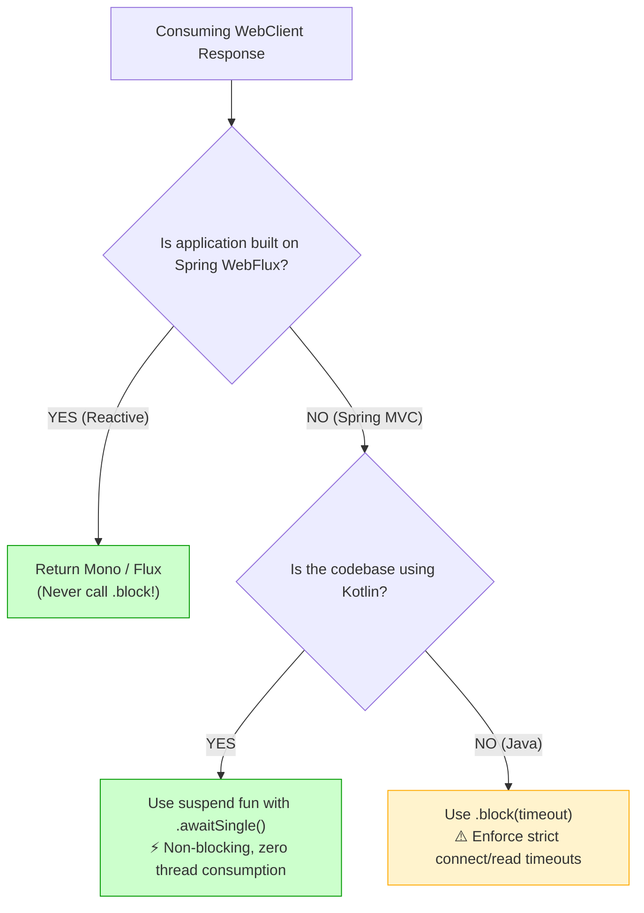

# The `.block()` Dilemma & The Kotlin Coroutine Bridge (`awaitSingle`)

In Spring Boot reactive architectures, the method **`.block()`** is both the simplest way to consume a `Mono<T>` and the most dangerous anti-pattern if used without understanding the underlying thread model.

This guide provides an exhaustive technical analysis of:
1. What happens inside the JVM and OS when `.block()` is called
2. Why `.block()` is permitted in Spring MVC but crashes Spring WebFlux
3. How `.block()` can cause Tomcat thread pool exhaustion
4. How Kotlin Coroutines' `.awaitSingle()` solves the problem completely

---

## Table of Contents
1. [The Anatomy of `.block()`: JVM & OS Internals](#1-the-anatomy-of-block-jvm--os-internals)
2. [The Thread Context Rule: MVC vs. WebFlux](#2-the-thread-context-rule-mvc-vs-webflux)
   - [Spring MVC (Tomcat Worker Thread)](#spring-mvc-tomcat-worker-thread)
   - [Spring WebFlux (Netty EventLoop Thread)](#spring-webflux-netty-eventloop-thread)
3. [The Threat in Spring MVC: Worker Thread Exhaustion](#3-the-threat-in-spring-mvc-worker-thread-exhaustion)
4. [The Kotlin Solution: Suspending with `.awaitSingle()`](#4-the-kotlin-solution-suspending-with-awaitsingle)
   - [Continuation Passing Style (CPS) vs. Thread Parking](#continuation-passing-style-cps-vs-thread-parking)
   - [Side-by-Side Code Refactoring](#side-by-side-code-refactoring)
5. [Summary Decision Flowchart](#5-summary-decision-flowchart)

---

## 1. The Anatomy of `.block()`: JVM & OS Internals

When you call `.block()` on a Project Reactor `Mono`:
```kotlin
val response = externalApiWebClient
    .get()
    .uri("/api/v1/enrichment/{refId}", referenceId)
    .retrieve()
    .bodyToMono(ExternalApiResponse::class.java)
    .block() // 👈 What happens under the hood?
```

### Internal Mechanics:
1. **Subscriber Creation:** Reactor creates an internal `BlockingSingleSubscriber<T>`.
2. **Subscription:** The subscriber subscribes to the upstream publisher, triggering the Netty HTTP request.
3. **Thread Parking (`LockSupport.park`):**
   ```java
   // Inside Reactor's BlockingSingleSubscriber.java:
   while (state == PENDING) {
       LockSupport.park(this); // 👈 Kernel deschedules this thread!
   }
   ```
4. **OS Context Switch:** The operating system kernel marks the calling thread as **`WAITING`** (or `TIMED_WAITING`), removes it from the CPU run queue, and context-switches to another thread.
5. **Callback & Unpark:** When Netty finishes decoding the response bytes, the Netty thread calls `onNext(value)` on the subscriber, which executes:
   ```java
   LockSupport.unpark(callingThread); // 👈 Wakes up the blocked thread!
   ```
6. The OS reschedules the Tomcat thread, which resumes execution and returns the unboxed value.

---

## 2. The Thread Context Rule: MVC vs. WebFlux

Whether `.block()` is acceptable depends entirely on **which thread** executes it:

```
                      Thread calls .block()
                                │
                 Is it an EventLoop thread?
                                │
               ┌────────────────┴────────────────┐
               │ YES                             │ NO
               ▼                                 ▼
   [Spring WebFlux Netty Thread]      [Spring MVC Tomcat Thread]
   💥 IllegalStateException           ✅ Permitted (Thread Parks)
   (Server would freeze!)             (Worker waits for I/O)
```

### Spring MVC (Tomcat Worker Thread)
- **Thread Name:** `http-nio-8080-exec-1`
- **Architecture:** Tomcat allocates a pool of dedicated worker threads (default `server.tomcat.threads.max: 200`). Each worker thread is designed to handle a single request from start to finish.
- **Verdict:** Calling `.block()` here is **safe and standard practice** when integrating reactive libraries into a synchronous servlet application.

---

### Spring WebFlux (Netty EventLoop Thread)
- **Thread Name:** `reactor-http-nio-1`
- **Architecture:** WebFlux runs on a tiny pool of non-blocking Netty event loops (usually 1 per CPU core). A single event loop thread handles **hundreds or thousands of concurrent sockets**.
- **The Crash:** If you call `.block()` on an event loop thread, Project Reactor detects it via `Schedulers.isInNonBlockingThread()` and **immediately aborts**:
  ```text
  java.lang.IllegalStateException: block()/blockFirst()/blockLast() are blocking, 
  which is not supported in thread reactor-http-nio-2
      at reactor.core.publisher.BlockingSingleSubscriber.blockingGet(BlockingSingleSubscriber.java:48)
      at reactor.core.publisher.Mono.block(Mono.java:1742)
  ```
- **Why this safeguard exists:** If Netty allowed you to park that thread for 3 seconds, all other 500 connections multiplexed on that event loop would freeze!

---

## 3. The Threat in Spring MVC: Worker Thread Exhaustion

Even though `.block()` is legal in Spring MVC, it introduces a **scalability ceiling**:

### The Scenario:
- Tomcat worker pool: `server.tomcat.threads.max: 200`.
- External third-party API becomes slow and takes **2,000ms (2 seconds)** to respond.
- Incoming traffic rate: **150 requests per second**.

### What Happens:
1. In the first second, 150 Tomcat threads call `.block()` and enter `WAITING` state.
2. In the second second, another 150 requests arrive. Only 50 threads remain in the pool!
3. The Tomcat thread pool is **completely exhausted (200 / 200 threads blocked)**!
4. New incoming requests queue up in the OS TCP backlog (`server.tomcat.accept-count: 100`).
5. After 100 requests fill the queue, Tomcat begins rejecting all new TCP handshakes with **`Connection refused`**.
6. **Result:** An outage in an external third-party API has cascaded into a complete outage of your entire microservice!

---

## 4. The Kotlin Solution: Suspending with `.awaitSingle()`

Kotlin Coroutines provide the bridge between reactive efficiency and sequential code readability:

```kotlin
import kotlinx.coroutines.reactor.awaitSingle

@Component
class ExternalWebClientAdapter(
    private val externalApiWebClient: WebClient,
) : ExternalClientPort {

    override suspend fun fetchEnrichmentData(referenceId: String): String {
        val response = externalApiWebClient
            .get()
            .uri("/api/v1/enrichment/{referenceId}", referenceId)
            .retrieve()
            .bodyToMono(ExternalApiResponse::class.java)
            .timeout(Duration.ofSeconds(5))
            .awaitSingle() // ⚡ SUSPENDS WITHOUT BLOCKING!

        return processEnrichmentResponse(response, referenceId)
    }
}
```

### Continuation Passing Style (CPS) vs. Thread Parking

| Metric | `.block()` (Blocking) | `.awaitSingle()` (Suspending) |
| :--- | :--- | :--- |
| **Thread State** | `WAITING` / `TIMED_WAITING` | **`RUNNABLE` (Thread is freed immediately!)** |
| **Thread Availability** | Thread is locked and cannot do any other work. | **Thread returns to pool to serve new HTTP requests.** |
| **Memory Cost** | 1MB thread stack held hostage for duration of call. | **~250 bytes (Continuation state on heap).** |
| **Max Concurrency** | Limited by thread count (e.g. 200). | **Tens of thousands of concurrent calls.** |
| **Cascading Failure** | Slow external API causes thread exhaustion. | **Slow external API does NOT exhaust worker threads.** |

---

## 5. Summary Decision Flowchart

When deciding how to consume a `WebClient` response:


