# Spring HTTP Clients: WebClient vs. RestTemplate vs. RestClient

When building REST microservices in Spring Boot 3, choosing the right HTTP client to invoke external APIs is critical for performance, thread safety, and resource efficiency.

Spring provides three distinct client abstractions across its history:
1. **`RestTemplate`** (Spring 3.0 / 2009) — The legacy synchronous template.
2. **`WebClient`** (Spring 5.0 / 2017) — The reactive, non-blocking Netty powerhouse.
3. **`RestClient`** (Spring 6.1 / Spring Boot 3.2 / late 2023) — The modern synchronous facade.

This guide provides an architectural comparison of these three clients, benchmarks their concurrency models, and explains why `WebClient` was selected for our service.

---

## Table of Contents
1. [Architectural Overview & Concurrency Models](#1-architectural-overview--concurrency-models)
2. [Detailed Feature Matrix](#2-detailed-feature-matrix)
3. [The Resource Cost: 1,000 Concurrent Outbound Calls](#3-the-resource-cost-1000-concurrent-outbound-calls)
4. [Deep Dive into RestClient (Spring 6.1+)](#4-deep-dive-into-restclient-spring-61)
5. [Why WebClient Remains the Senior Engineer's Choice in Kotlin](#5-why-webclient-remains-the-senior-engineers-choice-in-kotlin)

---

## 1. Architectural Overview & Concurrency Models

```
┌────────────────────────────────────────────────────────────────────────┐
│                        Evolution of Spring HTTP Clients                │
├─────────────────────┬──────────────────────────┬───────────────────────┤
│ RestTemplate (2009) │ WebClient (2017)         │ RestClient (2023)     │
│ Legacy / Blocking   │ Reactive / Non-Blocking  │ Modern Synchronous    │
│ Thread-per-request  │ Netty EventLoop Group    │ Pluggable HTTP engine │
│ Maintenance Mode    │ Spring WebFlux Core      │ Spring 6.1 MVC        │
└─────────────────────┴──────────────────────────┴───────────────────────┘
```

### The Blocking Model (`RestTemplate` & `RestClient` Default):
```
Tomcat Thread 1 ──► [Socket Open] ──► [Wait for Data (3s)] ──► [Read Response] ──► Thread Freed
Tomcat Thread 2 ──► [Socket Open] ──► [Wait for Data (3s)] ──► [Read Response] ──► Thread Freed
```
- Each outgoing HTTP request binds an OS worker thread.
- If the external API takes 3 seconds to respond, the thread is completely frozen, consuming 1MB of memory and preventing other work.

### The Non-Blocking EventLoop Model (`WebClient`):
```
Netty EventLoop (Thread 1) ──► Multiplexes Sockets [S1, S2, S3, ..., S1000] via Linux epoll
                              (Zero threads blocked while waiting for data!)
```
- WebClient delegates socket management to **Reactor Netty**.
- When an HTTP request is dispatched, the socket is registered with the OS kernel (`epoll` on Linux, `kqueue` on macOS).
- Netty worker threads are never blocked; they immediately process packets from other active sockets.

---

## 2. Detailed Feature Matrix

| Feature | `RestTemplate` | `RestClient` (Spring 6.1) | `WebClient` (Our Choice) |
| :--- | :---: | :---: | :---: |
| **Current Status** | ⚠️ Maintenance Mode | ✅ Active / Recommended for Sync | ✅ Active / Primary Reactive Engine |
| **Execution Engine** | `HttpURLConnection` / Apache | JDK HttpClient / Apache / Netty | **Reactor Netty (EventLoop)** |
| **API Style** | Template Methods (`postForObject`) | Fluent API (`.post().uri().retrieve()`) | **Fluent Pipeline (`.post().uri().retrieve()`)** |
| **Asynchronous Execution** | ❌ No | ❌ No (Blocking API) | **✅ Native (`Mono<T>`, `Flux<T>`)** |
| **Kotlin Coroutine Native** | ❌ Requires wrapper | ❌ Requires wrapper | **✅ Built-in (`awaitSingle()`, `asFlow()`)** |
| **HTTP/2 Multiplexing** | ❌ Complex / Library-dependent | ⚠️ Dependent on JDK HttpClient | **✅ Native out of the box** |
| **Streaming & SSE** | ❌ Poor | ❌ Poor | **✅ High performance (`Flux<ServerSentEvent>`)** |
| **WebSockets** | ❌ No | ❌ No | **✅ Full support** |
| **Resilience & Timeouts** | Brittle / Inconsistent | Client-connector dependent | **Declarative (`.timeout()`, `.retry()`)** |

---

## 3. The Resource Cost: 1,000 Concurrent Outbound Calls

Consider an endpoint that aggregates data from a third-party microservice with a 2-second average latency:

```mermaid
graph TD
    subgraph RestTemplate["RestTemplate / Blocking RestClient"]
        T1["1,000 Concurrent Outbound Requests"] --> TThreads["Allocates 1,000 OS Worker Threads"]
        TThreads --> TMem["Memory: ~1,000 MB (1 GB) for Thread Stacks"]
        TMem --> TPreempt["OS Kernel Context-Switch Thrashing"]
        TPreempt --> TCrash["Risk of OutOfMemoryError / Thread Starvation"]
    end

    subgraph WebClientModel["Spring WebClient (Reactor Netty)"]
        W1["1,000 Concurrent Outbound Requests"] --> WEvent["Multiplexed on 8 Netty EventLoop Threads"]
        WEvent --> WMem["Memory: ~8 MB for Thread Stacks"]
        WMem --> WEpoll["Linux epoll / macOS kqueue Non-blocking I/O"]
        WEpoll --> WPerf["Zero Context Switching / Ultra-Low CPU Latency"]
    end

    style TCrash fill:#ffcccc,stroke:#cc0000
    style WPerf fill:#ccffcc,stroke:#009900
```



---

## 4. Deep Dive into RestClient (Spring 6.1+)

### Why Did the Spring Team Create `RestClient`?
Before Spring 6.1, developers in standard Spring MVC applications who wanted a modern fluent API (like `.get().uri().retrieve().body(...)`) were forced to add the `spring-boot-starter-webflux` dependency to get `WebClient`.

Many enterprise teams complained:
> *"We don't need reactive programming; we just want a modern replacement for RestTemplate without pulling in Netty and Project Reactor!"*

In response, Spring 6.1 introduced `RestClient`:
```kotlin
// Spring 6.1 RestClient (Synchronous)
val restClient = RestClient.create("http://localhost:8081")
val response = restClient.get()
    .uri("/api/v1/enrichment/{refId}", referenceId)
    .retrieve()
    .body(ExternalApiResponse::class.java)
```

### When to Choose `RestClient`:
- Pure Java or simple synchronous Spring MVC services that do **not** use Kotlin Coroutines.
- Applications with strict organizational bans on reactive dependencies (`reactor-core`, Netty).

---

## 5. Why WebClient Remains the Senior Engineer's Choice in Kotlin

In Kotlin microservices, **`WebClient` is superior to `RestClient`**:

1. **Kotlin Coroutines Synergy:**
   `WebClient` pairs natively with Kotlin Coroutines. You can bridge reactive types to coroutines with zero boilerplate:
   ```kotlin
   // Non-blocking, sequential-looking Kotlin coroutine:
   suspend fun fetch(refId: String): ExternalApiResponse =
       webClient.get()
           .uri("/api/v1/enrichment/{refId}", refId)
           .retrieve()
           .bodyToMono<ExternalApiResponse>()
           .awaitSingle() // Suspends without blocking threads!
   ```
   `RestClient` cannot do this because its underlying engine is fundamentally thread-blocking.

2. **HTTP/2 Streaming & Multiplexing:**
   `WebClient` supports connection multiplexing over HTTP/2, allowing multiple concurrent requests to share a single TCP connection.

3. **Production Hardening:**
   Reactor Netty has undergone nearly a decade of battle-tested enterprise hardening under massive traffic at organizations like Netflix, Apple, and Salesforce.
