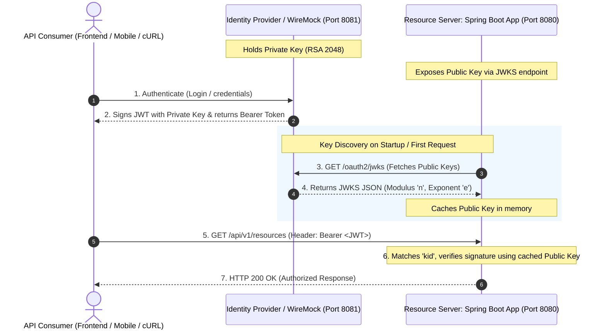
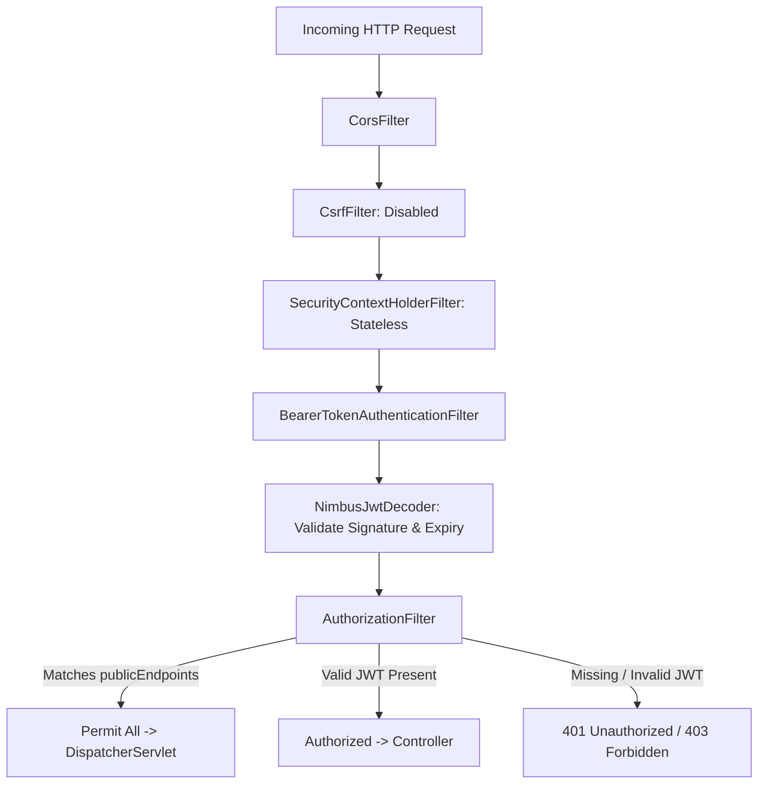
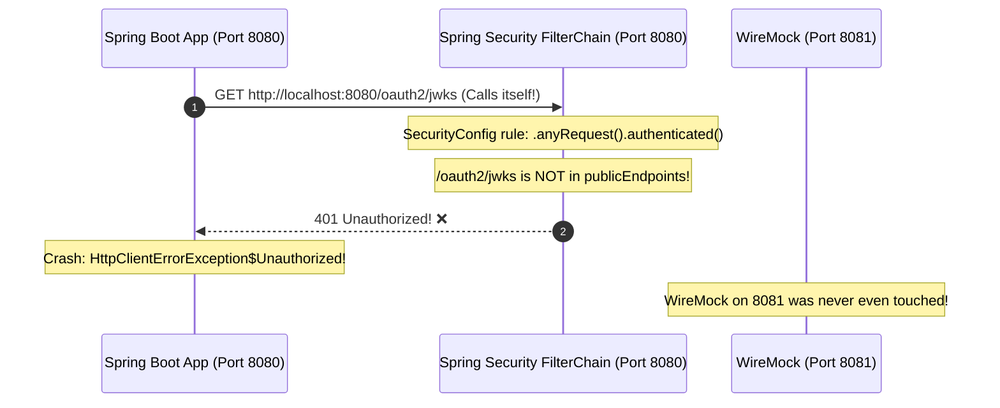

# Spring Security OAuth2 Resource Server & JWKS Architecture

This guide details how OAuth2 Resource Server JWT validation is implemented in this service, how asymmetric public-key cryptography (RS256/JWKS) verifies identities without shared secrets, and provides an in-depth post-mortem of the common **"401 Loopback Error"** encountered during local development.

---

## Table of Contents
1. [Mental Model: OAuth2 Resource Server & Asymmetric Cryptography](#1-mental-model-oauth2-resource-server--asymmetric-cryptography)
2. [Spring Security Architecture & Filter Chain](#2-spring-security-architecture--filter-chain)
   - [2.1 The SecurityFilterChain Breakdown](#21-the-securityfilterchain-breakdown)
   - [2.2 Why CSRF is Disabled in Stateless REST APIs](#22-why-csrf-is-disabled-in-stateless-rest-apis)
   - [2.3 Stateless Session Policy](#23-stateless-session-policy)
3. [The JWKS Protocol (JSON Web Key Set - RFC 7517)](#3-the-jwks-protocol-json-web-key-set---rfc-7517)
   - [3.1 Structure of a JWKS Key](#31-structure-of-a-jwks-key)
   - [3.2 How NimbusJwtDecoder Validates Tokens](#32-how-nimbusjwtdecoder-validates-tokens)
4. [Case Study: Debugging the `401 Unauthorized` on `/oauth2/jwks`](#4-case-study-debugging-the-401-unauthorized-on-oauth2jwks)
   - [4.1 The Incident / Error](#41-the-incident--error)
   - [4.2 The Loopback Self-Call Trap](#42-the-loopback-self-call-trap)
   - [4.3 Docker Network vs. Host Port Mapping](#43-docker-network-vs-host-port-mapping)
   - [4.4 The Solution](#44-the-solution)
5. [Key Rotation & Production Resilience](#5-key-rotation--production-resilience)
6. [Testing Strategy for Spring Security](#6-testing-strategy-for-spring-security)
7. [60-Second Interview PREP Scripts](#7-60-second-interview-prep-scripts)

---

## 1. Mental Model: OAuth2 Resource Server & Asymmetric Cryptography

In our architecture, there are three distinct parties:



### Why Asymmetric Encryption (RS256) Matters:
* **No Shared Secret:** The Resource Server does **not** need access to the private signing key. Even if our application database or container is compromised, the attacker cannot forge new JWT tokens.
* **Decoupled Verification:** The Resource Server validates tokens entirely locally using the cached public key. It does **not** make a network call to the Authorization Server on every incoming user request.

---

## 2. Spring Security Architecture & Filter Chain

Implemented in [`SecurityConfig.kt`](file:///src/main/kotlin/com/example/demo/infrastructure/config/SecurityConfig.kt):

```kotlin
@Configuration
@EnableWebSecurity
class SecurityConfig {
    private val publicEndpoints = arrayOf(
        "/v3/api-docs/**",
        "/swagger-ui/**",
        "/swagger-ui.html",
        "/actuator/**"
    )

    @Bean
    fun securityFilterChain(http: HttpSecurity): SecurityFilterChain {
        http
            .csrf { it.disable() }
            .sessionManagement { it.sessionCreationPolicy(SessionCreationPolicy.STATELESS) }
            .authorizeHttpRequests { authorize ->
                authorize
                    .requestMatchers(*publicEndpoints).permitAll()
                    .anyRequest().authenticated()
            }
            .oauth2ResourceServer { oauth2 ->
                oauth2.jwt(Customizer.withDefaults())
            }

        return http.build()
    }
}
```

### 2.1 The SecurityFilterChain Breakdown
When an incoming HTTP request hits the servlet container, it passes through Spring Security's filter chain before reaching the `DispatcherServlet`:



### 2.2 Why CSRF is Disabled in Stateless REST APIs
* **CSRF (Cross-Site Request Forgery)** attacks rely on the browser automatically attaching session cookies (`JSESSIONID`) to cross-origin requests.
* Our microservice uses **Bearer JWT tokens** stored in memory or authorization headers—browsers **never** automatically attach Bearer headers across origins.
* Therefore, disabling CSRF (`http.csrf { it.disable() }`) eliminates unnecessary CSRF token validation overhead with zero security risk.

### 2.3 Stateless Session Policy
* `SessionCreationPolicy.STATELESS` guarantees that Spring Security will **never create an `HttpSession`** on the JVM.
* Every single HTTP request must be self-contained and carry its own authentication token.
* This allows our service to scale horizontally behind a load balancer with zero need for sticky sessions or shared session caches (like Redis).

---

## 3. The JWKS Protocol (JSON Web Key Set - RFC 7517)

When Spring Boot initializes the JWT decoder, it looks at `application.yml`:

```yaml
spring:
  security:
    oauth2:
      resourceserver:
        jwt:
          jwk-set-uri: ${JWT_JWK_SET_URI:http://localhost:8081/oauth2/jwks}
```

### 3.1 Structure of a JWKS Key
WireMock serves our public keys from [`.dev/wiremock/mappings/jwks.json`](file:///.dev/wiremock/mappings/jwks.json):

```json
{
  "keys": [
    {
      "kty": "RSA",
      "kid": "dev-key-1",
      "use": "sig",
      "alg": "RS256",
      "n": "q1jsWhi7obqRTiT7CZ2lhL66Pn_he87kQe88i7cH1RapZaRaRqvM6qLbW0uMJGgjKenMC9ixhSMPxRgOkDfvTlg8viLV2qByTn6QuW0K3RHqb8aeDC4o0lyHUbp3rRzTB1kjxc0jTr6ETK4r5YhSb4M0tqk4FrDUqW7gzE936EWeBf-koiCcXzmkcdG6CHMXSipvkgIKe4TBKn4OsNuigizw3wKNeq8b6jHmRz1oMWCWe2cFTmQp58M8yRnv4uZLeysTK6bV1iiZnGQ_Mky1pxzQGW71gRqUx2lRje1Kf4sxejNoB80r8GeAHi_yrvKSrOisQo5pklRVbBAx2wZG9Q",
      "e": "AQAB"
    }
  ]
}
```

* **`kty` (Key Type):** `RSA` indicates an RSA asymmetric key.
* **`kid` (Key ID):** `dev-key-1`. Identifies which key was used to sign the token when multiple keys exist (crucial for zero-downtime key rotation).
* **`alg` (Algorithm):** `RS256` (RSA Signature with SHA-256).
* **`use` (Public Key Use):** `sig` (Signature verification).
* **`n` (Modulus):** Base64URL-encoded public key modulus.
* **`e` (Exponent):** Base64URL-encoded public key exponent (`AQAB` = 65537, standard RSA exponent).

### 3.2 How NimbusJwtDecoder Validates Tokens
1. **Header Parsing:** Reads the JWT header and extracts the `kid` claim (`"kid": "dev-key-1"`).
2. **Key Lookup:** Checks in-memory cache for a public key matching `dev-key-1`. If not cached, fetches from `jwk-set-uri`.
3. **Cryptographic Mathematical Verification:** Computes the SHA-256 hash of `Header.Payload` and verifies the signature using `(n, e)`.
4. **Claims Validation:** Verifies that the current timestamp is within `nbf` (not before) and `exp` (expiration), and validates the issuer (`iss`).

---

## 4. Case Study: Debugging the `401 Unauthorized` on `/oauth2/jwks`

### 4.1 The Incident / Error
During local testing, launching the application resulted in the following startup/request exception:

```
Caused by: org.springframework.web.client.HttpClientErrorException$Unauthorized: 
  401 on GET request for "http://localhost:8080/oauth2/jwks": [no body]
```

### 4.2 The Loopback Self-Call Trap
The error message revealed that the application was sending an HTTP GET request to **`http://localhost:8080/oauth2/jwks`**.

#### The Deadly Loop:
1. Port **8080** is the Spring Boot microservice itself.
2. The WireMock stub server hosting `/oauth2/jwks` was actually running on port **8081** on the host machine.
3. Because `jwk-set-uri` defaulted to `8080`, Spring Security made an outbound HTTP request to **itself**:



Because `/oauth2/jwks` is not in `publicEndpoints` in [`SecurityConfig.kt`](file:///src/main/kotlin/com/example/demo/infrastructure/config/SecurityConfig.kt), the microservice's own security filter challenged the request, saw no Bearer token, and rejected its own request with **`401 Unauthorized`**!

---

### 4.3 Docker Network vs. Host Port Mapping

Why did this work inside Docker Compose but fail on the local host?

Look at [`docker-compose.yml`](file:///docker-compose.yml):

```yaml
services:
  app:
    environment:
      # Inside the Docker bridge network:
      - JWT_JWK_SET_URI=http://mock-external-api:8080/oauth2/jwks

  mock-external-api:
    image: wiremock/wiremock:3.9.1
    ports:
      # Host:Container port mapping
      - "8081:8080"
```

| Context | WireMock Target Address | Why? |
| :--- | :--- | :--- |
| **Inside Docker Network** | `http://mock-external-api:8080/oauth2/jwks` | Inter-container communication uses container port `8080` via Docker DNS. |
| **On Local Host Machine** | `http://localhost:8081/oauth2/jwks` | Host mapping exposes WireMock on port `8081` because port `8080` is reserved for Spring Boot. |

---

### 4.4 The Solution

In [`src/main/resources/application.yml`](file:///src/main/resources/application.yml#L37), the local fallback port was corrected from `8080` to **`8081`**:

```yaml
spring:
  security:
    oauth2:
      resourceserver:
        jwt:
          jwk-set-uri: ${JWT_JWK_SET_URI:http://localhost:8081/oauth2/jwks}
```

Now:
* In Docker Compose: `JWT_JWK_SET_URI` environment variable overrides to `http://mock-external-api:8080/oauth2/jwks`.
* On Local Host (`./gradlew bootRun`): It defaults to `http://localhost:8081/oauth2/jwks`, successfully reaching WireMock.

---

## 5. Key Rotation & Production Resilience

In a production environment (Auth0, Okta, Keycloak):

### How Zero-Downtime Key Rotation Works:
1. The Authorization Server generates a new key pair (`dev-key-2`).
2. The JWKS endpoint is updated to return **both** keys:
   ```json
   { "keys": [ { "kid": "dev-key-1", ... }, { "kid": "dev-key-2", ... } ] }
   ```
3. The Auth Server starts signing new tokens using `dev-key-2`.
4. When a user presents a token with `"kid": "dev-key-2"`, Spring Boot detects that `dev-key-2` is not in its local cache, queries the JWKS endpoint, caches the new key, and validates seamlessly.
5. After all old tokens with `dev-key-1` expire, `dev-key-1` is deleted from the JWKS.

### What if the JWKS Endpoint Goes Down?
* **Spring Boot Caches Keys:** `NimbusJwtDecoder` caches retrieved public keys. If the JWKS endpoint experiences a temporary 10-minute outage, our microservice continues validating incoming requests with 100% availability using cached keys.

---

## 6. Testing Strategy for Spring Security

In [`src/test/kotlin/com/example/demo/infrastructure/config/SecurityConfigTest.kt`](file:///src/test/kotlin/com/example/demo/infrastructure/config/SecurityConfigTest.kt):

We use Spring Security Test's JWT post-processor to simulate signed JWT tokens in tests without needing a real running WireMock server:

```kotlin
@Test
fun `protected API endpoints should accept authenticated requests with valid JWT`() {
    mockMvc.perform(
        get("/api/v1/resources")
            .with(jwt().jwt { it.claim("sub", "test-user-uuid") })
    ).andExpect(status().isOk)
}

@Test
fun `protected API endpoints should reject unauthenticated requests with 401 Unauthorized`() {
    mockMvc.perform(
        get("/api/v1/resources")
    ).andExpect(status().isUnauthorized)
}
```

---

## 7. 60-Second Interview PREP Scripts

### Script 1: "How does JWT validation work in your service, and why did you use JWKS?"
> **Point:**  
> We configured our microservice as a stateless OAuth2 Resource Server using Spring Security and RS256 asymmetric encryption via JWKS.
>
> **Reason:**  
> Unlike symmetric HMAC where both the auth server and every microservice must share a secret key (a massive security risk), asymmetric RSA ensures only the auth server possesses the private signing key. Microservices only need the public key to verify signatures.
>
> **Example:**  
> On startup, Spring's `NimbusJwtDecoder` queries the JWKS endpoint at `http://localhost:8081/oauth2/jwks` (or our Auth0/Keycloak URI) and caches the public keys in memory. When a client presents a Bearer JWT, Spring extracts the `kid` header, matches the cached public key, and verifies the cryptographic signature without needing a network call.
>
> **Point (Restated):**  
> This architecture achieves maximum security isolation, local signature verification speed, and seamless zero-downtime key rotation.

---

### Script 2: "Tell me about a tricky bug you diagnosed with Spring Security."
> **Point:**  
> I diagnosed an issue where the service was failing with `401 Unauthorized` on its own JWKS URL during local startup.
>
> **Reason:**  
> In `docker-compose.yml`, WireMock ran on port `8080` internally and was exposed to the host on port `8081`. In `application.yml`, the fallback property for `jwk-set-uri` was mistakenly defaulting to `localhost:8080` instead of `localhost:8081`.
>
> **Example:**  
> Because port 8080 was the microservice itself, Spring Security made an outbound HTTP request to its own server. Since `/oauth2/jwks` was not in the public endpoint whitelist, Spring Security challenged the request, saw no Bearer token, and returned a 401 to itself. Correcting the host fallback port to `8081` resolved the loopback and routed traffic to WireMock.
>
> **Point (Restated):**  
> This diagnostic experience highlighted the importance of distinguishing between container network namespaces and host port bindings in hybrid local development environments.
