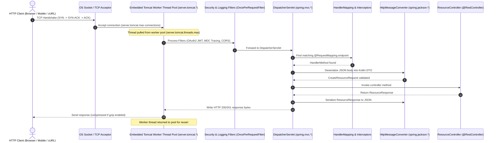
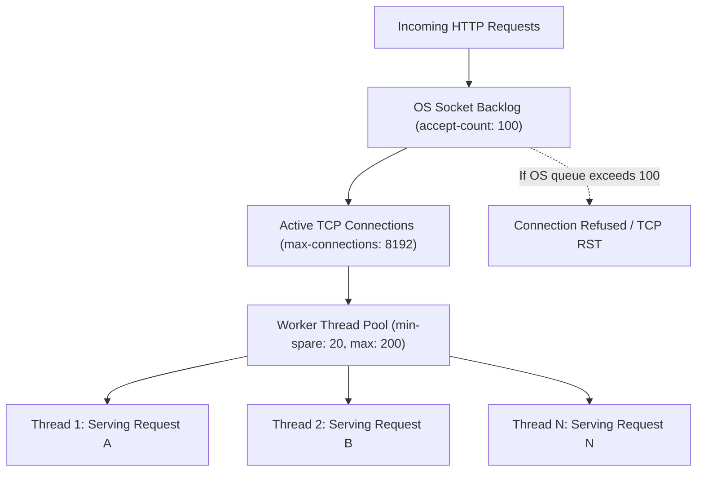

# Spring MVC Configuration in `application.yml`: Complete Deep Dive

This guide explains how Spring Web MVC is configured via [`src/main/resources/application.yml`](file:///src/main/resources/application.yml), how the underlying HTTP server and `DispatcherServlet` process requests, and how each property impacts production performance, security, and developer ergonomics.

---

## Table of Contents
1. [Mental Model: The Spring MVC HTTP Request Lifecycle](#1-mental-model-the-spring-mvc-http-request-lifecycle)
2. [Server & Container Settings (`server.*`)](#2-server--container-settings-server)
   - [2.1 Port & Network Binding](#21-port--network-binding)
   - [2.2 Context Path & Encoding](#22-context-path--encoding)
   - [2.3 Graceful Shutdown (Production Mandatory)](#23-graceful-shutdown-production-mandatory)
   - [2.4 Embedded Tomcat Thread Pool & Connection Tuning](#24-embedded-tomcat-thread-pool--connection-tuning)
   - [2.5 HTTP Response Compression (Gzip)](#25-http-response-compression-gzip)
   - [2.6 Reverse Proxy & Forwarded Headers](#26-reverse-proxy--forwarded-headers)
3. [Spring MVC DispatcherServlet Properties (`spring.mvc.*`)](#3-spring-mvc-dispatcherservlet-properties-springmvc)
   - [3.1 RFC 7807 Problem Details](#31-rfc-7807-problem-details)
   - [3.2 Path Matching & Trailing Slash Behavior](#32-path-matching--trailing-slash-behavior)
   - [3.3 404 Exception Handling (`throw-exception-if-no-handler-found`)](#33-404-exception-handling-throw-exception-if-no-handler-found)
   - [3.4 Date & Time Format Parameter Binding](#34-date--time-format-parameter-binding)
   - [3.5 Asynchronous Request Timeout](#35-asynchronous-request-timeout)
4. [JSON Serialization & Deserialization (`spring.jackson.*`)](#4-json-serialization--deserialization-springjackson)
   - [4.1 ISO-8601 Date Handling (`write-dates-as-timestamps: false`)](#41-iso-8601-date-handling-write-dates-as-timestamps-false)
   - [4.2 Handling Unknown Properties & Payload Evolution](#42-handling-unknown-properties--payload-evolution)
   - [4.3 Naming Strategy (camelCase vs. snake_case)](#43-naming-strategy-camelcase-vs-snake_case)
   - [4.4 Suppressing Null Fields to Reduce Network Payload](#44-suppressing-null-fields-to-reduce-network-payload)
5. [Multipart & File Uploads (`spring.servlet.multipart.*`)](#5-multipart--file-uploads-springservletmultipart)
6. [Complete Production-Ready `application.yml` Reference](#6-complete-production-ready-applicationyml-reference)
7. [Current Project State vs. Production Additions](#7-current-project-state-vs-production-additions)
8. [60-Second Interview PREP Scripts](#8-60-second-interview-prep-scripts)

---

## 1. Mental Model: The Spring MVC HTTP Request Lifecycle

Before configuring properties, it is essential to visualize how an HTTP request travels through the layers controlled by these YAML settings:



Every property in `application.yml` tunes one or more steps in this pipeline.

---

## 2. Server & Container Settings (`server.*`)

These settings configure the embedded servlet container (Tomcat by default in `spring-boot-starter-web`).

### 2.1 Port & Network Binding
```yaml
server:
  port: ${SERVER_PORT:8080}
  address: 0.0.0.0
```
- **`server.port`**: The TCP port on which the HTTP server listens. Using `${SERVER_PORT:8080}` allows environment variables to override it dynamically (e.g., in Docker or Kubernetes).
- **`server.address`**: The network interface IP to bind to. `0.0.0.0` binds to all available network interfaces (mandatory inside Docker containers so external hosts can route packets in). `127.0.0.1` restricts access strictly to localhost.

---

### 2.2 Context Path & Encoding
```yaml
server:
  servlet:
    context-path: /api/v1
    encoding:
      charset: UTF-8
      force: true
```
- **`context-path`**: A global prefix prepended to all servlet endpoints. For example, if set to `/api/v1`, your `@GetMapping("/resources")` becomes `GET /api/v1/resources`.
- **`encoding.charset: UTF-8`** & **`encoding.force: true`**: Forces both HTTP requests and responses to use UTF-8 encoding, overriding misconfigured client headers to prevent corrupted characters (Mojibake).
- **Deep Dive Guide:** See [character-encoding-and-utf8.md](file:///repo-wiki/springboot/web-mvc/character-encoding-and-utf8.md) for a comprehensive breakdown of why UTF-8 already works out of the box in Spring Boot 3 + Java 21, how multi-byte emojis/umlauts are processed, and when `force: true` is required for legacy systems.

---

### 2.3 Graceful Shutdown (Production Mandatory)
```yaml
server:
  shutdown: graceful
spring:
  lifecycle:
    timeout-per-shutdown-phase: 30s
```

#### What it does:
When Kubernetes, Docker, or systemd sends a `SIGTERM` signal to stop the application:
- **`immediate` (Default prior to Spring Boot 2.3):** The server abruptly severs active TCP connections and drops ongoing HTTP requests. Clients receive `502 Bad Gateway` or `Connection Reset by Peer`.
- **`graceful` (Recommended for Production):**
  1. The embedded Tomcat stops accepting **new** incoming network connections.
  2. In-flight HTTP requests currently executing inside the application are allowed to finish within the `timeout-per-shutdown-phase` window (e.g., 30 seconds).
  3. Once all in-flight requests complete (or the timeout elapses), the container closes database connection pools and shuts down cleanly.
- **Deep Dive Guide:** See [graceful-shutdown.md](file:///repo-wiki/springboot/web-mvc/graceful-shutdown.md) for sequence diagrams, an explanation of why the default is `immediate`, and how this prevents 502 Bad Gateway errors during Kubernetes rolling updates.

---

### 2.4 Embedded Tomcat Thread Pool & Connection Tuning
Spring MVC follows the **thread-per-request** model (unless using Coroutines or WebFlux). Each incoming HTTP request holds one worker thread from start to finish.

```yaml
server:
  tomcat:
    threads:
      max: 200          # Maximum worker threads in the pool
      min-spare: 20     # Minimum worker threads kept alive and idle
    max-connections: 8192 # Maximum concurrent TCP connections Tomcat will hold
    accept-count: 100   # OS queue length for incoming connection requests when all threads are busy
    connection-timeout: 20000 # 20 seconds before dropping an idle TCP socket
```



#### Why this matters:
- **`threads.max: 200`**: Allows up to 200 concurrent HTTP requests to execute simultaneously. If all 200 threads are busy (e.g., waiting on slow database queries or external APIs), subsequent requests wait in the queue.
- **`accept-count: 100`**: If all worker threads are busy and the queue fills past 100, the OS immediately rejects further connection attempts (`Connection Refused`), protecting the server from running out of memory.
- **Deep Dive Guides:**
  - See [tomcat-connection-multiplexing.md](file:///repo-wiki/springboot/web-mvc/tomcat-connection-multiplexing.md) for how `accept-count: 100` feeds into `max-connections: 8192` via Acceptor, Poller (`epoll`), and Worker threads.
  - See [what-is-a-socket.md](file:///repo-wiki/springboot/web-mvc/what-is-a-socket.md) for a foundational explanation of network sockets, OS file descriptors, the 4-tuple, and the socket lifecycle in Java.

---

### 2.5 HTTP Response Compression (Gzip)
```yaml
server:
  compression:
    enabled: true
    mime-types: text/html,text/xml,text/plain,text/css,application/javascript,application/json
    min-response-size: 2048 # 2 KB
```
- Compresses JSON payloads exceeding 2KB with Gzip if the client sends `Accept-Encoding: gzip`.
- **Impact:** Decreases network bandwidth consumption by 60%–80% for large collection endpoints (`GET /api/v1/resources`), lowering latency for mobile and frontend clients.
- **Deep Dive Guide:** See [http-response-compression.md](file:///repo-wiki/springboot/web-mvc/http-response-compression.md) for the wire-level handshake, why images/videos are excluded, the 2KB threshold rationale, and server CPU vs. network trade-offs.

---

### 2.6 Reverse Proxy & Forwarded Headers
In cloud environments (AWS ALB, Kubernetes Ingress, Nginx, Cloudflare), the client connects to the proxy via HTTPS, and the proxy forwards HTTP to the microservice:

```yaml
server:
  forward-headers-strategy: framework
```
- Tells Spring MVC to read `X-Forwarded-For` (original client IP), `X-Forwarded-Proto` (https), and `X-Forwarded-Port`.
- Prevents redirect loops where Spring Security or Swagger generates redirect URLs using `http://` instead of `https://`.

---

### 2.7 Request Header Size Limit (`server.max-http-request-header-size`)
```yaml
server:
  max-http-request-header-size: 10KB # or 16KB / 32KB (Default: 8KB)
```

#### Why it is needed:
* **Default:** In Spring Boot (Tomcat), the default limit is **8 KB (8192 bytes)**.
* **The Problem with Enterprise JWTs:** In OAuth2/OIDC enterprise environments (Azure Active Directory, Okta, Keycloak), users often have dozens of group memberships, roles, tenant claims, and custom metadata encoded directly inside the JWT payload.
* When a client sends a large `Authorization: Bearer <JWT>` header alongside session cookies, OpenTelemetry tracing headers (`traceparent`), and browser headers, the total request header can easily exceed 8 KB.
* **What happens if exceeded:** The server abruptly rejects the connection with **`HTTP 431 Request Header Fields Too Large`** (or `400 Bad Request: Request header is too large`) before the request ever reaches the `DispatcherServlet` or your controller.
* **Trade-off:** Setting it to `10KB`, `16KB`, or `32KB` accommodates large enterprise JWTs without wasting server memory (avoid setting to multi-megabytes to protect against Slowloris header memory-exhaustion attacks).

---

## 3. Spring MVC DispatcherServlet Properties (`spring.mvc.*`)

These properties configure the Spring MVC framework itself and the `DispatcherServlet`.

### 3.1 RFC 7807 Problem Details
```yaml
spring:
  mvc:
    problemdetails:
      enabled: true
```
- Introduced in Spring Boot 3.0 / Spring Framework 6.0.
- When enabled, Spring MVC automatically wraps standard web exceptions (`MethodArgumentNotValidException`, `HttpRequestMethodNotSupportedException`, etc.) into standardized **RFC 7807 `ProblemDetail`** JSON responses containing `type`, `title`, `status`, and `detail`.
- Matches the custom error handling implemented in our [`GlobalExceptionHandler.kt`](file:///src/main/kotlin/com/example/demo/infrastructure/adapter/in/rest/GlobalExceptionHandler.kt).
- **Deep Dive Guide:** See [rfc-7807-problem-details-and-swagger.md](file:///repo-wiki/springboot/web-mvc/rfc-7807-problem-details-and-swagger.md) for how `ProblemDetail` is exposed in OpenAPI / Swagger UI via `OperationCustomizer` in `OpenApiConfig.kt` and why custom exceptions work without the YAML setting.

---

### 3.2 Path Matching & Trailing Slash Behavior
```yaml
spring:
  mvc:
    pathmatch:
      matching-strategy: path-pattern-parser
```
- **`path-pattern-parser`** (Default in Spring Boot 3): Modern, high-performance URI pattern parser written specifically for web applications. It is faster than the legacy `ant-path-matcher`.
- **Trailing Slash Notice:** In Spring Boot 3 / Spring 6, trailing slash matching is disabled by default for security (`/api/resources` and `/api/resources/` are treated as distinct paths to prevent cache-poisoning and authorization bypass).

---

### 3.3 404 Exception Handling (`throw-exception-if-no-handler-found`)
```yaml
spring:
  mvc:
    throw-exception-if-no-handler-found: true
  web:
    resources:
      add-mappings: false # Disable default static resource mapping (/** -> /static)
```
- By default, if a client requests an unknown URL, Spring Boot serves a white-label error page or static 404.
- Setting `throw-exception-if-no-handler-found: true` forces `DispatcherServlet` to throw a `NoHandlerFoundException`, allowing your [`GlobalExceptionHandler.kt`](file:///src/main/kotlin/com/example/demo/infrastructure/adapter/in/rest/GlobalExceptionHandler.kt) to catch it and return an RFC 7807 JSON error body.

---

### 3.4 Date & Time Format Parameter Binding
```yaml
spring:
  mvc:
    format:
      date: iso
      date-time: iso
      time: iso
```
- Configures default parsing formats for `@RequestParam` and `@PathVariable` dates without needing `@DateTimeFormat(iso = DateTimeFormat.ISO.DATE_TIME)` on every controller method parameter.
- Supports standard ISO-8601 strings (e.g. `2026-10-18T14:30:00Z`).

---

### 3.5 Asynchronous Request Timeout
```yaml
spring:
  mvc:
    async:
      request-timeout: 10000 # 10 seconds
```
- Configures timeout for asynchronous controller operations (e.g. `Callable`, `DeferredResult`, or Kotlin Coroutines). If an async operation does not produce a response within 10 seconds, Spring MVC throws an `AsyncRequestTimeoutException`.

---

## 4. JSON Serialization & Deserialization (`spring.jackson.*`)

In Spring MVC, Jackson's `ObjectMapper` handles serialization (Kotlin object -> JSON) and deserialization (JSON -> Kotlin object).

### 4.1 ISO-8601 Date Handling (`write-dates-as-timestamps: false`)
```yaml
spring:
  jackson:
    serialization:
      write-dates-as-timestamps: false
    date-format: "yyyy-MM-dd'T'HH:mm:ss.SSSXXX"
    time-zone: UTC
```

| Setting | Output Example | Verdict |
| :--- | :--- | :--- |
| `write-dates-as-timestamps: true` (Legacy Default) | `{"createdAt": 1729261800.123}` | ❌ Confusing, requires frontend epoch conversion, loss of timezone clarity |
| `write-dates-as-timestamps: false` (Best Practice) | `{"createdAt": "2026-10-18T14:30:00.123Z"}` | ✅ Standard ISO-8601 format, universally understood by frontends |

---

### 4.2 Handling Unknown Properties & Payload Evolution
```yaml
spring:
  jackson:
    deserialization:
      fail-on-unknown-properties: false
```
- **`fail-on-unknown-properties: false`** (Default in Spring Boot): If a client sends an extra field in the JSON body that does not exist in our Kotlin DTO (e.g. `CreateResourceRequest`), Jackson silently ignores the field rather than throwing `UnrecognizedPropertyException`.
- **Why it matters:** Enables non-breaking API evolution (clients can send new fields before older service instances are restarted).

---

### 4.3 Naming Strategy (camelCase vs. snake_case)
```yaml
spring:
  jackson:
    property-naming-strategy: LOWER_CAMEL_CASE # or SNAKE_CASE
```
- Kotlin conventions use camelCase (`externalReferenceId`).
- If integrating with legacy systems or Python/Ruby APIs requiring snake_case (`external_reference_id`), setting this globally eliminates the need for `@JsonProperty("external_reference_id")` on every single field.
- **Swagger / OpenAPI Synchronization:** By default, Swagger UI does not automatically reflect Spring Boot's Jackson naming strategy and continues to display `camelCase` schemas. Registering a `ModelResolver(objectMapper)` `@Bean` bridges Spring's `ObjectMapper` with Swagger-Core so request/response schemas in Swagger UI perfectly match the runtime JSON format.
- **Deep Dive Guide:** See [jackson-naming-strategy-and-openapi.md](file:///repo-wiki/springboot/web-mvc/jackson-naming-strategy-and-openapi.md) for a comprehensive breakdown, `@JsonProperty` overrides, Kotlin data class handling, and automated unit tests.

---

### 4.4 Suppressing Null Fields to Reduce Network Payload
```yaml
spring:
  jackson:
    default-property-inclusion: non_null
```
- When serializing an entity or DTO with `null` fields (such as `externalEnrichmentData: String? = null`), Jackson completely omits the key from the output JSON rather than rendering `"externalEnrichmentData": null`.
- Reduces payload size over the wire.

---

## 5. Multipart & File Uploads (`spring.servlet.multipart.*`)

If your service exposes endpoints accepting file uploads (`MultipartFile`):

```yaml
spring:
  servlet:
    multipart:
      enabled: true
      max-file-size: 10MB       # Max size per individual file
      max-request-size: 25MB    # Max size for the entire multipart HTTP request
      file-size-threshold: 2MB  # Files > 2MB are written to disk buffer instead of RAM
```
- Prevents malicious or accidental Denial of Service (DoS) attacks where clients attempt to upload gigabyte-sized files that crash the JVM with `OutOfMemoryError`.

---

## 6. Complete Production-Ready `application.yml` Reference

Here is a consolidated reference template showcasing how all Spring MVC properties fit together:

```yaml
server:
  port: ${SERVER_PORT:8080}
  address: 0.0.0.0
  shutdown: graceful                    # Clean graceful shutdown for containers
  max-http-request-header-size: 16KB    # Accommodates large enterprise OAuth2 JWTs (Default: 8KB)
  forward-headers-strategy: framework   # Trust X-Forwarded-* headers from Ingress/ALB
  compression:
    enabled: true                       # Enable Gzip compression
    mime-types: application/json,text/plain,text/html
    min-response-size: 2048             # 2 KB threshold
  tomcat:
    threads:
      max: 200                          # Max worker threads
      min-spare: 20                     # Idle threads kept ready in pool
    max-connections: 8192               # Max simultaneous TCP sockets
    accept-count: 100                   # OS socket backlog before refusing connections
    connection-timeout: 20000           # 20s TCP idle timeout
  servlet:
    encoding:
      charset: UTF-8
      force: true

spring:
  lifecycle:
    timeout-per-shutdown-phase: 30s     # Maximum grace period for in-flight requests

  mvc:
    problemdetails:
      enabled: true                     # RFC 7807 Problem Detail responses
    pathmatch:
      matching-strategy: path-pattern-parser
    format:
      date: iso
      date-time: iso
    async:
      request-timeout: 10000            # 10s async request timeout

  jackson:
    serialization:
      write-dates-as-timestamps: false # Output ISO-8601 strings, not epoch numbers
      indent-output: false             # Compact JSON in production
    deserialization:
      fail-on-unknown-properties: false# Resilient payload consumption
    time-zone: UTC
    default-property-inclusion: non_null # Exclude null fields from JSON responses

  servlet:
    multipart:
      enabled: true
      max-file-size: 10MB
      max-request-size: 20MB
```

---

## 7. Current Project State vs. Production Additions

Let's review what is currently defined in our [`src/main/resources/application.yml`](file:///src/main/resources/application.yml) and how it relates to this guide:

```yaml
# In src/main/resources/application.yml currently:
server:
  port: ${SERVER_PORT:8080}
```

### What we already have working:
1. Dynamic port override with `${SERVER_PORT:8080}` for container flexibility.
2. Custom RFC 7807 exception mapping implemented in [`GlobalExceptionHandler.kt`](file:///src/main/kotlin/com/example/demo/infrastructure/adapter/in/rest/GlobalExceptionHandler.kt).
3. Jackson Kotlin module registered in [`build.gradle.kts`](file:///build.gradle.kts#L39) (`jackson-module-kotlin`).

### High-value properties you can discuss adding in your interview:
1. **`server.shutdown: graceful`**: Demonstrates deep Kubernetes and zero-downtime deployment awareness.
2. **`server.tomcat.threads.max` and `accept-count`**: Demonstrates capacity planning and protection against cascading outages.
3. **`server.compression.enabled: true`**: Demonstrates client empathy and bandwidth optimization.
4. **`spring.jackson.serialization.write-dates-as-timestamps: false`**: Demonstrates adherence to standard API design and ISO-8601 timestamps.

---

## 8. 60-Second Interview PREP Scripts

### Script 1: "How do you configure and tune Spring MVC for production in `application.yml`?"
> **Point:**  
> In Spring Boot, Spring MVC is tuned across two primary namespaces: `server.*` for container runtime characteristics and `spring.mvc.*` / `spring.jackson.*` for HTTP dispatching and payload serialization.
>
> **Reason:**  
> By default, Spring Boot chooses sensible developer defaults, but production services in Kubernetes require explicit controls over worker thread pools, graceful shutdown periods, connection backlog limits, and standard payload formatting.
>
> **Example:**  
> In `application.yml`, I configure `server.shutdown: graceful` with a 30-second shutdown phase to ensure in-flight HTTP requests complete before pod termination. I also configure `server.tomcat.threads.max: 200` alongside `accept-count: 100` for load shedding, and set `spring.jackson.serialization.write-dates-as-timestamps: false` to enforce clean ISO-8601 dates across all API endpoints.
>
> **Point (Restated):**  
> Tuning these properties transforms a standard Spring Boot service into a resilient, cloud-native microservice that handles traffic spikes and rolling updates gracefully.

---

### Script 2: "What happens when all Tomcat worker threads are busy?"
> **Point:**  
> When all `server.tomcat.threads.max` worker threads are occupied, incoming requests are queued in the operating system's socket backlog defined by `server.tomcat.accept-count`.
>
> **Reason:**  
> If external dependencies slow down or database connections saturate, worker threads remain blocked waiting for I/O. Without queue limits, queued requests accumulate indefinitely until the JVM runs out of heap memory and crashes.
>
> **Example:**  
> If `threads.max` is 200 and `accept-count` is 100, Tomcat handles 200 concurrent requests and queues 100 more. If request 301 arrives while all 300 are active or queued, the OS immediately sends a TCP RST (`Connection Refused`). This sheds load quickly rather than letting latency spiral out of control.
>
> **Point (Restated):**  
> Proper configuration of `threads.max` and `accept-count` acts as a crucial first line of defense against cascading service failures.
