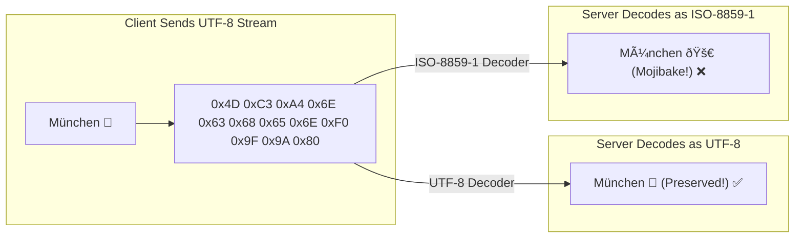

# Character Encoding & UTF-8 in Spring MVC: Deep Dive

This guide resolves common misunderstandings surrounding character encodings in Spring Web MVC, explaining how multi-byte characters (emojis, German umlauts, accents, non-Latin scripts) are handled, why modern Spring Boot applications work out of the box without explicit configuration, and when `server.servlet.encoding.force: true` is actually required.

---

## Table of Contents
1. [Core Misconception: Does UTF-8 Restrict Emojis or Umlauts?](#1-core-misconception-does-utf-8-restrict-emojis-or-umlauts)
2. [The Anatomy of Text Corruption (Mojibake)](#2-the-anatomy-of-text-corruption-mojibake)
3. [Why It Works Out of the Box in Spring Boot 3 & Java 21](#3-why-it-works-out-of-the-box-in-spring-boot-3--java-21)
   - [3.1 Spring Boot Convention over Configuration (`HttpEncodingAutoConfiguration`)](#31-spring-boot-convention-over-configuration-httpencodingautoconfiguration)
   - [3.2 The JSON Specification (RFC 8259) & Jackson](#32-the-json-specification-rfc-8259--jackson)
   - [3.3 Java 21 & JEP 400 (UTF-8 by Default Everywhere)](#33-java-21--jep-400-utf-8-by-default-everywhere)
4. [So Why Does `server.servlet.encoding.force: true` Even Exist?](#4-so-why-does-serverservletencodingforce-true-even-exist)
5. [Summary: Default vs. Forced Encoding Behavior](#5-summary-default-vs-forced-encoding-behavior)
6. [60-Second Interview PREP Script](#6-60-second-interview-prep-script)

---

## 1. Core Misconception: Does UTF-8 Restrict Emojis or Umlauts?

### The Question:
> *"Does setting `encoding.charset: UTF-8` & `encoding.force: true` mean clients **cannot** send umlauts (ä, ö, ü) or emojis (🚀, ☕) in request/response bodies?"*

### The Answer:
**No! Exactly the opposite.**

It does **not** forbid or filter out umlauts or emojis. It **guarantees** that umlauts, accents, international scripts (Japanese, Arabic, Cyrillic), and emojis are **fully supported, correctly interpreted, and safely preserved without corruption**.

---

## 2. The Anatomy of Text Corruption (Mojibake)

Over the network, text is transmitted as a stream of raw binary bytes (`0`s and `1`s). The character encoding determines how those bytes are translated into readable characters on screen.

### Single-Byte vs. Multi-Byte Encodings

| Encoding Standard | Character Size | Supported Characters |
| :--- | :--- | :--- |
| **ASCII** | Strictly **1 byte** (7 bits used: 0–127) | Basic English letters (`A-Z`, `a-z`), numbers (`0-9`), basic punctuation. |
| **ISO-8859-1 (Latin-1)** | Strictly **1 byte** (8 bits: 0–255) | Western European languages. **Cannot** represent emojis or Asian/Eastern European alphabets. |
| **UTF-8** | **Variable-length (1 to 4 bytes)** | **Every Unicode character in existence:** all human languages, symbols, and all emojis. |

### How Byte Length Differs:
* Standard English `A`: **1 byte** (`0x41`)
* German Umlaut `ä`: **2 bytes** (`0xC3 0xA4`)
* French Accent `é`: **2 bytes** (`0xC3 0xA9`)
* Rocket Emoji `🚀`: **4 bytes** (`0xF0 0x9F 0x9A 0x80`)



When a server erroneously reads a multi-byte sequence using a 1-byte encoding like Latin-1, each byte of the multi-byte character is rendered as a standalone garbage character. This is known as **Mojibake**.

---

## 3. Why It Works Out of the Box in Spring Boot 3 & Java 21

In our application, you can send:
```json
POST /api/v1/resources
{
  "name": "Büro München 🚀",
  "description": "Café & Crêpes ☕"
}
```
And the service stores and returns `"Büro München 🚀"` perfectly **without adding any encoding lines to `application.yml`**.

Here are the **three technical layers** responsible for this:

### 3.1 Spring Boot Convention over Configuration (`HttpEncodingAutoConfiguration`)
Spring Boot provides sensible production defaults out of the box. Inside Spring Boot's internal `HttpEncodingAutoConfiguration`:
* `server.servlet.encoding.charset = UTF-8` (Default is already `UTF-8`)
* `server.servlet.encoding.enabled = true` (Default is already `true`)

Spring Boot automatically registers a `CharacterEncodingFilter` bean set to UTF-8 on every startup.

### 3.2 The JSON Specification (RFC 8259) & Jackson
Spring MVC uses **Jackson** (`ObjectMapper`) to serialize and deserialize JSON bodies:
* The official JSON specification ([RFC 8259, Section 8.1](https://datatracker.ietf.org/doc/html/rfc8259#section-8.1)) explicitly mandates:
  > *"JSON text exchanged between systems that are not part of a closed ecosystem MUST be encoded using UTF-8."*
* Jackson reads raw incoming byte streams using **UTF-8 by default**, completely independent of the underlying servlet container's settings.

### 3.3 Java 21 & JEP 400 (UTF-8 by Default Everywhere)
Our service runs on **Java 21**:
* Prior to Java 18, `Charset.defaultCharset()` on the JVM was resolved from the host operating system's locale (e.g., Windows defaulted to `Windows-1252`, while Linux used `UTF-8`). This caused subtle bugs when running on Windows developer machines vs. Linux production servers.
* With [**JEP 400**](https://openjdk.org/jeps/400) released in Java 18 and standard in Java 21, **UTF-8 is the default charset across the entire Java platform globally**.

---

## 4. So Why Does `server.servlet.encoding.force: true` Even Exist?

If UTF-8 is already the default, why does Spring Boot provide:
```yaml
server:
  servlet:
    encoding:
      charset: UTF-8
      force: true # or force-request: true, force-response: true
```

### The "Polite Server" Problem
By default, Spring Boot sets `force: false`. This means:
> *"I will decode everything as UTF-8 by default, **unless** the client explicitly specifies a different charset in its HTTP header."*

### The Dangerous Edge Case: Legacy Clients & Corporate Proxies
Imagine an upstream client (or an enterprise API gateway, corporate firewall, or legacy system) sends:
```http
POST /api/v1/resources HTTP/1.1
Content-Type: application/json; charset=ISO-8859-1

{"name": "Büro München 🚀"}
```
1. The client actually encoded the body as UTF-8, but its misconfigured HTTP client library blindly appended `; charset=ISO-8859-1` to the header.
2. Because `force` is `false`, Spring attempts to be polite and obeys the client's header, switching the request decoder to `ISO-8859-1`.
3. The multi-byte emoji `🚀` and umlaut `ü` get corrupted into `"München 🚀"`.

### What `force: true` Solves:
Setting `force: true` tells Spring:
> *"Do not trust or obey non-UTF-8 charset headers from clients. Forcefully decode every incoming byte stream as UTF-8, and forcefully send every outgoing response as UTF-8."*

---

## 5. Summary: Default vs. Forced Encoding Behavior

| Scenario | Default Spring Boot Behavior (`force: false`) | With `force: true` Configured |
| :--- | :--- | :--- |
| Client sends `Content-Type: application/json` (no charset) | Decodes as **UTF-8** ✅ | Decodes as **UTF-8** ✅ |
| Client sends `Content-Type: application/json; charset=UTF-8` | Decodes as **UTF-8** ✅ | Decodes as **UTF-8** ✅ |
| Client sends misconfigured `charset=ISO-8859-1` | Obeys header -> **Corrupts multi-byte text** ❌ | Ignores header -> **Safely decodes as UTF-8** ✅ |
| HTML Form / Query Params on legacy servlet engines | May depend on container defaults | **Forced to UTF-8** ✅ |

---

## 6. 60-Second Interview PREP Script

Use this script during technical interviews when asked about character encoding, internationalization, or servlet filters in Spring Boot:

> **Point:**  
> In modern Spring Boot 3 and Java 21 services, UTF-8 works out of the box without explicit configuration because UTF-8 is the default across Spring, Jackson, and the JVM.
>
> **Reason:**  
> Spring Boot auto-configures `CharacterEncodingFilter` to UTF-8, Jackson enforces RFC 8259's mandate that JSON must be UTF-8, and Java 21's JEP 400 standardized the JVM platform default to UTF-8. Multi-byte characters like emojis (`🚀`) or umlauts (`ä`) are preserved automatically.
>
> **Example:**  
> The only reason to explicitly configure `server.servlet.encoding.force: true` in `application.yml` is as a defensive measure against misconfigured corporate proxies or legacy clients. By default, Spring respects incoming `charset` headers; `force: true` overrides mislabeled headers like `charset=ISO-8859-1` to guarantee UTF-8 decoding under all circumstances.
>
> **Point (Restated):**  
> Understanding this distinction shows that you don't just add boilerplate YAML properties—you know what the framework defaults are and when explicit defensive overrides are necessary.
