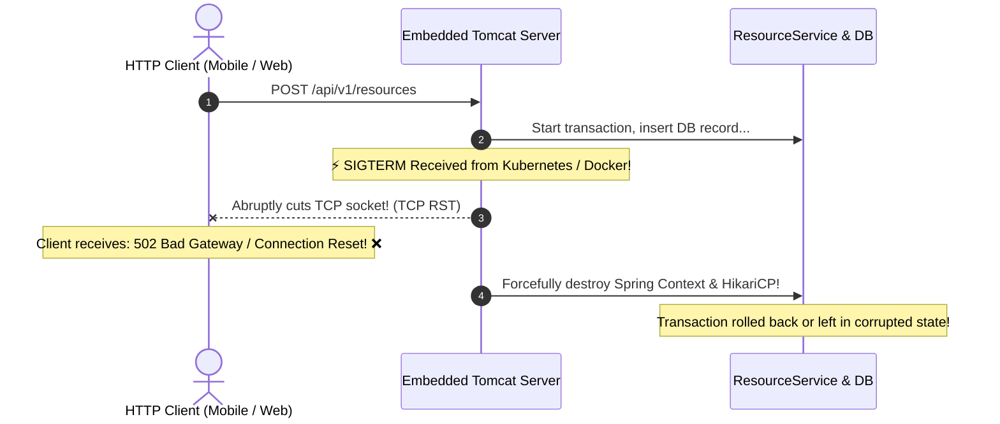
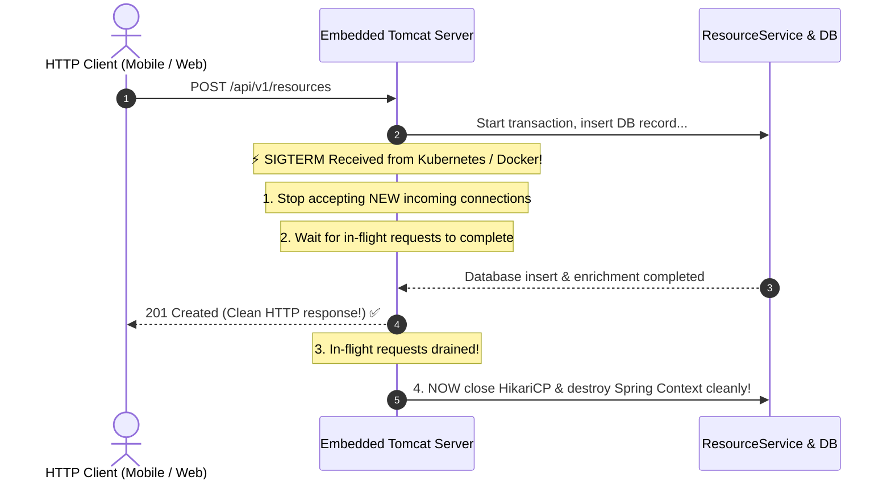
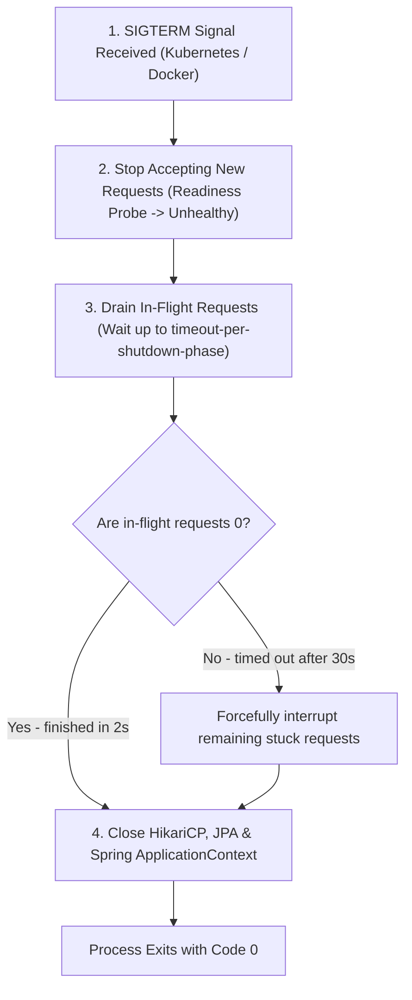
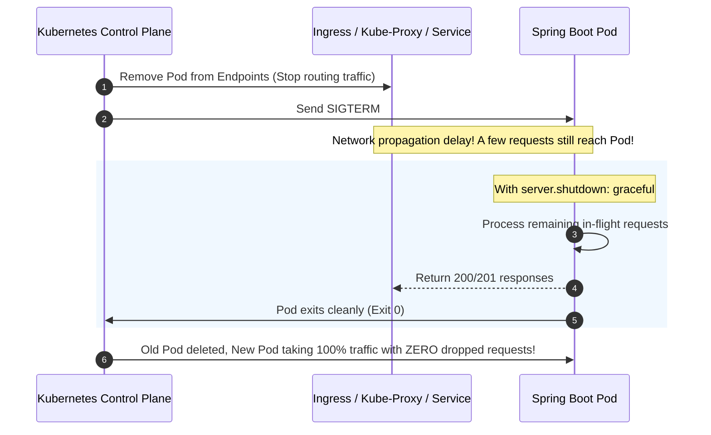

# Graceful Shutdown in Spring Boot: Why It Is Not Automatic

This guide clarifies one of the most widespread misconceptions in Spring Boot backend engineering: the difference between JVM shutdown hooks and HTTP request draining, why `server.shutdown: graceful` is not enabled by default, and how to achieve zero-downtime rolling deployments in Kubernetes and Docker.

---

## Table of Contents
1. [The Common Misconception: "Doesn't it work automatically?"](#1-the-common-misconception-doesnt-it-work-automatically)
2. [What is the Real Default in Spring Boot?](#2-what-is-the-real-default-in-spring-boot)
3. [The Anatomy of a Shutdown: `immediate` vs. `graceful`](#3-the-anatomy-of-a-shutdown-immediate-vs-graceful)
   - [3.1 Scenario A: Default Behavior (`server.shutdown: immediate`)](#31-scenario-a-default-behavior-servershutdown-immediate)
   - [3.2 Scenario B: Explicit Behavior (`server.shutdown: graceful`)](#32-scenario-b-explicit-behavior-servershutdown-graceful)
4. [The 4 Phases of Graceful Shutdown](#4-the-4-phases-of-graceful-shutdown)
5. [Kubernetes Pod Lifecycle & Zero-Downtime Deployments](#5-kubernetes-pod-lifecycle--zero-downtime-deployments)
6. [Complete `application.yml` Configuration](#6-complete-applicationyml-configuration)
7. [60-Second Interview PREP Script](#7-60-second-interview-prep-script)

---

## 1. The Common Misconception: "Doesn't it work automatically?"

When developers stop an application locally (via `Ctrl+C` in terminal or the stop button in IntelliJ), they see console output like this:

```
2026-10-18T14:34:26.037+02:00  INFO ... Closing JPA EntityManagerFactory for persistence unit 'default'
2026-10-18T14:34:26.039+02:00  INFO ... HikariPool-1 - Shutdown initiated...
2026-10-18T14:34:26.040+02:00  INFO ... HikariPool-1 - Shutdown completed.
```

Because Spring cleanly disposes of its beans and database pools, developers assume:
> *"Graceful shutdown is already working out of the box."*

### The Catch:
**That is only the standard JVM Shutdown Hook destroying Spring beans.**  
It does **NOT** protect active, in-flight HTTP requests!

---

## 2. What is the Real Default in Spring Boot?

If you inspect Spring Boot's internal autoconfiguration source code (`org.springframework.boot.autoconfigure.web.ServerProperties`):

```java
public class ServerProperties {
    /**
     * The type of shutdown that the server will use.
     */
    private Shutdown shutdown = Shutdown.IMMEDIATE; // <-- The default is IMMEDIATE!
}
```

The default enum value is explicitly **`Shutdown.IMMEDIATE`**, not `Shutdown.GRACEFUL`!

---

## 3. The Anatomy of a Shutdown: `immediate` vs. `graceful`

To see the difference, imagine a client sends a `POST /api/v1/resources` that takes **2 seconds** (e.g., executing a database write and an external API enrichment call).

At **second 1**, the container receives a `SIGTERM` signal (e.g. during a Kubernetes rolling update or `docker stop`).

### 3.1 Scenario A: Default Behavior (`server.shutdown: immediate`)



#### What happens:
1. Tomcat immediately severs all active TCP network sockets.
2. The user's request is terminated mid-execution.
3. The client receives **`502 Bad Gateway`** or **`Connection reset by peer`**.
4. Database connection pools are destroyed while queries were still in flight.

---

### 3.2 Scenario B: Explicit Behavior (`server.shutdown: graceful`)



#### What happens:
1. **Stop Accepting New Work:** Tomcat stops binding new connections.
2. **Drain Active Traffic:** Tomcat allows existing worker threads to finish their execution.
3. **Clean Client Response:** The client receives a valid `201 Created` HTTP response.
4. **Orderly Resource Release:** Database connections and beans are destroyed **only after** active HTTP requests reach zero.

---

## 4. The 4 Phases of Graceful Shutdown

When `server.shutdown: graceful` is enabled, Spring Boot executes an orderly 4-phase teardown:



### The Timeout Budget:
* Controlled by: `spring.lifecycle.timeout-per-shutdown-phase` (Default: **30 seconds**).
* **If requests finish early:** If your in-flight requests finish in 1.2 seconds, the application exits immediately in 1.2 seconds. It does **not** artificially wait the full 30 seconds.
* **If requests get stuck:** If a worker thread is deadlocked or an external API hangs indefinitely, the shutdown phase forces termination after the 30-second budget expires, preventing pods from hanging forever.

---

## 5. Kubernetes Pod Lifecycle & Zero-Downtime Deployments

In cloud-native Kubernetes environments, rolling updates happen continuously (new features, scaling, node maintenance).



### Why Graceful Shutdown is Mandatory in K8s:
1. **Network Propagation Latency:** When a pod is deleted, it takes a few milliseconds to seconds for IPVS/iptables and Ingress controllers to update routing tables across all cluster nodes.
2. **Avoiding 502s:** Without `graceful`, any request that reached the pod right before or during `SIGTERM` gets severed, generating visible `502 Bad Gateway` errors for end users during every deployment.

---

## 6. Complete `application.yml` Configuration

To enable graceful shutdown in production, configure both the server mode and the phase timeout in [`src/main/resources/application.yml`](file:///src/main/resources/application.yml):

```yaml
server:
  port: ${SERVER_PORT:8080}
  shutdown: graceful                    # Enable HTTP request draining

spring:
  lifecycle:
    timeout-per-shutdown-phase: 30s     # Maximum grace period to wait for in-flight requests
```

---

## 7. 60-Second Interview PREP Script

Use this script during technical interviews when asked: *"How do you handle graceful shutdown in Spring Boot, and is it enabled by default?"*

> **Point:**  
> Graceful shutdown is **not** enabled by default in Spring Boot. By default, `server.shutdown` is set to `immediate`, which abruptly terminates active HTTP connections upon receiving a `SIGTERM`.
>
> **Reason:**  
> While Spring's JVM shutdown hooks always run to close beans and database pools, `immediate` mode does not drain in-flight web requests. In containerized environments like Kubernetes, rolling updates send `SIGTERM` to old pods while requests are still in flight. Without graceful shutdown, users experience dropped connections and `502 Bad Gateway` errors.
>
> **Example:**  
> In our `application.yml`, we configure `server.shutdown: graceful` alongside `spring.lifecycle.timeout-per-shutdown-phase: 30s`. When a `SIGTERM` arrives, the embedded Tomcat stops accepting new connections, allows in-flight requests to complete cleanly within the 30-second budget, and only then tears down database connection pools.
>
> **Point (Restated):**  
> Configuring graceful shutdown is an essential production best practice that guarantees true zero-downtime rolling deployments in cloud environments.
