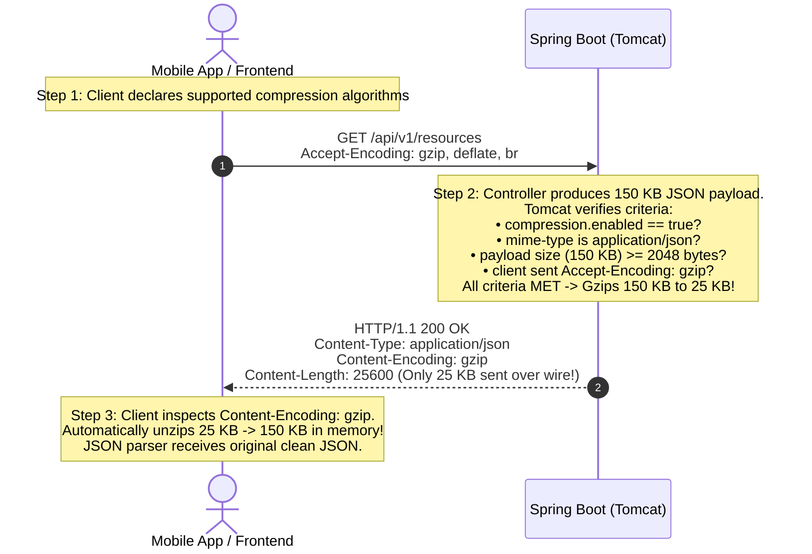
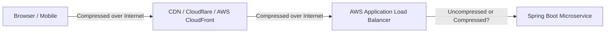

# HTTP Response Compression (Gzip) in Spring Boot: Deep Dive

This guide details how HTTP response compression works in Spring Web MVC, dissects each property under `server.compression.*` in `application.yml`, explains the wire-level HTTP handshake, and evaluates the engineering trade-offs between server CPU cycles and network bandwidth.

---

## Table of Contents
1. [Core Concept: The ZIP Analogy](#1-core-concept-the-zip-analogy)
2. [Dissecting `application.yml` Line-by-Line](#2-dissecting-applicationyml-line-by-line)
   - [2.1 `enabled: true`](#21-enabled-true)
   - [2.2 `mime-types` (Why JSON Yes, JPEGs No)](#22-mime-types-why-json-yes-jpegs-no)
   - [2.3 `min-response-size: 2048` (The 2 KB Threshold)](#23-min-response-size-2048-the-2-kb-threshold)
3. [The Wire-Level Handshake (`Accept-Encoding` vs. `Content-Encoding`)](#3-the-wire-level-handshake-accept-encoding-vs-content-encoding)
4. [Trade-Off Analysis: Server CPU vs. Network Bandwidth](#4-trade-off-analysis-server-cpu-vs-network-bandwidth)
5. [Spring Boot vs. API Gateway / CDN Offloading](#5-spring-boot-vs-api-gateway--cdn-offloading)
6. [How to Verify Compression via cURL](#6-how-to-verify-compression-via-curl)
7. [60-Second Interview PREP Script](#7-60-second-interview-prep-script)

---

## 1. Core Concept: The ZIP Analogy

Imagine you need to send a **100-page text document** to a colleague across slow cellular Wi-Fi:
* If you send the raw 100-page text file, it might be **200 KB** and take several seconds to transfer.
* If you right-click the file and **"Compress to .zip"**, the file shrinks down to **30 KB**.
* Your colleague downloads the 30 KB file in a fraction of a second, their computer automatically unzips it in RAM, and they view the original document.

**HTTP Response Compression does this automatically for your REST API:**
1. When your API returns a large JSON array (e.g. `GET /api/v1/resources`), Tomcat compresses the raw text stream using the **Gzip** algorithm.
2. The compressed bytes travel across the internet.
3. The client (browser, iOS/Android mobile app, or frontend single-page application) automatically decompresses the stream in memory without requiring custom application code.

---

## 2. Dissecting `application.yml` Line-by-Line

```yaml
server:
  compression:
    enabled: true
    mime-types: text/html,text/xml,text/plain,text/css,application/javascript,application/json
    min-response-size: 2048 # 2 KB
```

### 2.1 `enabled: true`
* **Default:** `false` (turned off by default in Spring Boot).
* Setting it to `true` activates Tomcat's response compression filter in the servlet pipeline.

---

### 2.2 `mime-types` (Why JSON Yes, JPEGs No)
Tells the server **which media types are eligible for compression**.

#### Why JSON is an Ideal Candidate:
Text formats like JSON, XML, HTML, and CSS are inherently **repetitive**:
```json
[
  {"id": "c1f7a0b5-...", "name": "Resource 1", "description": "Sample..."},
  {"id": "d2a8b1c6-...", "name": "Resource 2", "description": "Sample..."}
]
```
The Gzip algorithm (LZ77 + Huffman coding) replaces repeated strings like `"id":`, `"name":`, `"description":`, whitespace, and brackets with short binary dictionary pointers, shrinking JSON payloads by **60% to 80%**.

#### Why Images, Audio, and Video Must Be Excluded:
* Formats like **JPEG, PNG, WebP, MP4, and PDF** are **already compressed** using sophisticated lossy/lossless algorithms.
* Attempting to Gzip a JPEG wastes CPU cycles and often results in **negative compression** (the output file is actually *larger* due to Gzip header overhead).

---

### 2.3 `min-response-size: 2048` (The 2 KB Threshold)
Tells the server: *"Only compress responses whose uncompressed payload size is **greater than or equal to 2,048 bytes (2 KB)**."*

#### Why have a minimum threshold?
1. **Gzip Header Overhead:** Gzip introduces a header and trailer of ~18–20 bytes. Compressing a 100-byte JSON like `{"status":"UP"}` yields a file around 120 bytes—making it larger!
2. **CPU Waste:** Running compression algorithms on tiny strings wastes CPU cycles for zero network benefit.
3. **TCP Packet Size (MTU):** Standard Ethernet Maximum Transmission Unit (MTU) is 1,500 bytes (with ~1,460 bytes for TCP payload). Any response under 1.5 KB already fits entirely within a **single TCP packet**. Compressing it does not reduce the number of network packets required to send the response.

---

## 3. The Wire-Level Handshake (`Accept-Encoding` vs. `Content-Encoding`)

The server never sends compressed bytes unless the client explicitly declares it can decompress them:



### Key HTTP Headers:
* **`Accept-Encoding: gzip` (Request Header):** Sent by the client to indicate: *"I support Gzip decompression."*
* **`Content-Encoding: gzip` (Response Header):** Sent by the server to indicate: *"The body of this response is compressed using Gzip. Unzip it before reading."*
* If a client does not send `Accept-Encoding: gzip`, Tomcat automatically sends the raw uncompressed JSON, guaranteeing 100% backwards compatibility with all clients.

---

## 4. Trade-Off Analysis: Server CPU vs. Network Bandwidth

| Metric | Without Compression | With Gzip Compression Enabled |
| :--- | :--- | :--- |
| **Payload Size (1,000 Resources)** | **~250 KB** | **~40 KB** *(84% reduction!)* |
| **Download Time (Mobile 4G: 10 Mbps)** | **~200 ms** | **~32 ms** |
| **Server CPU Cost** | 0 ms (Raw stream write) | ~1–2 ms (Gzip compression computation) |
| **Network Egress Cost (AWS / GCP)** | Charged for full 250 KB | Charged for only 40 KB *(84% savings!)* |

### The Core Takeaway:
In distributed cloud architectures, **network latency over mobile internet is thousands of times slower than server CPU operations**. Spending 1.5 milliseconds of CPU to eliminate 170 milliseconds of network transfer is one of the highest-ROI optimizations available in backend engineering.

---

## 5. Spring Boot vs. API Gateway / CDN Offloading

In enterprise architectures, where should compression happen?



* **Option A: Handled in Spring Boot (`application.yml`)**:
  * **Pros:** Self-contained, works locally in Docker Compose without needing Nginx or an API gateway, protects network bandwidth between microservices in private VPCs.
  * **Cons:** Consumes JVM CPU cycles that could otherwise be used for business logic.
* **Option B: Offloaded to the Edge (Nginx / Cloudflare / AWS CloudFront / Ingress)**:
  * In massive-scale architectures, compression is often offloaded to the reverse proxy or CDN at the edge of the network, freeing the Spring Boot JVM to focus purely on business execution.

---

## 6. How to Verify Compression via cURL

You can test and verify compression from your terminal using `curl`:

### Request with Compression:
```bash
curl -i -H "Accept-Encoding: gzip" \
  -H "Authorization: Bearer $TOKEN" \
  http://localhost:8080/api/v1/resources
```

### Expected Response Headers:
```http
HTTP/1.1 200 OK
Content-Type: application/json
Content-Encoding: gzip
Vary: Accept-Encoding
Transfer-Encoding: chunked
```

If you omit `-H "Accept-Encoding: gzip"`, Tomcat will return standard uncompressed JSON without the `Content-Encoding: gzip` header.

---

## 7. 60-Second Interview PREP Script

Use this script during technical interviews when asked: *"How do you optimize API payload sizes and network latency in Spring Boot?"*

> **Point:**  
> We configure HTTP response compression via `server.compression` in `application.yml` to automatically Gzip large text-based responses like JSON.
>
> **Reason:**  
> JSON payloads contain significant textual repetition. Gzip compresses repetitive string keys, reducing payload sizes by 60% to 80%. This dramatically cuts network latency for mobile clients and reduces cloud bandwidth egress bills.
>
> **Example:**  
> In `application.yml`, we enable compression for `application/json` and configure `min-response-size: 2048`. The 2KB threshold is critical because small responses under 2KB already fit in a single TCP packet; compressing them would add Gzip header overhead and waste CPU cycles. When a client sends `Accept-Encoding: gzip`, Tomcat streams compressed bytes with `Content-Encoding: gzip`, which the client transparently decompresses in memory.
>
> **Point (Restated):**  
> Understanding the balance between server CPU utilization and network latency allows us to make deliberate, high-impact performance optimizations.
