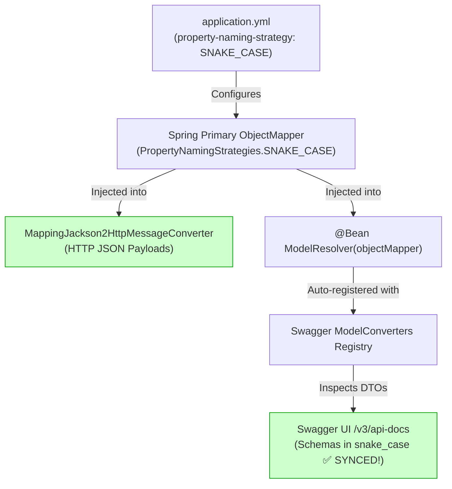

# Jackson Property Naming Strategy & OpenAPI / Swagger Synchronization

When developing REST APIs with Spring Boot and OpenAPI (Springdoc), aligning the JSON field naming convention between runtime serialization/deserialization and the generated Swagger API documentation is critical.

A common pitfall occurs when configuring:
```yaml
spring:
  jackson:
    property-naming-strategy: SNAKE_CASE # or LOWER_CAMEL_CASE, KEBAB_CASE
```
While HTTP endpoints properly serialize and deserialize JSON payloads using `snake_case`, **Swagger UI and OpenAPI JSON schemas (`/v3/api-docs`) may still display standard `camelCase`**.

This guide explains the root cause, how to synchronize OpenAPI schemas with Jackson naming strategies, how Kotlin data classes interact with it, and how to verify the configuration.

---

## Table of Contents
1. [The Disconnect: Spring MVC vs. Swagger-Core](#1-the-disconnect-spring-mvc-vs-swagger-core)
2. [The Solution: Registering `ModelResolver`](#2-the-solution-registering-modelresolver)
3. [Supported Jackson Naming Strategies](#3-supported-jackson-naming-strategies)
4. [Precedence & Overrides (@JsonProperty and @JsonNaming)](#4-precedence--overrides-jsonproperty-and-jsonnaming)
5. [Kotlin Data Classes & Jackson Kotlin Module](#5-kotlin-data-classes--jackson-kotlin-module)
6. [RFC 7807 Problem Details Interaction](#6-rfc-7807-problem-details-interaction)
7. [Unit Testing & Verification](#7-unit-testing--verification)
8. [Interview "Show & Tell" Talking Points](#8-interview-show--tell-talking-points)

---

## 1. The Disconnect: Spring MVC vs. Swagger-Core

### How Spring MVC Serializes Payloads
When a client sends an HTTP request or receives an HTTP response:
1. Spring Boot's `JacksonAutoConfiguration` builds a primary `ObjectMapper` bean and applies properties configured under `spring.jackson.*` in `application.yml`.
2. Spring MVC registers `MappingJackson2HttpMessageConverter`, injecting this primary `ObjectMapper`.
3. In-flight JSON payloads are serialized and deserialized according to the configured naming strategy (e.g. `external_reference_id` when `SNAKE_CASE` is selected).

### Why Swagger UI Schemas Default to `camelCase`
Springdoc-OpenAPI generates API definitions by scanning controllers and DTO classes using **Swagger-Core 2.x**.
- Under the hood, Swagger-Core uses its own schema introspection engine (`ModelConverters.getInstance()`).
- By default, Swagger-Core initializes an internal `ModelResolver` using a standalone `ObjectMapper` instance (`io.swagger.v3.core.util.Json.mapper()`).
- This internal `ObjectMapper` **does not automatically read** Spring Boot's `application.yml` properties.
- **Result:** Your API expects and returns `snake_case`, but Swagger UI documents the request/response schemas in `camelCase`. When a developer uses the "Try it out" button in Swagger UI, it generates a `camelCase` payload that can cause validation errors or result in null fields on the server.

```mermaid
flowchart TD
    subgraph SpringBoot["Spring Boot Runtime"]
        YML["application.yml<br/>(property-naming-strategy: SNAKE_CASE)"]
        YML -->|Configures| SpringOM["Spring Primary ObjectMapper<br/>(PropertyNamingStrategies.SNAKE_CASE)"]
        SpringOM -->|Used by| HTTPConv["MappingJackson2HttpMessageConverter<br/>(HTTP JSON Serialization)"]
    end

    subgraph SwaggerEngine["Swagger Schema Engine"]
        DefaultOM["Default Internal ObjectMapper<br/>(PropertyNamingStrategies.LOWER_CAMEL_CASE)"]
        DefaultOM -->|Used by| DefaultResolver["Default ModelResolver<br/>(OpenAPI Schema Introspection)"]
        DefaultResolver -->|Generates| Docs["Swagger UI /v3/api-docs<br/>(Schemas in camelCase ❌ DESYNC!)"]
    end

    style Docs fill:#ffcccc,stroke:#cc0000
    style HTTPConv fill:#ccffcc,stroke:#009900
```



---

## 2. The Solution: Registering `ModelResolver`

To bridge Spring Boot's configured `ObjectMapper` and Swagger-Core's schema generator, register a `@Bean` returning `io.swagger.v3.core.jackson.ModelResolver`:

```kotlin
package com.example.demo.infrastructure.config

import com.fasterxml.jackson.databind.ObjectMapper
import io.swagger.v3.core.jackson.ModelResolver
import org.springframework.context.annotation.Bean
import org.springframework.context.annotation.Configuration

@Configuration
class OpenApiConfig {

    /**
     * Connects Spring Boot's configured ObjectMapper (including naming strategies,
     * Kotlin module, and date/time formatters) to Springdoc OpenAPI schema generation.
     */
    @Bean
    fun modelResolver(objectMapper: ObjectMapper): ModelResolver = ModelResolver(objectMapper)
}
```

### How Springdoc Handles the Bean
1. Spring Boot injects the primary `ObjectMapper` (which has already processed `spring.jackson.property-naming-strategy` from `application.yml`).
2. Springdoc's auto-configuration detects all beans of type `ModelConverter` / `ModelResolver` in the application context.
3. Springdoc registers this resolver into Swagger-Core's `ModelConverters` registry:
   ```java
   ModelConverters.getInstance().addConverter(modelResolver);
   ```
4. All generated request/response schemas, properties, examples, and definitions in `/v3/api-docs` now inherit the exact same naming strategy as your runtime HTTP JSON payloads.



---

## 3. Supported Jackson Naming Strategies

Spring Boot 3 / Jackson 2.15+ supports the following property naming strategy values in `application.yml`:

| YAML Property Value | Jackson Strategy Class | Example Field (`externalReferenceId`) | Common Use Case |
| :--- | :--- | :--- | :--- |
| `LOWER_CAMEL_CASE` *(Default)* | `PropertyNamingStrategies.LowerCamelCaseStrategy` | `externalReferenceId` | Default in Java, Kotlin, TypeScript, JavaScript |
| `SNAKE_CASE` | `PropertyNamingStrategies.SnakeCaseStrategy` | `external_reference_id` | Python, Ruby, PostgreSQL, REST industry standards |
| `UPPER_CAMEL_CASE` | `PropertyNamingStrategies.UpperCamelCaseStrategy` | `ExternalReferenceId` | C#, .NET Web APIs |
| `KEBAB_CASE` | `PropertyNamingStrategies.KebabCaseStrategy` | `external-reference-id` | Lisp, CSS, CLI flags, URL path parameters |
| `LOWER_CASE` | `PropertyNamingStrategies.LowerCaseStrategy` | `externalreferenceid` | Legacy mainframe / database schemas |
| `LOWER_DOT_CASE` | `PropertyNamingStrategies.LowerDotCaseStrategy` | `external.reference.id` | Configuration properties, structured log keys |

### Example `application.yml` Configuration:

```yaml
spring:
  jackson:
    property-naming-strategy: SNAKE_CASE
    serialization:
      write-dates-as-timestamps: false
    default-property-inclusion: non_null
```

---

## 4. Precedence & Overrides (@JsonProperty and @JsonNaming)

Field names are evaluated by Jackson and `ModelResolver` according to a strict hierarchy:

1. **`@JsonProperty("custom_name")` (Highest Precedence):**
   Explicitly defines the exact serialization and schema name for a single property, ignoring all naming strategies.
   ```kotlin
   data class CreateResourceRequest(
       @field:JsonProperty("client_ref_id")
       val externalReferenceId: String, // Always "client_ref_id" in JSON & Swagger
   )
   ```

2. **`@JsonNaming(PropertyNamingStrategies.SnakeCaseStrategy::class)` (Class-Level Precedence):**
   Overrides the global naming strategy for a specific DTO or entity without affecting other classes.
   ```kotlin
   @JsonNaming(PropertyNamingStrategies.SnakeCaseStrategy::class)
   data class LegacyIntegrationDto(
       val externalReferenceId: String, // "external_reference_id"
   )
   ```

3. **Global `spring.jackson.property-naming-strategy` in `application.yml` (Application Baseline):**
   Applies to all DTOs and entities that do not have class-level or field-level annotations.

---

## 5. Kotlin Data Classes & Jackson Kotlin Module

In Kotlin, properties defined in primary constructors can sometimes be compiled into fields, getter methods, and constructor parameters:

```kotlin
data class ResourceResponse(
    val id: UUID,
    val name: String,
    val externalReferenceId: String,
    val riskScore: Int,
    val createdAt: Instant,
)
```

For Jackson and `ModelResolver` to properly discover Kotlin constructor properties:
1. `jackson-module-kotlin` must be on the classpath (`com.fasterxml.jackson.module:jackson-module-kotlin`).
2. Spring Boot automatically registers `KotlinModule` on the primary `ObjectMapper`.
3. By passing this primary `ObjectMapper` to `ModelResolver(objectMapper)`, Swagger-Core correctly reads Kotlin constructor parameters and applies the naming strategy to both request schemas and response schemas.

---

## 6. RFC 7807 Problem Details Interaction

Standard RFC 7807 problem detail fields defined by the IETF specification are:
- `type`
- `title`
- `status`
- `detail`
- `instance`

Because each of these standard attributes is a single word, their spelling remains identical whether `SNAKE_CASE` or `LOWER_CAMEL_CASE` is configured.

For custom extension attributes (such as `timestamp` or `invalid_params`):
- If added dynamically via `problemDetail.setProperty("invalid_params", ...)`: The map key is preserved as provided.
- If added via a custom subclass or DTO: Jackson and `ModelResolver` will apply the naming strategy consistently across both the JSON response and Swagger schema.

---

## 7. Unit Testing & Verification

We verify that `ModelResolver` respects the naming strategy using dedicated tests in [`OpenApiNamingStrategyTest.kt`](file:///src/test/kotlin/com/example/demo/infrastructure/config/OpenApiNamingStrategyTest.kt):

```kotlin
package com.example.demo.infrastructure.config

import com.fasterxml.jackson.databind.ObjectMapper
import com.fasterxml.jackson.databind.PropertyNamingStrategies
import com.fasterxml.jackson.module.kotlin.registerKotlinModule
import io.swagger.v3.core.converter.AnnotatedType
import io.swagger.v3.core.converter.ModelConverterContextImpl
import io.swagger.v3.core.jackson.ModelResolver
import org.assertj.core.api.Assertions.assertThat
import org.junit.jupiter.api.Test

data class TestNamingDto(
    val externalReferenceId: String,
    val userRiskScore: Int,
)

class OpenApiNamingStrategyTest {

    @Test
    fun `should generate snake_case properties in schema when ObjectMapper has SNAKE_CASE strategy`() {
        val objectMapper =
            ObjectMapper().apply {
                propertyNamingStrategy = PropertyNamingStrategies.SNAKE_CASE
                registerKotlinModule()
            }

        val resolver = ModelResolver(objectMapper)
        val context = ModelConverterContextImpl(listOf(resolver))
        val resolved = resolver.resolve(AnnotatedType(TestNamingDto::class.java), context, null)

        assertThat(resolved).isNotNull
        assertThat(resolved!!.properties).containsKey("external_reference_id")
        assertThat(resolved.properties).containsKey("user_risk_score")
        assertThat(resolved.properties).doesNotContainKey("externalReferenceId")
    }

    @Test
    fun `should generate camelCase properties in schema when ObjectMapper has LOWER_CAMEL_CASE strategy`() {
        val objectMapper =
            ObjectMapper().apply {
                propertyNamingStrategy = PropertyNamingStrategies.LOWER_CAMEL_CASE
                registerKotlinModule()
            }

        val resolver = ModelResolver(objectMapper)
        val context = ModelConverterContextImpl(listOf(resolver))
        val resolved = resolver.resolve(AnnotatedType(TestNamingDto::class.java), context, null)

        assertThat(resolved).isNotNull
        assertThat(resolved!!.properties).containsKey("externalReferenceId")
        assertThat(resolved.properties).containsKey("userRiskScore")
        assertThat(resolved.properties).doesNotContainKey("external_reference_id")
    }
}
```

---

## 8. Interview "Show & Tell" Talking Points

When discussing API design, documentation, and Jackson serialization in an interview:

> **Q: "If you configure `spring.jackson.property-naming-strategy: SNAKE_CASE`, why does Swagger UI still show camelCase schemas, and how do you fix it?"**
>
> **A:**  
> "Spring Boot configures its own primary `ObjectMapper` for `MappingJackson2HttpMessageConverter`, which governs HTTP request/response serialization.  
> However, `springdoc-openapi` uses Swagger-Core's introspection engine (`ModelConverters`), which by default initializes an internal `ModelResolver` using a default, unconfigured `ObjectMapper`.  
>  
> To keep the runtime HTTP contract and Swagger documentation perfectly synchronized, we define a `@Bean` returning `ModelResolver(objectMapper)` in our OpenAPI configuration. Springdoc auto-detects this bean and registers it into the Swagger-Core converter chain.  
>  
> As a result, any naming strategy configured in `application.yml` (such as `SNAKE_CASE` or `LOWER_CAMEL_CASE`), along with Kotlin module support and custom date formatting, is automatically reflected across all OpenAPI schema definitions, request body models, and Swagger UI examples."
