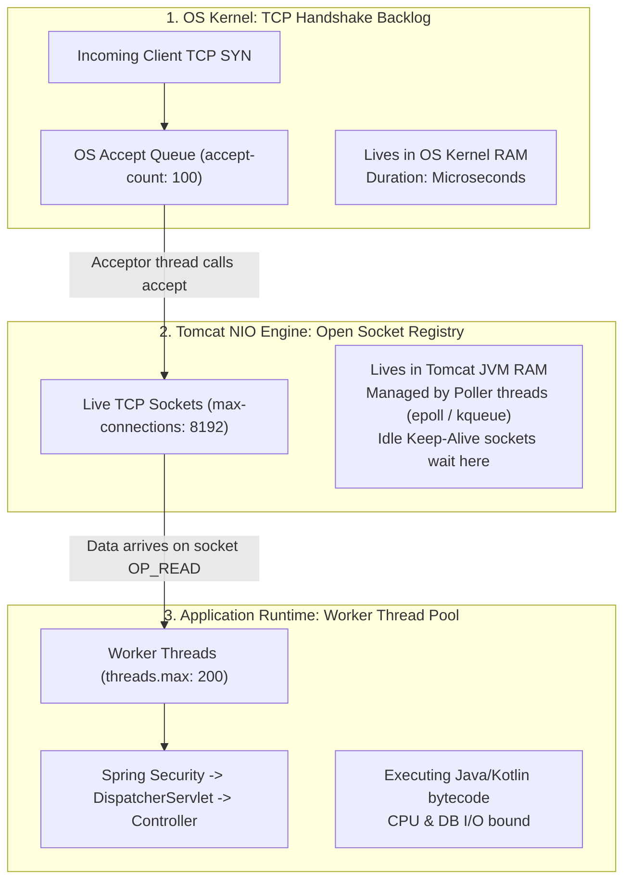
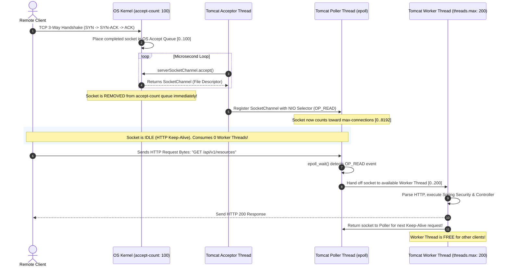
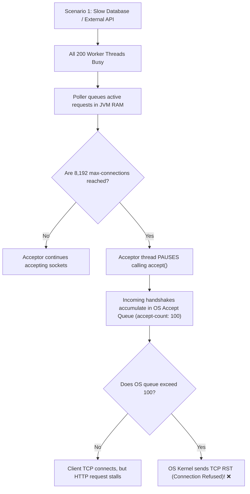

# Tomcat Connection Multiplexing: How `accept-count: 100` Feeds `max-connections: 8192`

A common source of confusion in backend engineering is the relationship between Tomcat's connection parameters in `application.yml`:

```yaml
server:
  tomcat:
    threads:
      max: 200          # Active execution threads
    max-connections: 8192 # Maximum live TCP connections
    accept-count: 100   # OS socket backlog
```

### The Apparent Paradox:
> *"If `accept-count` is only **100**, how can Tomcat possibly multiplex and maintain **8,192 connections**? Doesn't the 100 limit choke the server before it ever reaches 8,192?"*

**The short answer:** `accept-count` is **NOT** a pool inside Tomcat—it is a temporary, transient **operating system queue** where connections wait for *microseconds* during the TCP 3-way handshake before Tomcat pulls them into its memory.

> [!NOTE]
> For a foundational breakdown of what a network socket is, how file descriptors work, and the TCP 4-tuple, see [what-is-a-socket.md](file:///repo-wiki/springboot/web-mvc/what-is-a-socket.md).

---

## Table of Contents
1. [The 3 Tiers of Connection Handling](#1-the-3-tiers-of-connection-handling)
2. [The Assembly Line / Bouncer Analogy](#2-the-assembly-line--bouncer-analogy)
3. [Under the Hood: Acceptor, Poller, and Worker Threads](#3-under-the-hood-acceptor-poller-and-worker-threads)
4. [Why `accept-count` Lives in the OS Kernel (POSIX `listen`)](#4-why-accept-count-lives-in-the-os-kernel-posix-listen)
5. [The Power of NIO & HTTP Keep-Alive (8192 Sockets on 200 Threads)](#5-the-power-of-nio--http-keep-alive-8192-sockets-on-200-threads)
6. [Failure Cascades: What Happens Under Extreme Load?](#6-failure-cascades-what-happens-under-extreme-load)
7. [60-Second Interview PREP Script](#7-60-second-interview-prep-script)

---

## 1. The 3 Tiers of Connection Handling

To understand how 100 feeds 8,192, we must recognize that these three numbers govern **three completely different layers of the operating system and JVM**:



| Parameter | Location | Typical Residence Time | What Is It Doing? |
| :--- | :--- | :--- | :--- |
| **`accept-count: 100`** | **Linux / OS Kernel** | **Microseconds** (~10–50 µs) | A waiting line for TCP sockets that completed the 3-way handshake but haven't been picked up by Java yet. |
| **`max-connections: 8192`** | **Tomcat JVM Memory** | **Seconds to Minutes** | Established TCP connections (mostly idle HTTP Keep-Alive sockets monitored by Linux `epoll`). |
| **`threads.max: 200`** | **JVM CPU Threads** | **Milliseconds** (~10–200 ms) | Actively executing Java bytecode, running queries against PostgreSQL, or calling external APIs. |

---

## 2. The Assembly Line / Bouncer Analogy

Imagine a popular nightclub with a strict capacity:

* **The Club Floor (`max-connections: 8192`)**: The club holds up to 8,192 guests. Inside, people are hanging out, chatting, or drinking (idle Keep-Alive connections).
* **The Bartenders (`threads.max: 200`)**: There are only 200 bartenders. Only 200 people can be actively ordering a drink at any single instant (executing HTTP requests).
* **The Welcome Doormat (`accept-count: 100`)**: Outside the front door, the sidewalk doormat fits 100 people.
* **The Bouncer (`Acceptor Thread`)**: The bouncer's only job is to grab people off the doormat and pull them inside through the door. Grabbing one person takes **10 microseconds**.

### Why the 100-person doormat doesn't block 8,192 people:
Because the bouncer pulls people off the doormat in microseconds, **thousands of people can step onto the doormat and enter the club every second**. The doormat is practically always empty!

The doormat only fills up to 100 if:
1. The club reaches its legal limit of 8,192 people, so the bouncer stops letting people in; OR
2. A sudden stampede of 500 people steps onto the doormat at the exact same millisecond faster than the bouncer can open the door.

---

## 3. Under the Hood: Acceptor, Poller, and Worker Threads

Tomcat's NIO (Non-blocking I/O) architecture divides connection processing across three distinct thread groups:



### The 3 Thread Groups: Breakdown & Exact Counts

| Thread Group | Default Active Count | Thread Name in JVM Thread Dump | Responsibility |
| :--- | :---: | :--- | :--- |
| **Acceptor Thread** | **`1`** | `http-nio-8080-Acceptor` | Calls `serverSocket.accept()` in a microsecond loop to pull TCP sockets off the OS kernel backlog into the JVM. |
| **Poller Thread(s)** | **`1`** *(or `2` in older Tomcat)* | `http-nio-8080-ClientPoller` *(or `-0`, `-1`)* | Runs the Linux `epoll` / macOS `kqueue` event loop to monitor up to 8,192 open sockets for incoming data. |
| **Worker Threads** | **`10` min to `200` max** | `http-nio-8080-exec-1` to `http-nio-8080-exec-200` | Executes Spring Security, `DispatcherServlet`, Jackson parsing, and your `@RestController` code. |
| **Async Timeout Thread** | **`1`** | `http-nio-8080-AsyncTimeout` | Monitors timeouts for async requests and Keep-Alive socket expiration. |

#### 1. Why is There Only 1 Acceptor Thread?
* **Accepting is blisteringly fast:** Invoking `serverSocketChannel.accept()` is a non-blocking system call that takes only **~10 to 30 microseconds** to retrieve the socket file descriptor from the OS kernel.
* **Massive throughput per single thread:** One dedicated thread can easily pull **30,000+ connections per second** off the OS queue.
* **Preventing Lock Contention:** If multiple Acceptor threads listen on the same port, they fight for the exact same underlying OS socket lock (`accept mutex`), causing CPU cache thrashing without increasing connection speed.

#### 2. How Can 1 Poller Thread Monitor 8,192 Sockets?
* **In Tomcat 10.1+ (Spring Boot 3):** Standardized to **1** Poller thread. (In Tomcat 8/9, it was $\min(2, \text{cores})$).
* **The Power of `epoll`:** The Poller does **not** loop through 8,192 sockets one by one (which would be slow $O(N)$ CPU polling). Instead, it calls Linux `epoll_wait()`, an **$O(1)$ kernel event callback**. The Poller sleeps until the network card deposits bytes into a socket's receive buffer, at which point the kernel wakes the Poller and identifies the exact ready socket.

#### 3. What It Looks Like in a Real JVM Thread Dump:
```text
"http-nio-8080-Acceptor" #31 daemon prio=5 runnable
   java.lang.Thread.State: RUNNABLE
        at sun.nio.ch.ServerSocketChannelImpl.accept(...)

"http-nio-8080-ClientPoller" #32 daemon prio=5 runnable
   java.lang.Thread.State: RUNNABLE
        at sun.nio.ch.EPoll.wait(...)

"http-nio-8080-exec-1" #33 daemon prio=5 waiting on condition
   java.lang.Thread.State: WAITING (parking)
        at java.util.concurrent.locks.LockSupport.park(...)
        at org.apache.tomcat.util.threads.ThreadPoolExecutor.getTask(...)
```

---

## 4. Why `accept-count` Lives in the OS Kernel (POSIX `listen`)

When Tomcat starts up, it binds a server socket and executes the standard POSIX system call:

```c
int listen(int sockfd, int backlog);
```

Tomcat passes `server.tomcat.accept-count` directly as the `backlog` argument:
```java
// Inside org.apache.tomcat.util.net.NioEndpoint.initServerSocket()
serverSocketChannel.bind(new InetSocketAddress(getAddress(), getPort()), getAcceptCount());
```

### In the Linux Kernel:
The kernel creates two queues for the socket:
1. **SYN Queue (Half-Open Connections):** Holds incoming TCP `SYN` packets while waiting for the client's `ACK`.
2. **Accept Queue (Fully Established Connections):** Once the 3-way handshake completes, the connection moves here. **This is what `accept-count` controls.**

As long as Tomcat's `Acceptor` thread is running, it constantly pulls sockets out of this queue. Sockets do not live here; they only pass through!

---

## 5. The Power of NIO & HTTP Keep-Alive (8192 Sockets on 200 Threads)

Why do we need 8,192 connections if we only have 200 worker threads?

### The Traditional BIO Anti-Pattern (Pre-Tomcat 8):
In old blocking I/O (BIO), **1 thread = 1 connection**.
* If a mobile app opened a connection and idled for 30 seconds using HTTP Keep-Alive, that worker thread was locked and completely unusable by anyone else.
* To support 8,192 connections, you needed **8,192 OS threads**!
* At ~1MB per thread stack, that required **8 GB of RAM** just for thread stacks, causing JVM `OutOfMemoryError: unable to create new native thread`.

### The Modern NIO Solution:
With Java NIO and `epoll`:
* **Idle connections cost almost nothing:** An idle Keep-Alive connection is just a file descriptor registered with the Linux `epoll` system. It consumes **0 CPU threads** and only ~few KB of kernel memory.
* **8,192 clients can remain connected simultaneously**, but at any given millisecond, only a fraction of them (e.g. 50–150) are actively sending an HTTP request.
* Those active requests are processed by the **200 worker threads**. As soon as a request completes, the thread is released, and the socket goes back to idling in the Poller.

---

## 6. Failure Cascades: What Happens Under Extreme Load?

Understanding how these thresholds interact is essential for production troubleshooting and incident post-mortems:



### Stage 1: Worker Thread Saturation (`threads.max: 200`)
* If PostgreSQL slows down or third-party APIs hang, all 200 worker threads get stuck waiting for I/O.
* New HTTP requests on already-connected sockets wait in the Poller's internal work queue.

### Stage 2: Connection Saturation (`max-connections: 8192`)
* As clients continue opening connections, the number of open sockets reaches 8,192.
* Tomcat's `Acceptor` thread deliberately **pauses** calling `serverSocket.accept()`. It stops reading from the OS queue.

### Stage 3: OS Backlog Overflow (`accept-count: 100`)
* Because the `Acceptor` is paused, newly arriving TCP connections accumulate in the OS kernel's Accept Queue.
* Once the queue reaches **100**, the operating system's kernel drops further incoming SYN packets or immediately responds with a **`TCP RST` (`Connection Refused`)**.
* **Protective Effect:** This fail-fast mechanism sheds load at the OS network layer, preventing the JVM from consuming infinite memory and crashing.

---

## 7. 60-Second Interview PREP Script

Use this script during technical interviews when asked: *"How does Tomcat handle connections, and what is the difference between `accept-count`, `max-connections`, and `max-threads`?"*

> **Point:**  
> `accept-count`, `max-connections`, and `max-threads` govern three distinct layers: the OS kernel TCP queue, the Tomcat NIO socket registry, and the JVM worker thread pool.
>
> **Reason:**  
> `accept-count: 100` does not limit the server to 100 connections because it is merely the OS kernel's `listen()` backlog. Connections only sit in the `accept-count` queue for microseconds during the TCP 3-way handshake. A dedicated Tomcat `Acceptor` thread continuously pulls sockets off this OS queue and registers them with the NIO `Poller`.
>
> **Example:**  
> Once accepted, up to `max-connections: 8192` open sockets sit in an event-driven `epoll` loop inside the Poller. Thanks to HTTP Keep-Alive, idle connections consume zero worker threads. Only when a client transmits HTTP request bytes does the Poller assign that socket to one of the `threads.max: 200` worker threads to execute our Spring MVC controller. Once the response is sent, the thread is returned to the pool while the socket stays open in the Poller.
>
> **Point (Restated):**  
> In short, `accept-count` is the doormat outside the building, `max-connections` is the building's room capacity, and `threads.max` is the number of active cashiers serving customers.
