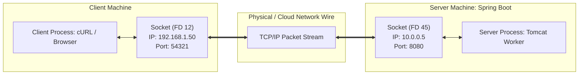

# What is a Network Socket? A Deep Dive from Operating System to Spring Boot

Whenever we discuss TCP connections, HTTP requests, WebSockets, or Tomcat's `max-connections`, the fundamental building block is always a **Socket**.

This guide demystifies what a socket actually is under the hood: how the operating system represents it, the difference between listening and connected sockets, how thousands of clients connect to port `8080` simultaneously, and how Java/Spring Boot interacts with it.

---

## Table of Contents
1. [Core Definition: What Actually is a Socket?](#1-core-definition-what-actually-is-a-socket)
2. [The Telephone & Pipe Analogy](#2-the-telephone--pipe-analogy)
3. [The Socket 4-Tuple: How 8,192 Clients Connect to One Port](#3-the-socket-4-tuple-how-8192-clients-connect-to-one-port)
4. [Listening Socket vs. Connected Socket](#4-listening-socket-vs-connected-socket)
5. [Anatomy of a Socket in OS Kernel Memory](#5-anatomy-of-a-socket-in-os-kernel-memory)
6. [Types of Sockets (TCP vs. UDP vs. Unix Domain Sockets)](#6-types-of-sockets-tcp-vs-udp-vs-unix-domain-sockets)
7. [How Java, Tomcat, and Spring Boot Use Sockets](#7-how-java-tomcat-and-spring-boot-use-sockets)
8. [Socket Lifecycle in Spring MVC (End-to-End Walkthrough)](#8-socket-lifecycle-in-spring-mvc-end-to-end-walkthrough)
9. [60-Second Interview PREP Script](#9-60-second-interview-prep-script)

---

## 1. Core Definition: What Actually is a Socket?

In the operating system kernel, a **socket** is an **endpoint for bi-directional communication** between two programs across a network (or locally on the same host).

### "Everything is a File" (Unix/Linux Philosophy)
In Linux and Unix-like operating systems (including macOS and Docker container runtimes):
* Sockets are treated as **files**.
* When a program creates a socket, the OS kernel assigns it an integer called a **File Descriptor (FD)** (e.g., `fd = 7` or `fd = 1042`).
* An application reads from and writes to a socket using the same basic system calls it uses for files: `read(fd)` and `write(fd)`.



---

## 2. The Telephone & Pipe Analogy

Think of a socket like a **two-way telephone handset connected to a phone line**:

* **IP Address (`10.0.0.5`)**: The building's street address (which computer).
* **Port Number (`8080`)**: The telephone extension inside the building (which application, e.g., Spring Boot).
* **Socket**: The physical **telephone handset** held in your hand.
  * You speak into the mouthpiece (**Send Buffer** -> writes bytes to the wire).
  * You listen through the earpiece (**Receive Buffer** -> reads bytes from the wire).
* **The Connection**: The established phone call between your handset and the client's handset.

---

## 3. The Socket 4-Tuple: How 8,192 Clients Connect to One Port

A major point of confusion for backend developers:
> *"If our Spring Boot server is only listening on port `8080`, how can 8,192 different clients connect to port `8080` at the same time without colliding?"*

### The Answer: The 4-Tuple
In TCP, a connection is **NOT** identified by the port alone. Every single socket connection is globally identified by a **4-Tuple**:

$$\{ \text{Source IP}, \text{Source Port}, \text{Destination IP}, \text{Destination Port} \}$$

```
Connection 1: { 192.168.1.50, 54321, 10.0.0.5, 8080 } -> Unique Socket FD 45
Connection 2: { 192.168.1.50, 54322, 10.0.0.5, 8080 } -> Unique Socket FD 46
Connection 3: { 203.0.113.88, 61001, 10.0.0.5, 8080 } -> Unique Socket FD 47
...
Connection 8192: { 198.51.100.12, 49200, 10.0.0.5, 8080 } -> Unique Socket FD 8237
```

Even though the Destination IP and Port (`10.0.0.5:8080`) are identical for all 8,192 clients:
* Every client has either a **different IP address** or a **different ephemeral source port** assigned by their OS.
* Because every 4-tuple is unique, the Linux network stack routes packets to the exact corresponding socket buffer with zero collisions!

---

## 4. Listening Socket vs. Connected Socket

In server applications like Tomcat, there are actually **two distinct kinds of sockets**:

```mermaid
sequenceDiagram
    autonumber
    actor Client as Remote Client
    participant Listen as Listening Socket (Port 8080)
    participant Kernel as Linux Kernel Network Stack
    participant Conn as New Connected Socket (FD 45)
    participant Worker as Tomcat Worker Thread

    Note over Listen: ServerSocketChannel.bind(8080)<br/>Does NOT exchange HTTP data!
    Client->>Listen: TCP SYN (Handshake request)
    Note over Kernel: 3-way handshake completes in OS
    Kernel->>Conn: Kernel creates a BRAND NEW Connected Socket!
    Note over Conn: Bound to 4-Tuple: {Client_IP:Port, Server_IP:8080}
    Kernel-->>Listen: Socket ready in accept-count queue
    Listen->>Worker: serverSocket.accept() returns Conn (FD 45)
    Note over Listen: Listening socket returns to listening on 8080!
    Client<-->>Conn: HTTP Request/Response data flows through FD 45!
```

1. **The Listening Socket (`ServerSocket` in Java / `listen()` in C)**:
   * Sits bound to port `8080`.
   * **Does not send or receive application data.**
   * Its sole purpose is to act as a factory that accepts incoming connections.
2. **The Connected Socket (`Socket` / `SocketChannel` in Java)**:
   * When `accept()` succeeds, the operating system instantiates a **new, dedicated socket** specifically for that one client.
   * All HTTP requests and responses travel through this dedicated socket.
   * The listening socket goes right back to waiting for the next client.

---

## 5. Anatomy of a Socket in OS Kernel Memory

When a socket is created, the Linux kernel allocates an internal data structure (`struct sock` in C) inside kernel RAM:

```
┌─────────────────────────────────────────────────────────────┐
│                 Kernel Socket Data Structure                │
├─────────────────────────────────────────────────────────────┤
│ 1. State Machine:       ESTABLISHED, CLOSE_WAIT, TIME_WAIT  │
│ 2. 4-Tuple Addressing:  Source IP:Port <-> Dest IP:Port     │
│ 3. Send Buffer (SO_SNDBUF):                                 │
│    [ bytes waiting for network card to transmit... ]        │
│ 4. Receive Buffer (SO_RCVBUF):                              │
│    [ bytes received from wire waiting for Java to read... ] │
│ 5. TCP Window & Flow Control: Advertised window sizes       │
│ 6. Associated File Descriptor: e.g. fd = 45                 │
└─────────────────────────────────────────────────────────────┘
```

* **Receive Buffer (`SO_RCVBUF`, e.g. 128 KB)**: When packets arrive over the Ethernet/Wi-Fi cable, the network card puts them here. Java reads from this buffer.
* **Send Buffer (`SO_SNDBUF`, e.g. 128 KB)**: When Spring writes an HTTP response (`"HTTP/1.1 200 OK..."`), the bytes are copied into this kernel buffer. The kernel's TCP stack takes care of chunking them into packets, computing checksums, and handling retransmissions if packets get dropped on the Internet.

---

## 6. Types of Sockets (TCP vs. UDP vs. Unix Domain Sockets)

| Socket Type | Protocol / OS Layer | Characteristics | Where It's Used |
| :--- | :--- | :--- | :--- |
| **Stream Socket (`SOCK_STREAM`)** | **TCP** | Reliable, connection-oriented, ordered byte stream, automatic retransmission. | **HTTP, HTTPS, REST APIs, PostgreSQL, gRPC** |
| **Datagram Socket (`SOCK_DGRAM`)** | **UDP** | Connectionless, unreliable, fast, no handshake, packet-oriented. | **DNS lookups, Video Streaming, VoIP, Gaming** |
| **Unix Domain Socket (`AF_UNIX`)** | **Inter-Process (IPC)** | High-speed communication **within the same machine**. Bypasses network cards, IP routing, and checksum calculations entirely. Represented as a file on disk (e.g. `/var/run/docker.sock`). | **Docker CLI -> Docker Daemon, Nginx -> Node.js/PHP on same server** |
| **WebSocket** | **HTTP / TCP** | An application-level protocol (RFC 6455) running on top of a standard TCP socket, allowing continuous full-duplex messaging without repeating HTTP headers. | **Chat apps, real-time dashboards, live financial tickers** |

---

## 7. How Java, Tomcat, and Spring Boot Use Sockets

In Java's evolution, socket programming progressed through two major paradigms:

### Old Classic IO (`java.net.Socket` / Blocking IO)
* In pre-Tomcat 8 days, Java used `java.net.Socket`.
* **The limitation:** `socket.getInputStream().read()` **blocks the calling thread** until bytes arrive.
* If a client connected and idled for 30 seconds using HTTP Keep-Alive, that Java thread was trapped waiting on the socket.

### Modern Non-blocking IO (`java.nio.channels.SocketChannel`)
* Used by Tomcat NIO, Netty, and Spring WebFlux.
* Instead of blocking, a `SocketChannel` is configured in **non-blocking mode**:
  ```java
  socketChannel.configureBlocking(false);
  ```
* Sockets register with a **`Selector`** (which calls Linux **`epoll`** or macOS **`kqueue`**):
  ```java
  socketChannel.register(selector, SelectionKey.OP_READ);
  ```
* **Result:** A single Poller thread can monitor **8,192 sockets simultaneously**. When any socket receives bytes, `epoll` wakes up and hands that socket to a worker thread.

---

## 8. Socket Lifecycle in Spring MVC (End-to-End Walkthrough)

Here is what happens from socket creation to controller execution:

```
1. Client browser creates a TCP socket and initiates a 3-way handshake to 10.0.0.5:8080.
2. The Linux kernel completes the handshake and places the socket in the accept backlog (accept-count: 100).
3. Tomcat's Acceptor thread calls serverSocketChannel.accept() to retrieve the connected SocketChannel.
4. The Acceptor registers the SocketChannel with the Poller (now counting towards max-connections: 8192).
5. The client transmits HTTP bytes: "POST /api/v1/resources ...".
6. The network card puts bytes into the socket's Receive Buffer.
7. Linux epoll notifies the Tomcat Poller thread that the socket is ready for reading (OP_READ).
8. The Poller assigns the socket to an idle Tomcat Worker thread (from threads.max: 200).
9. The Worker thread reads bytes from the socket's receive buffer, Jackson parses the JSON, and Spring executes ResourceController.createResource().
10. The controller returns ResourceResponse, Spring serializes it to JSON bytes, and writes them into the socket's Send Buffer.
11. The Linux kernel transmits the response packets back across the Internet to the client.
12. If HTTP Keep-Alive is enabled, the worker thread is released, and the socket goes back to idling in the Poller!
```

---

## 9. 60-Second Interview PREP Script

Use this script during technical interviews when asked: *"What is a socket in the context of backend web services?"*

> **Point:**  
> A socket is an operating system abstraction representing one endpoint of a bi-directional communication channel between two processes over a network.
>
> **Reason:**  
> In Unix and Linux systems, a socket is represented by an integer file descriptor. The OS kernel maintains a data structure for each socket containing state, IP addresses, ports, and dedicated send and receive memory buffers. In TCP, every connection is uniquely identified by a 4-tuple: source IP, source port, destination IP, and destination port.
>
> **Example:**  
> This 4-tuple explains how our Spring Boot application on port 8080 can maintain thousands of concurrent connections simultaneously—each client has a unique source IP or ephemeral port. In Tomcat's non-blocking NIO connector, connected sockets are registered with a Selector using Linux `epoll`. This allows a few Poller threads to monitor thousands of idle Keep-Alive sockets, only allocating one of our 200 worker threads when request bytes arrive in the socket's receive buffer.
>
> **Point (Restated):**  
> In summary, sockets bridge low-level network packets from the OS kernel into Java byte buffers that frameworks like Spring MVC and Jackson convert into high-level domain objects.
