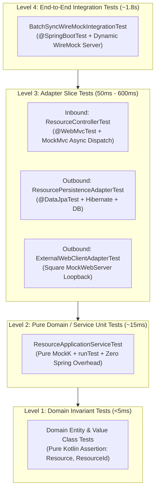

# Hexagonal Architecture Testing Strategy & Implementation Guide

This section documents the end-to-end testing philosophy, slice-testing mechanics, and coroutine testing patterns implemented across `crud-kotlin-service`.

---

## 1. The Hexagonal Testing Pyramid

In Hexagonal Architecture (Ports and Adapters), the core business logic is strictly isolated from infrastructure. Our testing pyramid mirrors this boundary separation:

---

## 2. Testing Decision Matrix & Tooling Comparison

| Testing Layer | Target Component | Test Slice / Framework | Mocking Strategy | Typical Execution Time | Primary Verification Focus |
| :--- | :--- | :--- | :--- | :--- | :--- |
| **Domain Core** | `Resource`, `ResourceId` | Pure JUnit 5 | None (Real POJOs) | `< 5 ms` | Invariants, state transitions, validation, `@JvmInline` unboxing |
| **Application Service** | [`ResourceApplicationService`](file:///Users/atifanowar/Workspace/interview/crud-kotlin-service/src/main/kotlin/com/example/demo/application/service/ResourceApplicationService.kt) | Pure JUnit 5 + Kotlin Coroutines Test | MockK (`mockk<ResourceRepositoryPort>()`, `mockk<ExternalClientPort>()`) | `~15 ms` | Business orchestration, exception handling, coroutine fan-out (`coVerify`, `runTest`) |
| **Inbound Driving Adapter** | [`ResourceController`](file:///Users/atifanowar/Workspace/interview/crud-kotlin-service/src/main/kotlin/com/example/demo/infrastructure/adapter/in/rest/ResourceController.kt) | `@WebMvcTest(ResourceController::class)` | `@MockkBean` (Use Case Inbound Ports) | `~500 ms` | Routing, JSON serialization, HTTP status codes (`201`, `200`, `204`), RFC 7807 problem details, coroutine async dispatch |
| **Outbound Driven Adapter (Persistence)** | [`ResourcePersistenceAdapter`](file:///Users/atifanowar/Workspace/interview/crud-kotlin-service/src/main/kotlin/com/example/demo/infrastructure/adapter/out/persistence/ResourcePersistenceAdapter.kt) | `@DataJpaTest` | Real JPA repository + Real DB | `~600 ms` | Domain $\leftrightarrow$ JPA entity mapping, schema constraints, UUID handling, transaction boundaries |
| **Outbound Driven Adapter (Client)** | [`ExternalWebClientAdapter`](file:///Users/atifanowar/Workspace/interview/crud-kotlin-service/src/main/kotlin/com/example/demo/infrastructure/adapter/out/client/ExternalWebClientAdapter.kt) | JUnit 5 + OkHttp `MockWebServer` | Local HTTP loopback mock server | `~80 ms` | Bearer auth headers, path formatting, timeout resilience, fallback handling, payload normalization |
| **End-to-End High-Concurrency** | Entire Application | `@SpringBootTest(webEnvironment = RANDOM_PORT)` | Multi-threaded WireMock server | `~1.8 s` | 100+ concurrent asynchronous requests, `Semaphore` bulkheading, Netty connection pool contention |

---

## 3. Coroutine Testing: Key Technical Insights

Testing asynchronous Kotlin Coroutines in Spring Boot introduces unique challenges compared to standard synchronous JVM testing:

### 1. `runTest` vs. `runBlocking`
* **`runBlocking`**: Blocks the underlying test thread. If a coroutine uses `delay(1000)`, the physical test thread sleeps for 1 second, significantly slowing down CI pipelines.
* **`runTest`**: Uses a `TestScope` and `StandardTestDispatcher` with **virtual time skipping**. Delays advance instantaneously in virtual time while preserving execution order. Used in [`ResourceApplicationServiceTest`](file:///Users/atifanowar/Workspace/interview/crud-kotlin-service/src/test/kotlin/com/example/demo/application/service/ResourceApplicationServiceTest.kt).

### 2. MockK Suspending Stubs (`coEvery` vs. `every`)
Kotlin's compiler transforms `suspend fun` methods into state machines that accept a hidden `Continuation<T>` parameter. 
* Attempting to stub a suspending function using standard `every { ... }` will throw a runtime `ClassCastException`.
* MockK provides `coEvery { ... }` and `coVerify { ... }` which inspect the call stack, extract the hidden `Continuation`, and resume the coroutine properly.

### 3. Spring MVC Coroutine Async Dispatch
In Spring MVC, a controller function marked with `suspend` does not write directly to the `HttpServletResponse`. Instead, it hands off execution to a DeferredResult/Coroutine adapter and suspends.
* A standard MockMvc call (`mockMvc.perform(...).andExpect(status().isCreated)`) fails immediately with `200` or an empty body because the response is incomplete.
* The test must execute a two-step dispatch:
  1. `val mvcResult = mockMvc.perform(post(...)).andExpect(request().asyncStarted()).andReturn()`
  2. `mockMvc.perform(asyncDispatch(mvcResult)).andExpect(status().isCreated)`

---

## 4. Detailed Guides in This Section

| Guide | Scope | Description | Link |
| :--- | :--- | :--- | :--- |
| **Service-Layer Testing** | Application Core | Deep-dive into [`ResourceApplicationServiceTest`](file:///Users/atifanowar/Workspace/interview/crud-kotlin-service/src/test/kotlin/com/example/demo/application/service/ResourceApplicationServiceTest.kt): Zero-Spring MockK setup, synchronous CRUD verification, negative testing, and coroutine batch synchronization with `runTest` and `coVerify`. | [service-layer-testing.md](file:///Users/atifanowar/Workspace/interview/crud-kotlin-service/repo-wiki/test/service-layer-testing.md) |
| **Adapter-Layer Testing** | Infrastructure Boundary | Deep-dive into inbound driving adapters ([`ResourceControllerTest`](file:///Users/atifanowar/Workspace/interview/crud-kotlin-service/src/test/kotlin/com/example/demo/infrastructure/adapter/in/rest/ResourceControllerTest.kt)) and outbound driven adapters ([`ResourcePersistenceAdapterTest`](file:///Users/atifanowar/Workspace/interview/crud-kotlin-service/src/test/kotlin/com/example/demo/infrastructure/adapter/out/persistence/ResourcePersistenceAdapterTest.kt), [`ExternalWebClientAdapterTest`](file:///Users/atifanowar/Workspace/interview/crud-kotlin-service/src/test/kotlin/com/example/demo/infrastructure/adapter/out/client/ExternalWebClientAdapterTest.kt), and [`BatchSyncWireMockIntegrationTest`](file:///Users/atifanowar/Workspace/interview/crud-kotlin-service/src/test/kotlin/com/example/demo/BatchSyncWireMockIntegrationTest.kt)). | [adapter-layer-testing.md](file:///Users/atifanowar/Workspace/interview/crud-kotlin-service/repo-wiki/test/adapter-layer-testing.md) |

---

## 5. Interview Cheat Sheet: The 60-Second Verbal Answer (PREP Framework)

When an interviewer asks: *"How do you test a Spring Boot microservice using Hexagonal Architecture and Kotlin Coroutines?"*

* **Point (P):**
  > "I apply strict test boundary isolation aligned with Hexagonal Architecture: pure MockK unit tests for domain services, targeted slice tests for adapters, and full integration tests with WireMock only for high-concurrency flows."

* **Reason (R):**
  > "Loading the full Spring context for every test makes test suites sluggish, taking minutes to run and slowing down CI/CD feedback loops. Furthermore, testing coroutines requires specialized tools like `runTest` and MockMvc async dispatch to correctly handle Kotlin's underlying continuation state machine."

* **Example (E):**
  > "In my application service test, I use zero Spring annotations. I instantiate `ResourceApplicationService` with MockK constructor-injected port mocks; this allows our entire business logic suite to execute in under 20 milliseconds. When testing `batchSync` coroutine fan-out, I wrap tests in `runTest` and stub suspending ports using `coEvery`. For inbound REST controllers, I use `@WebMvcTest` with SpringMockK and two-step MockMvc async dispatch (`request().asyncStarted()` followed by `asyncDispatch(mvcResult)`). For outbound HTTP clients, I test against OkHttp's `MockWebServer` to verify auth headers and retry fallbacks without network flakiness."

* **Point (P):**
  > "This architecture ensures sub-second local test runs, deterministic CI builds, and 100% confidence across protocol boundaries without bloated `@SpringBootTest` overhead."
