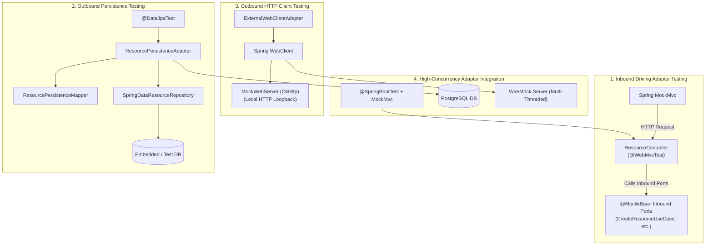

# Adapter-Layer Testing Guide: Inbound & Outbound Testing Strategies

A comprehensive architectural breakdown of how inbound driving adapters (REST controllers) and outbound driven adapters (PostgreSQL persistence and WebClient external HTTP) are tested in `crud-kotlin-service`.

---

## 1. Overview of the Adapter Testing Strategy

Adapters sit at the boundary of Hexagonal Architecture, translating between external protocols (HTTP, JSON, SQL) and pure domain models.



---

## 2. Inbound Driving Adapter: REST Controller Testing (`ResourceControllerTest`)

Implemented in [`src/test/kotlin/com/example/demo/infrastructure/adapter/in/rest/ResourceControllerTest.kt`](file:///Users/atifanowar/Workspace/interview/crud-kotlin-service/src/test/kotlin/com/example/demo/infrastructure/adapter/in/rest/ResourceControllerTest.kt).

### Architectural Goal:
Verify HTTP routing, JSON deserialization, HTTP status codes (`201 Created`, `200 OK`, `204 No Content`), and exception mappings **without** loading the service layer, database, or external clients.

### Annotation Strategy:
```kotlin
@WebMvcTest(ResourceController::class)
@AutoConfigureMockMvc(addFilters = false)
class ResourceControllerTest {
    @Autowired
    private lateinit var mockMvc: MockMvc

    @Autowired
    private lateinit var objectMapper: ObjectMapper

    // Mock all inbound use case ports using SpringMockK
    @MockkBean
    private lateinit var createResourceUseCase: CreateResourceUseCase
    @MockkBean
    private lateinit var getResourceUseCase: GetResourceUseCase
    @MockkBean
    private lateinit var batchSyncResourcesUseCase: BatchSyncResourcesUseCase
    ...
```

### Key Pattern: Testing Asynchronous Coroutine Endpoints
When an endpoint is implemented using Kotlin `suspend fun`:
```kotlin
@PostMapping("/batch-sync")
@ResponseStatus(HttpStatus.CREATED)
suspend fun batchSync(@Valid @RequestBody request: BatchSyncRequest): BatchSyncResponse
```
Spring MVC treats this as an **asynchronous request**. If you call `mockMvc.perform(post(...)).andExpect(status().isCreated)` directly, the test will fail because the initial HTTP request only initiates asynchronous dispatch!

#### The Two-Step Async MockMvc Verification:
```kotlin
@Test
fun `POST batch-sync should trigger batch sync and return 201 Created`() {
    val request = BatchSyncRequest(count = 10, referencePrefix = "batch-ref", parallelism = 5)
    val syncResult = BatchSyncResult(totalRequested = 10, totalPersisted = 10, durationMs = 120, resources = emptyList())
    
    // Stub suspending use case
    coEvery { batchSyncResourcesUseCase.batchSync(any()) } returns syncResult

    // Step 1: Perform POST and expect async processing started
    val mvcResult = mockMvc.perform(
        post("/api/v1/resources/batch-sync")
            .contentType(MediaType.APPLICATION_JSON)
            .content(objectMapper.writeValueAsString(request))
    )
    .andExpect(request().asyncStarted())
    .andReturn()

    // Step 2: Dispatch the async result and assert final HTTP 201 and JSON payload
    mockMvc.perform(asyncDispatch(mvcResult))
        .andExpect(status().isCreated)
        .andExpect(jsonPath("$.totalRequested").value(10))
        .andExpect(jsonPath("$.totalPersisted").value(10))
        .andExpect(jsonPath("$.durationMs").value(120))
}
```

---

## 3. Outbound Driven Adapter: Persistence Testing (`ResourcePersistenceAdapterTest`)

Implemented in [`src/test/kotlin/com/example/demo/infrastructure/adapter/out/persistence/ResourcePersistenceAdapterTest.kt`](file:///Users/atifanowar/Workspace/interview/crud-kotlin-service/src/test/kotlin/com/example/demo/infrastructure/adapter/out/persistence/ResourcePersistenceAdapterTest.kt).

### Architectural Goal:
Verify that the `ResourcePersistenceAdapter` and its `ResourcePersistenceMapper` properly convert pure Domain Entities (`Resource`, `@JvmInline value class ResourceId`) into JPA Entities (`ResourceJpaEntity`), save them through Spring Data JPA, and map them back with zero data loss.

### Annotation Strategy:
```kotlin
@DataJpaTest
class ResourcePersistenceAdapterTest {
    @Autowired
    private lateinit var springDataRepository: SpringDataResourceRepository

    private lateinit var adapter: ResourcePersistenceAdapter
    private val mapper = ResourcePersistenceMapper()

    @BeforeEach
    fun setUp() {
        // Instantiate adapter with real repository and mapper
        adapter = ResourcePersistenceAdapter(springDataRepository, mapper)
    }
```

### Why `@DataJpaTest`?
* Bootstraps **only** JPA entities, Spring Data repositories, and Hibernate.
* Does **not** load controllers, security configs, or WebClient beans.
* Automatically wraps each test method in a `@Transactional` boundary, rolling back changes after each test to keep tests isolated and deterministic.

### Verifying Round-Trip Persistence:
```kotlin
@Test
fun `save and findById should persist and retrieve domain entity`() {
    val resource = Resource(
        name = "Test DB Resource",
        description = "Persistence test",
        status = ResourceStatus.ACTIVE,
        externalEnrichmentData = "enriched-data",
    )

    // Save domain entity via adapter
    val saved = adapter.save(resource)
    
    // Retrieve domain entity via adapter
    val retrieved = adapter.findById(saved.id)

    assertNotNull(retrieved)
    assertEquals(saved.id, retrieved?.id)
    assertEquals("Test DB Resource", retrieved?.name)
    assertEquals(ResourceStatus.ACTIVE, retrieved?.status)
    assertEquals("enriched-data", retrieved?.externalEnrichmentData)
}
```

---

## 4. Outbound Driven Adapter: HTTP Client Testing (`ExternalWebClientAdapterTest`)

Implemented in [`src/test/kotlin/com/example/demo/infrastructure/adapter/out/client/ExternalWebClientAdapterTest.kt`](file:///Users/atifanowar/Workspace/interview/crud-kotlin-service/src/test/kotlin/com/example/demo/infrastructure/adapter/out/client/ExternalWebClientAdapterTest.kt).

### Architectural Goal:
Test outbound HTTP calls, Bearer token header injection, URL path formatting, response DTO parsing, business normalization rules, and resilience fallbacks **without calling real internet endpoints**.

### Tool: Square `MockWebServer`
`MockWebServer` starts a lightweight, real HTTP server on a dynamic local port during the test lifecycle:

```kotlin
class ExternalWebClientAdapterTest {
    private lateinit var mockWebServer: MockWebServer
    private lateinit var adapter: ExternalWebClientAdapter

    @BeforeEach
    fun setUp() {
        mockWebServer = MockWebServer()
        mockWebServer.start()

        val webClient = WebClient.builder()
            .baseUrl(mockWebServer.url("/").toString())
            .defaultHeader(HttpHeaders.AUTHORIZATION, "Bearer test-token")
            .build()

        adapter = ExternalWebClientAdapter(webClient)
    }

    @AfterEach
    fun tearDown() {
        mockWebServer.shutdown()
    }
```

### Verifying Outbound Headers & Normalization:
```kotlin
@Test
fun `fetchEnrichmentData should call external API with auth and process high risk response`() {
    val jsonResponse = """
        {
            "referenceId": "ref-100",
            "category": "finance",
            "riskScore": 85,
            "verified": true,
            "tags": ["vip", "kyc"]
        }
    """.trimIndent()

    // Enqueue simulated HTTP 200 response
    mockWebServer.enqueue(
        MockResponse()
            .setResponseCode(200)
            .setHeader(HttpHeaders.CONTENT_TYPE, MediaType.APPLICATION_JSON_VALUE)
            .setBody(jsonResponse)
    )

    val result = adapter.fetchEnrichmentData("ref-100")

    // Assert that the outbound HTTP request contained correct path and auth header
    val recordedRequest = mockWebServer.takeRequest()
    assertEquals("/api/v1/enrichment/ref-100", recordedRequest.path)
    assertEquals("Bearer test-token", recordedRequest.getHeader(HttpHeaders.AUTHORIZATION))

    // Assert normalized domain enrichment string
    assertTrue(result.contains("category=FINANCE"))
    assertTrue(result.contains("riskScore=85"))
    assertTrue(result.contains("riskLevel=HIGH"))
}
```

### Testing Error Resilience & Fallbacks:
When the third-party endpoint returns HTTP 500 Internal Server Error, the adapter must not crash the microservice; it must gracefully fall back to a safe domain status:

```kotlin
@Test
fun `fetchEnrichmentData should gracefully fallback on external error response`() {
    mockWebServer.enqueue(MockResponse().setResponseCode(500))

    val result = adapter.fetchEnrichmentData("ref-error")

    assertTrue(result.contains("status=UNAVAILABLE"))
    assertTrue(result.contains("details=500 INTERNAL_SERVER_ERROR"))
}
```

---

## 5. End-to-End High-Concurrency Adapter Integration (`BatchSyncWireMockIntegrationTest`)

Implemented in [`src/test/kotlin/com/example/demo/infrastructure/adapter/in/rest/BatchSyncWireMockIntegrationTest.kt`](file:///Users/atifanowar/Workspace/interview/crud-kotlin-service/src/test/kotlin/com/example/demo/infrastructure/adapter/in/rest/BatchSyncWireMockIntegrationTest.kt).

### Architectural Goal:
Test the entire Hexagonal pipeline in a single integration suite:
$$\text{HTTP Request} \to \text{Spring Controller} \to \text{Application Service} \to \text{WebClient} \to \text{WireMock (100 calls)} \to \text{PostgreSQL (100 rows)}$$

```kotlin
@SpringBootTest
@AutoConfigureMockMvc
@DirtiesContext
class BatchSyncWireMockIntegrationTest {
    @Autowired
    private lateinit var mockMvc: MockMvc
    @Autowired
    private lateinit var springDataResourceRepository: SpringDataResourceRepository

    companion object {
        private lateinit var wireMockServer: WireMockServer

        @BeforeAll
        @JvmStatic
        fun startWireMock() {
            wireMockServer = WireMockServer(
                wireMockConfig()
                    .dynamicPort()
                    .containerThreads(50)
                    .asynchronousResponseEnabled(true)
                    .asynchronousResponseThreads(50)
            )
            wireMockServer.start()
        }

        @DynamicPropertySource
        @JvmStatic
        fun dynamicProperties(registry: DynamicPropertyRegistry) {
            // Dynamically point WebClient to our isolated test WireMock port
            registry.add("external.client.base-url") { "http://localhost:${wireMockServer.port()}" }
        }
    }
```

### Key Verifications:
1. **Parallel Execution Guarantee:** Verifies that 100 requests with 60ms delay finish in under 4,500ms (sequential execution would take $100 \times 60\text{ms} = 6,000\text{ms}$).
2. **WireMock Request Counting:** `wireMockServer.verify(100, getRequestedFor(urlPathMatching("/api/v1/enrichment/.*")))`.
3. **Database Integrity:** Verifies that all 100 entities are persisted in PostgreSQL with normalized enrichment data.

---

## 6. Summary Comparison Matrix

| Adapter Test Class | Target Component | Technology Used | Spring Context? | Execution Time |
| :--- | :--- | :--- | :---: | :---: |
| `ResourceControllerTest` | REST Driving Adapter | `@WebMvcTest` + MockMvc + MockK | Controller Slice | ~500ms |
| `ResourcePersistenceAdapterTest` | JPA Driven Adapter | `@DataJpaTest` + Hibernate | JPA Data Slice | ~600ms |
| `ExternalWebClientAdapterTest` | WebClient Driven Adapter | `MockWebServer` (Square) | None (Pure JVM) | ~80ms |
| `BatchSyncWireMockIntegrationTest` | Full End-to-End Pipeline | `@SpringBootTest` + `WireMock` | Full Context | ~1.8s |
