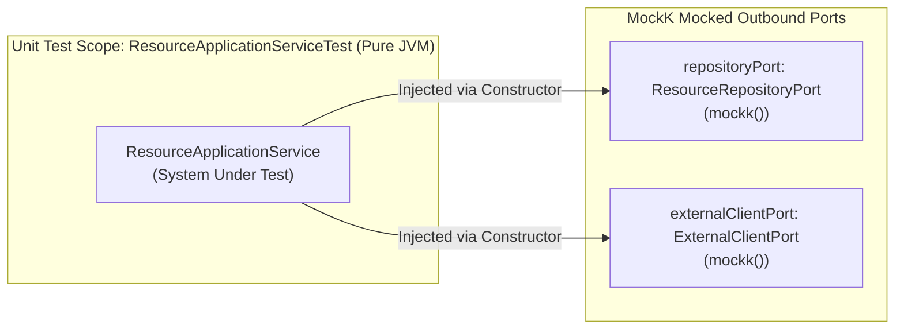

# Service-Layer Testing Guide: Pure MockK Unit Testing & Coroutine Orchestration

A technical deep-dive into how business logic and use case orchestration are tested in the Application Service layer ([`ResourceApplicationServiceTest.kt`](file:///Users/atifanowar/Workspace/interview/crud-kotlin-service/src/test/kotlin/com/example/demo/application/service/ResourceApplicationServiceTest.kt)) adhering to Hexagonal Architecture principles.

---

## 1. Architectural Philosophy: Why Zero Frameworks?

In Hexagonal Architecture, the Application Service (`ResourceApplicationService`) coordinates business logic between inbound use cases and outbound ports (SPIs).



### The Three Testing Principles of the Service Layer:
1. **Zero Spring Context Overhead (`@SpringBootTest` is Forbidden here):**
   * Bootstrapping the Spring `ApplicationContext`, Hibernate session factory, and Flyway migrations takes **3 to 8 seconds**.
   * By instantiating `ResourceApplicationService` with pure MockK mocks, the entire service test suite executes in **~15 milliseconds**.
2. **Isolation from Infrastructure:**
   * Business logic tests never fail due to database connection timeouts, syntax differences in SQL, or network socket errors.
   * If a business rule fails, the failure pinpoint is immediately localized to the application logic.
3. **Contract-Based Verification:**
   * The service tests verify that outbound ports (`ResourceRepositoryPort`, `ExternalClientPort`) are invoked with exact parameters and the correct number of times (`verify(exactly = 1)`).

---

## 2. Test Setup & Constructor Injection

In [`src/test/kotlin/com/example/demo/application/service/ResourceApplicationServiceTest.kt`](file:///Users/atifanowar/Workspace/interview/crud-kotlin-service/src/test/kotlin/com/example/demo/application/service/ResourceApplicationServiceTest.kt):

```kotlin
class ResourceApplicationServiceTest {
    // 1. Declare pure MockK mocks for driven/outbound ports
    private val repositoryPort: ResourceRepositoryPort = mockk()
    private val externalClientPort: ExternalClientPort = mockk()

    // 2. System Under Test (SUT)
    private lateinit var service: ResourceApplicationService

    @BeforeEach
    fun setUp() {
        // 3. Pure constructor injection - zero reflection or @Autowired
        service = ResourceApplicationService(repositoryPort, externalClientPort)
    }
```

---

## 3. Testing Synchronous Use Cases

### Scenario A: Creation with External Enrichment
Verifying that the service coordinates between the third-party client port and the repository port:

```kotlin
@Test
fun `createResource should fetch external enrichment data and persist resource`() {
    val command = CreateResourceCommand(
        name = "Test Resource",
        description = "Test Description",
        externalReferenceId = "ext-ref-123",
    )
    val enrichmentData = "{\"riskScore\": 98}"

    // Stubbing outbound port behaviors
    every { externalClientPort.fetchEnrichmentData("ext-ref-123") } returns enrichmentData
    every { repositoryPort.save(any()) } answers { firstArg() }

    // Execute SUT
    val result = service.createResource(command)

    // Assert business invariants
    assertNotNull(result.id)
    assertEquals("Test Resource", result.name)
    assertEquals(ResourceStatus.DRAFT, result.status)
    assertEquals(enrichmentData, result.externalEnrichmentData)

    // Verify invocation contracts
    verify(exactly = 1) { externalClientPort.fetchEnrichmentData("ext-ref-123") }
    verify(exactly = 1) { repositoryPort.save(any()) }
}
```

> [!TIP]
> **MockK Dynamic Answers (`answers { firstArg() }`):**
> Instead of constructing dummy return objects, `answers { firstArg() }` inspects the runtime argument passed to `save(entity)` and echoes it back, faithfully replicating real repository behavior.

---

### Scenario B: Negative Testing & Domain Exceptions
Verifying that application services translate missing resources into clean domain exceptions:

```kotlin
@Test
fun `getResourceById should throw ResourceNotFoundException when not found`() {
    val resourceId = ResourceId()
    every { repositoryPort.findById(resourceId) } returns null

    // Assert that the domain exception is thrown
    assertThrows<ResourceNotFoundException> {
        service.getResourceById(resourceId)
    }
    
    verify(exactly = 1) { repositoryPort.findById(resourceId) }
}
```

---

## 4. Testing Asynchronous Coroutines (`runTest`, `coEvery`, `coVerify`)

When testing suspending functions like `batchSync(command: BatchSyncCommand)`:

```kotlin
@Test
fun `batchSync should call external API concurrently and save all entities to repository`() =
    kotlinx.coroutines.test.runTest {
        val command = BatchSyncCommand(
            count = 5, 
            referencePrefix = "item", 
            parallelism = 2
        )

        // Stubbing suspending functions requires coEvery
        coEvery { externalClientPort.fetchEnrichmentDataAsync(any()) } answers {
            "source=external-api;ref=${firstArg<String>()};status=OK"
        }
        every { repositoryPort.saveAll(any()) } answers { firstArg() }

        // Execute suspending use case
        val result = service.batchSync(command)

        // Assert batch summary
        assertEquals(5, result.totalRequested)
        assertEquals(5, result.totalPersisted)
        assertEquals(5, result.resources.size)

        // Verify suspending function calls with coVerify
        coVerify(exactly = 5) { externalClientPort.fetchEnrichmentDataAsync(any()) }
        verify(exactly = 1) { repositoryPort.saveAll(match { it.size == 5 }) }
    }
```

### Why `runTest` is Crucial for Coroutine Tests:
1. **Virtual Time Skipping:** `runTest` from `kotlinx-coroutines-test` provides a `TestScope` that automatically skips virtual time if your coroutines call `delay(...)`, running 10-second delays in 1 millisecond.
2. **Deterministic Completion:** Ensures all child coroutines spawned via `async` or `launch` are completed before the test finishes. Any unhandled coroutine failure or leak fails the test immediately.
3. **`coEvery` vs. `every`:**
   * `every` is used for standard blocking/synchronous functions (`repositoryPort.saveAll`).
   * `coEvery` is required for Kotlin suspending functions (`externalClientPort.fetchEnrichmentDataAsync`). Using `every` on a `suspend` function will produce compilation or runtime `ClassCastException` errors.

---

## 5. Performance Benchmark

| Test Target | Test Engine | Spring Boot Context Loaded? | Database Loaded? | Execution Time |
| :--- | :--- | :---: | :---: | :---: |
| `ResourceApplicationServiceTest` (8 tests) | MockK + JUnit 5 | **NO** | **NO** | **~15ms** |
